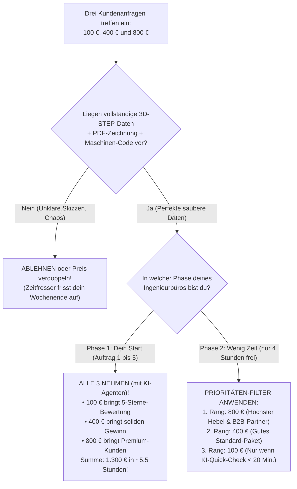
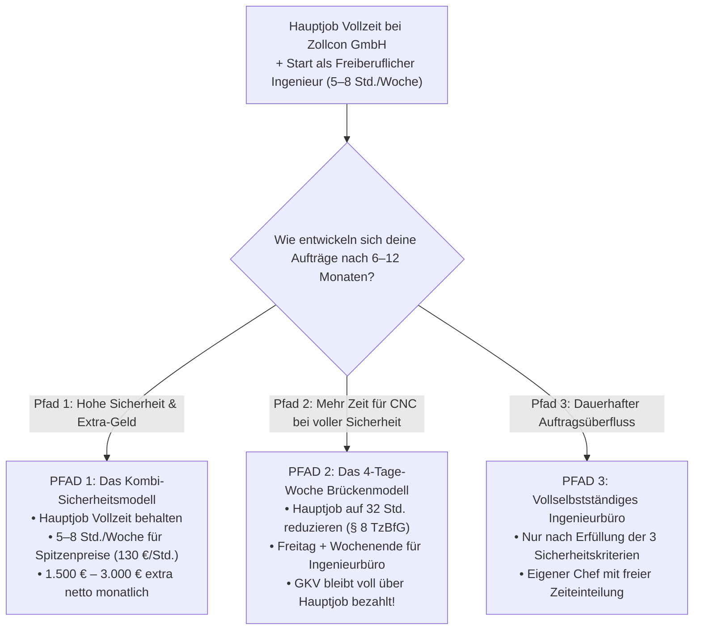
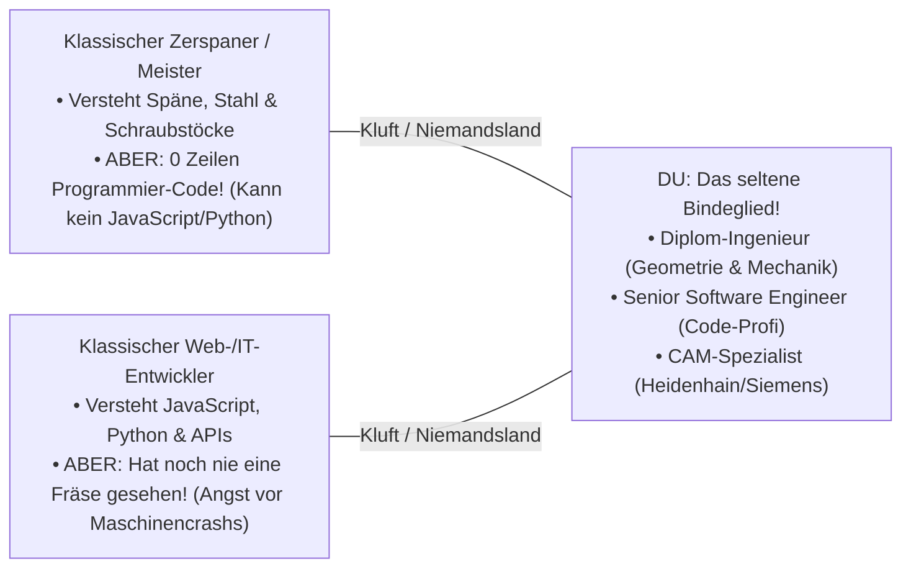
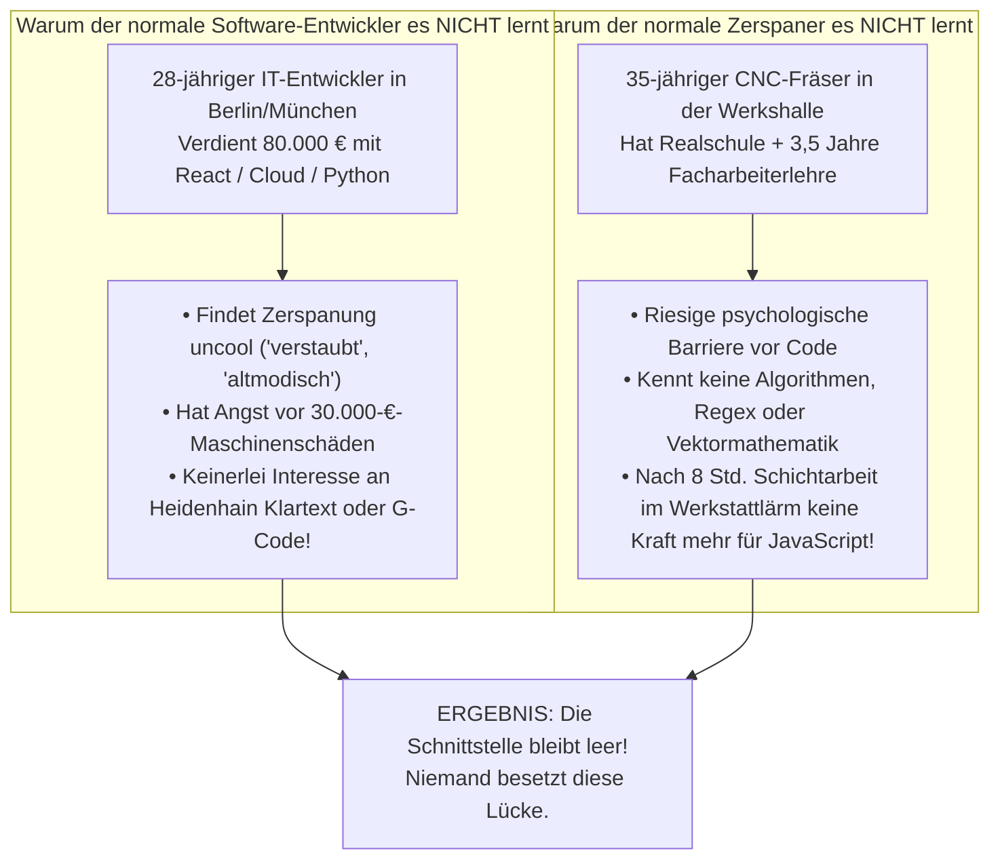
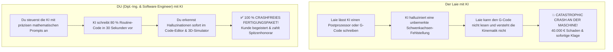
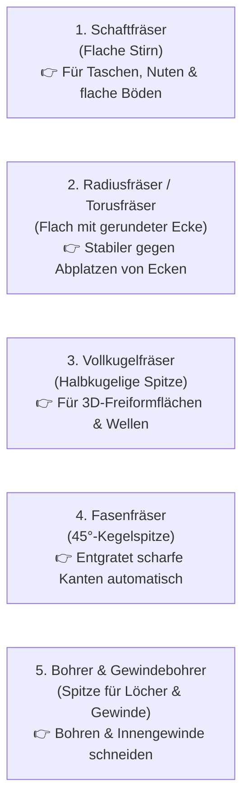

# Leitfaden: Nebenberuflicher Start als CAM-Spezialist (Hauptjob Software Engineer in Fürth / Wohnsitz Erlensee, Hessen)

Dieses Dokument bündelt alle rechtlichen, steuerlichen, organisatorischen und strategischen Grundlagen für den Start als nebenberuflicher **CAM-Spezialist *(Computer-Aided Manufacturing – rechnerunterstützte Fertigung und CNC-Programmierung)*** parallel zur Festanstellung als **Software Engineer *(Softwareentwickler / Ingenieur für Softwareentwicklung)***.

---

## 🧭 MASTER-WEGWEISER: Deine exakte zeitliche Reihenfolge (Von heute bis zum 1. Online-Auftrag)

Da dieses Dokument im Laufe unserer Detailanalyse stetig gewachsen ist *(mit deinen konkreten Eckdaten: Arbeitgeber **Zollcon GmbH in Fürth**, in Deutschland **offiziell anerkanntes Moskauer Bauingenieur-Diplom** und Fokus auf **100 % reine Online-/Remote-Aufträge**)*, findest du hier ganz oben deinen **verbindlichen chronologischen Fahrplan in der exakt richtigen Reihenfolge**:

| Reihenfolge | Was du konkret machst | Welcher Abschnitt in dieser Datei gilt für dich? |
| :---: | :--- | :--- |
| **SCHRITT 0**<br>*(Dein allererster Startpunkt – Heute!)* | **Alle 16 Praxis-Übungen (+ 2 Basis-Übungen) in deinem Übungshandbuch durcharbeiten:**<br>• Arbeite zuerst in Ruhe alle **16 praktischen Übungen (+ Basis-Übung A & B)** in **[ALLE_UEBUNGEN_HANDBUCH.md](file:///C:/Projekte/CNC/03_Fachdokumentation_und_Wissen/ALLE_UEBUNGEN_HANDBUCH.md)** *(Postprozessor [`src/mein_erster_post.cps`](file:///c:/Projekte/CNC/02_Software_und_Tools/src/mein_erster_post.cps), 3D-Modell bearbeiten, 3D-Simulation, Schnittdaten, `G55`, Gewindebohren `G84`, Radiuskorrektur `G41`, Heidenhain Klartext & 5-Punkte-Endabnahme)* durch.<br>• Dafür brauchst du **keine Erlaubnis von Zollcon** und **kein Finanzamt**! | • 👉 **[ALLE_UEBUNGEN_HANDBUCH.md](file:///C:/Projekte/CNC/03_Fachdokumentation_und_Wissen/ALLE_UEBUNGEN_HANDBUCH.md)**<br>• 👉 **[ANLEITUNG_BERUFSEINSTIEG_UND_IMPLEMENTATION_PLAN.md](file:///C:/Projekte/CNC/03_Fachdokumentation_und_Wissen/ANLEITUNG_BERUFSEINSTIEG_UND_IMPLEMENTATION_PLAN.md)**<br>• **Abschnitt 2.2** *(Was ohne Genehmigung sofort erlaubt ist)* |
| **SCHRITT 1**<br>*(Sofort & ohne Erlaubnis)* | **Technische Vorbereitung & GitHub-Aufbau zu Hause in Erlensee:**<br>• In dein CAM-System und Postprozessor-Programmierung einarbeiten.<br>• Deine **4 vorbereiteten Musterprojekte** im Ordner `Portfolio` prüfen und 60-Sekunden-Simulationsvideos aufnehmen.<br>• Dein **GitHub-Repository** *(inkl. Python-Tool `cnc_setup_sheet_extractor.py`)* als privates/Open-Source-Fachprojekt hochladen. | • **Abschnitt 2.2** *(Was ohne Genehmigung erlaubt ist)*<br>• **Abschnitt 10 & 12** *(Deine 4 Musterprojekte)*<br>• **Abschnitt 13** *(GitHub-Strategie & Tool)* |
| **SCHRITT 2**<br>*(Vor dem 1. Euro Umsatz)* | **Genehmigung bei deinem Arbeitgeber (Zollcon GmbH, Fürth) einholen:**<br>• Nutze die **speziell auf dein Ingenieurstudium abgestimmte Vorlage aus Abschnitt 9.4** *(darin ist das Wort „Softwareentwicklung“ für die Nebentätigkeit bewusst weggelassen, damit es 0 % Überschneidung mit der Zoll-Software gibt!)*.<br>• Kurz mündlich ankündigen, unterschreiben lassen und abheften. | • **Abschnitt 8.1 & 8.3** *(Analyse Zollcon GmbH)*<br>• **Abschnitt 9.3 & 9.4** *(Perfekter Antrag für Zollcon GmbH)* |
| **SCHRITT 3**<br>*(Direkt nach Zollcon-Okay)* | **Steuerliche Anmeldung als „Freiberuflicher Ingenieur“ beim Finanzamt Hanau:**<br>• **WICHTIG:** Da dein Moskauer Diplom in Deutschland bereits offiziell anerkannt ist, gilt **Abschnitt 11** *(du musst **KEIN Gewerbe** im Rathaus Erlensee anmelden!)*.<br>• Du meldest dich nur online über **ELSTER** beim **Finanzamt Hanau** als **Freiberuflicher Ingenieur nach § 18 EStG** an und hängst deine Diplom-Anerkennung als PDF an. | • **Abschnitt 11** *(Gamechanger: Anerkanntes Diplom = Freiberufler ohne Gewerbeamt & ohne Gewerbesteuer!)*<br>• **Abschnitt 5** *(Umsatzsteuer: Kleinunternehmer vs. 19 % Regelbesteuerung)* |
| **SCHRITT 4**<br>*(Parallel zur Steuernummer)* | **Absicherung gegen Maschinencrashs & Separates Bankkonto:**<br>• Separates Giro-/Unterkonto für deine Einnahmen/Ausgaben anlegen.<br>• In jedem Angebot und Einrichteblatt das **Sicherheits- und Einfahrprotokoll** *(Pflicht zur Endkontrolle durch den Maschinenbediener)* verwenden + Berufshaftpflicht prüfen. | • **Abschnitt 6.1 & 6.2** *(Lizenzen & Haftungsschutz)*<br>• **[Vorlage Einrichteblatt](file:///c:/Projekte/CNC/04_Recht_Steuern_und_Backoffice/Portfolio/Vorlage_Einrichteblatt_und_Werkzeugliste.md)** |
| **SCHRITT 4.5**<br>*(Fundament vor jeder Registrierung!)* | **Offizielle Geschäfts-E-Mail `bujanovski.engineering@gmail.com` anlegen:**<br>• **WICHTIGSTE REGEL:** Ohne diese E-Mail-Adresse darfst du KEIN EINZIGES Profil anlegen!<br>• Du brauchst diese Mailadresse ZWINGEND zur Registrierung auf **ELSTER**, **Upwork**, **Fiverr**, **Malt**, **Freelancermap**, **GitHub** und für dein Bankkonto.<br>• Niemals deine private Mailadresse oder die Zollcon-Firmenmail verwenden! | • **Abschnitt 13.4** *(E-Mail-Setup & Google Drive)*<br>• 👉 **[PROFIL-LEITFADEN (Kapitel 7)](file:///c:/Projekte/CNC/04_Recht_Steuern_und_Backoffice/PROFIL_POSITIONIERUNG_UND_KUNDENGESPRAECHE_LEITFADEN.md#L328)** |
| **SCHRITT 5**<br>*(Start der 100 % Online-Akquise)* | **Profile für 100 % Online-/Remote-Aufträge freischalten (mit bujanovski.engineering@gmail.com):**<br>• **Fiverr.com & Upwork.com:** Die 2 fertigen Gig-Vorlagen *(Postprozessor & 3–5-Achs-CAM)* online stellen.<br>• **Malt.de & Freelancermap.de:** Remote-Profil mit den 20 Schlagworten und deinem Portfolio-PDF anlegen.<br>• **LinkedIn (optional):** Das „Kombi-Profil“ (`Software Engineer @ Zollcon GmbH | Dipl.-Ing. • CAD/CAM...`) einrichten. | • **Abschnitt 16** *(100 % Online-Arbeitsmodell)*<br>• **Abschnitt 17.1 & 17.2** *(Upwork, Fiverr, Malt, Freelancermap)*<br>• **Abschnitt 18** *(LinkedIn-Kombi-Profil)* |
| **SCHRITT 6**<br>*(Lukrative Daueraufträge)* | **Deutsche CAM-Systemhäuser für Remote-Postprozessor-Aufträge anschreiben:**<br>• Schreibe 5 bis 10 Systemhäuser aus der Tabelle in **Abschnitt 17.3** *(z. B. JANUS Engineering, WDS GmbH Weiterstadt, Mensch und Maschine, SolidCAM)* mit der fertigen E-Mail-Vorlage an. | • **Abschnitt 14 (Kanal 1)**<br>• **Abschnitt 17.3** *(Konkrete Firmenliste & Anschreiben an Systemhäuser)* |
| **SCHRITT 7**<br>*(Im laufenden Betrieb)* | **80 % der Arbeit durch deine 4 KI-Agenten erledigen lassen:**<br>• Nutze die 4 vorbereiteten KI-Agenten für Kundensuche (`Lead-Scout`), Postprozessor-Programmierung (`Postprocessor-Coder`), G-Code-Sicherheitscheck & Einrichteblatt (`NC-Safety & Setup`) sowie Angebote/Rechnungen nach § 18 EStG (`Backoffice-Agent`). | • **Abschnitt 15** *(Übersicht KI-Agenten)*<br>• **[KI_Agenten_System_und_Bauplan.md](file:///c:/Projekte/CNC/04_Recht_Steuern_und_Backoffice/KI_Agenten_System_und_Bauplan.md)** |

---

## 📂 ZENTRALE DATEI-ÜBERSICHT: Alle zugehörigen Dokumente, Vorlagen & Tools in deinem Ordner `c:\Projekte\CNC\`

Von hier aus kannst du jede einzelne ergänzende Datei deines kompletten Ingenieur-Handbuchs (~80 DIN-A4-Seiten inklusive Übungshandbuch & Implementierungsplan) direkt mit einem Klick öffnen:

| Kategorie | Direkter Klick-Link zur Datei | Inhalt & Umfang |
| :--- | :--- | :--- |
| **0. Dein Praxis-Übungshandbuch (Alle 16 Übungen!)** | • 👉 **[ALLE_UEBUNGEN_HANDBUCH.md](file:///C:/Projekte/CNC/03_Fachdokumentation_und_Wissen/ALLE_UEBUNGEN_HANDBUCH.md)**<br>• 👉 **[ANLEITUNG_BERUFSEINSTIEG_UND_IMPLEMENTATION_PLAN.md](file:///C:/Projekte/CNC/03_Fachdokumentation_und_Wissen/ANLEITUNG_BERUFSEINSTIEG_UND_IMPLEMENTATION_PLAN.md)**<br>• 👉 **[src/mein_erster_post.cps](file:///c:/Projekte/CNC/02_Software_und_Tools/src/mein_erster_post.cps)** | Alle **16 praktischen Schritt-für-Schritt-Übungen (+ 2 Basis-Vorübungen A & B)** für 3D-CAM-Bearbeitung, 3D-Simulation, Schnittdaten, `G55`, Gewindebohren `G84`, `G41`, Heidenhain Klartext und JavaScript-Postprozessor-Entwicklung *(~30 DIN-A4-Seiten – dein praktischer Startpunkt!)*. |
| **1. KI-Agenten-System** | 👉 **[KI_Agenten_System_und_Bauplan.md](file:///c:/Projekte/CNC/04_Recht_Steuern_und_Backoffice/KI_Agenten_System_und_Bauplan.md)** | Kompletter Bauplan, System-Prompts, 100 %-Online-Konfiguration und Stundensatz-Tabelle deiner **4 KI-Agenten** *(~6 DIN-A4-Seiten, näher beschrieben in **Abschnitt 15**)*. |
| **2. Kunden-Portfolio & 4 Referenzprojekte** | • 👉 **[Ingenieurbuero_CAD_CAM_Portfolio_Mappe.md](file:///c:/Projekte/CNC/04_Recht_Steuern_und_Backoffice/Portfolio/Ingenieurbuero_CAD_CAM_Portfolio_Mappe.md)**<br>• 👉 **[Fertigungspaket_Projekt_01.md (2,5D-Frästeil)](file:///c:/Projekte/CNC/04_Recht_Steuern_und_Backoffice/Portfolio/Projekt_01_25D_Praezisionsfraesteil/Fertigungspaket_Projekt_01.md)**<br>• 👉 **[Fertigungspaket_Projekt_02.md (3+2-Achsen)](file:///c:/Projekte/CNC/04_Recht_Steuern_und_Backoffice/Portfolio/Projekt_02_3plus2_Mehrseiten_Ventilblock/Fertigungspaket_Projekt_02.md)**<br>• 👉 **[Fertigungspaket_Projekt_03.md (5-Achs-Simultan)](file:///c:/Projekte/CNC/04_Recht_Steuern_und_Backoffice/Portfolio/Projekt_03_3D_Freiform_und_5Achs/Fertigungspaket_Projekt_03.md)**<br>• 👉 **[Fertigungspaket_Projekt_04.md (Postprozessor)](file:///c:/Projekte/CNC/04_Recht_Steuern_und_Backoffice/Portfolio/Projekt_04_Postprozessor_und_CAM_Automatisierung/Fertigungspaket_Projekt_04.md)**<br>• 👉 **[Vorlage_Einrichteblatt_und_Werkzeugliste.md](file:///c:/Projekte/CNC/04_Recht_Steuern_und_Backoffice/Portfolio/Vorlage_Einrichteblatt_und_Werkzeugliste.md)** | Deine fertige Referenzmappe für Kunden, alle **4 technischen Fertigungspakete** *(inkl. Heidenhain `.H` & Siemens `.MPF` Code)* sowie die **Einrichteblatt-Vorlage mit Sicherheits-Freigabeprotokoll** *(~10 DIN-A4-Seiten, näher beschrieben in **Abschnitt 10 & 12**)*. |
| **3. Angebot, Rechnung & Geheimhaltung (NDA)** | • 👉 **[Vorlage_Angebot_und_Rechnung_Ingenieurbuero.md](file:///c:/Projekte/CNC/04_Recht_Steuern_und_Backoffice/Vorlagen_Vertraege_Rechnungen/Vorlage_Angebot_und_Rechnung_Ingenieurbuero.md)**<br>• 👉 **[Vorlage_Geheimhaltungserklaerung_NDA.md](file:///c:/Projekte/CNC/04_Recht_Steuern_und_Backoffice/Vorlagen_Vertraege_Rechnungen/Vorlage_Geheimhaltungserklaerung_NDA.md)** | Kopierfertige **Angebots- und Rechnungsvorlage nach § 18 EStG** *(für das Finanzamt Hanau)* inkl. **50-%-Anzahlungs- & Video-Vorabfreigabe-Klausel** sowie **CNC-Haftungsschutzklausel** und **Geheimhaltungserklärung (NDA)** für 3D-STEP-Kundendaten *(~4 DIN-A4-Seiten, näher beschrieben in **Abschnitt 11.6, 19.1 & 19.2**)*. |
| **4. GitHub-Projekt & Python-Tool** | • 👉 **[GitHub_Projekte/README.md](file:///c:/Projekte/CNC/02_Software_und_Tools/GitHub_Projekte/README.md)**<br>• 👉 **[cnc_setup_sheet_extractor.py](file:///c:/Projekte/CNC/02_Software_und_Tools/GitHub_Projekte/cnc_setup_sheet_extractor.py)** | Zweisprachige GitHub-Startseite (Deutsch/Englisch) und das lauffähige **Python-Analyse-Skript** zur automatischen Einrichteblatt-Erstellung aus NC-Code *(näher beschrieben in **Abschnitt 13**)*. |
| **5. Fräser- & Bohrer-Praxisguide mit Bildern** | 👉 **[FRAESER_UND_BOHRER_PRAXISGUIDE.md](file:///C:/Projekte/CNC/03_Fachdokumentation_und_Wissen/FRAESER_UND_BOHRER_PRAXISGUIDE.md)** | Bebilderte Werkzeugkunde für CAM-Spezialisten: Die **5 Fräser-Typen**, Bohrwerkzeuge *(Zentrieren, Kernloch, Gewinde)*, Schnittdaten *(ToolScout-Nutzung)*, Auskraglänge und Crash-Vermeidung *(näher beschrieben in **Abschnitt 27**)*. |
| **6. Bauingenieur-Wissen für CNC & CAM** | 👉 **[BAUINGENIEUR_WISSEN_FUER_CNC_GUIDE.md](file:///C:/Projekte/CNC/03_Fachdokumentation_und_Wissen/BAUINGENIEUR_WISSEN_FUER_CNC_GUIDE.md)** | Was du aus deinem 40 Jahre zurückliegenden Bauingenieurstudium wirklich brauchst: Die **4 simplen Brücken** *(Koordinatensystem Z=0, Schwenkungen, Schnitte/Passungen, Kragarm-Durchbiegung)* und was du zu 100 % vergessen kannst! |
| **7. Sicherheits- & Qualitätsprüfprotokoll (G-Code-Cockpit)** | 👉 **[SICHERHEITS_UND_QUALITAETS_PRUEFLISTE_GCODE.md](file:///C:/Projekte/CNC/03_Fachdokumentation_und_Wissen/SICHERHEITS_UND_QUALITAETS_PRUEFLISTE_GCODE.md)** | Das lückenlose **5-Stufen-Prüfprotokoll** *(CAM & Postprozessor, 3D-Simulator, G-Code-Inspektion, Maschinenrüsten & Luftschnitt)* inkl. **druckbarer Kunden-Abnahmecheckliste** – **die verbindliche Arbeitsgrundlage für KI-Agent 3 (`NC-Safety & Setup`)**! |
| **8. Profil-Positionierung & Kundengespräche** | 👉 **[PROFIL_POSITIONIERUNG_UND_KUNDENGESPRAECHE_LEITFADEN.md](file:///c:/Projekte/CNC/04_Recht_Steuern_und_Backoffice/PROFIL_POSITIONIERUNG_UND_KUNDENGESPRAECHE_LEITFADEN.md)** | Strategische Einwandbehandlung, remote Stundensätze (100–150 €/h) und **Kapitel 7: Digitale Kommunikations-Zentrale (E-Mail-Setup & Google Drive Cloud)**. |

---

## 🔄 LESE- & UMSCHALT-ANLEITUNG: Wann du welches Dokument öffnest und wie du zwischen den Dokumenten wechselst

Damit du immer sofort weißt, **in welchem Dokument du gerade arbeiten sollst** und **wann du zum nächsten Dokument umschaltest**, folge einfach diesen **5 Phasen**:

| Phase | Wann ist das? | In welchem Dokument arbeitest du? | Wann schaltest du um? |
| :---: | :--- | :--- | :--- |
| **PHASE 1:<br>Gesamtüberblick verstehen** | **Heute (Dauer: ca. 30–45 Min.)** | 📘 **DIESES HAUPTDOKUMENT (`CAM_Nebentaetigkeit_und_Gewerbe_Leitfaden.md`):**<br>• Lies einmal in Ruhe **Abschnitt 1 bis Abschnitt 20** von oben nach unten durch, damit du alle Regeln *(Arbeitsrecht, Steuern, 19 % MwSt., Lizenzen, Haftungsschutz, Zollcon GmbH, Finanzamt Hanau, 100 % Online-Aufträge)* komplett verstehst. | Sobald du einmal alles gelesen hast, **schaltest du um auf das Übungshandbuch (`ALLE_UEBUNGEN_HANDBUCH.md`)**. |
| **PHASE 2:<br>Technisch fit werden (Üben)** | **Die nächsten Tage / Wochen zu Hause in Erlensee** *(ohne Erlaubnis nötig!)* | 🛠️ **[ALLE_UEBUNGEN_HANDBUCH.md](file:///C:/Projekte/CNC/03_Fachdokumentation_und_Wissen/ALLE_UEBUNGEN_HANDBUCH.md)** + **[ANLEITUNG_BERUFSEINSTIEG_UND_IMPLEMENTATION_PLAN.md](file:///C:/Projekte/CNC/03_Fachdokumentation_und_Wissen/ANLEITUNG_BERUFSEINSTIEG_UND_IMPLEMENTATION_PLAN.md):**<br>• Hier arbeitest du praktisch am Laptop **Stufe 1 bis Stufe 18 (alle 16 Übungen + 2 Basis-Übungen)** mit [`src/mein_erster_post.cps`](file:///c:/Projekte/CNC/02_Software_und_Tools/src/mein_erster_post.cps) und dem 3D-Simulator durch.<br>• Dieses Hauptdokument (`CAM_Nebentaetigkeit_und_Gewerbe_Leitfaden.md`) lässt du währenddessen einfach zu. | Sobald du die 16 Übungen sicher beherrschst und bereit bist, echtes Geld zu verdienen, **schaltest du wieder zurück in dieses Hauptdokument (`CAM_Nebentaetigkeit_und_Gewerbe_Leitfaden.md`)**! |
| **PHASE 3:<br>Genehmigung & Finanzamt** | **Vor deinem 1. bezahlten Auftrag** | 📘 **ZURÜCK IN DIESES HAUPTDOKUMENT (`CAM_Nebentaetigkeit_und_Gewerbe_Leitfaden.md`):**<br>1. Gehe zu **Abschnitt 9.4** *(warum 9.4 statt Abschnitt 3? Weil in Abschnitt 3 nur der erste allgemeine Entwurf stand, während in **Abschnitt 9.4** schon die **Zollcon GmbH** und dein **Moskauer Ingenieurstudium** perfekt eingetragen sind!)* $\rightarrow$ Brief ausdrucken und bei Zollcon unterschreiben lassen.<br>2. Sobald unterschrieben: Gehe zu **Abschnitt 11.2** $\rightarrow$ Online bei **ELSTER** als **Freiberuflicher Ingenieur** beim **Finanzamt Hanau** anmelden. | Sobald deine Genehmigung und Steuernummer da sind, **schaltest du um auf deine Portfolio- & GitHub-Dateien**! |
| **PHASE 4:<br>Portfolio & Online-Profile live schalten** | **Tag 1 nach deiner Freigabe** | 📂 **UMSCHALTEN AUF PORTFOLIO & GITHUB + ABSCHNITT 17 & 18:**<br>1. Öffne **[GitHub_Projekte/README.md](file:///c:/Projekte/CNC/02_Software_und_Tools/GitHub_Projekte/README.md)** und lade den Ordner auf GitHub hoch.<br>2. Öffne **[Ingenieurbuero_CAD_CAM_Portfolio_Mappe.md](file:///c:/Projekte/CNC/04_Recht_Steuern_und_Backoffice/Portfolio/Ingenieurbuero_CAD_CAM_Portfolio_Mappe.md)** (und die 4 Projekte) und speichere sie als PDF.<br>3. Kopiere aus **Abschnitt 17 & 18** dieses Hauptdokuments die fertigen Texte in **Fiverr, Upwork, Malt, Freelancermap & LinkedIn** und schreibe die **CAM-Systemhäuser (Abschnitt 17.3)** an. | Sobald die ersten Kunden-Anfragen reinkommen, **schaltest du um auf die Vertrags-/Rechnungsvorlagen und die KI-Agenten**! |
| **PHASE 5:<br>Echte Online-Aufträge abwickeln** | **Bei jedem Kundenauftrag am Wochenende** | 🤖 **UMSCHALTEN ZWISCHEN VORLAGEN & KI-AGENTEN:**<br>• **Kunde will Geheimhaltung (NDA)?** $\rightarrow$ Öffne **[Vorlage_Geheimhaltungserklaerung_NDA.md](file:///c:/Projekte/CNC/04_Recht_Steuern_und_Backoffice/Vorlagen_Vertraege_Rechnungen/Vorlage_Geheimhaltungserklaerung_NDA.md)**.<br>• **Kunde will ein Angebot oder eine Rechnung?** $\rightarrow$ Öffne **[Vorlage_Angebot_und_Rechnung_Ingenieurbuero.md](file:///c:/Projekte/CNC/04_Recht_Steuern_und_Backoffice/Vorlagen_Vertraege_Rechnungen/Vorlage_Angebot_und_Rechnung_Ingenieurbuero.md)** (oder starte Agent 4).<br>• **Programm fertig und du brauchst das Einrichteblatt?** $\rightarrow$ Öffne **[Vorlage_Einrichteblatt_und_Werkzeugliste.md](file:///c:/Projekte/CNC/04_Recht_Steuern_und_Backoffice/Portfolio/Vorlage_Einrichteblatt_und_Werkzeugliste.md)** (oder starte Agent 3).<br>• **Du willst einen der 4 KI-Agenten starten?** $\rightarrow$ Öffne **[KI_Agenten_System_und_Bauplan.md](file:///c:/Projekte/CNC/04_Recht_Steuern_und_Backoffice/KI_Agenten_System_und_Bauplan.md)**. | So arbeitest du dauerhaft entspannt jeden Auftrag ab! |

*(Tipp zum schnellen Umschalten hier im Programm: Halte einfach die Taste **`Strg` gedrückt und klicke mit der linken Maustaste** auf einen der blauen Datei-Links oben – dann öffnet sich das andere Dokument sofort in einem neuen Tab nebenan!)*

---

## 📑 Vollständiges Inhaltsverzeichnis aller 27 Abschnitte in diesem Dokument

1. **Abschnitt 1:** Ausgangssituation und Rahmenbedingungen *(Fürth / Erlensee / Behörden)*
2. **Abschnitt 2:** Arbeitsrecht: Genehmigung durch den Arbeitgeber in Fürth *(Was sofort erlaubt ist & Rechtslage)*
3. **Abschnitt 3:** Allgemeine Muster-Vorlage: Antrag auf Nebentätigkeitsgenehmigung *(Hinweis: Nutze für Zollcon die spezialisierte Version in **Abschnitt 9.4**!)*
4. **Abschnitt 4:** Gewerbe oder Freiberufler? Allgemeine Weichenstellung in Hessen *(Hinweis: Durch dein anerkanntes Diplom gilt für dich der direkte Freiberufler-Weg in **Abschnitt 11**!)*
5. **Abschnitt 5:** Steuern & Rechnungen: Kleinunternehmerregelung (§ 19 UStG) oder Regelbesteuerung (19 %)?
6. **Abschnitt 6:** Kritische Punkte speziell für CAM-Spezialisten *(Kommerzielle CAM-Lizenzen & Haftung bei Maschinencrashs)*
7. **Abschnitt 7:** Allgemeine Schritt-für-Schritt-Checkliste
8. **Abschnitt 8:** Spezifische Analyse und Antrag für deinen Arbeitgeber: **Zollcon GmbH (Fürth)**
9. **Abschnitt 9:** Deine persönliche Kombination: **Bauingenieur (Moskau) + Software Engineer (Deutschland)** *(inkl. psychologisch optimiertem Antrag 9.4 für die Zollcon GmbH)*
10. **Abschnitt 10:** Wie du ohne bisherige Kunden ein überzeugendes **CAM-Portfolio (4 Musterprojekte)** aufbaust
11. **Abschnitt 11:** **GAMECHANGER:** Dein Diplom ist in Deutschland bereits offiziell anerkannt *(Direkter Start als **Freiberuflicher Ingenieur nach § 18 EStG** beim Finanzamt Hanau ohne Gewerbeamt!)*
12. **Abschnitt 12:** Übersicht deiner fertigen **Portfolio- und Vorlagen-Dateien** im Projektordner `c:\Projekte\CNC\04_Recht_Steuern_und_Backoffice\Portfolio\`
13. **Abschnitt 13:** **GitHub-Strategie** für CAM-Spezialisten *(inkl. Python-Tool `cnc_setup_sheet_extractor.py`)*
14. **Abschnitt 14:** Wo und wie du konkret deine Kunden findest *(Die 5 besten Kanäle)*
15. **Abschnitt 15:** Automatisierung mit **4 KI-Agenten** *(80/20-Arbeitsteilung & Verlinkung zum Bauplan)*
16. **Abschnitt 16:** **100 % Online-Aufträge (Remote-Engineering):** Ortsunabhängig von überall arbeiten (Homeoffice Erlensee oder auf Reisen in Spanien / EU-Workation) ohne jeden Vor-Ort-Besuch
17. **Abschnitt 17:** Exakter Fahrplan & Kopiervorlagen für **Upwork/Fiverr, Malt/Freelancermap und deutsche CAM-Systemhäuser**
18. **Abschnitt 18:** **LinkedIn-Strategie** für Angestellte mit Nebentätigkeit *(Kombi-Profil-Vorlage ohne Konflikt mit der Zollcon GmbH)*
19. **Abschnitt 19:** Die letzten 4 Praxis-Bausteine *(Angebots-/Rechnungsvorlage, Geheimhaltung NDA, Software-Setup & einfaches Steuer-Rechenbeispiel in **19.5**)*
20. **Abschnitt 20:** **Alles auf einen Blick – Die 10 wichtigsten Punkte ganz einfach in Alltagssprache erklärt (Ohne Behörden-Deutsch!)**
21. **Abschnitt 21:** **Detaillierte Erklärung zum Zusammenspiel aller Dokumente & warum es im Leitfaden 3 Brief-Entwürfe (Abschnitt 3, 8.2 und 9.4) gibt**
22. **Abschnitt 22:** **Was passiert bei mehreren Aufträgen und hohem Verdienst? (Gibt es Obergrenzen? Krankenkasse, Steuern, Zollcon GmbH & Preiserhöhungs-Strategie)**
23. **Abschnitt 23:** **Was soll ich mit meinem Hauptjob machen? (Klare Handlungsanleitung: Jetzt, im laufenden Betrieb und die 3 Zukunftspfade)**
24. **Abschnitt 24:** **Warum dieser Beruf so extrem gefragt ist – Trotz scheinbar „vieler CAM-Programmierer“ (Die 4 Marktlücken & das Postprozessor-Monopol)**
25. **Abschnitt 25:** **„Ich habe nie an einer Fräsmaschine gestanden – und können andere das nicht auch lernen?“ (Die ehrliche Antwort & dein 90/10-Vorsprung)**
26. **Abschnitt 26:** **„Kann das mit KI nicht jeder genauso machen wie ich?“ (Das 30.000-€-Crash-Problem & warum KI ohne Ingenieurwissen wertlos ist)**
27. **Abschnitt 27:** **Brauche ich überhaupt tiefes Fachwissen über Fräser und Bohrer? (Die 5 Werkzeug-Typen, die Software-Realität & digitale Schnittdaten-Rechner)**

---

## 1. Ausgangssituation und Rahmenbedingungen

* **Hauptberuf *(sozialversicherungspflichtige Vollzeit- oder Teilzeitbeschäftigung als Angestellter)***: Software Engineer in **Fürth (Bayern)**.
* **Hauptwohnsitz *(gemeldeter Erstwohnsitz beim Einwohnermeldeamt, an dem sich der Lebensmittelpunkt befindet)***: **Erlensee (Hessen, Main-Kinzig-Kreis)**.
* **Geplante Nebentätigkeit *(bezahlte selbstständige Zweittätigkeit neben dem Hauptberuf)***: Dienstleistungen als CAM-Spezialist – zum Beispiel Erstellung von **NC-Programmen *(Numerical Control – Steuerungsprogramme für computergesteuerte Werkzeugmaschinen)***, Entwicklung und Anpassung von **Postprozessoren *(Software-Übersetzer, die den internen Werkzeugweg eines CAM-Systems in den maschinenspezifischen G-Code [Steuerungssprache wie Siemens Sinumerik, Heidenhain Klartext oder Fanuc ISO] umwandeln)***, **Prozessoptimierung *(Verkürzung von Laufzeiten und Werkzeugverschleiß in der Zerspanung)*** sowie **CAM-Automatisierung *(Skripte, Makros und API-Schnittstellen [Application Programming Interface – Programmierschnittstelle] für CAD/CAM-Systeme)***.
* **Zuständige Behörden am Wohnort Erlensee:**
  * **Gewerbeamt *(Ordnungsbehörde der Stadtverwaltung für die Registrierung von Gewerbebetrieben)***: Stadt Erlensee (Rathaus / Fachbereich Ordnungswesen).
  * **Finanzamt *(örtlich zuständige Steuerbehörde für Einkommensteuer, Umsatzsteuer und Gewerbesteuer)***: **Finanzamt Hanau** (zuständig für Erlensee im Main-Kinzig-Kreis).
  * **IHK *(Industrie- und Handelskammer – berufsständische Körperschaft des öffentlichen Rechts für Gewerbetreibende)***: IHK Hanau-Gelnhausen-Schlüchtern (nur relevant bei Anmeldung eines Gewerbes, nicht bei Freiberuflichkeit).

---

### 1.1 Das Geschäftsmodell einfach erklärt: Warum muss man für CNC-Maschinen JavaScript programmieren – und warum zahlen Metall-Firmen („Herr Müller“) dafür 400 € bis 800 €?

Viele fragen sich am Anfang: *„Warum braucht eine Metall-Fräserei überhaupt jemanden, der JavaScript programmiert?“* Hier ist die einfache Antwort aus der Praxis:

1. **Warum es im CAM-Programm keine Knöpfe für Sonderwünsche gibt (Warum JavaScript nötig ist):**
   * Wenn eine Metall-Firma im Büro ein **3D-CAM-Programm *(z. B. Autodesk Fusion 360)*** nutzt, klickt man dort nur mit der Maus auf ein 3D-Bauteil.
   * Aber in der Werkhalle steht eine **200.000-€-CNC-Fräsmaschine**, die einen ganz eigenen **Steuerungs-Dialekt** spricht *(z. B. Heidenhain Klartext, Siemens Sinumerik, Fanuc oder Haas)* und spezielle Sicherheitsbefehle braucht *(z. B. eine automatische Werkzeugliste ganz oben im Programm, die Berechnung der tiefsten Frästiefe `Z-MIN` gegen Schraubstock-Crashs oder das Parken des Tisches an der Kabinentür)*.
   * **Der entscheidende Punkt:** Für diese Sonderwünsche gibt es im Menü des CAM-Programms **keine Knöpfe zum Anklicken**! Stattdessen benutzt das CAM-Programm zum Ausschreiben des Maschinencodes eine **Übersetzungs-Datei mit der Endung `.cps` (den Postprozessor)** – und diese Datei ist zu **100 % in der Programmiersprache JavaScript** geschrieben *(bzw. in Tcl/Python bei Siemens NX)*. Man **muss** also JavaScript programmieren, um dem CAM-Programm diese Funktionen beizubringen!
2. **Warum der Chef der Metall-Firma („Herr Müller“) und seine Fräser das nicht selbst können:**
   * Ein **Zerspanungsmechaniker *(CNC-Fräser)*** oder **Industriemeister Metall** lernt in seiner 3,5-jährigen Ausbildung alles über Metall, Fräser, Schraubstöcke und Messschieber – aber **keine einzige Stunde Softwareentwicklung oder JavaScript**! Wenn er eine `.cps`-Datei öffnet und 4.000 Zeilen JavaScript-Code sieht, versteht er kein Wort.
   * Umgekehrt verstehen normale Web-Programmierer zwar JavaScript, haben aber keine Ahnung, was ein Schraubstock, Kühlmittel (`M08`), Gewindebohren (`G84`) oder eine Frästiefe (`Z-MIN`) an einer CNC-Maschine ist.
3. **Wofür Herr Müller DIR mit Freude 400 € bis 800 € bezahlt:**
   * Ohne deine Anpassung sieht der Arbeiter an der Fräsmaschine am Anfang der Datei nicht, welche Werkzeuge vorkommen und wie tief der Fräser nach unten rast (`Z-MIN`). Spannt er das Metallteil 5 mm zu tief in den Schraubstock, knallt der Fräser mit voller Wucht in den Stahl-Schraubstock (**5.000 € bis 15.000 € Reparaturkosten!**).
   * Du als **Software Engineer & Diplom-Ingenieur** programmierst Herrn Müller genau diese Sicherheits-Funktionen einmalig in seine `.cps`-JavaScript-Datei hinein. Er zahlt dir **einmalig 400 € bis 800 €**, und ab diesem Tag kommt bei ihm in der Firma bei jedem Knopfdruck für die nächsten 10 Jahre automatisch der perfekte, crashsichere Code heraus!
4. **Spielt das Material eine Rolle (Stahl vs. Aluminium vs. Holz / Kunststoff)?**
   * **Beim Postprozessor-Programmieren (JavaScript `.cps`): Nein, das Material spielt keine Rolle!** Auch jede **Schreinerei / Tischlerei (Holz-CNC-Fräsen wie Homag, Biesse, SCM oder Portalfräsen)** sowie **Aluminium- und Kunststoff-Verarbeiter** brauchen angepasste `.cps`-Postprozessoren (z. B. zum automatischen Einschalten der Staubabsaugung oder des Vakuumtisches bei Holz) und können selbst kein JavaScript programmieren. Dadurch hast du neben der Metallindustrie sofort noch einen riesigen zweiten Kundenmarkt!
   * **Beim Einstellen der Fräs-Geschwindigkeit im CAM (Schnittdaten – siehe Übung 9): Ja!** Dort braucht **Holz** extrem hohe Drehzahlen (`S18000+`) und **kein Kühlwasser (`M09` / nur Absaugung)**, **Aluminium** hohe Drehzahlen (`S8000`–`S12000`) und **Stahl** niedrige Drehzahlen (`S2000`–`S4000`) mit viel Kühlwasser (`M08`).

---

## 2. Arbeitsrecht: Genehmigung durch den Arbeitgeber in Fürth

### 2.1 Warum du nicht heimlich Rechnungen schreiben solltest
In nahezu jedem Arbeitsvertrag *(schriftliche Vereinbarung über Rechte und Pflichten zwischen Arbeitgeber und Arbeitnehmer)* ist geregelt, dass jede **entgeltliche Nebentätigkeit *(auf Gewinnerzielung oder Bezahlung gerichtete Arbeit außerhalb des Hauptjobs)*** vorher angezeigt und vom Arbeitgeber genehmigt werden muss (**Nebentätigkeitsgenehmigung *(formelle schriftliche Erlaubnis des Arbeitgebers zur Ausübung einer Zweittätigkeit)***).

Wer ohne diese Genehmigung ein Gewerbe anmeldet oder Rechnungen an Kunden stellt, geht ein unnötiges Risiko ein:
1. **Krankenkassen-Prüfung *(Statusprüfung durch die gesetzliche Krankenversicherung [GKV])***: Sobald du ein Gewerbe in Erlensee anmeldest, informiert das Gewerbeamt automatisch das Finanzamt und oft auch Sozialversicherungsträger. Deine Krankenkasse schreibt dich an, um zu prüfen, ob deine Selbstständigkeit **nebenberuflich *(zeitlich und wirtschaftlich dem Hauptberuf untergeordnet)*** ist, und gleicht dabei manchmal Daten mit der Meldung deines Arbeitgebers ab.
2. **Sichtbarkeit am Markt:** Als CAM-Spezialist brauchst du früher oder später Sichtbarkeit (z. B. LinkedIn, eigene Website, Einträge in öffentlichen Registern oder Empfehlungen).
3. **Arbeitsrechtliche Konsequenzen:** Wird eine nicht gemeldete Nebentätigkeit entdeckt, droht eine **Abmahnung *(offizielle schriftliche Rüge eines Vertragsverstoßes mit Warnfunktion vor einer Kündigung)*** und im Wiederholungsfall oder bei vermeintlicher Konkurrenz sogar eine **Kündigung *(einseitige Beendigung des Arbeitsverhältnisses)***.

### 2.2 Was du OHNE Genehmigung sofort machen darfst (Vorbereitungsphase)
Solange du **kein Geld verlangst**, **keine Rechnungen schreibst** und **noch nicht aktiv am Markt wirbst**, gilt alles als private Vorbereitung und Weiterbildung in deiner Freizeit:
* Einarbeitung in CAM-Systeme *(z. B. Siemens NX CAM, Autodesk Fusion / PowerMill, Mastercam, hyperMILL, SolidCAM oder TopSolid)*.
* Aufbau eines **Portfolios *(Sammlung eigener Referenzprojekte, Musterbauteile, Simulationsvideos und Code-Beispiele)***.
* Entwicklung eigener **Postprozessoren *(Übersetzungsskripte für CNC-Steuerungen)*** oder **Automatisierungs-Skripte *(z. B. in Python, C# oder JavaScript zur Automatisierung von CAM-Abläufen)***.
* Unverbindliche Gespräche mit Bekannten oder Fertigungsbetrieben *(Zerspanungsunternehmen, Lohnfertiger, Werkzeug- und Formenbauer)*, um den Bedarf abzuklopfen.

### 2.3 Warum dein Arbeitgeber die Genehmigung fast immer erteilen MUSS
In Deutschland schützt **Artikel 12 Grundgesetz (GG) *(Verfassungsrecht auf Berufsfreiheit – freie Wahl von Beruf, Arbeitsplatz und Ausbildungsstätte)*** auch deine Nebentätigkeit. Dein Arbeitgeber in Fürth hat **kein Recht**, dir die Arbeit als CAM-Spezialist nach Lust und Laune zu verbieten. Er darf die Genehmigung nur verweigern, wenn **berechtigte betriebliche Interessen *(schützenswerte wirtschaftliche oder organisatorische Belange des Arbeitgebers)*** beeinträchtigt werden:

| Ablehnungsgrund | Bedeutung für deinen Fall (Software Engineer vs. CAM-Spezialist) |
| :--- | :--- |
| **1. Wettbewerbsverbot *(§ 60 Handelsgesetzbuch [HGB] – Verbot, im Handelszweig des Arbeitgebers eigene Geschäfte zu machen)*** | Solange deine Firma in Fürth keine CAM-Dienstleistungen oder CNC-Postprozessoren an dieselbe Zielgruppe verkauft, stehst du in **keinerlei Konkurrenz** zu deinem Arbeitgeber. |
| **2. Arbeitszeitgesetz *(ArbZG – gesetzliche Höchstarbeitszeit und Ruhezeiten zum Gesundheitsschutz)*** | Für Angestellte gilt eine Höchstarbeitszeit von durchschnittlich 48 Stunden pro Woche und 11 Stunden ununterbrochene Ruhezeit zwischen zwei Arbeitstagen. Auch wenn selbstständige Tätigkeit formal nicht direkt unter das ArbZG fällt, verlangen Arbeitgeber meist eine Begrenzung auf **ca. 5 bis 8 Stunden pro Woche**, damit deine Erholung nicht leidet. |
| **3. Leistungsbeeinträchtigung & Urlaub *(§ 8 Bundesurlaubsgesetz [BUrlG] – Verbot von dem Urlaubszweck widersprechender Erwerbstätigkeit)*** | Du darfst nicht übermüdet im Hauptjob sitzen und während einer Krankschreibung *(Arbeitsunfähigkeit [AU])* keine CAM-Aufträge abarbeiten, wenn dies die Genesung verzögert. |
| **4. Betriebsmittel & Geheimhaltung *(Nutzung von Firmeneigentum und Schutz von Geschäftsgeheimnissen)*** | Du darfst für deine CAM-Kunden **niemals** den Firmen-Laptop, Firmen-Lizenzen oder die Arbeitszeit deines Hauptjobs nutzen. |

---

## 3. Muster-Vorlage: Antrag auf Nebentätigkeitsgenehmigung

Diesen Text kannst du (per E-Mail oder ausgedruckt) an deine Personalabteilung *(HR – Human Resources)* oder deine Führungskraft in Fürth schicken, sobald du startklar bist:

```text
Absender:
[Dein Vor- und Nachname]
[Deine Adresse in Erlensee]

An:
[Name deines Arbeitgebers in Fürth]
Personalabteilung / Geschäftsführung
[Adresse in Fürth]

Ort, Datum: Erlensee, den [Datum]

Betreff: Anzeige und Antrag auf Genehmigung einer selbstständigen Nebentätigkeit

Sehr geehrte Damen und Herren,

hiermit zeige ich gemäß meinem Arbeitsvertrag die Aufnahme einer selbstständigen Nebentätigkeit an und bitte um deren schriftliche Genehmigung.

Eckdaten der geplanten Nebentätigkeit:
- Art der Tätigkeit: Selbstständige technische Beratung und Programmierung im Bereich CNC-Fertigungstechnik / CAM (Erstellung von NC-Steuerungsprogrammen und Postprozessoren für Werkzeugmaschinen)
- Geplanter Beginn: [z. B. 01.11.2026]
- Zeitlicher Umfang: durchschnittlich ca. 5 bis maximal 8 Stunden pro Woche (ausschließlich außerhalb meiner regulären Arbeitszeit, vorwiegend am Wochenende)

Ich versichere ausdrücklich, dass:
1. durch diese Tätigkeit keinerlei Wettbewerbsverhältnis zu [Name der Firma in Fürth] entsteht, da es sich um ein völlig anderes technisches Fachgebiet (spanende Fertigungstechnik / Werkzeugmaschinen) handelt,
2. meine arbeitsvertraglichen Pflichten sowie meine Leistungsfähigkeit im Hauptberuf in keiner Weise beeinträchtigt werden,
3. die gesetzlichen Ruhezeiten jederzeit eingehalten werden und
4. keinerlei Betriebsmittel, Softwarelizenzen oder Ressourcen von [Name der Firma in Fürth] für diese Nebentätigkeit genutzt werden.

Über eine kurze schriftliche Bestätigung freue ich mich. Für Rückfragen stehe ich jederzeit gerne zur Verfügung.

Mit freundlichen Grüßen

[Deine Unterschrift]
Dipl.-Ing. Bujanovski
```

---

## 4. Gewerbe oder Freiberufler? (Wichtige Weichenstellung in Hessen)

Bevor du ein Gewerbe im Rathaus Erlensee anmeldest, solltest du prüfen, wie du steuerlich eingestuft wirst. Als Software Engineer, der im CAM-Bereich arbeitet, gibt es zwei Möglichkeiten:

### Option A: Freiberufler *(Tätigkeit nach § 18 Einkommensteuergesetz [EStG])*
* **Voraussetzung:** Du hast einen Studienabschluss als **Ingenieur *(z. B. Bachelor/Master/Diplom in Maschinenbau, Mechatronik, Informatik oder Wirtschaftsingenieurwesen)*** oder kannst eine vergleichbare mathematisch-technische Tiefe nachweisen **UND** deine Tätigkeit ist anspruchsvoll (z. B. Entwicklung von Postprozessoren, CAM-Schnittstellenprogrammierung, komplexe 5-Achs-Prozessauslegung, technische Beratung).
* **Anmeldung:** **KEINE Gewerbeanmeldung** im Rathaus Erlensee nötig! Du meldest dich ausschließlich direkt beim **Finanzamt Hanau** über das Online-Portal **ELSTER *(Elektronische Steuererklärung – bundesweites Webportal der Finanzverwaltung)*** an.
* **Vorteile:**
  * Keine Anmeldegebühr beim Gewerbeamt.
  * Keine Pflichtmitgliedschaft bei der **IHK *(Industrie- und Handelskammer)***.
  * Keine **Gewerbesteuer *(kommunale Steuer auf den Gewerbeertrag, wobei ohnehin ein Freibetrag von 24.500 € Gewinn pro Jahr gilt)***.
  * Dauerhaft einfache Buchhaltung mittels **EÜR *(Einnahmen-Überschuss-Rechnung – einfache Gewinnermittlung: Einnahmen minus Ausgaben)***.

### Option B: Kleingewerbe / Nebengewerbe *(Gewerbebetrieb nach § 14 Gewerbeordnung [GewO])*
* **Voraussetzung:** Du hast keinen einschlägigen Hochschulabschluss oder bietest überwiegend standardisierte **Lohnprogrammierung *(Routine-Erstellung von NC-Programmen nach Kundenzeichnung)*** bzw. den Verkauf fertiger Software-Pakete/Tools an.
* **Anmeldung:**
  1. **Gewerbeanmeldung *(offizielle Registrierung des Betriebs)*** bei der **Stadt Erlensee** (geht online über das Hessen-Portal oder persönlich im Rathaus Erlensee, Gebühr ca. 25–40 €).
  2. **Fragebogen zur steuerlichen Erfassung *(Steuerformular zur Vergabe einer neuen Steuernummer für die Selbstständigkeit)*** über **ELSTER** an das **Finanzamt Hanau**.
* **Sind Nachteile beim Nebengewerbe schlimm?** Nein! Solange dein **Gewinn *(Umsatz abzüglich aller betrieblichen Ausgaben)*** unter **24.500 € pro Jahr** liegt, zahlst du **0,00 € Gewerbesteuer**. Und bei der IHK Hanau sind Kleingewerbetreibende, deren Jahresgewinn unter **5.200 €** liegt, komplett vom Mitgliedsbeitrag befreit.

> **Wichtiger Hinweis zum Ort der Anmeldung:**
> Obwohl du in **Fürth (Bayern)** als Angestellter arbeitest, meldest du deine Selbstständigkeit **in Erlensee (Hessen)** an, weil sich dort dein Wohnsitz und dein häuslicher Arbeitsplatz *(Schreibtisch / Homeoffice für die Nebentätigkeit)* befinden.

---

## 5. Steuern & Rechnungen: Kleinunternehmerregelung oder Regelbesteuerung?

Beim Ausfüllen des Fragebogens beim Finanzamt Hanau musst du dich bei der **Umsatzsteuer *(Mehrwertsteuer [MwSt.] – Steuer auf Lieferungen und Leistungen, regulär 19 %)*** entscheiden:

### 1. Kleinunternehmerregelung *(§ 19 Umsatzsteuergesetz [UStG])*
* **Was ist das?** Wenn dein Gesamtumsatz im Gründungsjahr voraussichtlich unter **25.000 €** (und im Folgejahr unter 100.000 €) bleibt, musst du auf deinen Rechnungen **keine Umsatzsteuer (0 % statt 19 %)** ausweisen.
* **Vorteil:** Extrem wenig Bürokratie. Du musst keine **Umsatzsteuer-Voranmeldung *(monatliche oder vierteljährliche Meldung der eingenommenen und gezahlten Mehrwertsteuer an das Finanzamt)*** abgeben.
* **Nachteil im CAM-Bereich:** Wenn du dir für 3.000 € eine teure **Workstation *(leistungsstarker Computer für CAD/CAM-Berechnungen)*** oder eine **CAM-Software-Lizenz *(Nutzungsrecht für kommerzielle CAM-Programme)*** kaufst, bekommst du die darin enthaltenen 19 % Mehrwertsteuer (**Vorsteuer *(Mehrwertsteuer auf eigene geschäftliche Einkäufe)***) **nicht** vom Finanzamt zurück. Außerdem wirken Rechnungen mit 19 % Mehrwertsteuer auf Industriekunden *(GmbHs und Maschinenbaufirmen)* oft professioneller, weil B2B-Kunden *(Business-to-Business – Geschäftskunden)* die Mehrwertsteuer ohnehin als durchlaufenden Posten vom Finanzamt erstattet bekommen.

### 2. Regelbesteuerung *(Verzicht auf die Kleinunternehmerregelung)*
* **Was ist das?** Du schreibst auf jede Rechnung `Nettobetrag + 19 % Umsatzsteuer = Bruttobetrag`.
* **Vorteil:** Für deine Industriekunden (Zerspaner, Maschinenbauer) ist die Umsatzsteuer völlig egal, weil sie nur den Nettobetrag wirtschaftlich tragen. Du selbst bekommst aber **sofort 19 % auf alle deine Anschaffungen** (PC, Monitor, 3D-Maus *(SpaceMouse für 3D-CAD/CAM-Navigation)*, CAM-Lizenz, Fachliteratur, Fahrtkosten zu Kunden) vom Finanzamt Hanau zurückerstattet!

---

## 6. Kritische Punkte speziell für CAM-Spezialisten (Unbedingt beachten!)

Im Gegensatz zu normaler Web-Entwicklung hat die Arbeit als CAM-Spezialist zwei Besonderheiten, die viele am Anfang unterschätzen:

### 6.1 Kommerzielle CAM-Lizenzen & Remote-Arbeit auf Kundenmaschinen (100 % Rechtssicherheit)
* CAM-Hersteller *(wie Siemens, Autodesk, Open Mind, Tebis, Mastercam)* überwachen ihre Lizenzen extrem streng über **Telemetrie *(automatische Hintergrund-Datenübertragung der Software an den Hersteller-Server)*** und **Wasserzeichen im Postprozessor-Lauf *(unsichtbare Kennung in Projektdateien)***.
* Wenn du für einen Kunden eine CAM-Datei öffnest oder speicherst, darfst du niemals eine Studentenlizenz oder nicht-kommerzielle Lizenz nutzen – die Hersteller schicken sonst sofort teure Nachforderungen (oft 15.000–50.000 €) an dich oder sogar an deinen Endkunden!
* **Praxis-Lösung für den günstigen Start:**
  1. **Arbeiten auf der Lizenz des Kunden:** Viele Zerspanungsbetriebe haben eigene CAM-Lizenzen (Dongle *(Hardware-Kopierschutzstecker)* oder Floating-Lizenz *(Netzwerklizenz)*), auf die du dich per **Remote-Zugang *(Fernzugriff über TeamViewer, AnyDesk oder VPN [Virtual Private Network])* ** aufschaltest oder vor Ort arbeitest. Dann brauchst du gar keine eigene teure CAM-Lizenz!
  2. **Autodesk Fusion mit Manufacturing Extension *(bezahlbares Cloud-CAD/CAM-System mit monatlicher oder jährlicher Miete)***: Ideal für den Einstieg mit überschaubaren Fixkosten.
  3. **Fokus auf Postprozessoren & API-Entwicklung:** Da du bereits **Software Engineer** bist, ist dein größter Hebel die Programmierung von **Postprozessoren** (JavaScript, Python, Tcl *(Tool Command Language – Skriptsprache, auf der z. B. Siemens NX Post Configurator / Post Builder basiert)*) und **Makros/Automatisierung**. Dafür brauchst du oft nur einen Texteditor *(z. B. VS Code)* und Testläufe beim Kunden!

#### Der genaue 3-Phasen-Lizenz-Fahrplan & Remote-Zugriff im Detail:
1. **Phase 1: Vorbereitung & Portfolio-Aufbau (JETZT):**  
   * **Kosten: 0,00 €!**  
   * Für eigene Übungen, das Schreiben von Postprozessoren und G-Code-Prüfungen brauchst du keine teure kommerzielle Lizenz. Unsere Node.js-Testsuite (`simuliere_post.js`), die Python-Tools und der Universal 3D Viewer laufen komplett Open Source und kostenfrei.
2. **Phase 2: Echter Kundenauftrag mit Fernzugriff (Remote auf Kunden-PC per AnyDesk / TeamViewer / VPN):**  
   * **Kosten für dich: 0,00 €!**  
   * Du wählst dich per **AnyDesk, TeamViewer oder VPN** auf die Workstation des Kunden ein und arbeitest direkt in dessen CAM-System *(z. B. Siemens NX, Hypermill, Mastercam)*.
   * **Rechtslage & Lizenzrecht:** Dies ist zu **100 % legal**. Der Kunde ist der offizielle Lizenznehmer. Nach internationalem und deutschem Lizenzrecht dürfen beauftragte Dritte *(Authorized Contractors / freiberufliche Ingenieure)* die Software auf den Rechnern des Lizenznehmers für dessen Projekte nutzen. Es wird zu jedem Zeitpunkt nur die eine bezahlte Lizenz des Kunden genutzt.
   * **Vorteile für den Kunden:** Keine vertraulichen CAD-Daten müssen das Kundennetzwerk verlassen (perfekt für Geheimhaltung / NDA). Zudem hast du direkten Zugriff auf alle werkseigenen Maschinen- und Werkzeugbibliotheken des Betriebs.
3. **Phase 3: Echter Kundenauftrag auf eigenem Rechner in Erlensee (Autodesk Fusion):**  
   * Erst wenn ein Kunde ein Angebot unterschrieben hat (z. B. 480 €) und die Bearbeitung auf deinem Laptop stattfinden soll, buchst du ein **flexibles Monatsabo für Autodesk Fusion *(ca. 60–70 € / Monat)***.
   * Die Lizenzkosten werden direkt aus dem Kundenhonorar bezahlt und beim Finanzamt Hanau zu **100 % als Betriebsausgabe nach § 18 EStG** abgesetzt *(mindert deine Steuerlast)*. Nach Auftragsende kann das Abo pausiert werden.

#### Nutzungsrechte an Postprozessoren (.cps-Dateien):
* Die von Autodesk bereitgestellten Basis-Postprozessoren stehen unter freier Open-Source-Lizenz. Du darfst diese für Kunden beliebig modifizieren, programmieren und weitergeben.
* Der Kunde erhält mit deinem Honorar das **dauerhafte, uneingeschränkte Nutzungsrecht** an der für ihn programmierten Postprozessor-Datei für all seine Maschinen im Betrieb.

### 6.2 Haftung bei Maschinencrashs *(Spindelschaden / Werkzeugbruch)*
* Wenn ein CNC-Fräszentrum für 400.000 € wegen eines falschen `G0 Z-100` *(Eilgangbewegung direkt ins Werkstück oder in den Maschinentisch)* crasht, kostet eine neue Motorspindel *(Hauptantriebseinheit der Fräsmaschine)* schnell 15.000 bis 35.000 €.
* **Schutzmaßnahme 1 (Vertraglich / AGB):** Vereinbare in jedem Angebot schriftlich, dass du **NC-Programmvorschläge** lieferst und die **Endkontrolle, das Einfahren an der Maschine *(erster vorsichtiger Testlauf mit reduziertem Vorschub [Feedrate Override])* sowie die Freigabe der Aufspannung und Werkzeuge zwingend durch den Maschinenbediener des Auftraggebers** erfolgen müssen.
* **Schutzmaßnahme 2 (Die IT- und Ingenieur-Berufshaftpflichtversicherung im Detail):**

#### A. Springt die Versicherung SOFORT nach Abschluss an?
**JA, zu 100 % SOFORT!**
* Bei modernen gewerblichen Haftpflichtversicherern für IT und Ingenieure *(speziell **Hiscox**, **Exali** oder **Markel**)* gilt **sofortiger Versicherungsschutz ab dem vertraglich vereinbarten Beginn (in der Regel 00:00 Uhr des Folgetages oder sofort nach Online-Antragstellung)**.
* **Keine Wartezeit für Haftpflichtschäden:** Im Gegensatz zu einer Rechtsschutzversicherung *(die oft 3 Monate Wartezeit hat)* gibt es bei der Berufshaftpflicht **KEINE Wartezeit**. Sobald der Vertrag online abgeschlossen ist und die Bestätigung vorliegt, bist du gegen Schäden geschützt.
* **Wichtig (Vorab-Schäden ausgeschlossen):** Du kannst die Versicherung natürlich nicht erst abschließen, wenn der Fräser schon in die Spindel gekracht ist. Der Schadenfall muss *nach* Versicherungsbeginn eintreten.

#### B. Wann genau sollst du die Versicherung abschließen?
* **Wann NICHT:** Jetzt während der Übungsphase (Übung 00b bis 16) brauchst du **noch KEINE Versicherung**! Du übst nur auf deinem Laptop und simulierst virtuell – es entstehen 0,00 € Kosten.
* **Der perfekte Zeitpunkt:** Schließe die Versicherung **erst in Phase 4 / kurz vor Auslieferung deines ALLERERSTEN bezahlten Kundenauftrags** ab!
  1. Sobald ein Kunde dir ein Angebot unterschreibt (z. B. über 380 € oder 800 €).
  2. Gehst du auf das Online-Portal von **Exali.de** oder **Hiscox.de**.
  3. Du wählst die Tarifoption **„Ingenieur- und IT-Haftpflicht für Nebenerwerb / Freiberufler“** (Jahresumsatz anfangs bis 25.000 €).
  4. Die Beantragung dauert online nur ca. **10 Minuten**.
  5. Der Versicherungsschein liegt sofort per PDF in deinem Postfach – und du lieferst deinen Code mit absolut ruhigem Gewissen aus!

#### C. Was kostet die Versicherung und wie wird sie bezahlt?
* **Kosten:** Für nebenberufliche Freiberufler und Ingenieure liegt der Beitrag bei nur ca. **180 € bis 300 € pro JAHR** (ca. 15 bis 25 € im Monat).
* **100 % steuerlich absetzbar:** Der Versicherungsbeitrag ist zu 100 % eine **Betriebsausgabe** nach § 18 EStG. Du reichst die Rechnung beim Finanzamt Hanau ein und minderst damit direkt deine Einkommensteuer!
* **Deckungssumme:** Üblich und empfohlen sind **1.000.000 € bis 2.000.000 € pauschal für Personen- und Sachschäden** sowie mindestens **250.000 € für echte Vermögensschäden** (z. B. Produktionsausfallkosten, wenn die Fräsmaschine des Kunden stillsteht).

#### D. Die 3-fache Schutzmauer (Warum du praktisch NIEMALS privat zahlen musst):
1. **1. Schutzlinie (Vertragsklausel):** Dein Kunde bestätigt im Angebot schriftlich, dass sein eigener Maschinenbediener das Programm im Einzelsatzbetrieb *(Single Block)* vorsichtig einfährt.
2. **2. Schutzlinie (Agent 3 Sicherheits-Audit):** Vor der Auslieferung prüft Agent 3 alle $Z_{\text{min}}$-Tiefen, Spindeldrehzahlen und Eilgangbewegungen ab.
3. **3. Schutzlinie (Berufshaftpflicht Hiscox / Exali):** Sollte trotz allem ein unvorhersehbarer Schaden entstehen, wehrt die Versicherung unberechtigte Forderungen ab *(passiver Rechtsschutz)* oder bezahlt den Sachschaden an der Spindel vollständig.

---

## 7. Schritt-für-Schritt-Checkliste für deinen Start

- [ ] **Phase 1: Vorbereitung (ohne Anmeldung, ohne Arbeitgeber-Frage)**
  - [ ] Spezialisierung festlegen: Willst du reine Teileprogrammierung machen oder deine Stärke als Software Engineer nutzen (Postprozessoren, Makros, Schnittstellen, Automatisierung)?
  - [ ] Portfolio und Beispiele vorbereiten (ohne Kundendaten aus dem Hauptjob!).
  - [ ] Prüfen, welchen Studienabschluss du hast (Ingenieur/Informatik = Chance auf **Freiberufler-Status** beim Finanzamt Hanau).
- [ ] **Phase 2: Arbeitgeber-Freigabe in Fürth einholen**
  - [ ] Kurzen Antrag auf Nebentätigkeit (siehe Vorlage in Abschnitt 3) bei deiner Firma in Fürth einreichen.
  - [ ] Schriftliche Genehmigung abheften.
- [ ] **Phase 3: Offizielle Anmeldung in Erlensee / Hanau (erst wenn Genehmigung da ist oder der erste Kunde vor der Tür steht)**
  - [ ] *Falls Freiberufler:* Direkt über **ELSTER** den „Fragebogen zur steuerlichen Erfassung (Aufnahme einer freiberuflichen Tätigkeit)“ an das **Finanzamt Hanau** senden.
  - [ ] *Falls Gewerbe:* Online-Gewerbeanmeldung bei der **Stadt Erlensee** durchführen + über **ELSTER** den Fragebogen zur steuerlichen Erfassung an das **Finanzamt Hanau** senden.
- [ ] **Phase 4: Sauberes Setup ab Tag 1**
  - [ ] Separates Girokonto oder Unterkonto *(getrenntes Bankkonto für geschäftliche Einnahmen und Ausgaben zur sauberen Buchhaltung)* einrichten.
  - [ ] Haftungshinweis („Einfahren durch Bediener Pflicht“) in Angeboten und Übergabeprotokollen verankern.
  - [ ] Bereits gekaufte Hardware/Fachbücher aus den letzten Monaten (Belege aufheben!) als **vorweggenommene Betriebsausgaben *(Ausgaben vor der offiziellen Gründung, die den zu versteuernden Gewinn mindern)*** in der Steuererklärung ansetzen.


---

## 8. Spezifische Analyse und fertiger Antrag für deinen Arbeitgeber: Zollcon GmbH (Fürth)

### 8.1 Unternehmensprofil der Zollcon GmbH und rechtliche Bewertung des Wettbewerbsverbots
Dein Hauptarbeitgeber ist die **Zollcon GmbH *(Gesellschaft mit beschränkter Haftung – Kapitalgesellschaft nach deutschem Recht)*** mit Sitz in der **Dieter-Streng-Straße 3, 90766 Fürth**.

* **Geschäftsfeld der Zollcon GmbH:**
  Die Zollcon GmbH ist spezialisiert auf **Zoll- und Außenwirtschaftsberatung *(Beratung zu Import, Export, Präferenzrecht und internationalem Warenverkehr)***, **Exportkontrolle & Compliance *(Einhaltung gesetzlicher Vorschriften wie Sanktionslistenprüfung, Lieferkettensorgfaltspflichtengesetz [LkSG] oder Carbon Border Adjustment Mechanism [CBAM – CO₂-Grenzausgleichssystem])***, operative **ATLAS-Zollabwicklung *(Automatisiertes Tarif- und Lokales Zollabwicklungssystem der deutschen Zollverwaltung)*** sowie die Entwicklung entsprechender **Zoll-Software-Lösungen *(wie die Zoll Suite / GTC Portal für Lieferantenerklärungen, Gelangensbestätigungen und Sanktionslistenprüfung)***.
* **Abgrenzung zu deiner Nebentätigkeit als CAM-Spezialist:**
  Deine geplante Nebentätigkeit liegt im Bereich **CAM-Programmierung *(Computer-Aided Manufacturing – Erstellung von Werkzeugwegen für CNC-Maschinen)***, **Zerspanungstechnik *(spanende Metall- und Kunststoffbearbeitung durch Fräsen, Drehen, Bohren)*** und **Postprozessor-Entwicklung *(Übersetzungsprogramme für Werkzeugmaschinensteuerungen)***.
* **Ergebnis der Konkurrenzprüfung *(Prüfung nach § 60 Handelsgesetzbuch [HGB] und allgemeinem Arbeitsrecht)***:
  Es besteht **null Prozent Überschneidung (0 % Wettbewerb)** zwischen dem Geschäftsfeld der Zollcon GmbH (Zollrecht, Außenhandel, Compliance-Software) und deiner Nebentätigkeit (Fertigungstechnik, CNC-Maschinenprogrammierung, CAM-Technologie).
  * Du wirbst der Zollcon GmbH keine Kunden im Bereich Zollberatung oder Zoll-Software ab.
  * Du nutzt kein geschütztes Branchenwissen *(Know-how über Zollprozesse oder GTC-Portal-Algorithmen)* für deine CAM-Kunden.
  * Selbst wenn ein produzierendes Industrieunternehmen zufällig sowohl Zollberatung von der Zollcon GmbH bezieht als auch in seiner Werkshalle CNC-Fräsmaschinen stehen hat, handelt es sich um zwei komplett getrennte Märkte, Abteilungen und Dienstleistungen.
  * **Fazit:** Die Zollcon GmbH hat **keinerlei rechtliche Grundlage**, dir die Genehmigung wegen Konkurrenz zu verweigern. Im Gegenteil: Da die Sache so glasklar getrennt ist, wird die Geschäftsführung *(z. B. Michael Dwehus)* bzw. die Personalabteilung das in aller Regel völlig entspannt sehen.

---

### 8.2 Maßgeschneiderter Antrag auf Nebentätigkeitsgenehmigung an die Zollcon GmbH

Hier ist die exakt auf die **Zollcon GmbH** in Fürth zugeschnittene Vorlage, bei der der Unterschied zwischen eurer **Zoll-/Außenwirtschafts-Software** und deiner **CNC-/CAM-Tätigkeit** sofort sauber herausgestellt wird, damit beim Lesen gar keine Rückfragen oder Bedenken aufkommen:

```text
Absender:
[Dein Vor- und Nachname]
[Deine Straße und Hausnummer]
63526 Erlensee

An die
Zollcon GmbH
Geschäftsführung / Personalabteilung
Dieter-Streng-Straße 3
90766 Fürth

Ort, Datum: Erlensee, den [Aktuelles Datum eintragen, z. B. 19.10.2026]

Betreff: Anzeige und Bitte um Genehmigung einer selbstständigen Nebentätigkeit (Bereich CNC-Fertigungstechnik / CAM)

Sehr geehrte Geschäftsführung,
sehr geehrte Damen und Herren,

gemäß den Regelungen meines Arbeitsvertrages möchte ich Sie hiermit über die geplante Aufnahme einer nebenberuflichen selbstständigen Tätigkeit informieren und freundlich um Ihre schriftliche Genehmigung bitten.

1. Art und Inhalt der Nebentätigkeit:
Ich beabsichtige, nebenberuflich technische Dienstleistungen als CAM-Spezialist (Computer-Aided Manufacturing) im Bereich der mechanischen Fertigungstechnik anzubieten. Konkret umfasst dies die Erstellung von NC-Steuerungsprogrammen für CNC-Werkzeugmaschinen (Fräs- und Drehmaschinen) sowie die Anpassung maschinenspezifischer Postprozessoren für Fertigungsbetriebe.

2. Geplanter Beginn und zeitlicher Umfang:
- Geplanter Start: ab [z. B. 01.11.2026]
- Zeitlicher Rahmen: durchschnittlich ca. 5 bis maximal 8 Stunden pro Woche, ausschließlich außerhalb meiner regulären Arbeitszeit bei der Zollcon GmbH (insbesondere am Wochenende).

3. Ausschluss von Interessenkonflikten und Wettbewerb:
Da sich meine geplante Nebentätigkeit ausschließlich auf die technische Steuerung von Werkzeugmaschinen in der Metall- und Kunststoffbearbeitung bezieht, besteht keinerlei fachliche oder wirtschaftliche Überschneidung mit dem Geschäftsfeld der Zollcon GmbH (Zoll- und Außenwirtschaftsberatung, Exportkontrolle, Compliance sowie Zoll-Softwarelösungen wie die Zoll Suite / GTC Portal).

Ich versichere zudem ausdrücklich, dass:
- meine arbeitsvertraglichen Pflichten sowie meine volle Einsatz- und Leistungsfähigkeit als Software Engineer bei der Zollcon GmbH jederzeit Vorrang haben und in keiner Weise beeinträchtigt werden,
- sämtliche gesetzlichen Ruhezeiten nach dem Arbeitszeitgesetz (ArbZG) strikt eingehalten werden,
- während des Erholungsurlaubs oder im Falle einer Arbeitsunfähigkeit keine dem Erholungs- bzw. Genesungszweck widersprechenden Tätigkeiten ausgeübt werden und
- keinerlei Betriebsmittel, Hardware, Softwarelizenzen oder vertrauliche Informationen der Zollcon GmbH für diese Nebentätigkeit verwendet werden.

Ich bitte Sie um eine kurze schriftliche Bestätigung (gerne durch Gegenzeichnung auf dem beigefügten Rücklaufabschnitt). Für Rückfragen stehe ich Ihnen jederzeit gerne persönlich zur Verfügung.

Mit freundlichen Grüßen


____________________________________
[Dein Vor- und Nachname]


--------------------------------------------------------------------------------
Bestätigung / Genehmigung durch den Arbeitgeber (Zollcon GmbH):

Die oben angezeigte selbstständige Nebentätigkeit im Bereich CNC-Fertigungstechnik / CAM-Programmierung im Umfang von bis zu 8 Stunden wöchentlich außerhalb der betrieblichen Arbeitszeit wird hiermit genehmigt.

Fürth, den ___________________


____________________________________
Unterschrift / Stempel Zollcon GmbH
Geschäftsführung / Personalabteilung
```

---

### 8.3 Praktischer Tipp für das Gespräch bei der Zollcon GmbH
Weil die **Zollcon GmbH** ein mittelständisches Beratungshaus mit eigener Softwareentwicklung ist (und kein unpersönlicher Großkonzern mit 50.000 Mitarbeitern), empfiehlt sich folgendes Vorgehen:
1. **Kurz mündlich vorwarnen:** Sprich deinen direkten Teamleiter oder die Geschäftsführung kurz in einem ruhigen Moment an: *„Ich beschäftige mich privat leidenschaftlich mit CNC-Werkzeugmaschinen und CAM-Programmierung für Frästeile. Ich würde das gerne am Wochenende ganz klein als Nebengewerbe für ein paar Stunden pro Woche anmelden. Da das reine Metallbearbeitung ist und null mit Zoll oder unserer Software zu tun hat, habe ich den kurzen Standard-Zettel für die Personalakte vorbereitet.“*
2. **Vorteil des Rücklaufabschnitts *(vorformulierter Unterschriftsblock am Ende des Schreibens)***: Durch den fertigen Bestätigungsblock ganz unten auf deinem Schreiben muss die Geschäftsführung der Zollcon GmbH keinen eigenen Brief tippen, sondern nur kurz Datum, Stempel und Unterschrift druntersetzen und dir eine Kopie (oder einen Scan per PDF *(Portable Document Format – plattformunabhängiges Dateiformat für Dokumente)*) zurückgeben. Das spart beiden Seiten Zeit und beschleunigt die Freigabe enorm!


---

## 9. Deine persönliche Kombination: Bauingenieur (Moskau) + Software Engineer (Deutschland) = Dein perfekter Weg in den CAM-Markt

Deine persönliche Biografie – ein abgeschlossenes Studium als **Bauingenieur *(Инженер-строитель / Hochschuldiplom im Bauingenieurwesen mit fundierter Ausbildung in technischer Mechanik, darstellender Geometrie und höherer Mathematik)*** in Moskau vor rund 40 Jahren, kombiniert mit langjähriger Berufserfahrung als **Software Engineer *(Softwareentwickler / IT-Spezialist)*** in Deutschland – ist für den Einstieg als CAM-Spezialist ein enormer Vorteil. Gleichzeitig ergibt sich daraus eine ganz klare Empfehlung für die Behörden in **Erlensee / Hanau** und für das Gespräch mit der **Zollcon GmbH**.

> 💡 **Wichtig für die Praxis (Falls dein Studium 40 Jahre her ist):**
> Niemand verlangt von dir, dass du dich an Beton, Bauphysik oder Statikformeln erinnerst! Was du davon zu 100 % vergessen kannst und welche **4 simplen Grundprinzipien** *(3D-Koordinaten Z=0, Schnitte/Maße, 5-Achs-Neigungen, Fräserverbiegung als Kragträger)* an der Maschine wirklich zählen, findest du einfach erklärt in **[BAUINGENIEUR_WISSEN_FUER_CNC_GUIDE.md](file:///C:/Projekte/CNC/03_Fachdokumentation_und_Wissen/BAUINGENIEUR_WISSEN_FUER_CNC_GUIDE.md)**.

---

### 9.1 Was dein Moskauer Ingenieur-Diplom für Gewerbeamt vs. Finanzamt bedeutet

Rein rechtlich gehört der Ingenieur (auch mit ausländischem Hochschulabschluss) und der leitende System-Softwareentwickler zu den **freien Berufen *(Katalogberufe nach § 18 Einkommensteuergesetz [EStG])***. In der Praxis gibt es bei deinem Profil aber zwei Wege – und einer davon spart dir am Anfang extrem viel Bürokratie:

#### Warum das Finanzamt bei „Freiberufler“ oft unbequeme Nachfragen stellt:
Wenn du beim **Finanzamt Hanau** angibst, dass du *Freiberufler (ohne Gewerbe)* bist, verlangt der Sachbearbeiter häufig:
1. Eine beglaubigte Übersetzung deines Moskauer Diploms *(inklusive Nachweis der Gleichwertigkeit über die Datenbank **anabin** [Informationsportal zur Anerkennung ausländischer Bildungsabschlüsse] oder die **ZAB** [Zentralstelle für ausländisches Bildungswesen])*.
2. Eine Erklärung, warum du als **Bauingenieur** und **Softwareentwickler** jetzt im **Maschinenbau / CNC-Fertigung** arbeitest und warum das keine gewerbliche **Lohnprogrammierung *(Standard-Erstellung von CNC-Programmen nach Zeichnung)*** ist.

#### Die schlaue, stressfreie Lösung für dich: Direkt ein Nebengewerbe in Erlensee anmelden!
Statt dich wochenlang mit dem Finanzamt über die Anerkennung deines 30 Jahre alten Moskauer Bauingenieur-Diploms für den Maschinenbau zu streiten, meldest du nach dem Okay der Zollcon GmbH einfach ein ganz normales **Nebengewerbe *(gewerbliche Tätigkeit im Nebenerwerb nach § 14 Gewerbeordnung [GewO])*** bei der **Stadt Erlensee** an.

**Warum du dadurch absolut NULL Nachteile hast:**
* **Keine Diplom-Prüfung:** Beim Gewerbeamt Erlensee ist dein Studienabschluss völlig egal. Du darfst sofort sowohl **NC-Programme *(Steuerungsprogramme für Fräs- und Drehmaschinen)***, **Postprozessoren *(Übersetzungsprogramme zwischen CAM und CNC-Steuerung)***, **3D-CAD-Modelle *(dreidimensionale Konstruktionszeichnungen)*** als auch fertige Software-Tools verkaufen, ohne dass das Finanzamt prüft, ob das „ingenieurmäßig“ genug ist.
* **0,00 € Gewerbesteuer:** Als Einzelunternehmer *(Gewerbetreibender ohne eigene Kapitalgesellschaft wie eine GmbH)* hast du einen gesetzlichen **Gewerbesteuer-Freibetrag *(steuerfreier Gewinn nach § 11 Gewerbesteuergesetz [GewStG])*** von **24.500 € Gewinn pro Jahr**. Solange dein Gewinn (Einnahmen minus Ausgaben) darunter liegt, zahlst du keinen einzigen Cent Gewerbesteuer.
* **0,00 € IHK-Beitrag am Anfang:** Bei der **IHK Hanau-Gelnhausen-Schlüchtern** bist du als Kleingewerbetreibender bis zu einem Gewinn von **5.200 € pro Jahr** komplett vom Mitgliedsbeitrag befreit (und selbst darüber kostet es im Nebenerwerb nur ca. 40–70 € im Jahr).
* **Gleiche Buchhaltung:** Auch mit einem Nebengewerbe machst du am Jahresende nur eine ganz einfache **EÜR *(Einnahmen-Überschuss-Rechnung – Anlage EÜR in der Einkommensteuererklärung)***, solange dein Gewinn unter 80.000 € und dein Umsatz unter 800.000 € im Jahr bleibt.

---

### 9.2 Dein massiver fachlicher Vorteil gegenüber normalen CAM-Programmierern

Viele klassische CAM-Programmierer kommen aus der Werkstatt (**Zerspanungsmechaniker *(Facharbeiter für Fräs- und Drehtechnik)***). Sie wissen super, wie man Stahl oder Aluminium fräst, haben aber oft große Angst vor Programmierlogik, Koordinatentransformationen und Skriptsprachen.

Du bringst aus deinem Studium in Moskau und deiner Arbeit als Software Engineer in Deutschland zwei Fähigkeiten mit, die in der CNC-Branche extrem selten und hochbezahlt sind:

1. **Sowjetisch/Russische Ingenieur-Mathematik & Darstellende Geometrie *(Начертательная геометрия и теоретическая механика)***:
   * Wer vor 30 Jahren in Moskau Bauingenieurwesen studiert hat, hat eine extrem harte Schule in **Vektorgeometrie *(Rechnen mit Richtungs- und Ortsvektoren im dreidimensionalen Raum)***, **Matrizenrechnung *(Dreh- und Verschiebungsmatrizen für Raumachsen)***, **Darstellender Geometrie *(räumliches Vorstellungsvermögen, Schnitte und Projektionen)*** und **Technischer Mechanik *(Kräfte, Biegemomente, Spannungen und Verformungen)*** durchlaufen.
   * Genau das ist das Herzstück der **5-Achs-CNC-Bearbeitung *(gleichzeitige Bewegung von drei Linearachsen X, Y, Z und zwei Rundachsen A/B/C)*** und der **Schwenkebenentransformation *(automatische Verrechnung gekippter Bearbeitungsebenen wie Siemens CYCLE800 oder Heidenhain PLANE SPATIAL)***.
2. **Professionelle Softwareentwicklung *(Software Engineering)***:
   * Während normale CAM-Bediener hilflos sind, wenn der **Postprozessor *(das Übersetzungsskript im CAM-System)*** falschen G-Code ausgibt, ist ein Postprozessor für dich als Software Engineer einfach nur ein ganz normales Stück Code (meistens geschrieben in **JavaScript**, **Python**, **Tcl *(Tool Command Language)*** oder einer proprietären Skriptsprache) – ein klassischer **Compiler / Transpiler *(Programm, das einen Quellcode in eine andere Zielsprache übersetzt)***.
   * Außerdem kannst du über die **CAM-API *(Programmierschnittstelle des CAM-Systems, z. B. NX Open in C#/Python oder Fusion API in Python/C++)*** wiederkehrende Fräsaufgaben automatisieren oder **parametrische NC-Programme *(Unterprogramme mit Variablen, Bedingungen [IF/WHILE] und mathematischen Formeln direkt auf der CNC-Steuerung)*** schreiben.

**Empfehlung für deine Positionierung am Markt:**
Verkaufe dich nicht nur als „jemand, der einfache 2,5D-Frästeile klickt“, sondern nutze deine Doppelkompetenz:
* **CAM-Programmierung (Fräsen/Drehen)** **PLUS**
* **Postprozessor-Anpassung, Makro-Programmierung & CAM-Automatisierung**.
Gerade kleine und mittlere Fertigungsbetriebe rund um das Rhein-Main-Gebiet (Hanau, Offenbach, Frankfurt, Aschaffenburg) und Franken (Fürth, Nürnberg, Erlangen) suchen händeringend nach Leuten, die sowohl die Geometrie eines Bauteils als auch den Code dahinter verstehen!

---

### 9.3 Wie du das Gespräch bei der Zollcon GmbH mit deiner Hintergrundgeschichte perfekt führst

Dein Abschluss als **Bauingenieur** macht die Begründung gegenüber der **Zollcon GmbH** noch viel glaubwürdiger und sympathischer!

Wenn dein Chef oder die Personalabteilung bei der Zollcon GmbH fragt, wie du als Softwareentwickler plötzlich auf **CAM und CNC-Maschinen** kommst, hast du die perfekte, menschlich absolut einleuchtende Antwort:

> **Deine Argumentation im Gespräch:**
> *„Ich bin ja ursprünglich ausgebildeter Ingenieur (Bauingenieurwesen aus Moskau) mit einem starken Hintergrund in Konstruktion, Geometrie und Mechanik. Hauptberuflich mache ich bei der Zollcon GmbH super gerne unsere Softwareentwicklung. Aber privat hat es mich schon immer gereizt, mein altes Ingenieurwissen im Bereich 3D-Konstruktion und CNC-Fertigungstechnik (CAM) praktisch anzuwenden. Deshalb möchte ich am Wochenende für ein paar Stunden kleinere Aufträge für Fertigungsbetriebe (Werkstück- und Maschinenprogrammierung) übernehmen. Mit Zoll, Außenwirtschaft oder unserer Unternehmenssoftware hat das fachlich absolut null zu tun – für mich ist das der perfekte handwerklich-technische Ausgleich am Wochenende.“*

**Warum diese Erklärung bei jedem Chef sofort zieht:**
1. **Es klingt ehrlich und logisch:** Jeder versteht sofort, dass ein studierter Ingenieur Lust auf 3D-Geometrie, Konstruktion und Maschinen hat.
2. **Es nimmt der Zollcon GmbH jede Angst, dass du kündigen willst:** Du suchst keinen neuen Software-Job bei einer anderen IT-Firma, sondern pflegst am Wochenende deine klassische Ingenieur-Leidenschaft an CNC-Bauteilen.
3. **Klare Trennung im Gewerbeantrag:** Im offiziellen Schreiben (und später bei der Gewerbeanmeldung in Erlensee) nennen wir die Tätigkeit bewusst **„Ingenieurtechnische Dienstleistungen im Bereich CAD/CAM-Konstruktion und CNC-Fertigungstechnik“** – damit ist das Wort „Softwareentwicklung“ komplett raus aus dem Antrag für deinen Arbeitgeber, sodass in der Personalabteilung der Zollcon GmbH niemand auch nur auf die Idee kommt, es könnte Überschneidungen mit deiner Arbeit als Software Engineer geben!

---

### 9.4 Optimierte Version des Antrags für die Zollcon GmbH (Speziell angepasst auf deinen Ingenieur-Hintergrund)

Wenn du möchtest, dass im Brief an die **Zollcon GmbH** das Wort „Software“ bei deiner Nebentätigkeit gar nicht erst auftaucht (damit niemand nervös wird), nutze diese noch schärfer abgegrenzte Formulierung:

```text
Absender:
[Dein Vor- und Nachname]
[Deine Straße und Hausnummer]
63526 Erlensee

An die
Zollcon GmbH
Geschäftsführung / Personalabteilung
Dieter-Streng-Straße 3
90766 Fürth

Ort, Datum: Erlensee, den [Datum eintragen]

Betreff: Anzeige und Bitte um Genehmigung einer selbstständigen Nebentätigkeit im Bereich CAD/CAM-Fertigungstechnik

Sehr geehrte Geschäftsführung,
sehr geehrte Damen und Herren,

gemäß meinem Arbeitsvertrag möchte ich Sie hiermit über die geplante Aufnahme einer nebenberuflichen selbstständigen Tätigkeit informieren und um Ihre schriftliche Genehmigung bitten.

1. Hintergrund und Art der Nebentätigkeit:
Anknüpfend an mein ursprüngliches Ingenieurstudium beabsichtige ich, nebenberuflich technische Dienstleistungen als CAM-Spezialist (Computer-Aided Manufacturing) für mechanische Fertigungsbetriebe anzubieten. Die Tätigkeit umfasst die 3D-Aufbereitung von Werkstückgeometrien sowie die Erstellung von NC-Steuerungsprogrammen und Maschinenanpassungen für CNC-Werkzeugmaschinen (Fräs- und Drehbearbeitung).

2. Geplanter Beginn und zeitlicher Umfang:
- Geplanter Start: ab [z. B. 01.11.2026]
- Zeitlicher Rahmen: durchschnittlich ca. 5 bis maximal 8 Stunden pro Woche, ausschließlich außerhalb meiner regulären Arbeitszeit bei der Zollcon GmbH (vorwiegend am Wochenende).

3. Ausschluss von Interessenkonflikten und Wettbewerb:
Da sich diese Tätigkeit ausschließlich auf die mechanische Bauteilfertigung und Werkzeugmaschinensteuerung in der Metall- und Kunststoffindustrie bezieht, besteht keinerlei fachliche, technische oder wirtschaftliche Überschneidung mit dem Geschäftsfeld der Zollcon GmbH (Zoll- und Außenwirtschaftsberatung, Exportkontrolle, Compliance sowie Zoll-Softwarelösungen).

Ich versichere ausdrücklich, dass:
- meine arbeitsvertraglichen Pflichten sowie meine volle Leistungsfähigkeit als Software Engineer bei der Zollcon GmbH jederzeit Vorrang haben und nicht beeinträchtigt werden,
- sämtliche gesetzlichen Ruhezeiten nach dem Arbeitszeitgesetz (ArbZG) eingehalten werden,
- während des Urlaubs oder im Krankheitsfall keine dem Erholungs- bzw. Genesungszweck widersprechenden Tätigkeiten ausgeübt werden und
- keinerlei Betriebsmittel, Hardware, Lizenzen oder vertrauliche Daten der Zollcon GmbH für diese Nebentätigkeit genutzt werden.

Über eine kurze schriftliche Bestätigung (gerne direkt auf dem unteren Abschnitt dieses Schreibens) freue ich mich. Für Rückfragen stehe ich jederzeit gerne zur Verfügung.

Mit freundlichen Grüßen


____________________________________
[Dein Vor- und Nachname]


--------------------------------------------------------------------------------
Bestätigung / Genehmigung durch den Arbeitgeber (Zollcon GmbH):

Die oben angezeigte selbstständige Nebentätigkeit im Bereich CAD/CAM-Fertigungstechnik und CNC-Maschinenprogrammierung im Umfang von bis zu 8 Stunden wöchentlich außerhalb der betrieblichen Arbeitszeit wird hiermit genehmigt.

Fürth, den ___________________


____________________________________
Unterschrift / Stempel Zollcon GmbH
Geschäftsführung / Personalabteilung
```


---

## 10. Wie du ohne bisherige Kunden ein überzeugendes CAM-Portfolio aufbaust (Schritt-für-Schritt-Anleitung)

Viele Einsteiger stehen vor dem klassischen **Henne-Ei-Problem *(Dilemma: Ohne Erfahrung keine Kunden, ohne Kunden keine Erfahrung)***: *„Wie soll ich einem Fertigungsbetrieb beweisen, dass ich CAM programmieren kann, wenn ich noch keine Kundenprojekte habe?“*

Die überraschende Wahrheit aus der CNC-Branche lautet: **Selbst erfahrene CAM-Profis dürfen ihre echten Kundenbauteile fast nie zeigen**, weil in der Industrie strenge **Geheimhaltungsvereinbarungen *(NDAs – Non-Disclosure Agreements / Zeichnungsschutz)*** gelten!
Deshalb überzeugt man Fertigungsleiter *(Produktionsleiter in Zerspanungsbetrieben)* und Meister nicht mit geheimen Kundenzeichnungen, sondern mit **4 bis 5 perfekt ausgearbeiteten Muster-Fertigungspaketen *(Referenzprojekten)***.

Hier ist der exakte Bauplan, wie du dir dieses Portfolio zu Hause in Erlensee erstellst und damit deine ersten echten Aufträge gewinnst.

---

### 10.1 Woher bekommst du kostenlos realistische 3D-Industriebauteile?

Du musst dir keine Teile selbst ausdenken. Nutze reale, praxisnahe Konstruktionsdaten im **STEP-Format *(Standard for the Exchange of Product Model Data – herstellerneutrales 3D-CAD-Dateiformat `.stp` / `.step`)*** zusammen mit echten technischen Zeichnungen:

1. **Titans of CNC Academy *(weltweit bekannte kostenlose Lernplattform für CNC-Zerspanung)***:
   * Dort kannst du dir unter *„Building Blocks“*, *„Aerospace Academy“* oder *„Rocket Parts“* komplett kostenlos dutzende realistische 3D-STEP-Modelle **inklusive bemaßter technischer Zeichnungen *(PDF-Zeichnungen mit Form- und Lagetoleranzen [GD&T – Geometric Dimensioning and Tolerancing] sowie Passungen wie H7)*** herunterladen.
2. **GrabCAD Community Library *(größte kostenlose Online-Datenbank für 3D-CAD-Modelle von Ingenieuren)***:
   * Suche dort nach Begriffen wie `CNC milling part`, `hydraulic manifold` *(Hydraulikventilblock)*, `aerospace bracket` *(Luftfahrt-Halterung)*, `impeller` *(Pumpen-/Turbinenlaufrad)* oder `injection mold core` *(Spritzguss-Formeinsatz)*.
3. **Offizielle Test- und Schulungsbauteile der Steuerungshersteller:**
   * Sowohl **Heidenhain *(führender deutscher Hersteller von CNC-Steuerungen wie TNC 640 / TNC7)*** als auch **Siemens *(Hersteller der Steuerung Sinumerik 840D sl / Sinumerik ONE)*** stellen in ihren Schulungsunterlagen klassische Fräs- und Drehbauteile als Zeichnung zur Verfügung.

---

### 10.2 Welche 4 Musterprojekte dein Portfolio unbedingt enthalten sollte

Ein erfahrener CNC-Meister sieht in 30 Sekunden, ob jemand nur im CAM-Programm „bunte Linien klickt“ oder ob das Programm auf einer echten Maschine funktioniert. Baue dir genau diese **4 Referenzprojekte** auf:

#### Projekt 1: Das realistische 2,5D-Präzisionsbauteil (Dein Brot-und-Butter-Geschäft)
* **Was ist das?** Ein klassisches Maschinenbauteil aus Aluminium oder Vergütungsstahl *(z. B. 42CrMo4)* mit Taschen, Passbohrungen *(H7-Toleranz)*, Gewinden und Fasen.
* **Was du darin zeigst:**
  * Ein durchdachtes **Spannkonzept *(Festlegung, wie das Rohteil im Maschinenschraubstock gehalten wird)***: **OP10 *(erste Aufspannung im Schraubstock mit z. B. 3 mm Spannrand)*** und **OP20 *(zweite Aufspannung zum Planfräsen der Rückseite in weichen Backen [Formbacken] oder mit Anschlag)***.
  * **Dynamisches Fräsen / Trochoidales Schruppen *(Wirbelfräsen mit voller Schnitttiefe $a_p$, geringer seitlicher Zustellung $a_e$ und konstantem Umschlingungswinkel zur Schonung des Werkzeugs)***.
  * Sauberes **Maschinen-Entgraten *(automatisches Fasenfräsen aller scharfen Kanten direkt auf der Maschine, damit der Werker nicht mit der Handfeile entgraten muss)***.

#### Projekt 2: Die 3+2-Achsen-Mehrseitenbearbeitung *(Angestellte 5-Achs-Bearbeitung)*
* **Was ist das?** Ein komplexes Gehäuse oder ein Ventilblock mit schrägen Bohrungen und Taschen von 5 verschiedenen Seiten in **einer einzigen Aufspannung *(Komplettbearbeitung auf einem 5-Achs-Bearbeitungszentrum mit Schwenkrundtisch, z. B. auf einem Zentrischspanner [5-Achs-Schraubstock])***.
* **Was du darin zeigst:**
  * Sicheres Schwenken der Bearbeitungsebene über **Schwenkzyklen *(z. B. `PLANE SPATIAL` bei Heidenhain oder `CYCLE800` bei Siemens Sinumerik)***.
  * **Kollisionskontrolle *(Prüfung, dass weder Werkzeughalter [Aufnahme wie HSK-A63 oder SK40] noch Spindelkopf beim Schwenken gegen den Schraubstock stoßen)***.

#### Projekt 3: Das 3D-Freiformbauteil *(Werkzeug- und Formenbau / 5-Achs-Simultan)*
* **Was ist das?** Ein Bauteil mit gekrümmten Freiformflächen (z. B. eine Gesenkform, ein medizinisches Implantat-Muster oder ein Laufrad).
* **Was du darin zeigst:**
  * Intelligente **3D-Schlichtstrategien *(Feinbearbeitung der Oberfläche mit Kugelfräser oder Tonnenfräser [Kreissegmentfräser] für perfekte Oberflächengüte ohne sichtbare Absätze)***.
  * **Restmaterialbearbeitung *(automatisches Erkennen und Nacharbeiten von engen Ecken mit einem kleineren Fräser, in die das große Schruppwerkzeug nicht hineingepasst hat)***.

#### Projekt 4: Dein Geheimwaffen-Projekt als Software Engineer (Postprozessor & Automatisierung)
* **Was ist das?** Hier hängst du 95 % deiner Mitbewerber ab! Zeige an einem konkreten Beispiel, wie du einen **Postprozessor *(das Übersetzungsskript im CAM-System)*** angepasst oder ein **Automatisierungs-Skript** geschrieben hast.
* **Was du darin zeigst:**
  * Einen Vorher-/Nachher-Vergleich des erzeugten **NC-Codes *(Steuerungstext für die Maschine)***: Links der unübersichtliche Standard-Code, rechts dein sauber formatierter **Heidenhain-Klartext** oder **Siemens-Sinumerik-Code** mit automatischen Kommentaren, automatischem Aufruf der **Werkzeugbruchkontrolle *(Laser- oder Taktil-Messung nach dem Fräsen)*** und sauberer Sicherheitsposition beim Werkzeugwechsel.

---

### 10.3 Was zu JEDEM der 4 Projekte gehört (Das „Komplette Fertigungspaket“)

Zeige potenziellen Kunden niemals nur einen einzelnen Screenshot! Erstelle für jedes deiner 4 Musterbauteile einen Ordner (oder eine PDF-Mappe + Video), der genau das enthält, was der Maschinenbediener in der Werkshalle braucht:

| Bestandteil | Warum Fertigungsleiter genau darauf achten |
| :--- | :--- |
| **1. Abtrag- und Maschinensimulation als Video *(60–90 Sek. Bildschirmaufnahme mit OBS Studio [kostenlose Aufnahmesoftware])*** | Der Kunde sieht sofort in Bewegung, dass deine **An- und Abfahrbewegungen *(sanftes Eintauchen über Helix [Schraubenlinie] oder Rampe statt senkrecht ins Volle zu knallen)*** sauber sind und keine Kollision passiert. |
| **2. Einrichteblatt *(Setup Sheet als PDF)*** | Ein übersichtliches Blatt für den Einrichter an der Maschine: Wo liegt der **Werkstücknullpunkt *(Bezugspunkt X0/Y0/Z0, z. B. Ecke links oben oder Bauteilmitte)***? Welche Rohteilmaße werden benötigt? Wie wird gespannt? Wie lange läuft das Programm (**Zykluszeit**)? |
| **3. Reale Werkzeugliste *(Tool Sheet mit echten Katalogwerkzeugen)*** | Statt „Fräser 10 mm“ schreibst du echte Industriewerkzeuge rein (z. B. *VHM-Schaftfräser [Vollhartmetall] Ø 10 mm, 4 Schneiden, Auskraglänge 32 mm, Aufnahme Schrumpffutter HSK-A63*) inklusive realistischer **Schnittdaten *(Schnittgeschwindigkeit $v_c$, Drehzahl $n$, Zahnvorschub $f_z$, Vorschubgeschwindigkeit $v_f$)*** – z. B. aus dem kostenlosen *Hoffmann Group (Garant) ToolScout* oder *Walter GPS*. |
| **4. Echter NC-Code (Auszug als `.h` für Heidenhain und `.mpf` für Siemens)** | Wenn ein CNC-Meister 50 Zeilen deines erzeugten Programms liest und sieht, dass dort saubere Strukturblöcke, richtige Kühlmittelbefehle (`M8` / Innenkühlung) und korrekte Zyklen stehen, hast du sein Vertrauen sofort gewonnen. |

---

### 10.4 Wie du dein Portfolio präsentierst und die ersten Kunden gewinnst

#### Schritt 1: Die „Digitale Referenzmappe“ (Sofort vorzeigbar per Link oder PDF)
* Erstelle ein schickes, 5-seitiges **Portfolio-PDF *(Bewerbungs- und Referenzmappe für Industriekunden)***:
  * **Seite 1:** Kurzprofil (*Diplom-Ingenieur & Software Engineer – Spezialisiert auf CAM-Programmierung, Postprozessoren & Prozessoptimierung*).
  * **Seite 2–5:** Jeweils eines deiner 4 Musterprojekte mit Bild der Aufspannung, Werkzeugliste, Zykluszeit, Code-Ausschnitt und einem **QR-Code / Klick-Link *(direkte Verknüpfung zu einem nicht-gelisteten YouTube-Video oder Google-Drive-Ordner)***, über den sich der Fertigungsleiter am Smartphone oder PC sofort das 60-Sekunden-Simulationsvideo anschauen kann.

#### Schritt 2: Der „Kostenlose Testbauteil-Türöffner“ (So gewinnst du deinen allerersten zahlenden Kunden – 100 % digital!)
Sobald deine Genehmigung von der **Zollcon GmbH** und deine Freiberufler-Bestätigung vom **Finanzamt Hanau** vorliegen, suchst du dir online *(über Google, LinkedIn oder B2B-Verzeichnisse)* 15 bis 20 moderne **Lohnfertiger *(CNC-Fräsereien, Zerspanungsbetriebe, Werkzeug- und Formenbauer mit 5 bis 40 Mitarbeitern)*** in ganz Deutschland, Österreich und der Schweiz.

Statt einer langweiligen Werbe-Mail machst du ihnen ein **unwiderstehliches, risikofreies digitales Angebot**:

> **Dein unschlagbarer digitaler Pitch per E-Mail oder LinkedIn an den Fertigungsleiter:**  
> *„Hallo Herr [Name], ich bin freiberuflicher Diplom-Ingenieur und Senior Software Engineer und unterstütze Fertigungsbetriebe zu 100 % digital und ortsunabhängig (Remote) bei Engpässen in der CAM-Programmierung und bei maschinenspezifischen Postprozessor-Anpassungen. Damit Sie sich ohne jedes Risiko von meiner Arbeitsweise überzeugen können, mache ich Ihnen einen fairen Vorschlag: Schicken Sie mir ein Bauteil (3D-STEP-Datei + Zeichnung) zusammen mit einem kurzen Beispiel-NC-Programm Ihrer Maschine, damit ich Ihren Programmierstil und Ihre Zyklen kenne. Ich erstelle Ihnen das komplette CAM-Fertigungspaket inklusive Einrichteblatt, Werkzeugliste und 3D-Simulationsvideo für dieses erste Testbauteil **100 % kostenlos**. Nur wenn Ihr Fräser an der Maschine sagt ‚Das Programm läuft spitze‘, sprechen wir über zukünftige Remote-Aufträge bei Auftragsspitzen oder Urlaubsvertretungen.“*

**Warum diese Methode online hervorragend funktioniert:**
1. Fast jeder CNC-Betrieb hat das Problem, dass die teure Fräsmaschine steht, wenn der Programmierer krank oder im Urlaub ist.
2. Durch das kostenlose Probebauteil und die rein digitale Abwicklung *(Cloud-Download / E-Mail)* nimmst du dem Kunden jedes wirtschaftliche und organisatorische Risiko ab.
3. Du kannst dieses Probebauteil völlig flexibel am Feierabend oder am Wochenende auf deinem Laptop programmieren – ganz egal, ob du gerade in Hessen oder in Spanien bist!


---

## 11. Gamechanger: Dein Diplom ist in Deutschland bereits offiziell anerkannt! (Direkter Start als Freiberuflicher Ingenieur ohne Gewerbe)

Da dein Moskauer Hochschuldiplom als Ingenieur **in Deutschland bereits offiziell anerkannt** ist, ändert sich deine Situation gegenüber den Behörden in **Erlensee** und dem **Finanzamt Hanau** entscheidend zu deinem Vorteil!

### 11.1 Warum du jetzt GAR KEIN Gewerbe im Rathaus Erlensee anmelden musst
Mit einem in Deutschland anerkannten Ingenieur-Diplom gehörst du kraft Gesetzes zu den sogenannten **Katalogberufen *(gesetzlich festgeschriebene freie Berufe nach § 18 Absatz 1 Nummer 1 Einkommensteuergesetz [EStG])***.

Nach der ständigen Rechtsprechung des **Bundesfinanzhofs *(BFH – oberstes Gericht für Steuer- und Zollfragen in Deutschland)*** gilt:
* Wer über einen anerkannten Hochschulabschluss als **Ingenieur** verfügt, ist auch dann **freiberuflich *(steuerlich privilegiert und nicht gewerblich)*** tätig, wenn er in einem angrenzenden ingenieurtechnischen oder technisch-informatischen Fachgebiet arbeitet – also zum Beispiel als studierter Bauingenieur im Bereich **CAD/CAM-Fertigungstechnik *(rechnerunterstützte Konstruktion und Fertigungsplanung)***, **5-Achs-Kinematik & Prozessauslegung *(mathematisch-technische Bahnplanung für Werkzeugmaschinen)*** sowie **Postprozessor- und Systemprogrammierung *(Entwicklung technischer Übersetzungs- und Steuerungssoftware)***.

**Deine konkreten Vorteile durch das bereits anerkannte Diplom:**
1. **Kein Gang zum Gewerbeamt Erlensee:** Du musst **kein Gewerbe** anmelden und sparst dir die Anmeldegebühr im Rathaus.
2. **Keine Gewerbesteuer – egal wie viel du verdienst:** Selbst wenn dein Gewinn später einmal über 24.500 € im Jahr steigt, zahlst du als Freiberufler **niemals Gewerbesteuer**.
3. **Keine IHK-Pflichtmitgliedschaft:** Als freiberuflicher Ingenieur wirst du **nicht** bei der **IHK *(Industrie- und Handelskammer)*** eingetragen und bekommst keine Beitragsrechnungen.
4. **Dauerhaft einfache Buchhaltung:** Als Freiberufler darfst du unabhängig von der Höhe deines Umsatzes oder Gewinns immer die einfache **EÜR *(Einnahmen-Überschuss-Rechnung)*** nutzen und musst niemals eine doppelte Buchführung mit **Bilanz *(aufwendiger Jahresabschluss mit Gegenüberstellung von Aktiva und Passiva durch einen Steuerberater)*** erstellen.
5. **Enormes Vertrauen bei deutschen Maschinenbau-Kunden:** Wenn auf deinem Briefkopf und deinem Portfolio offiziell **„Diplom-Ingenieur / Ingenieurbüro für CAD/CAM-Fertigungstechnik & CNC-Programmierung“** steht, begegnen dir Geschäftsführer und Fertigungsleiter in der Metallindustrie sofort mit maximalem Respekt auf Augenhöhe.

---

### 11.2 Wie du dich beim Finanzamt Hanau als Freiberufler anmeldest (Exakte Formulierung für ELSTER)

Sobald du die Unterschrift der **Zollcon GmbH** für deine Nebentätigkeit hast, gehst du wie folgt vor:

1. Du loggst dich auf **[www.elster.de](https://www.elster.de)** *(offizielles Online-Finanzamtsportal)* ein.
2. Du öffnest das Formular **„Fragebogen zur steuerlichen Erfassung (Aufnahme einer gewerblichen, selbständigen [freiberuflichen] oder land- und forstwirtschaftlichen Tätigkeit)“**.
3. Bei der Art der Tätigkeit kreuzt du **„Selbständige (freiberufliche) Tätigkeit“** an (NICHT Gewerbebetrieb!).
4. Im Feld **„Genaue Bezeichnung der ausgeübten Tätigkeit“** trägst du folgende Formulierung ein (damit für das Finanzamt Hanau sofort klar ist, dass es sich um eine Ingenieurleistung nach § 18 EStG handelt und nicht um einen einfachen Handwerks- oder Gewerbebetrieb):
   > **`Ingenieurtechnische Beratung, CAD/CAM-Fertigungsplanung, NC-Prozessauslegung und Entwicklung technischer Postprozessoren (Freiberuflicher Ingenieur nach § 18 EStG)`**
5. Über die Funktion **„Belege nachreichen“** in ELSTER schickst du dem **Finanzamt Hanau** direkt das PDF deiner offiziellen Urkunde mit:
   * **Behörde:** **Hessisches Ministerium für Wissenschaft und Kunst** (Wiesbaden).
   * **Datum der Urkunde:** **19. Mai 1994** (mit offiziellem Landessiegel des Landes Hessen).
   * **Genehmigter akademischer Grad:** **DIPLOM - Ingenieur (Fachhochschule) / Sowjetunion**, Kurzform: **`Dipl.-Ing. (FH)/SU`** *(Abschluss am Institut für Bauingenieurwesen in Moskau vom 30.06.1987, Dipl.-Nr. NW 577 455, Reg.Nr. 59 012)*.
   * **Warum das der unanfechtbare Hauptgewinn ist:** Das **Finanzamt Hanau** untersteht der hessischen Finanzverwaltung. Eine Urkunde des **Hessischen Ministeriums für Wissenschaft und Kunst** stammt von der obersten hessischen Landesbehörde – keine nachgeordnete Behörde in Hessen kann diese Urkunde jemals infrage stellen!
6. Nach ca. 2 bis 4 Wochen schickt dir das Finanzamt Hanau per Post deine neue **Steuernummer für deine freiberufliche Tätigkeit** zu.

### 11.2.1 Musst du 2 bis 4 Wochen auf den Finanzamts-Bescheid warten, bevor du echte Kundenaufträge annimmst?
**NEIN! Du musst KEINE 2 bis 4 Wochen tatenlos warten!**

Im deutschen Wirtschafts- und Steuerrecht gilt der Grundsatz: **Die unternehmerische bzw. freiberufliche Tätigkeit beginnt mit der allerersten Vorbereitungshandlung**, nicht erst am Tag, an dem der Brief vom Finanzamt im Briefkasten liegt!

* **Sofortiger Auftragsstart:** Sobald du den Fragebogen zur steuerlichen Erfassung bei ELSTER online übermittelt hast, ist deine gesetzliche Anzeigepflicht nach § 138 Abgabenordnung *(AO)* erfüllt. Du darfst ab Minute 1 Kunden ansprechen, Angebote abgeben, Verträge schließen und Postprozessoren oder NC-Code programmieren.
* **Wie schreibst du eine Rechnung, solange die Steuernummer noch mit der Post unterwegs ist?**  
  Nach § 14 Absatz 4 Nummer 2 Umsatzsteuergesetz *(UStG)* muss eine Rechnung zwar eine Steuernummer enthalten, für die Übergangszeit gibt es aber eine bundesweit anerkannte, vollkommen legale Standard-Regelung:
  - Du schreibst oben auf deine Rechnung einfach:  
    > **`Steuernummer: Beantragt beim Finanzamt Hanau (ELSTER-Übermittlung vom [Datum])`**
  - Sobald der Brief vom Finanzamt Hanau nach 2 bis 4 Wochen eintrifft, reichst du die Nummer per kurzer E-Mail an die Buchhaltung des Kunden nach: *„Zur Vervollständigung Ihrer Unterlagen: Unsere neue Steuernummer lautet 022/xxx/xxxxx.“*
  - Alternativ kannst du auf der Rechnung zusätzlich deine persönliche 11-stellige **Steuer-Identifikationsnummer *(Steuer-ID / IdNr.)*** angeben, die du bereits über deinen Hauptjob bei der Zollcon GmbH besitzt.
* **Was du in den 2 bis 4 Wochen Wartezeit aktiv erledigen solltest:**
  1. Deine Profile auf **Upwork, Malt und Freelancermap** freischalten (die Profilprüfung dort dauert auch 1 bis 2 Tage).
  2. Die ersten 5 bis 10 **CAM-Systemhäuser** (nach der Vorlage aus Abschnitt 17.3) kontaktieren. Bis ein erstes Fachgespräch stattfindet, vergehen ohnehin 1 bis 2 Wochen – exakt die Zeitspanne, bis deine Steuernummer per Post da ist!

---

### 11.3 Was du auf deinen Rechnungen beachten musst (damit der Freiberufler-Status unangreifbar bleibt)

Damit auch bei einer späteren Prüfung durch das Finanzamt niemals jemand auf die Idee kommt, deine Tätigkeit als „gewerblich“ einzustufen, solltest du deine Leistungen auf Angeboten und Rechnungen immer **ingenieurmäßig** benennen:

| ❌ Ungünstige Formulierung (klingt nach einfachem Gewerbe) | ✅ Perfekte Formulierung für dich als Freiberuflicher Ingenieur |
| :--- | :--- |
| *„Lohnprogrammierung Bauteil XY“* | *„Ingenieurtechnische CAM-Prozessauslegung, Bahnplanung und NC-Programmerstellung für Bauteil XY“* |
| *„Fräsprogramm getippt“* | *„3D-Geometrieaufbereitung, Kollisionsanalyse und technologische Schnittdatenberechnung inkl. Einrichtedokumentation“* |
| *„Fertiges Software-Tool verkauft“* *(Verkauf von Standard-Software gilt steuerlich als Gewerbe!)* | *„Individuelle Entwicklung und Programmierung eines maschinenspezifischen Postprozessors / kundenspezifische CAM-Schnittstellenanpassung“* |

---

### 11.4 Was tun, falls das Finanzamt Hanau sagt: „Sie sind Bauingenieur, aber CAM ist Maschinenbau“? (So bestreitest du das erfolgreich + Muster-Einspruch!)

Falls ein Sachbearbeiter beim **Finanzamt Hanau** deine Anmeldung sieht und zunächst behauptet, du müsstest ein Gewerbe anmelden, weil auf deiner Anerkennungsurkunde **„Bauingenieur“** *(Инженер-строитель)* steht und nicht „Maschinenbauingenieur“, **kannst und solltest du das sofort bestreiten (per kostenlosem Einspruch *(offizieller Widerspruch beim Finanzamt)*)!**

Deine Erfolgsaussichten sind dabei hervorragend, weil das höchste deutsche Steuergericht – der **Bundesfinanzhof *(BFH – oberstes Gericht für Steuersachen in München)*** – genau für solche Fälle klare Urteile zugunsten von Ingenieuren gesprochen hat:

#### Deine 3 unschlagbaren juristischen Argumente (BFH-Rechtsprechung):
1. **Kein Fachrichtungs-Gefängnis für Diplom-Ingenieure (BFH-Grundsatz der Breite des Ingenieurberufs):**
   Nach ständiger Rechtsprechung des Bundesfinanzhofs ist ein akademisch ausgebildeter **Ingenieur *(Katalogberuf nach § 18 Abs. 1 Nr. 1 EStG)*** steuerlich **nicht** starr auf die enge Studienrichtung beschränkt, die auf seinem Diplom steht. Entscheidend ist allein, dass deine Tätigkeit auf den **mathematisch-naturwissenschaftlichen und technischen Kerngrundlagen deines Ingenieurstudiums** aufbaut.
2. **Dein Moskauer 5-Jahres-Ingenieurstudium deckt genau die CAM- und Kinematik-Grundlagen ab:**
   Im klassischen universitären Ingenieurstudium (insbesondere im strengen mathematisch-physikalischen Grundstudium in Moskau) hast du exakt die Fächer absolviert, auf denen jede CAD/CAM-Berechnung und jede 5-Achs-Postprozessor-Entwicklung beruht:
   * **Höhere Mathematik, Lineare Algebra, Vektor- und Matrizenrechnung** *(exakte Grundlage für räumliche Koordinatentransformationen, Eulersche Winkel, `PLANE SPATIAL` / `CYCLE800` und `TCPM` / `TRAORI` in 5-Achs-Postprozessoren)*,
   * **Technische Mechanik, Statik, Dynamik und Festigkeitslehre *(Сопротивление материалов / Sopromat)*** *(exakte Grundlage für Schnittkraftberechnung, Werkzeugbiegung, Schwingungsvermeidung und Spannkonzepte beim Fräsen)*,
   * **Darstellende Geometrie *(Начертательная геометрия)*, Technisches Zeichnen & Werkstoffkunde der Metalle/Stähle** *(exakte Grundlage für 3D-CAD-Konstruktion und Zerspanungstechnologie)*.
3. **Kombination aus Ingenieur-Diplom + langjähriger Hauptberufspraxis als Software Engineer (BFH-Urteile zu System- und Ingenieurinformatik):**
   Der Bundesfinanzhof hat mehrfach entschieden *(u. a. BFH-Urteil VIII R 8/03 sowie BFH III R 47/05)*, dass ein **studierter Ingenieur** (auch einer anderen Fachrichtung wie Bauingenieurwesen), der sich in der Praxis in die **anspruchsvolle System- und Softwareentwicklung** eingearbeitet hat (was du durch deine hauptberufliche Festanstellung als **Software Engineer bei der Zollcon GmbH** lückenlos beweist!), eine **freiberufliche Ingenieur- bzw. ingenieurähnliche Tätigkeit** ausübt. Ein Postprozessor ist technisch gesehen nichts anderes als ein **mathematischer Compiler *(Übersetzer von 3D-Vektordaten in maschinenspezifischen Steuerungscode)***.

#### Kopierfertige Vorlage: Dein kostenloser Einspruch / Begründungsbrief an das Finanzamt Hanau (nur falls das Finanzamt nachfragt!)

Falls das Finanzamt Hanau wider Erwarten nachfragt oder dich als Gewerbebetrieb einstufen will, schickst du (kostenlos über ELSTER *„Sonstige Nachricht an das Finanzamt“* oder per Post) innerhalb von 4 Wochen einfach diesen vorbereiteten Text ab:

```text
Absender:
[Dein Vorname Nachname], Diplom-Ingenieur
[Deine Straße & Hausnummer]
63526 Erlensee
Steuernummer / Aktenzeichen: [Nummer aus dem Schreiben des Finanzamts]

An das
Finanzamt Hanau
Am Freiheitsplatz 2
63450 Hanau

Datum: [TT.MM.JJJJ]

Betreff: Stellungnahme / Einspruch zur steuerlichen Einordnung meiner Nebentätigkeit als freiberufliche Ingenieurtätigkeit gemäß § 18 Abs. 1 Nr. 1 EStG

Sehr geehrte Damen und Herren,

bezugnehmend auf Ihr Schreiben vom [Datum] nehme ich zur Einordnung meiner nebenberuflichen Tätigkeit als Freiberuflicher Ingenieur nach § 18 Abs. 1 Nr. 1 EStG wie folgt Stellung und beantrage die Bestätigung der Einkünfte aus selbständiger Arbeit:

1. Formale Qualifikation als Katalogberuf (Ingenieur):
Wie bereits durch die beigefügte offizielle deutsche Anerkennungsurkunde nachgewiesen, verfüge ich über einen staatlich anerkannten Hochschulabschluss als Diplom-Ingenieur. Damit erfülle ich die formale Voraussetzung des Katalogberufs „Ingenieur“ im Sinne des § 18 Abs. 1 Nr. 1 EStG.

2. Fachliche Überschneidung und BFH-Rechtsprechung zur Durchlässigkeit der Ingenieurdisziplinen:
Nach ständiger Rechtsprechung des Bundesfinanzhofs (BFH) ist ein akademisch ausgebildeter Ingenieur für die Anerkennung der Freiberuflichkeit nicht eng auf die spezifische Vertiefungsrichtung seines Studiums beschränkt, sofern die ausgeübte Tätigkeit inhaltlich ein ingenieurmäßiges, auf mathematisch-naturwissenschaftlichen Erkenntnissen beruhendes Vorgehen erfordert.
Meine nebenberufliche Tätigkeit umfasst ausschließlich:
- die mathematisch-geometrische 3D-Modellanalyse und numerische Bahnplanung (CAD/CAM-Simulation),
- die mechanisch-technologische Auslegung von Zerspanungsprozessen (Schnittkräfte, Werkzeugstabilität, Werkstoffverhalten metallischer Werkstoffe) sowie
- die algorithmische Programmierung maschinenspezifischer Postprozessoren (räumliche Vektor- und Matrizentransformationen für 5-Achs-Kinematiken in JavaScript/Python).

Diese Aufgaben beruhen unmittelbar auf den im Rahmen meines Ingenieurstudiums absolvierten Kernfächern Höhere Mathematik, Analytische und Darstellende Geometrie, Technische Mechanik, Festigkeitslehre sowie Werkstoffkunde.

3. Nachgewiesene Hauptberufspraxis als Software-Ingenieur (BFH-Rechtsprechung zur Ingenieurinformatik):
Darüber hinaus bin ich hauptberuflich in Festanstellung als Software Engineer (Anwendungs- und Systementwicklung) tätig. Nach der Rechtsprechung des BFH (vgl. u. a. BFH VIII R 8/03 und III R 47/05) übt ein Diplom-Ingenieur auch dann eine freiberufliche Tätigkeit nach § 18 Abs. 1 Nr. 1 EStG aus, wenn er auf Basis seines Ingenieurstudiums und seiner praktischen Berufserfahrung komplexe technische Software- und Systemarchitekturen (hier: numerische Postprozessoren / Compiler für CNC-Steuerungen) entwickelt. Eine gewerbliche Produktion oder ein Warenverkauf findet zu keinem Zeitpunkt statt; es handelt sich zu 100 % um geistig-schöpferische Ingenieurarbeit am Rechnersystem.

Ich bitte daher darum, meine nebenberufliche Tätigkeit antragsgemäß als selbständige, freiberufliche Ingenieurtätigkeit nach § 18 Abs. 1 Nr. 1 EStG zu führen.

Mit freundlichen Grüßen

_______________________________
[Deine Unterschrift]
[Dein Vorname Nachname], Dipl.-Ing.
```

---

### 11.5 Wie hilft dir deine Private Rechtsschutzversicherung dabei? (Was ist abgedeckt – und wo musst du aufpassen?)

Dass du eine **Private Rechtsschutzversicherung *(Versicherung, die Anwalts- und Gerichtskosten für Privatpersonen und Arbeitnehmer übernimmt)*** hast, ist ein riesiger Sicherheitsvorteil! Allerdings musst du genau wissen, **wofür** eine *private* Rechtsschutzversicherung zahlt und wo die Grenze zur *Selbstständigkeit* verläuft:

| Bereich | Zahlt deine Private Rechtsschutzversicherung? | Erklärung im Klartext |
| :--- | :---: | :--- |
| **1. Gegenüber deinem Arbeitgeber (Zollcon GmbH)** | **✅ JA (100 % über Arbeits-/Berufs-Rechtsschutz)** | Alles, was mit deinem Arbeitsvertrag als angestellter Software Engineer und der **Genehmigung deiner Nebentätigkeit** zu tun hat, ist **reines Arbeitnehmer-Recht** und damit voll über deinen Berufs-Rechtsschutz abgedeckt. |
| **2. Telefonische Anwalts-Hotline / Erstberatung** | **✅ JA (Fast immer kostenlos inklusive)** | Fast jede private Rechtsschutzversicherung bietet eine **kostenlose telefonische Rechtsberatung *(Anwalts-Hotline)***. Dort kannst du jederzeit kostenlos anrufen und einen Fachanwalt für Steuerrecht oder Arbeitsrecht eine Frage stellen – ganz ohne Selbstbeteiligung *(Eigenanteil)*. |
| **3. Einspruch direkt beim Finanzamt Hanau (Stufe 1)** | **💡 Brauchst du gar nicht (0,00 € Kosten!)** | Das **außergerichtliche Einspruchsverfahren *(Widerspruch per Brief/ELSTER mit unserer Vorlage aus Abschnitt 11.4)*** direkt beim Finanzamt Hanau ist gesetzlich **100 % kostenlos**. Dafür brauchst du weder einen Anwalt noch die Versicherung. (Und 95 % aller Fälle sind damit bereits erledigt!) |
| **4. Steuer-Streit vor dem Finanzgericht *(Hessisches Finanzgericht Kassel – Stufe 2)*** | **⚠️ Kommt auf die „Nebentätigkeits-Klausel“ in deinem Vertrag an!** | In vielen modernen Privat-Rechtsschutzversicherungen *(z. B. ARAG, Allianz, ADAC, HUK, DEVK, Roland)* sind **selbstständige Nebentätigkeiten bis zu einer Umsatzgrenze** (oft bis **6.000 €**, **12.000 €** oder **22.000 € Jahresumsatz**) im **Steuer-Rechtsschutz vor Gerichten** kostenlos mitversichert! In ganz alten oder sehr billigen Basis-Tarifen sind selbstständige Tätigkeiten dagegen manchmal ausgeschlossen. |
| **5. Streit mit deinen späteren CNC-Kunden (z. B. Kunde zahlt Rechnung nicht)** | **❌ NEIN (Im Privat-Rechtsschutz fast immer ausgeschlossen)** | Wenn du als Ingenieur einem Industriekunden eine Rechnung schreibst und mit ihm streitest, gilt das als **gewerbliches/freiberufliches Vertragsrecht**. Das zahlt eine *private* Rechtsschutzversicherung nicht (Ausnahme: Manche Premium-Tarife enthalten einen speziellen „Kleinstunternehmer-Baustein“). |

**Dein 1-Minuten-Check in deinen Versicherungsunterlagen (optional für später):**
Wenn du irgendwann mal Zeit hast, schau in deiner Versicherungs-App oder deinem Versicherungsschein nach zwei Begriffen:
1. Ist **„Steuer-Rechtsschutz vor Gerichten“** enthalten?
2. Steht in den Bedingungen *(ARB – Allgemeine Rechtsschutzbedingungen)* eine Klausel zur **„Mitversicherung einer nebenberuflichen selbstständigen Tätigkeit bis X Euro Umsatz“**?
Selbst wenn nicht: Für den **Einspruch beim Finanzamt Hanau (Abschnitt 11.4)** kostet dich das Verfahren **0,00 €**, weil das Finanzamt für die Prüfung eines Einspruchs keine Gebühren verlangen darf!

---

### 11.6 Deine 2 Schutzschilde bei Kundenaufträgen (Warum du auch ohne Firmen-Rechtsschutz nie auf Geld warten oder für Crashs haften musst)

Weil deine private Rechtsschutzversicherung bei Streitigkeiten mit deinen späteren CNC-Kunden *(Punkt 5 in der Tabelle oben)* nicht greift, haben wir direkt in deine Vertragsvorlagen **zwei eiserne Schutzschilde** eingebaut, damit es gar nicht erst zu einem Rechtsstreit kommen kann:

#### Schutzschild 1: „50 % Anzahlung & Video-Vorabfreigabe“ (Damit du nie auf unbezahlten Rechnungen sitzen bleibst)
1. **Bei Aufträgen über Plattformen *(Upwork, Fiverr, Malt.de)***:
   * Hier schützt dich das automatische **Treuhand-Konto *(Escrow-System)***: Der Auftraggeber **muss** 100 % des Preises vorab bei der Plattform hinterlegen, bevor du die erste Zeile programmierst. Sobald du lieferst, wird das Geld automatisch an dich ausgezahlt.
2. **Bei Direktkunden *(z. B. Postprozessor-Anpassung für 800 €)***:
   * **Schritt 1:** Der Neukunde überweist **50 % Anzahlung (400 €)** bei Auftragserteilung.
   * **Schritt 2:** Nach Fertigstellung schickst du ihm **noch NICHT** die offene Programmdatei *(die `.cps`-Postprozessor-Datei oder das fertige NC-Programm)*, sondern zuerst ein **60-Sekunden-Bildschirmvideo (`.mp4`)**, in dem er live am Bildschirm sieht, dass die 3D-Simulation und der erzeugte Heidenhain-/Siemens-Code fehlerfrei laufen.
   * **Schritt 3:** Erst wenn die restlichen **50 % (400 €)** auf deinem Bankkonto eingegangen sind, schickst du ihm die freigeschaltete Datei per E-Mail!
   * **Direktlink zur fertigen Klausel im Angebot:** **[Vorlage_Angebot_und_Rechnung_Ingenieurbuero.md (Zeilen 56–62)](file:///c:/Projekte/CNC/04_Recht_Steuern_und_Backoffice/Vorlagen_Vertraege_Rechnungen/Vorlage_Angebot_und_Rechnung_Ingenieurbuero.md#L56-L62)**

#### Schutzschild 2: Das „Haftungs- und Einfahrprotokoll“ (Damit du nie für einen Crash an einer fremden CNC-Maschine haftest)
Wenn du 100 % remote programmierst *(ganz gleich, ob an deinem Schreibtisch in Erlensee oder von deinem Laptop auf Reisen in Spanien)*, kannst du naturgemäß nicht physisch danebenstehen, wenn der Maschinenbediener beim Kunden das Rohteil schief in den Schraubstock spannt oder das Werkzeug falsch vermisst. Deshalb enthalten dein Angebot und jedes deiner Einrichteblätter die zwingende **Einfahrvorschrift**:
1. Du prüfst das Programm am PC in der digitalen **3D-Maschinensimulation *(Kollisionsprüfung am Bildschirm)***.
2. Der Maschinenbediener beim Kunden ist vertraglich verpflichtet, das allererste Werkstück im **Einzelsatzbetrieb *(Single Block – Maschine stoppt nach jeder Zeile)***, mit **heruntergedrehtem Vorschub-/Eilgang-Regler *(Override auf 5–10 % Geschwindigkeit)*** und mit Blick auf die **Restweganzeige *(Distance-to-Go – Anzeige der verbleibenden Millimeter bis zum Zielpunkt)*** einzufahren und auf dem Einrichteblatt **4 Kontrollkästchen (☐)** abzuhaken.
3. Drückt der Arbeiter beim Kunden trotzdem blind auf „100 % Automatik-Start“, hat der Kundenbetrieb gegen deine Einfahrvorschrift verstoßen – und deine Haftung für Maschinenschäden, Werkzeugbruch oder Ausschuss ist ausgeschlossen!
* **Direktlinks zu den fertigen Klauseln in deinen Vorlagen:**
  * Im Angebot (Punkt 1 bis 4): **[Vorlage_Angebot_und_Rechnung_Ingenieurbuero.md (Zeilen 63–68)](file:///c:/Projekte/CNC/04_Recht_Steuern_und_Backoffice/Vorlagen_Vertraege_Rechnungen/Vorlage_Angebot_und_Rechnung_Ingenieurbuero.md#L63-L68)**
  * Auf dem Einrichteblatt (Abschnitt 5 mit Ankreuz-Checkliste): **[Vorlage_Einrichteblatt_und_Werkzeugliste.md (Zeilen 66–79)](file:///c:/Projekte/CNC/04_Recht_Steuern_und_Backoffice/Portfolio/Vorlage_Einrichteblatt_und_Werkzeugliste.md#L66-L79)**


---


## 12. Übersicht deiner fertigen Portfolio- und Vorlagen-Dateien im Projektordner

Damit du sofort startklar bist und potenziellen Industriekunden *(Fertigungsleitern, CNC-Meistern und Geschäftsführern)* deine Kompetenz als **Diplom-Ingenieur & Software Engineer** präsentieren kannst, wurden im Unterordner `c:\Projekte\CNC\04_Recht_Steuern_und_Backoffice\Portfolio\` alle notwendigen Dokumente, Vorlagen und 4 ausgearbeitete Referenzprojekte angelegt:

1. **Haupt-Referenzmappe (Dein Aushängeschild für Kunden):**
   * **[Ingenieurbuero_CAD_CAM_Portfolio_Mappe.md](file:///c:/Projekte/CNC/04_Recht_Steuern_und_Backoffice/Portfolio/Ingenieurbuero_CAD_CAM_Portfolio_Mappe.md)**
   * Enthält dein Ingenieurprofil, deine Doppelkompetenz *(CAD/CAM + Postprozessor-Entwicklung)*, die Zusammenfassung aller 4 Referenzprojekte sowie das risikofreie Angebot des kostenlosen ersten Probebauteils.
2. **Praxis-Vorlage für Einrichteblätter, Werkzeuglisten & Haftungsfreigabe:**
   * **[Vorlage_Einrichteblatt_und_Werkzeugliste.md](file:///c:/Projekte/CNC/04_Recht_Steuern_und_Backoffice/Portfolio/Vorlage_Einrichteblatt_und_Werkzeugliste.md)**
   * Kopierfertige Vorlage für jeden Kundenauftrag inklusive Aufspannbeschreibung, Werkstücknullpunkt (`G54`), detaillierter Werkzeugtabelle *(mit Schnittdaten $v_c, n, f_z, v_f$ und Mindest-Auskraglänge $L_{\text{min}}$)* sowie dem wichtigen **Sicherheits- und Einfahrprotokoll *(Rechtsschutz gegen Haftung bei Maschinencrashs)***.
3. **Referenzprojekt 01 – 2,5D-Präzisionsfrästeil (Lagergehäuse aus 42CrMo4):**
   * **[Fertigungspaket_Projekt_01.md](file:///c:/Projekte/CNC/04_Recht_Steuern_und_Backoffice/Portfolio/Projekt_01_25D_Praezisionsfraesteil/Fertigungspaket_Projekt_01.md)**
   * Zeigt die Komplettbearbeitung in 2 Aufspannungen (`OP10` & `OP20`), Passungsfräsen $\varnothing\,52\,\text{H7}$ mit tangentialer An-/Abfahrstrategie und Werkzeugradiuskorrektur (`RL` / `G41`) sowie prozesssicheres Gewindefräsen (`CYCL DEF 262`) in Vergütungsstahl – inklusive echtem **Heidenhain-Klartext-Code (`.H`)** und **Siemens-Sinumerik-Code (`.MPF`)**.
4. **Referenzprojekt 02 – 3+2-Achsen-Mehrseitenbearbeitung (Hydraulik-Ventilblock aus EN AW-7075):**
   * **[Fertigungspaket_Projekt_02.md](file:///c:/Projekte/CNC/04_Recht_Steuern_und_Backoffice/Portfolio/Projekt_02_3plus2_Mehrseiten_Ventilblock/Fertigungspaket_Projekt_02.md)**
   * Zeigt die 5-Seiten-Komplettbearbeitung auf einem 5-Achs-Bearbeitungszentrum in einer einzigen Aufspannung mit sauberer Raumwinkel-Transformation über **`PLANE SPATIAL` (Heidenhain TNC 640)** und **`CYCLE800` (Siemens Sinumerik)**.
5. **Referenzprojekt 03 – 3D-Freiformflächen & 5-Achs-Simultanbearbeitung:**
   * **[Fertigungspaket_Projekt_03.md](file:///c:/Projekte/CNC/04_Recht_Steuern_und_Backoffice/Portfolio/Projekt_03_3D_Freiform_und_5Achs/Fertigungspaket_Projekt_03.md)**
   * Zeigt die mathematische Vektorführung (`TX/TY/TZ` bzw. `A3/B3/C3`), den Einsatz moderner **Kreissegmentfräser *(Tonnenfräser für 65 % Zeitersparnis beim Schlichten)*** sowie die Aktivierung von **`FUNCTION TCPM` / `CYCL DEF 32 TOLERANZ`** und **`TRAORI` / `CYCLE832` / `COMPCAD`**.
6. **Referenzprojekt 04 – Postprozessor-Engineering & CAM-Automatisierung:**
   * **[Fertigungspaket_Projekt_04.md](file:///c:/Projekte/CNC/04_Recht_Steuern_und_Backoffice/Portfolio/Projekt_04_Postprozessor_und_CAM_Automatisierung/Fertigungspaket_Projekt_04.md)**
   * Dein stärkstes Verkaufsargument als Software Engineer: Ein direkter **Vorher-/Nachher-Vergleich** zwischen einem fehleranfälligen Standard-Postprozessor und deinem intelligenten Postprozessor *(mit automatischem Werkzeug-Header, Berechnung der Mindest-Auskraglänge und automatischer Laser-Werkzeugbruchkontrolle `TCH PROBE 586`)* inklusive echtem **JavaScript-Codebeispiel** aus der Postprozessor-Logik.


---

## 13. GitHub-Strategie für CAM-Spezialisten: Brauchst du GitHub – und wie nutzt du es richtig?

Du hast gehört, dass man auch Projekte auf **GitHub *(weltweit größte Online-Plattform für Softwareentwickler zur Verwaltung und Veröffentlichung von Programmcode mittels Git [Versionsverwaltungssystem])*** haben sollte. Hier muss man in der CNC-Branche ganz klar zwischen **zwei Arten von Kunden** unterscheiden:

### 13.1 Wer schaut sich dein GitHub an – und wer nicht?

1. **Der klassische CNC-Meister / Lohnfertiger in der Werkstatt:**
   * Ein 55-jähriger Fertigungsleiter in einer mechanischen Werkstatt hat meistens **keinen GitHub-Account** und weiß oft gar nicht, was ein Repository *(Code-Projektordner auf GitHub)* ist.
   * **Aber:** Über **GitHub Pages *(kostenlose Funktion von GitHub, die aus deinen Projekt-Dateien automatisch eine schicke, normale Internetseite wie `https://deinname.github.io` macht)*** kannst du ihm einfach einen normalen Weblink schicken! Er klickt auf dem Handy oder Büro-PC darauf und sieht eine professionelle Webseite mit deinen Bauteilen, Einrichteblättern und Videos.
2. **CAM-Systemhäuser, Reseller & größere Maschinenbaufirmen (Deine bestbezahlten Auftraggeber!):**
   * Firmen, die CAM-Software verkaufen und einrichten *(z. B. Systemhäuser für Siemens NX, Autodesk Fusion/PowerMill, Mastercam, SolidCAM, TopSolid)* oder große Fertigungsbetriebe mit eigener **Arbeitsvorbereitung *(AV – Abteilung für Fertigungsplanung und CAM-Programmierung)*** suchen händeringend nach Freiberuflern, die **Postprozessoren *(in JavaScript, Python oder Tcl)***, **CAM-Plugins *(API-Erweiterungen)*** und **Automatisierungs-Skripte** programmieren können.
   * Genau diese Entscheider schauen **sofort auf dein GitHub-Profil**! Und dort werden in Deutschland die höchsten Stundensätze gezahlt (oft **90 € bis 140 € netto pro Stunde**), weil normale CNC-Fräser keinen Programmiercode schreiben können.

---

### 13.2 Riesen-Vorteil bezüglich deines Arbeitgebers (Zollcon GmbH)

Es gibt noch einen cleveren Grund, warum GitHub für dich jetzt sofort perfekt ist:
* Solange du noch auf die schriftliche **Nebentätigkeitsgenehmigung *(Erlaubnis für den Nebenjob)*** der **Zollcon GmbH** wartest, darfst du noch keine kommerzielle Firmen-Webseite mit Preisliste und Impressum ins Netz stellen.
* **Aber:** Als Software Engineer auf GitHub **Open-Source-Projekte *(öffentlich zugängliche technische Beispielprojekte ohne Verkaufsangebot)***, CNC-Parser oder Muster-Postprozessoren zu veröffentlichen, ist zu **100 % legales privates Fachinteresse**! Du kannst dein GitHub-Portfolio also schon heute völlig risikofrei aufbauen, noch bevor du bei der Zollcon GmbH oder dem Finanzamt Hanau warst.

---

### 13.3 Welche 4 GitHub-Repositories (Projekte) du anlegen solltest

Damit dein GitHub-Profil sowohl auf CAM-Systemhäuser als auch auf Fertigungsbetriebe wie ein Magnet wirkt, sind genau diese **4 Repositories** ideal (wir haben die Struktur und ein echtes Software-Tool dafür direkt im Ordner `c:\Projekte\CNC\02_Software_und_Tools\GitHub_Projekte\` vorbereitet):

| GitHub-Repository | Was darin liegt | Warum Kunden davon begeistert sind |
| :--- | :--- | :--- |
| **1. `cnc-cam-engineering-portfolio`** | Deine 4 ausgearbeiteten Fertigungspakete (2,5D, 3+2-Achsen, 5-Achs-Simultan, Postprozessor) mit Bildern, PDF-Einrichteblättern und echtem `.H` / `.MPF` NC-Code. | Dient gleichzeitig über **GitHub Pages** als deine kostenlose Portfolio-Webseite für jeden Fertigungsleiter. |
| **2. `cnc-setup-sheet-generator`** *(Echtes Python-Tool!)* | Ein in **Python** geschriebenes Analyse-Skript, das ein beliebiges Heidenhain- (`.H`) oder Siemens-NC-Programm (`.MPF`) einliest, automatisch alle Werkzeuge (`TOOL CALL` / `T="..."`), Drehzahlen, Vorschübe und Rohteilmaße (`BLK FORM` / `WORKPIECE`) ausliest und daraus vollautomatisch ein **Einrichteblatt** generiert. | Beweist auf einen Schlag deine einzigartige Kombination aus **Software Engineer + CNC-Experte**. Kein normaler CAM-Bediener kann so ein Tool programmieren! |
| **3. `cam-postprocessor-extensions`** | Sauber dokumentierte Code-Module (JavaScript / Tcl / Python) für Postprozessoren: Automatische Berechnung der Mindest-Auskraglänge ($L_{\text{min}}$), automatische Laser-Werkzeugbruchkontrolle (`TCH PROBE 586`) und sichere 5-Achs-Rückzugsroutinen. | Zeigt CAM-Systemhäusern und Industriekunden, dass du ihre Postprozessoren sauber, modular und absturzsicher programmieren kannst. |
| **4. `parametric-cnc-macros`** | Mathematische NC-Unterprogramme mit **Heidenhain Q-Parametern *(Variablenprogrammierung `FN 0` bis `FN 18`)*** und **Siemens R-Parametern (`R1`..`R99`)** – z. B. für variables Taschenfräsen, Ellipsenkonturen oder automatische Teilkreisberechnung direkt an der Maschine. | Zeigt deine starke mathematisch-geometrische Ingenieurausbildung aus Moskau! |

---

### 13.4 Dein offizielles E-Mail- & Cloud-Setup (bujanovski.engineering@gmail.com & Google Drive)

Für dein 100 % Online-Ingenieurbüro ist die Wahl der E-Mail-Adresse das wichtigste Aushängeschild gegenüber Kunden *(CNC-Fräsereien, CAM-Systemhäuser)* und Behörden:

#### 1. Warum `bujanovski.engineering@gmail.com` die beste Wahl ist (Favorit Nr. 1):
* **Firmen-Charakter statt privates Hobby:** Eine Adresse wie `vadim.bujanovski@...` wirkt wie ein privater Freizeit-Account. Das Wort **`engineering`** signalisiert dem Kunden sofort ein professionelles Ingenieurbüro. Dadurch akzeptieren B2B-Kunden sofort hohe Ingenieur-Stundensätze (85 € bis 150 €/Std.) und Festpreise ohne Diskussion.
* **Fokus auf den Nachnamen:** Der Vorname muss nicht in die Mailadresse gequetscht werden. Er gehört stattdessen in den offiziellen Absendernamen!
* **International & modern:** Sowohl im deutschsprachigen Raum (D-A-CH) als auch auf Plattformen wie Upwork, Freelancermap und Malt genießt dieser Begriff höchste Wertschätzung.
* **Geprüfte Alternativen:**
  1. `bujanovski.engineering@gmail.com` (**Favorit 1** – Maximale B2B-Wirkung)
  2. `ing.vadim.bujanovski@gmail.com` (Favorit 2 – Klassischer Ingenieur-Titel)
  3. `dipl.ing.bujanovski@gmail.com` (Favorit 3 – Deutscher Standes-Klassiker)

#### 2. Wichtige Absender-Einstellung in deinem Google-Konto:
Trage in deinen Gmail-Einstellungen unter *„Konten und Import -> Senden als“* deinen vollständigen Namen ein:
> **`Dipl.-Ing. Vadim Bujanovski | CAD/CAM Engineering <bujanovski.engineering@gmail.com>`**

So sieht jeder Kunde schon in der Betreffzeile seines Postfachs deinen akademischen Titel und deinen Vornamen, während die Adresse selbst kurz und büromäßig bleibt.

#### 3. Kostenlose 15 GB Projekt-Cloud (Google Drive):
* Für den schnellen Austausch von großen 3D-CAD-Dateien (`.step`, `.stl`), Postprozessoren (`.cps`) und 3D-Simulationsvideos (`.mp4`), die zu groß für normale E-Mail-Anhänge sind, nutzt du direkt den mit `bujanovski.engineering@gmail.com` verknüpften Google Drive Speicher.

---

### 13.4 Verknüpfung mit deinem E-Mail- & Cloud-Setup (Google Drive & professioneller Absender)

Für den reibungslosen Datenaustausch mit Kunden über GitHub, Cloud-Speicher und ein separates Ingenieur-Postfach beachte die konkreten Praxisschritte in:
👉 **[PROFIL_POSITIONIERUNG_UND_KUNDENGESPRAECHE_LEITFADEN.md (Kapitel 7: Digitale Kommunikations-Zentrale)](file:///c:/Projekte/CNC/04_Recht_Steuern_und_Backoffice/PROFIL_POSITIONIERUNG_UND_KUNDENGESPRAECHE_LEITFADEN.md#L329)**  
Dort findest du:
* Die empfohlene Namensgebung für dein separates Google-Konto *(z. B. `bujanovski.engineering@gmail.com`)*.
* Die Einrichtung der 15 GB kostenlosen Google Drive Cloud für große 3D-STEP- und MP4-Simulationsdateien.
* Den verbindlichen professionellen Absendernamen: **`Dipl.-Ing. Bujanovski | CAD/CAM Engineering`**.


---

## 14. Wo und wie du konkret deine Kunden findest (Die 5 besten Kanäle für CAM-Spezialisten)

Als nebenberuflicher CAM-Spezialist mit nur **5 bis 8 Stunden Zeit pro Woche** brauchst du keine 50 Kunden. Dir reichen **2 bis 3 treue Stammkunden** (oder **1 einziges CAM-Systemhaus** als Partner), um das ganze Jahr über komplett ausgelastet zu sein!

Hier sind die 5 konkreten Orte, an denen du genau diese Auftraggeber findest – sortiert nach Erfolgsquote für dein Profil (**Diplom-Ingenieur + Software Engineer in Erlensee / Fürth**):

---

### Kanal 1: CAM-Systemhäuser & Software-Reseller (Dein lukrativster Hebel als Software Engineer!)
* **Wer ist das?** Unternehmen in Deutschland, die CAM-Software an Fertigungsbetriebe verkaufen, schulen und einrichten *(z. B. offizielle Vertriebspartner für **Autodesk Fusion / PowerMill**, **Siemens NX CAM**, **Mastercam**, **SolidCAM**, **TopSolid** oder **Esprit**)*.
* **Warum suchen die dich händeringend?** Jedes Mal, wenn ein Zerspanungsbetrieb eine neue CNC-Maschine kauft, braucht er einen angepassten **Postprozessor *(Übersetzungsprogramm in JavaScript, Python oder Tcl)***. Die Systemhäuser sind im Bereich Postprozessor-Programmierung fast immer völlig überlastet (Wartezeiten für Kunden oft 6 bis 12 Wochen!).
* **Wie du vorgehst:**
  * Suche bei Google nach:
    * `"Autodesk Manufacturing Partner" Deutschland`
    * `"Siemens NX CAM Partner" Postprozessor`
    * `"Mastercam Vertriebspartner" Deutschland`
    * `"SolidCAM" Niederlassung / Technik`
  * Schreibe direkt den **Technischen Leiter *(Head of Application Engineering / Leiter Postprozessor-Entwicklung)*** per E-Mail oder LinkedIn an:
    > *„Sehr geehrter Herr [Name], als Diplom-Ingenieur und Senior Software Engineer unterstütze ich CAM-Systemhäuser im Rahmen einer freiberuflichen Nebentätigkeit (ca. 5–8 Std./Woche) als externer Subunternehmer beim Abbau von Engpässen in der Postprozessor-Entwicklung (Heidenhain TNC / Siemens Sinumerik) sowie bei CAM-API-Automatisierungen. Hier ist mein GitHub-Portfolio mit Arbeitsproben: [Link]. Haben Sie aktuell Überlaufprojekte, bei denen ich Ihr Technik-Team entlasten kann?“*
* **Vorteil:** Wenn dich **ein einziges** Systemhaus als freien Mitarbeiter auf Abruf listet, schicken die dir fertige Aufträge direkt ins Homeoffice nach Erlensee – du musst gar keine eigene Kundenakquise mehr machen!

---

### Kanal 2: Bundesweite & DACH-weite Lohnfertiger für 100 % digitalen Remote-Service (Perfekt bei Aufenthalten in Spanien!)

* **Wer ist das?** Klassische **Lohnfertiger *(Zerspanungsbetriebe, CNC-Fräsereien, Werkzeug- und Formenbauer, Vorrichtungsbauer und Feinmechanik-Betriebe)*** mit **5 bis 40 Mitarbeitern** in ganz Deutschland, Österreich und der Schweiz.
* **Warum 100 % digital und ortsunabhängig (auch aus Spanien)?**
  * Da du **oft in Spanien bist**, fährst du zu keinem Kunden persönlich in die Werkstatt und machst keine Vor-Ort-Besuche!
  * Betriebe mit **5 bis 40 Mitarbeitern** haben oft akuten Fachkräftemangel an den CAM-Programmierplätzen. Wenn dort Auftragsspitzen anfallen, jemand krank ist oder der einzige Programmierer im Urlaub ist, ist der Fertigungsleiter heilfroh über einen flexiblen externen Diplom-Ingenieur, der ihm die Arbeit **100 % digital über das Wochenende oder abends abnimmt** – egal ob du gerade in Erlensee oder auf der Terrasse in Spanien sitzt.
* **Wie du sie komplett online findest:**
  * Nutze die B2B-Datenbank **[www.wlw.de](https://www.wlw.de) *(„Wer liefert was“ – führende Lieferantendatenbank)*** oder Google Maps und suche in industriestarken Regionen *(z. B. Baden-Württemberg, Bayern, Hessen, Nordrhein-Westfalen, Sachsen, Oberösterreich, Schweiz)*.
  * **Exakte Suchbegriffe für 100 % digitale Kooperationen:**
    * `"CNC Fräsen Lohnfertigung"`, `"5-Achs Zerspanungstechnik"`, `"Werkzeugbau Formenbau Präzisionsteile"`.
  * **Ablauf 100 % digital:** Kontaktaufnahme ausschließlich per E-Mail oder LinkedIn. Wenn Interesse besteht, schickt dir der Kunde die STEP-Datei und die Werkzeugliste online zu – fertig!

---

### Kanal 3: Die 4 wichtigsten Online-Plattformen & Portale für CNC/CAM-Aufträge (100 % Remote)

| Plattform / Portal | Wie du dort Kunden findest |
| :--- | :--- |
| **1. IndustryArena / CNC-Arena (`de.industryarena.com`)** | Das größte deutsche Fachforum für Zerspaner! Dort gibt es eigene Bereiche für **„Auftragsvergabe / Freie Kapazitäten“** sowie die Foren für **Heidenhain**, **Siemens Sinumerik** und **Postprozessoren**. Wer dort regelmäßig fachlich fundierte Antworten zu Postprozessor- oder 5-Achs-Fragen schreibt (mit Hinweis auf sein Ingenieurbüro in der Signatur), bekommt automatisch Anfragen per Privatnachricht – 100 % online aus Spanien bearbeitbar! |
| **2. Freelancermap.de & Gulp.de** | Die beiden größten Projektbörsen für freiberufliche Ingenieure und IT-Spezialisten in Deutschland. Lege dort ein kostenloses Profil an mit dem Filter **„100 % Remote / Homeoffice“** und den Schlagworten *(Keywords)*: `NC-Programmierer Remote`, `CAM-Spezialist`, `Postprozessor`, `Heidenhain TNC`, `Siemens Sinumerik 840D`, `5-Achs-Programmierung`. |
| **3. Kleinanzeigen.de *(Kategorie: Dienstleistungen -> Gewerbe & Industrie)*** | Klingt überraschend, ist aber im Handwerk und bei kleinen Zerspanern (5–15 Mann) extrem beliebt! Viele Werkstatt-Chefs suchen nach externer Unterstützung. Eine seriös gestaltete Anzeige mit deinem Titel **„Dipl.-Ing. bietet 100 % Remote-CAM-Programmierung (3- bis 5-Achs) & Postprozessor-Anpassung“** bringt regelmäßige Anfragen direkt in dein E-Mail-Postfach. |
| **4. LinkedIn *(Business-Netzwerk)*** | Vernetze dich digital mit `Fertigungsleiter`, `Produktionsleiter Zerspanung`, `CAM-Programmierer` oder `Geschäftsführer Zerspanungstechnik` in Deutschland, Österreich und der Schweiz. |

---

### Kanal 4: Insider-Geheimtipp – Außendienstler von Werkzeugherstellern digital vernetzen!
* Die **Anwendungstechniker und Außendienstmitarbeiter *(Vertriebsingenieure im Außendienst)*** der großen Werkzeughersteller (**Hoffmann Group / Garant, Iscar, Kennametal, Sandvik Coromant, Walter Tools, Gühring, Haimer**) kennen hunderte Betriebe mit Programmier-Rückstau.
* **100 % digitaler Weg:** Vernetze dich auf **LinkedIn** mit 10 bis 20 Anwendungstechnikern dieser Hersteller und schreibe ihnen eine kurze Nachricht: *„Hallo Herr [Name], ich unterstütze als freiberuflicher Diplom-Ingenieur Zerspanungsbetriebe 100 % digital und remote bei CAM-Engpässen und Postprozessor-Problemen. Wenn Ihre Kunden Maschinenstillstand wegen fehlender NC-Programme haben, stehe ich für schnelle Remote-Unterstützung bereit.“*
* **Warum das funktioniert:** Wenn der Kunde durch deine Programme schneller zerspant, verkauft der Außendienstler mehr Werkzeuge!

---

### Kanal 5: Dein digitaler Wochenplan für die ersten 3 Kunden (100 % ortsunabhängig & entspannt)

Sobald deine Genehmigung von der **Zollcon GmbH** und deine Steuernummer vom **Finanzamt Hanau** da sind, brauchst du nur **1 Stunde pro Woche** am Laptop (egal ob in Hessen oder Spanien):

1. **Woche 1:**
   * Profile auf **LinkedIn**, **Freelancermap.de**, **Malt.de** und **Upwork/Fiverr** mit dem klaren Hinweis **„100 % Remote Service (DACH-Raum)“** freischalten.
2. **Woche 2:**
   * **5 CAM-Systemhäuser** per E-Mail anschreiben und dich als externen **Postprozessor-Entwickler & CAM-Ingenieur** für Remote-Überlaufprojekte (5–8 Std./Woche) anbieten – mit Link zu deinem **GitHub-Portfolio**.
3. **Woche 3:**
   * **10 Zerspanungsbetriebe** digital per E-Mail mit dem **kostenlosen 1. Probebauteil** (aus Abschnitt 10.4) anschreiben.
   * Der Kunde lädt die 3D-STEP-Datei hoch, du programmierst das Teil auf deinem Laptop in Spanien oder Erlensee und lieferst G-Code + Einrichteblatt + Simulationsvideo digital zurück!


---

## 15. Automatisierung mit KI-Agenten: Was du selbst machst (20 %) und was KI-Agenten für dich erledigen (80 %)

Da du hauptberuflich als Software Engineer bei der **Zollcon GmbH** arbeitest und für deine freiberufliche Ingenieurtätigkeit nur **5 bis 8 Stunden pro Woche** Zeit hast, solltest du auf keinen Fall deine wertvollen Wochenendstunden mit mühsamer Handarbeit *(Firmen googeln, E-Mails tippen, Einrichteblätter abtippen, Angebote schreiben)* verschwenden!

Ich kann dir hier direkt **spezialisierte KI-Agenten *(autonome Software-Assistenten mit eigenen Werkzeugen für Web-Recherche, Code-Analyse und Dokumentenerstellung)*** und **Automatisierungs-Skripte** einrichten, die dir **80 % der Arbeit komplett abnehmen**.

---

### 15.1 Die 4 KI-Agenten, die ich für dein CAM-Ingenieurbüro bauen und starten kann

| KI-Agent | Was der Agent vollautomatisch für dich tut | Deine Zeitersparnis |
| :--- | :--- | :--- |
| **1. `Lead-Scout-Agent` *(Kunden- & Systemhaus-Recherche-Agent)*** | Durchsucht das Web bundesweit im gesamten deutschsprachigen Raum (**DACH: Deutschland, Österreich, Schweiz**) nach **CAM-Systemhäusern** und **CNC-Lohnfertigern**, die für **100 % digitale Remote-Zusammenarbeit** *(Cloud-Datenaustausch, AnyDesk, TeamViewer, VPN)* offen sind. Er analysiert deren Webseiten *(Welche Maschinen stehen im Maschinenpark? Heidenhain oder Siemens? 3-Achs oder 5-Achs? Wer ist Geschäftsführer oder Fertigungsleiter?)* und erstellt dir eine fertige Liste inklusive **individuell für jede Firma vorformulierter digitaler Anschreiben**! | Spart dir 10–15 Stunden manuelle Suche auf Google Maps und Firmenwebseiten. |
| **2. `Postprocessor-Coder-Agent` *(Postprozessor-Entwickler-Agent)*** | Du gibst ihm ein altes Beispiel-NC-Programm deines Kunden *(damit er sieht, wie der Kunde seinen Programmkopf, seine Zyklen und seine M-Befehle braucht)* und die Postprozessor-Datei (`.cps` JavaScript bei Fusion, `.tcl`/`.def` bei Siemens NX oder `.gpp` bei SolidCAM). Der Agent programmiert dir die passenden Funktionen direkt in den Postprozessor. | Beschleunigt eine Postprozessor-Anpassung von 2 Tagen auf 1–2 Stunden. |
| **3. `NC-Safety- & Setup-Agent` *(Sicherheitsprüfer & Einrichteblatt-Generator)*** | Prüft jedes deiner erzeugten NC-Programme (`.H` Heidenhain / `.MPF` Siemens) automatisch auf Basis der verbindlichen **5-Stufen-Prüfkette** aus **[SICHERHEITS_UND_QUALITAETS_PRUEFLISTE_GCODE.md](file:///C:/Projekte/CNC/03_Fachdokumentation_und_Wissen/SICHERHEITS_UND_QUALITAETS_PRUEFLISTE_GCODE.md)** auf typische **Crash-Fallen** *(Sicherheitszeilen, fehlende Mindest-Auskraglänge $L_{\text{min}}$, vergessenes `PLANE RESET` / `CYCLE800()`, Spindelanlauf vor $Z-$, fehlende Innenkühlung `M7` bei Tieflochbohrern)* und erzeugt in 2 Sekunden das fertige **Einrichteblatt + Werkzeugliste + Übergabeprotokoll mit Abnahme-Checkliste**. | Null Tippfehler im Einrichteblatt und doppelte Sicherheit gegen Maschinencrashs. |
| **4. `Backoffice-Ingenieur-Agent` *(Angebots- & Rechnungs-Agent nach § 18 EStG)*** | Erstellt dir auf Zuruf in 30 Sekunden ein druckfertiges **Angebot** oder eine **Rechnung** mit den exakt richtigen steuerlichen Formulierungen für das **Finanzamt Hanau** *(„Ingenieurtechnische CAM-Prozessauslegung...“ statt „Lohnprogrammierung“)*, damit dein Status als **Freiberufler ohne Gewerbesteuer** zu 100 % geschützt bleibt. | Keine Bürokratie am Wochenende – Angebot & Rechnung dauern nur noch 1 Minute. |

---

### 15.2 Klare Arbeitsteilung: Mensch (Du) vs. KI-Agenten

Damit alles rechtlich und technisch handfest ist, teilen wir die Aufgaben so auf:

* **Was die KI-Agenten für dich machen (80 %):**
  1. Bundesweit im DACH-Raum passende CAM-Systemhäuser und Remote-fähige CNC-Lohnfertiger heraussuchen, Maschinenpark analysieren und digitale Anschreiben vorbereiten.
  2. Postprozessor-Code (JavaScript, Python, Tcl) und parametrische NC-Makros schreiben und testen.
  3. NC-Programme anhand von **[SICHERHEITS_UND_QUALITAETS_PRUEFLISTE_GCODE.md](file:///C:/Projekte/CNC/03_Fachdokumentation_und_Wissen/SICHERHEITS_UND_QUALITAETS_PRUEFLISTE_GCODE.md)** statisch auf Sicherheitsfehler prüfen und Einrichteblätter generieren.
  4. Angebote, Übergabeprotokolle und Rechnungen nach § 18 EStG erstellen.
* **Was du selbst machst (20 % Kernarbeit als Senior Software Engineer – 0 % CAD-Klicks!):**
  1. Den fertigen Antrag (aus Abschnitt 9.4) ausdrucken, unterschreiben und bei der **Zollcon GmbH** abgeben.
  2. Nach der Genehmigung das Formular in **ELSTER** an das **Finanzamt Hanau** absenden.
  3. **In deinem Hauptfokus (Weg A: Postprozessoren & Automatisierung):** Kundenanforderungen prüfen, 2-Minuten-Code-Review in VS Code durchführen und die Freigabe als verantwortlicher Diplom-Ingenieur erteilen. Du musst **kein einziges 3D-Modell in Fusion 360 mit der Maus anklicken!**
  4. Wenn ein interessierter Kunde oder ein CAM-Systemhaus anfragt: Anforderungen über die 4 goldenen Fragen erfassen *(Maschine, Steuerung, altes Referenz-NC-Programm, Sonderwünsche)*.
  5. *(Optionaler Nebenweg B – nur falls jemals gewünscht):* Einfache Bauteile anhand der Klick-Anleitung abarbeiten.


---

### 15.3 Detaillierter Bauplan, System-Prompts & Stundensätze für deine 4 KI-Agenten

Die komplette technische Dokumentation, die fertigen **System-Prompts *(Arbeitsanweisungen für die KI-Agenten)***, die **Prüf-Checkliste gegen Maschinencrashs** sowie die **Stundensatz- und Festpreis-Tabelle für dich als freiberuflichen Diplom-Ingenieur** sind zusätzlich in einer eigenen, ausführlichen Datei gespeichert:

👉 **[KI_Agenten_System_und_Bauplan.md](file:///c:/Projekte/CNC/04_Recht_Steuern_und_Backoffice/KI_Agenten_System_und_Bauplan.md)**


---

## 16. 100 % Online-Aufträge (Remote-Engineering): Ortsunabhängig von überall arbeiten (Homeoffice Erlensee oder auf Reisen in Spanien / EU-Workation)

Dein Wunsch, **ausschließlich Online-Aufträge *(100 % Remote-Arbeit ohne jeden Vor-Ort-Besuch und ohne regionale Bindung)*** anzunehmen – insbesondere weil du **häufig in Spanien bist** –, ist für deine Situation die **allerbeste und wirtschaftlich klügste Entscheidung**!

---

### 16.0 Das Spanien- & EU-Remote-Modell: Rechtliche, steuerliche und praktische Spielregeln für deine Arbeit aus Spanien

Wenn du als freiberuflicher Ingenieur oft in **Spanien** lebst oder arbeitest *(EU-Workation / ortsunabhängige Tätigkeit)*, funktioniert das für deutsche Industriekunden absolut reibungslos, wenn du diese einfachen Grundregeln beachtest:

#### 1. Steuerlicher Sitz & Rechnungsstellung bleiben in Deutschland (Finanzamt Hanau)
* **Wohnsitz & Registrierung:** Deine offizielle Meldeadresse bleibt dein Wohnsitz in **63526 Erlensee**, dein deutsches Bankkonto bleibt bestehen und deine steuerliche Erfassung als **Freiberuflicher Diplom-Ingenieur nach § 18 EStG** läuft uneingeschränkt über das **Finanzamt Hanau**.
* **Deutsche Rechnungen:** Auf allen Rechnungen an Kunden in Deutschland, Österreich oder der Schweiz steht deine deutsche Steuernummer *(Finanzamt Hanau)* und deine Adresse in Erlensee. Du stellst ganz normale Rechnungen nach deutschem Steuerrecht aus.
* **183-Tage-Regelung & Doppelbesteuerungsabkommen *(DBA Deutschland-Spanien)***:
  * Solange dein Hauptwohnsitz, dein Lebensmittelpunkt *(Familie, Hauptarbeitsverhältnis bei der Zollcon GmbH)* in Deutschland liegt und du dich nicht dauerhaft mehr als 183 Tage im Kalenderjahr mit steuerlicher Ansässigkeit nach Spanien verlegst, bleibt dein gesamtes Welteinkommen in Deutschland steuerpflichtig.
  * Du musst in Spanien **weder** zum spanischen Finanzamt *(Agencia Tributaria)* gehen, **noch** musst du dich in Spanien als Selbstständiger *(Autónomo)* registrieren! Für spanische Behörden bist du einfach ein EU-Bürger, der sein deutsches Arbeits- und Ingenieurleben per Laptop digital verwaltet.

#### 2. Null Zeitunterschied zu Deutschland
* Spanien (Festland und Balearen) liegt in der **gleichen Zeitzone (MEZ / MESZ)** wie Deutschland!
* Du hast keine Zeitverschiebung: 09:00 Uhr in Frankfurt ist 09:00 Uhr in Madrid oder Valencia. Kundenanfragen per E-Mail oder Chat beantwortest du in exakt derselben Minute wie in Hessen.

#### 3. Erstklassige digitale Infrastruktur in Spanien
* Spanien verfügt über eines der am besten ausgebauten Glasfasernetze *(Fibra óptica hasta el hogar – FTTH)* und 5G-Mobilfunknetze in ganz Europa – in vielen spanischen Küsten- und Urlaubsregionen ist das Internet oft stabiler und schneller als in ländlichen Gebieten in Deutschland.
* Selbst sehr große 3D-CAD-Modelle (`.STEP`-Dateien mit 100 bis 300 Megabyte) und hochauflösende Maschinensimulations-Videos (`.MP4`) lädst du in wenigen Sekunden herunter oder hoch.

#### 4. Den Kunden interessiert nur das Ergebnis – nicht dein Schreibtischstuhl!
* Deutschen Zerspanungsbetrieben, Werkzeugbauern und CAM-Systemhäusern ist es **vollkommen egal**, ob du am Küchentisch in Hessen oder auf der sonnigen Terrasse in Spanien sitzt.
* Der Kunde beurteilt dich ausschließlich nach:
  1. **Präzision:** Passt der NC-Code fehlerfrei zur Steuerung *(Heidenhain / Siemens)*?
  2. **Verlässlichkeit:** Ist das Fertigungspaket inklusive [Einrichteblatt](file:///c:/Projekte/CNC/04_Recht_Steuern_und_Backoffice/Portfolio/Vorlage_Einrichteblatt_und_Werkzeugliste.md) und Simulationsvideo zum vereinbarten Termin im Postfach?
  3. **Erreichbarkeit:** Antwortest du innerhalb von 1–2 Stunden per Chat, E-Mail oder Microsoft Teams?
* Dem erzeugten G-Code sieht man nicht an, unter welcher Sonne er berechnet wurde!

#### 5. Keine Kollision mit der Zollcon GmbH
* Für deine Nebentätigkeit nutzt du ausschließlich deinen **eigenen privaten Laptop**.
* Da du die freiberufliche Ingenieurarbeit außerhalb deiner vereinbarten Arbeitszeiten für die Zollcon GmbH *(abends oder am Wochenende)* erledigst, steht es dir im Rahmen deiner persönlichen Freizügigkeit völlig frei, von wo aus in der EU du deine Freizeit und Nebentätigkeit gestaltest.

---

### 16.1 Warum „100 % Online“ perfekt zu deinem Lebensstil und deinem Hauptjob passt
1. **Keine Kollision mit deinen Arbeitszeiten:** Normale CNC-Werkstätten arbeiten werktags von 07:00 bis 16:00 Uhr – genau dann arbeitest du aber hauptberuflich für die **Zollcon GmbH**. Wenn du nur Online-Aufträge machst, kannst du **100 % frei am Samstag, Sonntag oder abends** an deinem Laptop in Erlensee oder Spanien arbeiten.
2. **Kein Zeitverlust auf der Autobahn:** Wenn du nur 5 bis 8 Stunden pro Woche hast, darfst du keine 2 Stunden im Stau stehen. Jede Minute deiner Zeit fließt direkt in bezahlte Ingenieurarbeit.
3. **Dein Markt vergrößert sich sofort auf ganz Deutschland, Österreich und die Schweiz *(DACH-Raum)***: Du bist nicht mehr auf Hanau oder Frankfurt beschränkt, sondern kannst Aufträge aus München, Hamburg, Stuttgart, Zürich oder Wien annehmen – besonders in der Schweiz und in Süddeutschland zahlen Fertigungsbetriebe für Remote-CAM-Programmierung und Postprozessoren Spitzen-Stundensätze!

---

### 16.2 Wie funktioniert CAM-Programmierung zu 100 % online ohne die Maschine live zu sehen?

Damit du niemals in die Werkshalle eines Kunden fahren musst und das Programm trotzdem zu 100 % sicher auf seiner Maschine läuft, nutzt du das **„Digitale Übergabe-Protokoll“** (der Kunde schickt dir per E-Mail oder Cloud-Ordner einfach diese 4 Dinge):

| Was der Kunde dir online schickt | Warum du dadurch keinen Vor-Ort-Termin brauchst |
| :--- | :--- |
| **1. 3D-CAD-Modell (`.STEP`) + Zeichnung (`.PDF`)** | Daraus entnimmst du alle Maße, Passungen *(z. B. H7)*, Gewinde und Oberflächenanforderungen. |
| **2. Ein altes, funktionierendes NC-Programm seiner Maschine (`.H` oder `.MPF`)** | Dein wichtigster Schlüssel! Aus einer einzigen alten Programmdatei der Kundenmaschine liest du (bzw. dein KI-Agent) in 60 Sekunden exakt ab, welchen Programmkopf, welche Sicherheitszeilen (`M91` / `SUPA`), welche Schwenkzyklen (`PLANE SPATIAL` / `CYCLE800`) und welche Kühlmittelbefehle genau diese Maschine braucht. |
| **3. Export der Werkzeugtabelle (`TOOL.T` bei Heidenhain / `.INI` bei Siemens / Excel-Liste)** | Jede moderne CNC-Steuerung kann ihre aktuelle Werkzeugtabelle in 10 Sekunden auf einen USB-Stick oder ins Netzwerk exportieren. Du importierst diese Liste in dein CAM-System und programmierst exakt mit den Werkzeugen, die beim Kunden schon fertig vermessen im Magazin stecken! |
| **4. Ein kurzes Handyfoto vom Schraubstock / Spannmittel** | Der Maschinenbediener macht mit dem Smartphone ein Foto vom Schraubstock (oder schickt die 3D-STEP-Datei des Schraubstocks, die es bei *Schunk*, *Lang Technik*, *Allmatic* oder *Gressel* kostenlos zum Download gibt) und schreibt dazu: *„Wir spannen auf 3 mm Rand, Nullpunkt ist Mitte oben.“* |

---

### 16.3 Die 2 Arbeitsmodelle für 100 % Online-CAM-Aufträge (Normalfall: Eigener Laptop!)

#### Modell B (Der 95-%-Normalfall): 100 % Bearbeitung auf deinem eigenen Laptop in Erlensee
* **Wie das abläuft:** Der Kunde lädt dir die Daten in einen geteilten Cloud-Ordner *(z. B. Nextcloud, OneDrive, Google Drive oder per E-Mail)* hoch.
* Du bearbeitest den Auftrag zu 100 % autark auf deinem privaten Rechner in Erlensee: 3D-Modellprüfung im Universal 3D Viewer, Postprozessor-Testung mit Node.js `simuliere_post.js`, G-Code-Generierung, 5-Stufen-Crashcheck und 3D-Video-Rendering.
* Du schickst dem Kunden das fertige Paket inklusive **Simulationsvideo (`.MP4`)** und **PDF-Einrichteblatt** online zurück.
* **Dein größter Vorteil:** Du musst auf keinen fremden Rechner gehen, bist an keine Termine gebunden und arbeitest in aller Ruhe, wann es dir passt (z. B. am Wochenende oder abends) mit deiner gewohnten Tool-Suite.

#### Modell A (Die 5-%-Ausnahme auf Kundenwunsch): Remote-Desktop auf den CAM-Rechner des Kunden (0 € eigene Lizenzkosten)
* **Wie das abläuft:** Viele Zerspanungsbetriebe in Deutschland haben im Büro einen teuren CAM-Arbeitsplatz *(z. B. Siemens NX, hyperMILL, SolidCAM, Mastercam oder Tebis)*, der ab 16:00 Uhr und das ganze Wochenende über ungenutzt leer steht!
* Der Kunde gibt dir über **AnyDesk**, **TeamViewer** oder **VPN *(Virtual Private Network – verschlüsselte Netzwerkverbindung)*** am Wochenende Zugriff auf seinen CAM-PC.
* **Deine Vorteile:**
  1. Du arbeitest zu 100 % online von deinem Laptop aus – völlig egal, ob du gerade in Erlensee oder in Spanien bist.
  2. Du brauchst **keine eigene teure CAM-Lizenz** zu kaufen!
  3. Alle Werkzeuge, Spannmittel und der fertige Postprozessor des Kunden sind auf dessen Rechner bereits fix und fertig eingerichtet. Du speicherst das fertige Programm einfach in den Maschinenordner des Kunden – am Montagmorgen drückt der Fräser nur noch auf Start!

#### Modell B: 100 % Online-Lieferung (Postprozessoren, Makros & CAM-Pakete per Cloud)
* **Wie das abläuft:** Der Kunde lädt dir die Daten in einen geteilten Cloud-Ordner *(z. B. Nextcloud, OneDrive, Google Drive oder per E-Mail)* hoch.
* Du entwickelst auf deinem privaten Rechner in Erlensee oder Spanien den **Postprozessor *(in JavaScript, Python oder Tcl)*** oder das **NC-Fertigungspaket** und schickst ihm die fertige Datei inklusive **60-Sekunden-Simulationsvideo (`.MP4`)** und **PDF-Einrichteblatt** online zurück.
* Bei Rückfragen teilst du für 10 Minuten deinen Bildschirm über **Microsoft Teams** oder **Zoom** und zeigst dem Fertigungsleiter live die 3D-Maschinensimulation.

---

### 16.4 Die 5 besten Plattformen speziell für 100 % reine Online-Aufträge (Weltweit & DACH-Raum)

Wenn du gar nicht lokal telefonieren willst, sondern Kunden suchst, die von vornherein **nur nach 100 % Online-Freelancern** suchen, sind das deine besten Adressen:

1. **[Malt.de](https://www.malt.de)** *(Größter europäischer Marktplatz für Direktaufträge an Freiberufler)*:
   * Kunden buchen dich dort direkt online (Projektstandort auf **„Remote / 100 % Homeoffice“** stellen). Zahlungsabwicklung und Rechnungsstellung laufen komplett automatisiert über die Plattform.
2. **[Freelancermap.de](https://www.freelancermap.de) & [Gulp.de](https://www.gulp.de) (Filter: „100 % Remote“)**:
   * Suche dort nach Projekten mit den Stichworten `Postprozessor`, `NC-Programmierung Remote`, `Siemens NX CAM`, `Autodesk Fusion CAM`, `Mastercam`, `Heidenhain`.
3. **[Upwork.com](https://www.upwork.com) & [Fiverr.com](https://www.fiverr.com) (Kategorie: Engineering & CAD/CAM)**:
   * Auf Upwork und Fiverr suchen täglich Maschinenbaufirmen aus Deutschland, der Schweiz, Österreich, den USA und Großbritannien nach Spezialisten für:
     * `Custom Fusion 360 / Mastercam / NX Post Processor (Heidenhain / Siemens 840D / Fanuc)`
     * `5-Axis CNC Programming / G-Code Generation`
   * Gerade für **Postprozessor-Anpassungen** zahlen Industriekunden dort problemlos **300 € bis 1.500 € pro Auftrag** – und die Abwicklung findet zu **100 % schriftlich im Chat** statt, ohne dass du jemals irgendwo hinfahren musst!
4. **[Kleinanzeigen.de](https://www.kleinanzeigen.de) (Bundesweite Online-Anzeige)**:
   * Schreibe direkt in den Titel deiner Anzeige:
     > **„100 % Online / Remote: Dipl.-Ing. übernimmt CNC/CAM-Programmierung (3–5 Achsen) & Postprozessor-Entwicklung (Heidenhain / Siemens) bundesweit“**
5. **CAM-Systemhäuser (Bundesweit per E-Mail)**:
   * Systemhäuser vergeben Postprozessor-Aufträge an freie Entwickler **immer zu 100 % online** (du bekommst ein Ticket im System + Beispielcode und lieferst das fertige Postprozessor-Skript per Git oder E-Mail ab).


---

## 17. Exakter Fahrplan: Wie du auf Upwork/Fiverr, Malt/Freelancermap und bei CAM-Systemhäusern deine ersten Online-Aufträge gewinnst

Hier ist die genaue Schritt-für-Schritt-Anleitung **(inklusive fertiger Profiltexte, konkreter Firmennamen und Bewerbungsvorlagen)**, wie du auf diesen drei Online-Kanälen vorgehst, sobald du deine Genehmigung von der **Zollcon GmbH** und deine Steuernummer vom **Finanzamt Hanau** hast.

---

### 17.1 Kanal A: Upwork.com & Fiverr.com (Am schnellsten für deine ersten 3–5 Online-Aufträge komplett per Chat!)

Auf **Fiverr *(Plattform für feste Dienstleistungspakete, sogenannte „Gigs“)*** und **Upwork *(weltgrößte Plattform für ausgeschriebene Freelancer-Projekte)*** gibt es zwar viele billige Anbieter aus Asien für einfache 3-Achs-Frästeile – aber **fast niemanden**, der:
1. fließend **Deutsch, Russisch und Englisch** spricht,
2. ein in Deutschland anerkannter **Diplom-Ingenieur + Senior Software Engineer** ist und
3. sich mit **deutschen Industriesteuerungen (`Heidenhain TNC 640 / TNC7` und `Siemens Sinumerik 840D sl / ONE`)** sowie **Postprozessor-Programmierung (`JavaScript / Python / Tcl`)** auskennt!

#### So gehst du auf Fiverr.com Schritt für Schritt vor:
1. Du erstellst ein kostenloses Verkäufer-Profil (*Seller Profile*) als **„Dipl.-Ing. & Senior Software Engineer – CNC/CAM & Postprocessor Specialist“**.
2. Du legst genau **2 spezialisierte Gigs *(Angebote mit festem Preisrahmen)*** an und lädst dort die Bilder und Code-Beispiele aus unseren **4 Referenzprojekten** hoch:

**Fertige Vorlage für deinen Fiverr-Gig Nr. 1 (Postprozessoren – höchste Nachfrage, kaum Konkurrenz!):**
* **Gig-Titel:** *I will develop or customize your CNC Post Processor for Heidenhain, Siemens Sinumerik, Fanuc*
* **Preisstufen:**
  * **Basic (190 €):** *Bugfix / Anpassung eines bestehenden 3-Achs-Postprozessors (z. B. Header, Werkzeugliste, Kühlmittel M7/M8, Bohrzyklen).*
  * **Standard (490 €):** *Komplette Anpassung eines 3+2-Achsen-Postprozessors inkl. `PLANE SPATIAL` (Heidenhain) oder `CYCLE800` (Siemens) und automatischer Werkzeugbruchkontrolle.*
  * **Premium (950 €):** *Vollständiger 5-Achs-Simultan-Postprozessor (`FUNCTION TCPM` / `TRAORI`) inkl. Berechnung der Mindest-Auskraglänge und ausführlichem Testlauf.*

**Fertige Vorlage für deinen Fiverr-Gig Nr. 2 (Remote CAM-Programmierung):**
* **Gig-Titel:** *I will create industrial 3 to 5 Axis CNC CAM programs with Setup Sheet and Simulation*
* **Preisstufen:**
  * **Basic (120 €):** *2,5D-Frästeil (OP10 + OP20) inkl. NC-Code (`.H` / `.MPF`), Werkzeugliste, Einrichteblatt-PDF und Simulationsvideo.*
  * **Standard (290 €):** *Komplexes 3+2-Achsen-Bauteil (Mehrseitenbearbeitung) inkl. Kollisionsprüfung, Einrichteblatt und Video.*
  * **Premium (550 €):** *High-End 5-Achs-Simultan- oder Freiform-Bauteil inkl. kompletter Fertigungsdokumentation.*

#### So gehst du auf Upwork.com Schritt für Schritt vor:
1. Du speicherst dir auf Upwork eine automatische Suche (*Saved Search*) mit den Begriffen:
   `post processor` OR `postprocessor` OR `Heidenhain` OR `Sinumerik` OR `5-axis CAM` OR `NX CAM` OR `Fusion 360 CAM`.
2. **Der Trick, wie du auf Upwork sofort den ersten Auftrag ohne bisherige Bewertungen gewinnst:**
   Wenn ein Kunde schreibt *„Ich brauche eine Änderung an meinem Heidenhain-Postprozessor“*, schreibst du keine lange Bewerbung, sondern hängst direkt das **Vorher-/Nachher-Codebeispiel aus unserem `Fertigungspaket_Projekt_04.md`** an und schreibst diese 4 Sätze:
   > *„Hello [Name], as a German Diplom-Ingenieur and Senior Software Engineer specializing in Heidenhain TNC and Siemens Sinumerik postprocessors, I have solved this exact issue many times. Attached you can see a sample of my custom Heidenhain postprocessor output (including automatic minimum tool overhang calculation and `TCH PROBE 586` breakage detection). Send me your current post file and a sample `.H` / `.MPF` file showing how you want the output to look—I will send you a working preview of the first section before you even release the milestone!“*

---

### 17.2 Kanal B: Malt.de & Freelancermap.de (Für deutsche & Schweizer Remote-Kunden mit 80–135 €/Std.)

Hier suchen deutsche, österreichische und Schweizer Mittelständler gezielt nach seriösen Ingenieuren im Homeoffice.

#### Dein Schritt-für-Schritt-Vorgehen auf Malt.de & Freelancermap.de:
1. **Profil anlegen (Dauer: 20 Minuten):**
   * **Berufstitel im Profil:**
     > `Dipl.-Ing. & Senior Software Engineer | CAD/CAM-Programmierung (3–5 Achsen) & Postprozessor-Entwicklung (Heidenhain / Siemens Sinumerik) – 100 % Remote`
   * **Stundensatz / Tagessatz eintragen:** Trage auf Malt.de z. B. **90 € / Std.** (bzw. 720 € Tagessatz) ein.
   * **Verfügbarkeit einstellen:** *„Verfügbar für Remote-Teilzeitprojekte & Arbeitspakete zum Festpreis (Abends / Wochenende)“*.
2. **Die 20 wichtigsten Schlagworte *(Skills / Tags)* eintragen (damit dich der Such-Algorithmus auf Platz 1 zeigt):**
   `CAM-Programmierung`, `CNC`, `Postprozessor`, `Heidenhain TNC 640`, `Heidenhain iTNC 530`, `Siemens Sinumerik 840D`, `Sinumerik ONE`, `5-Achs-Simultan`, `PLANE SPATIAL`, `CYCLE800`, `TRAORI`, `Autodesk Fusion CAM`, `Siemens NX CAM`, `Mastercam`, `SolidCAM`, `JavaScript`, `Python`, `Tcl`, `G-Code`, `NC-Programmierung`.
3. **Portfolio-PDF hochladen:**
   * Wandle unsere Datei **[Ingenieurbuero_CAD_CAM_Portfolio_Mappe.md](file:///c:/Projekte/CNC/04_Recht_Steuern_und_Backoffice/Portfolio/Ingenieurbuero_CAD_CAM_Portfolio_Mappe.md)** zusammen mit den 4 Projekten in ein PDF um und lade es direkt im Bereich „Arbeitsproben / Portfolio“ bei Malt und Freelancermap hoch.

---

### 17.3 Kanal C: Deutsche CAM-Systemhäuser (Konkrete Firmenliste + Schritt-für-Schritt-Ansprache)

Systemhäuser vergeben Aufträge zur **Postprozessor-Entwicklung** und **CAM-Automatisierung** zu **100 % online** (du bekommst die Kunden-Anforderung per E-Mail/Ticket und lieferst das fertige Postprozessor-Skript digital ab).

#### Hier sind die konkreten Namen der wichtigsten CAM-Systemhäuser im DACH-Raum:

| CAM-System | Konkrete Systemhäuser / Reseller in Deutschland (Deine Zielkunden!) |
| :--- | :--- |
| **Siemens NX CAM** | • **JANUS Engineering AG** *(Sindelfingen – Marktführer für NX CAM & Postprozessoren)*<br>• **BCT Technology AG** *(Willstätt)*<br>• **Dressler-Systemtechnik GmbH** *(Kempten)*<br>• **pbu CAD-Systeme GmbH** *(Böckingen)* |
| **Autodesk Fusion / PowerMill / FeatureCAM** | • **Mensch und Maschine (MuM) Deutschland GmbH** *(Wessling / bundesweit)*<br>• **NTI Deutschland GmbH** *(ehem. CADsys)*<br>• **Contelos GmbH** *(großer Autodesk Gold Partner)*<br>• **arnold IT Systems GmbH / Integral CAD** |
| **Mastercam** | • **InterCAM-Deutschland GmbH** *(Bad Lippspringe – Generalvertrieb Deutschland)*<br>• **WDS GmbH** *(Weiterstadt – direkt bei dir in Südhessen!)*<br>• **Unicam Software GmbH** *(Georgsmarienhütte)* |
| **SolidCAM** | • **SolidCAM GmbH** *(Schramberg – großes eigenes Postprozessor-Team, ständig auf der Suche nach freien GPP-Entwicklern)* |
| **TopSolid / Esprit** | • **TopSolid Deutschland GmbH** *(Kaiserslautern)*<br>• **DP Technology / Hexagon Manufacturing Intelligence** |

*(Besonderer Tipp: Die **WDS GmbH in Weiterstadt bei Darmstadt** ist einer der größten Mastercam-Partner Deutschlands und sitzt nur 35 Minuten von Erlensee entfernt – auch wenn du 100 % online arbeitest, schafft die regionale Nähe auf dem Papier sofort enormes Vertrauen!)*

#### So sprichst du diese Systemhäuser Schritt für Schritt an:
1. **Schritt 1:** Suche auf **LinkedIn** nach dem jeweiligen Firmennamen (z. B. `JANUS Engineering` oder `WDS GmbH Mastercam` oder `Mensch und Maschine CAM`) und schaue nach Personen mit dem Titel:
   * *„Leiter Technik“*, *„Teamleiter Postprozessoren“*, *„Head of Application Engineering“* oder *„CAM Consultant“*.
2. **Schritt 2:** Schicke dieser Person auf LinkedIn (oder per E-Mail) genau diese Nachricht:

```text
Betreff: Freie Remote-Kapazitäten (5–8 Std./Woche): Postprozessor-Entwicklung & CAM-Engineering (Dipl.-Ing. & Senior Software Engineer)

Sehr geehrter Herr [Nachname],

als in Deutschland anerkannter Diplom-Ingenieur und hauptberuflicher Senior Software Engineer (JavaScript, Python, Tcl, C#) unterstütze ich im Rahmen meines freiberuflichen Ingenieurbüros gezielt bei technischen Überlaufprojekten in der Postprozessor-Entwicklung (Heidenhain TNC / Siemens Sinumerik 840D & ONE / Fanuc) sowie der CAM-Automatisierung.

Da bei vielen Systemhäusern die Wartezeiten für kundenspezifische Postprozessor-Anpassungen aktuell sehr hoch sind, biete ich Ihnen eine unkomplizierte 100 % digitale Entlastung Ihres Technik-Teams für 5 bis 8 Stunden pro Woche (insbesondere über das Wochenende) an.

Einen direkten Einblick in meine Arbeitsweise, Postprozessor-Codebeispiele (inkl. automatischer Berechnung der Mindest-Auskraglänge und Laser-Bruchkontrolle) sowie mein Python-Tool zur automatischen Einrichteblatt-Generierung finden Sie hier:
👉 [Link zu deinem GitHub-Portfolio]

Gerne übernehme ich ein erstes kleines Postprozessor-Ticket oder eine Anpassung als unverbindliches Testprojekt, damit Ihr Team meine Code-Qualität in der Praxis prüfen kann.

Mit freundlichen Grüßen aus Erlensee

Dipl.-Ing. [Dein Vor- und Nachname]
[Deine Telefonnummer] | [Deine E-Mail-Adresse]
```

---

### 17.4 Deine goldene Reihenfolge (Damit du dich nicht verzettelst!)

Mach nicht alle Kanäle gleichzeitig auf, sondern geh in genau dieser entspannten Reihenfolge vor:

1. **Tag 1 nach deiner Freigabe (Zollcon + Finanzamt Hanau):**
   * Lade dein vorbereitetes Projekt aus `c:\Projekte\CNC\02_Software_und_Tools\GitHub_Projekte\` auf **GitHub** hoch.
2. **Woche 1:**
   * Lege dein kostenloses Profil auf **Malt.de** und **Freelancermap.de** (100 % Remote) an und stelle die **2 Gigs auf Fiverr.com** online (dauert zusammen einen Samstagnachmittag).
3. **Woche 2:**
   * Schreibe **5 ausgewählte CAM-Systemhäuser** aus der Tabelle oben (z. B. *WDS GmbH*, *Mensch und Maschine*, *JANUS Engineering*, *SolidCAM*) mit der Vorlage an.
4. **Ab Woche 3:**
   * Schau 2-mal pro Woche abends für 10 Minuten bei **Upwork.com** und **Freelancermap.de** rein und bewirb dich nur auf die Aufträge, die dir zu 100 % Spaß machen!


---

## 18. LinkedIn-Strategie: Musst du mit LinkedIn arbeiten – und wie richtest du es ein, ohne dass es mit deinem Hauptjob bei der Zollcon GmbH kollidiert?

Viele Angestellte, die nebenberuflich starten, fragen sich: *„Muss ich unbedingt auf LinkedIn aktiv sein? Und was denken meine Kollegen bei der Zollcon GmbH, wenn auf meinem LinkedIn-Profil plötzlich etwas von CNC und CAM steht?“*

Hier ist die ehrliche Antwort und die genaue Anleitung, wie du das löst:

---

### 18.1 Musst du zwingend mit LinkedIn arbeiten?
**Nein, du musst nicht!**
* Auf **Fiverr.com**, **Upwork.com**, **Malt.de** und **Freelancermap.de** brauchst du überhaupt kein LinkedIn. Dort hast du dein eigenes Profil direkt auf der Plattform.
* Auch die **deutschen CAM-Systemhäuser** *(wie JANUS Engineering, WDS GmbH, Mensch und Maschine, SolidCAM)* kannst du ganz klassisch **per E-Mail** anschreiben.
* Du kannst LinkedIn im einfachsten Fall **nur wie ein kostenloses Telefonbuch *(Suchmaschine für Ansprechpartner)*** nutzen: Du schaust auf LinkedIn kurz nach, wie der *„Leiter Technik / Teamleiter Postprozessoren“* bei der Firma heißt, und schickst ihm dann eine normale E-Mail an seine Firmenadresse!

---

### 18.2 Wenn du LinkedIn nutzt: Der „Kombi-Profil-Trick“ (Sobald die Genehmigung der Zollcon GmbH da ist!)

Sobald die **Zollcon GmbH** deine Nebentätigkeit unterschrieben hat, brauchst du dich auf LinkedIn überhaupt nicht zu verstecken. Im Gegenteil: Du machst aus deinem Hauptjob und deiner Nebentätigkeit ein **seriöses Ingenieur-Profil**, mit dem sowohl dein Chef bei Zollcon als auch deine CAM-Kunden zu 100 % glücklich sind!

Warum? Weil CAM-Systemhäuser und Industriekunden es **lieben**, wenn sie sehen, dass du hauptberuflich ein echter **Software Engineer in Deutschland** bist – das beweist ihnen sofort, dass du professionell programmieren kannst.

Hier ist die exakte **Kopiervorlage für dein LinkedIn-Profil** (Feld für Feld zum Eintragen):

#### 1. Dein LinkedIn-Profilslogan *(Headline – die Zeile direkt unter deinem Namen)*:
> **`Software Engineer @ Zollcon GmbH | Dipl.-Ing. • CAD/CAM & CNC Postprocessor Engineering (Heidenhain / Sinumerik)`**

*(Warum dieser Slogan perfekt ist: Dein Hauptarbeitgeber Zollcon GmbH steht respektvoll an erster Stelle – niemand in deiner Firma fühlt sich übergangen. Und jeder CAM-Kunde sieht rechts daneben sofort deinen Diplom-Ingenieur-Titel und deine CNC-Spezialisierung!)*

#### 2. Dein Infotext *(Bereich „Info / About“ auf deinem LinkedIn-Profil)*:
```text
Als in Deutschland anerkannter Diplom-Ingenieur (Studium mit Schwerpunkt Technische Mechanik, Darstellende Geometrie und Höhere Mathematik) und hauptberuflicher Software Engineer verbinde ich klassisches Ingenieurwissen mit moderner Softwareentwicklung.

🔹 Hauptberuf:
Software Engineer bei der Zollcon GmbH in Fürth (Entwicklung moderner Unternehmens- und Compliance-Softwarelösungen).

🔹 Freiberufliches Ingenieurbüro (Nebentätigkeit – 100 % Remote):
Nebenberuflich unterstütze ich CAM-Systemhäuser, Maschinenbauer und CNC-Fertigungsbetriebe im DACH-Raum bei technischen Spezialaufgaben rund um die CNC-Zerspanung:
• Entwicklung & Anpassung von CNC-Postprozessoren (JavaScript, Python, Tcl) für Heidenhain (iTNC 530 / TNC 640 / TNC7) und Siemens Sinumerik (840D sl / Sinumerik ONE)
• 2,5D-, 3+2-Achsen- (PLANE SPATIAL / CYCLE800) und 5-Achs-Simultan-CAM-Programmierung (FUNCTION TCPM / TRAORI) inkl. Kollisionsprüfung und Einrichtedokumentation
• Automatisierung in der Arbeitsvorbereitung (CAM-API-Skripte, automatische Einrichteblatt-Generatoren, parametrische NC-Makros)

📂 Technische Arbeitsproben & Open-Source-Tools (GitHub):
[Hier später deinen GitHub-Link eintragen]
```

#### 3. Bereich „Berufserfahrung *(Experience)*“ auf LinkedIn:
Dort stehen dann einfach **zwei Einträge** untereinander:
1. **Eintrag 1 (Vollzeit):**
   * **Titel:** `Software Engineer`
   * **Unternehmen:** `Zollcon GmbH` (Fürth)
2. **Eintrag 2 (Freiberuflich / Nebentätigkeit – erst eintragen, wenn die Genehmigung da ist!):**
   * **Titel:** `Beratender Ingenieur für CAD/CAM-Fertigungstechnik & Postprozessor-Entwicklung (Nebentätigkeit)`
   * **Beschäftigungsart:** `Freiberuflich`
   * **Ort:** `Erlensee, Hessen, Deutschland · Remote`
   * **Medien / Anhänge:** Hier lädst du direkt unser PDF **[Ingenieurbuero_CAD_CAM_Portfolio_Mappe.md](file:///c:/Projekte/CNC/04_Recht_Steuern_und_Backoffice/Portfolio/Ingenieurbuero_CAD_CAM_Portfolio_Mappe.md)** hoch!

---

### 18.3 Die Funktion „Service-Seite *(LinkedIn Services)*“ kostenlos aktivieren

Auf deinem LinkedIn-Profil gibt es direkt unter deinem Namen den kostenlosen Button **„Services anbieten“ *(Open to -> Providing services)***.
Wenn du den aktivierst (erst nach der Genehmigung durch Zollcon!), wirst du bei LinkedIn-Suchanfragen nach Freiberuflern kostenlos gelistet:
* **Ausgewählte Services:** `Softwareentwicklung`, `Technisches Consulting`, `CAD/CAM-Engineering`.
* **Arbeitsort:** Haken setzen bei **„Remote-Arbeit möglich“**.
* **Aufwand für dich:** Du musst auf LinkedIn **keine Beiträge schreiben** und keine Videos posten! Es reicht völlig, wenn dein Profil wie eine saubere digitale Visitenkarte eingerichtet ist, damit der Technische Leiter eines CAM-Systemhauses, dem du eine E-Mail oder Kontaktanfrage schickst, mit einem Klick sieht: *„Aha, echter Diplom-Ingenieur, arbeitet als Software Engineer in Fürth, wohnt in Erlensee, hat ein starkes GitHub-Portfolio – seriöser Mann!“*


---

## 19. Die letzten 4 fehlenden Praxis-Bausteine: Angebot/Rechnung, Geheimhaltung (NDA), Software-Setup & Steuer-Abzug

Damit dir in dem Moment, in dem dein **erster Online-Kunde „Ja“ sagt**, kein einziges Dokument mehr fehlt, haben wir im Ordner `c:\Projekte\CNC\04_Recht_Steuern_und_Backoffice\Vorlagen_Vertraege_Rechnungen\` auch noch die kaufmännischen und rechtlichen Vorlagen angelegt:

---

### 19.1 Baustein 1: Fertige Angebots- & Rechnungsvorlage (Finanzamtssicher nach § 18 EStG)
* **Datei:** 👉 **[Vorlage_Angebot_und_Rechnung_Ingenieurbuero.md](file:///c:/Projekte/CNC/04_Recht_Steuern_und_Backoffice/Vorlagen_Vertraege_Rechnungen/Vorlage_Angebot_und_Rechnung_Ingenieurbuero.md)**
* **Warum du diese Vorlage brauchst:**
  1. **Im Angebot (Zahlungsschutz):** Steht die **50-%-Anzahlungs- & Video-Vorabfreigabe-Klausel (Zeilen 56–62)** drin *(50 % Anzahlung bei Start, dann 3D-Simulationsvideo zeigen, und erst nach Zahlung der restlichen 50 % die offene `.cps`-/NC-Datei ausliefern)*.
  2. **Im Angebot (Haftungsschutz):** Steht unten bereits die juristisch saubere **CNC-Haftungsschutzklausel (Zeilen 63–68)** drin *(dass der Auftraggeber die Werkzeuge und Aufspannung vor Ort prüft und das erste Werkstück zwingend im Einzelsatzbetrieb mit reduziertem Vorschub einfährt)*.
  3. **In der Rechnung:** Stehen exakt die **ingenieurmäßigen Leistungsbezeichnungen nach § 18 EStG** drin, damit das **Finanzamt Hanau** deine Einnahmen immer als freiberufliche Ingenieurleistung (ohne Gewerbesteuer!) anerkennt – inklusive beider Varianten (Kleinunternehmer nach § 19 UStG oder 19 % Umsatzsteuer).

---

### 19.2 Baustein 2: Geheimhaltungserklärung (NDA) für den Online-Versand von 3D-STEP-Dateien
* **Datei:** 👉 **[Vorlage_Geheimhaltungserklaerung_NDA.md](file:///c:/Projekte/CNC/04_Recht_Steuern_und_Backoffice/Vorlagen_Vertraege_Rechnungen/Vorlage_Geheimhaltungserklaerung_NDA.md)**
* **Warum das bei 100 % Online-Aufträgen entscheidend ist:**
  Wenn dir ein deutscher Maschinenbauer oder ein CAM-Systemhaus zum ersten Mal eine geheime Kundenzeichnung oder ein 3D-STEP-Modell per E-Mail schicken soll, hat er oft Angst, dass die Zeichnung im Internet landet.
  Wenn du ihm sofort deine **vorab unterschriebene Geheimhaltungserklärung (NDA)** mitschickst, nimmst du ihm jede Sorge und wirkst sofort wie ein hochprofessionelles Ingenieurbüro!

---

### 19.3 Baustein 3: Dein ideales Software-Setup am eigenen PC oder Laptop (Minimale Kosten, maximaler Gewinn & 100 % ortsunabhängig)

Für deine Arbeit zu Hause in Erlensee oder unterwegs auf Reisen in Spanien brauchst du am Anfang **keine 25.000 € auszugeben**. Dein privater Laptop mit einem guten Monitor und stabiler Internetverbindung reicht völlig aus. Hier ist das schlauste Setup für deine 3 Arbeitsbereiche:

1. **Für Postprozessor-Entwicklung (JavaScript `.cps`, Python, Tcl `.tcl/.def`, SolidCAM `.gpp`):**
   * **Kosten: 0,00 €!**
   * Du nutzt einfach **Visual Studio Code *(kostenloser Code-Editor von Microsoft)*** zusammen mit der offiziellen kostenlosen Erweiterung **„Autodesk Fusion Post Processor Utility“** bzw. Tcl/Python-Highlighting und **CIMCO Edit / NC-Viewer** zur optischen Rücksimulation der G-Code-Bahnen.
2. **Für Remote-CAM-Aufträge auf dem Kundenrechner (Siemens NX, hyperMILL, Mastercam, SolidCAM):**
   * **Kosten: 0,00 €!**
   * Du schaltest dich am Wochenende über **AnyDesk / TeamViewer / VPN** direkt auf die Workstation und Lizenz deines Kunden auf.
3. **Für eigene CAM-Aufträge am heimischen PC:**
   * **Empfehlung zum Start:** **Autodesk Fusion *(inkl. Manufacturing Extension bei Bedarf monatsweise zubuchbar)***. Damit kannst du für sehr überschaubare Lizenzkosten offiziell kommerziell von 2,5D über 3+2-Achsen bis 5-Achs-Simultan alles programmieren und hast die größte Nachfrage auf Plattformen wie Upwork, Fiverr und Malt!

---

### 19.4 Baustein 4: Ab heute jeden Kassenbon aufheben! (Steuertrick: „Vorweggenommene Betriebsausgaben“)

Ein riesiger finanzieller Vorteil für dich, weil du im Hauptjob als Software Engineer bei der **Zollcon GmbH** gut verdienst und entsprechend viel **Lohnsteuer *(Einkommensteuer auf dein Gehalt)*** zahlst:

* Alles, was du **schon jetzt in der Vorbereitungsphase** für dein zukünftiges CAM-Ingenieurbüro kaufst oder nutzt, zählt beim **Finanzamt Hanau** als **vorweggenommene Betriebsausgaben *(Ausgaben vor dem offiziellen Start der Selbstständigkeit, die deinen zu versteuernden Gewinn mindern)***.
* Wenn du im Gründungsjahr z. B. erst 500 € Umsatz machst, aber **2.500 € Ausgaben** hast (für Hardware, 3D-Maus *(SpaceMouse)*, großen Monitor, CAM-Lizenz, Fachliteratur, Homeoffice-Pauschale, anteilig Internet/Telefon), entsteht ein **steuerlicher Verlust von -2.000 €**.
* Dieser Verlust wird in deiner Einkommensteuererklärung direkt mit deinem Gehalt von der **Zollcon GmbH** verrechnet – das heißt, **das Finanzamt Hanau überweist dir am Jahresende einen satten Teil deiner im Hauptjob gezahlten Lohnsteuer auf dein Bankkonto zurück!**
* **Merksatz ab heute:** Hebe jede Rechnung für Computerzubehör, Software, Fachbücher oder Büromaterial ordentlich als PDF auf!


---

### 19.5 Ganz einfach erklärt mit Rechenbeispiel: Wie dir das Finanzamt Hanau Geld aus deinem Hauptjob zurückzahlt

Viele denken: *„Ich darf erst Rechnungen für meinen PC oder meine Software sammeln, nachdem ich mich beim Finanzamt angemeldet habe.“* **Das stimmt nicht!**

Hier ist das Prinzip ganz einfach in **3 Schritten mit echten Zahlen** erklärt:

#### Schritt 1: Deine aktuelle Situation bei der Zollcon GmbH
* Nehmen wir als einfaches Beispiel an, du verdienst bei der **Zollcon GmbH** im Jahr **60.000 € Brutto**.
* Von diesem Gehalt zieht dir die Zollcon GmbH jeden Monat automatisch **Lohnsteuer *(Steuer auf dein Gehalt, z. B. insgesamt 12.000 € im Jahr)*** ab und schickt dieses Geld direkt an das Finanzamt.

#### Schritt 2: Du kaufst dir Dinge für deine CAM-Arbeit (auch schon VOR der Anmeldung!)
* Jetzt kaufst du dir (schon heute oder in den nächsten Monaten) Dinge, die du für deine Arbeit als CAM-Spezialist brauchst:
  * Einen starken PC oder Laptop für CAD/CAM: **1.500 €**
  * Einen großen 4K-Monitor + 3D-Maus *(SpaceMouse)*: **600 €**
  * Autodesk Fusion Lizenz / Fachbücher / Bürostuhl: **400 €**
  * **Summe deiner Ausgaben:** **2.500 €**
* Sagen wir, du nimmst im ersten Jahr erst **1 kleinen Auftrag für 500 €** an.
* Dann lautet deine Rechnung für das CAM-Geschäft am Jahresende:
  $$\text{500 € Einnahmen} - \text{2.500 € Ausgaben} = \mathbf{-2.000\text{ € (Verlust / Minus)}}$$

#### Schritt 3: Der magische Moment bei der Steuererklärung (Finanzamt Hanau)
Am Ende des Jahres wirft das **Finanzamt Hanau** dein Gehalt von der **Zollcon GmbH** und deine **CAM-Nebentätigkeit** in **einen gemeinsamen Topf**:
* Dein Gehalt bei Zollcon war: **60.000 €**
* Dein Minus aus der CAM-Tätigkeit war: **-2.000 €**
* Das Finanzamt rechnet: $60.000\text{ €} - 2.000\text{ €} = \mathbf{58.000\text{ €}}$.
* Plötzlich sagt das Finanzamt: *„Oh! Du hast dieses Jahr bei Zollcon Steuern für 60.000 € bezahlt, aber in Wahrheit hast du insgesamt nur 58.000 € verdient!“*
* **Das Ergebnis:** Bei einem persönlichen Steuersatz *(Grenzsteuersatz – Prozentsatz, den du auf jeden verdienten Euro an Einkommensteuer zahlst)* von ca. **35 % bis 40 %** überweist dir das Finanzamt Hanau für diese 2.000 € Ausgaben einfach **ca. 700 € bis 800 € bar auf dein Bankkonto zurück**!

**Auf Deutsch gesagt:**
Alles, was du dir für deine CAM-Arbeit kaufst (PC, Monitor, Maus, Software, Schreibtisch), **bezahlt dir das Finanzamt Hanau zu fast 40 % mit**, indem es dir deine schon gezahlte Lohnsteuer von der Zollcon GmbH zurückgibt – und zwar auch für Sachen, die du **schon Monate VOR deiner Anmeldung** gekauft hast, solange du die Kassenbons/Rechnungen aufhebst!


---

## 20. Alles auf einen Blick: Die 10 wichtigsten Punkte ganz einfach in Alltagssprache erklärt (Ohne Behörden-Deutsch!)

Falls dir die vielen Paragrafen und Fachbegriffe mal zu kompliziert sind, findest du hier das **gesamte Wissen aus diesem Dokument in 10 ganz einfachen Sätzen**:

1. **Darfst du sofort zu Hause üben und Projekte bauen?**
   * **Ja!** Solange du noch kein Geld nimmst und keine Rechnungen schreibst, musst du niemanden fragen. Du kannst heute schon in Erlensee am PC üben, deine 4 Musterprojekte bauen und deinen Code auf **GitHub *(Online-Plattform für Programmierer)*** hochladen.
2. **Warum musst du die Zollcon GmbH fragen, bevor du den ersten Euro verdienst?**
   * Weil es in deinem Arbeitsvertrag steht. Aber keine Sorge: Da die **Zollcon GmbH** Zoll-Software macht und du am Wochenende **CNC-Maschinen *(computergesteuerte Fräs- und Drehmaschinen)*** programmierst, machst du deiner Firma **null Konkurrenz**. Sie werden deinen Antrag (Brief aus **Abschnitt 9.4**) problemlos unterschreiben.
3. **Musst du zum Rathaus in Erlensee und ein Gewerbe anmelden?**
   * **Nein!** Weil dein **Moskauer Bauingenieur-Diplom** in Deutschland bereits offiziell anerkannt ist, zählst du als **Freiberuflicher Ingenieur *(selbstständiger Ingenieur nach § 18 Einkommensteuergesetz [EStG])***. Du sparst dir das Gewerbeamt, zahlst **niemals Gewerbesteuer** und musst nicht in die **IHK *(Industrie- und Handelskammer)***.
4. **Wo meldest du dich dann an?**
   * Nur an einer einzigen Stelle: Online über die Webseite **ELSTER *(Online-Portal der Finanzämter)*** beim **Finanzamt Hanau**. Dort kreuzt du „Freiberufliche Tätigkeit“ an und schickst eine PDF-Kopie deiner deutschen Diplom-Anerkennung mit (siehe **Abschnitt 11.2**).
5. **Wie zeigst du Kunden deine Erfahrung, wenn du noch keine Kunden hattest?**
   * Durch die **4 fertigen Muster-Projekte**, die wir dir schon im Ordner `c:\Projekte\CNC\04_Recht_Steuern_und_Backoffice\Portfolio\` gebaut haben! In der CNC-Branche darf wegen Geheimhaltung ohnehin fast niemand echte Kundenteile zeigen. Mit deinen 4 Musterprojekten *(inklusive Einrichteblatt, Werkzeugliste und echtem Heidenhain-/Siemens-Code)* siehst du sofort aus wie ein Profi.
6. **Wie arbeitest du zu 100 % online von zu Hause aus Erlensee?**
   * Entweder schickt dir der Kunde seine **3D-Datei (`.STEP`) + ein altes Programm seiner Maschine** per E-Mail, oder du schaltest dich am Wochenende von Erlensee aus per **AnyDesk / TeamViewer *(Fernwartungs-Software)*** direkt auf den CAM-Computer des Kunden auf (dann brauchst du nicht mal eine eigene teure CAM-Lizenz!).
7. **Wo kommen deine Online-Kunden her?**
   * Aus drei Quellen (siehe **Abschnitt 17**):
     1. **Fiverr.com & Upwork.com:** Kunden aus aller Welt und Deutschland buchen dich direkt im Chat für Postprozessoren und CAM-Programme.
     2. **Malt.de & Freelancermap.de:** Deutsche und Schweizer Firmen buchen dich für 100 % Homeoffice-Aufträge.
     3. **Deutsche CAM-Systemhäuser:** Firmen, die CAM-Software verkaufen *(wie WDS GmbH, JANUS Engineering, Mensch und Maschine)*, geben dir ihre überzähligen Postprozessor-Aufträge ab.
8. **Was ist, wenn eine Maschine beim Kunden crasht (kaputtgeht)?**
   * Dagegen bist du doppelt geschützt: Erstens steht auf jedem deiner Angebote und Einrichteblätter dick drauf, dass der **Maschinenbediener vor Ort das erste Teil langsam im Einzelsatz prüfen und einfahren MUSS** (unsere Vorlage in `Vorlage_Einrichteblatt_und_Werkzeugliste.md`). Zweitens überprüft unser **KI-Agent Nr. 3** jedes deiner Programme vorab automatisch auf Fehler.
9. **Wie bekommst du Geld vom Finanzamt Hanau zurück (Steuer-Trick)?**
   * Hebe ab sofort jeden Kassenbon für PC, Monitor, 3D-Maus, Software oder Bürostuhl auf. Diese Ausgaben werden bei der Steuererklärung von deinem **Zollcon-Gehalt** abgezogen – und das Finanzamt Hanau überweist dir **ca. 35 % bis 40 % des Kaufpreises bar auf dein Konto zurück** (siehe Rechenbeispiel in **Abschnitt 19.5**).
10. **Musst du die ganze Büro- und Sucharbeit alleine machen?**
    * **Nein!** Sobald du startklar bist, übernehmen die **4 KI-Agenten** (beschrieben in **[KI_Agenten_System_und_Bauplan.md](file:///c:/Projekte/CNC/04_Recht_Steuern_und_Backoffice/KI_Agenten_System_und_Bauplan.md)**) 80 % der Arbeit für dich: Kundensuche, Postprozessor-Code schreiben, G-Code prüfen, Einrichteblätter erstellen und Rechnungen schreiben.


---

## 21. Detaillierte Erklärung: Wie du zwischen allen Dokumenten umschaltest und warum manche Themen (wie der Brief an Zollcon) in mehreren Stufen verfeinert wurden

### 21.1 Warum gibt es in diesem Hauptdokument drei Brief-Entwürfe (Abschnitt 3, 8.2 und 9.4) und zwei Steuer-Wege (Abschnitt 4 und 11)?

Weil wir nach unserer eisernen Grundregel **niemals bereits geschriebene Kapitel kürzen oder löschen**, siehst du in diesem Dokument die komplette Entwicklung deiner Strategie von der ersten Sekunde bis zur maßgeschneiderten Lösung:

1. **Abschnitt 1 bis 7 (Das Grundfundament):**
   * Hier stehen alle allgemeinen Gesetze, Steuerregeln *(Kleinunternehmer § 19 UStG vs. 19 % Regelbesteuerung)*, Lizenzregeln und Haftungsregeln, die du **unbedingt einmal komplett lesen solltest**, um das System in Deutschland zu verstehen.
   * Der Brief in **Abschnitt 3** war der erste allgemeine Entwurf, als der Name deiner Firma noch nicht bekannt war.
2. **Abschnitt 8 (Ergänzung: Dein Arbeitgeber heißt Zollcon GmbH):**
   * Hier kam die wichtige rechtliche Prüfung hinzu, warum die **Zollcon GmbH** *(Zoll- und Außenwirtschafts-Software)* zu **0 % in Konkurrenz** zu deiner **CAM-Tätigkeit** steht.
3. **Abschnitt 9 (Ergänzung: Du bist studierter Bauingenieur aus Moskau):**
   * Hier entstand in **Abschnitt 9.4** die **beste, endgültige Version deines Genehmigungsbriefes an die Zollcon GmbH**, weil wir darin dein Ingenieurstudium als Begründung eingebaut und das Wort „Softwareentwicklung“ bei der Nebentätigkeit weggelassen haben. **$\rightarrow$ Wenn du den Brief für deinen Chef ausdruckst, nimmst du deshalb immer den Brief aus Abschnitt 9.4!**
4. **Abschnitt 11 (Ergänzung: Dein Diplom ist in Deutschland bereits offiziell anerkannt):**
   * Während in Abschnitt 4 und 9.1 noch überlegt wurde, ob man ein Nebengewerbe im Rathaus Erlensee anmeldet, hat die Information über dein **bereits in Deutschland anerkanntes Ingenieur-Diplom** in **Abschnitt 11** den besten Weg eröffnet: Du meldest **gar kein Gewerbe** im Rathaus an, sondern gehst über **ELSTER** direkt als **Freiberuflicher Ingenieur nach § 18 EStG** zum **Finanzamt Hanau**! **$\rightarrow$ Für deine Anmeldung beim Finanzamt gilt deshalb immer Abschnitt 11.2!**

---

### 21.2 Wie du technisch am schnellsten zwischen den Dokumenten umschaltest

In deiner Entwicklungsumgebung (**Antigravity IDE / Visual Studio Code**) musst du Dateien nicht mühsam im Windows-Ordner suchen:
1. **Per Klick direkt aus diesem Dokument:**
   Halte auf deiner Tastatur die Taste **`Strg` *(Steuerungstaste unten links)*** gedrückt und klicke mit der Maus auf irgendeinen blauen Dateilink in der Tabelle ganz oben auf Seite 1 (z. B. auf **[ALLE_UEBUNGEN_HANDBUCH.md](file:///C:/Projekte/CNC/03_Fachdokumentation_und_Wissen/ALLE_UEBUNGEN_HANDBUCH.md)**). Sofort öffnet sich das Dokument in einem zweiten Reiter *(Tab)* oben in deinem Editor, und du kannst mit einem einzigen Mausklick oben zwischen beiden Dokumenten hin- und herschalten!
2. **Per Schnellsuche (`Strg + P`):**
   Drücke jederzeit auf der Tastatur **`Strg + P`**, tippe die ersten Buchstaben der gewünschten Datei ein (z. B. `UEBUNGEN` oder `Portfolio` oder `Angebot` oder `KI_Agenten`) und drücke `Enter` – schon bist du im anderen Dokument!

---

## 22. Was passiert bei mehreren Aufträgen und hohem Verdienst? (Gibt es Obergrenzen? Krankenkasse, Steuern, Zollcon GmbH & Preiserhöhungs-Strategie)

Wenn dein Einstieg erfolgreich anläuft und plötzlich mehr Kunden anfragen, als du erwartet hast, stellen sich viele Einsteiger genau diese Frage:
*„Was passiert, wenn ich mehrere Aufträge bekomme und mehr verdiene als gedacht – gibt es eine gesetzliche Höchstgrenze für den Nebenverdienst?“*

Hier ist die detaillierte, beruhigende Antwort aufgeschlüsselt nach Gesetzgebung, Krankenkasse, Finanzamt und deinem Arbeitgeber.

---

### 22.1 Die wichtigste Grundregel: Es gibt KEINE gesetzliche Verdienst-Obergrenze!

In Deutschland gibt es für eine **freiberufliche oder selbstständige Nebentätigkeit *(selbstständige Erwerbstätigkeit neben einer Festanstellung)*** **KEINE gesetzliche Höchstgrenze für deinen Verdienst**!

* **Häufiges Missverständnis (Verwechslung mit dem Minijob):**
  Viele verwechseln eine selbstständige Freiberuflichkeit mit einem klassischen **Minijob *(geringfügige Beschäftigung im Angestelltenverhältnis nach § 8 SGB IV)***. Beim Minijob gibt es tatsächlich eine starre Grenze von aktuell **538 € pro Monat** *(bzw. 6.456 € im Jahr)*.
* **Für dich als Freiberuflicher Ingenieur gilt das NICHT:**
  Als freiberuflicher Ingenieur nach § 18 EStG darfst du so viel verdienen, wie du möchtest – egal ob **3.000 €**, **15.000 €**, **40.000 €** oder **100.000 € im Jahr**. Es gibt kein Gesetz, das dir verbietet, durch fleißige Arbeit hohe Honorare einzunehmen!

---

### 22.2 Warum „mehrere Aufträge von verschiedenen Kunden“ das Beste ist, was dir passieren kann (Schutz vor Scheinselbstständigkeit)

Dass du **mehrere Aufträge von unterschiedlichen Firmen** hast, ist rechtlich und steuerlich nicht nur erlaubt, sondern der **größtmögliche Glücksfall und dein stärkster Schutzschild**:

1. **Schutz vor Scheinselbstständigkeit *(sozialversicherungsrechtliche Einstufung als scheinbar Selbstständiger, der in Wahrheit wie ein Arbeitnehmer abhängig ist nach § 7 Abs. 1 SGB IV)***:
   * Wenn ein Freiberufler nur für **einen einzigen Kunden** arbeitet und von diesem wirtschaftlich komplett abhängig ist, schaut die **Deutsche Rentenversicherung Bund *(DRV – gesetzliche Rentenversicherungsanstalt)*** sehr genau hin, ob es sich um eine abhängige Beschäftigung handelt.
2. **Schutz vor der Rentenversicherungspflicht für arbeitnehmerähnliche Selbstständige *(§ 2 Satz 1 Nr. 9 Sechstes Buch Sozialgesetzbuch [SGB VI])***:
   * Ein Selbstständiger wird dann rentenversicherungspflichtig, wenn er auf Dauer und im Wesentlichen nur für einen Auftraggeber tätig ist *(mehr als fünf Sechstel bzw. 83,3 % seiner gesamten Einkünfte stammen von einem einzigen Auftraggeber)* und keine versicherungspflichtigen Arbeitnehmer beschäftigt.
3. **Dein Vorteil bei mehreren Kunden:**
   * Sobald du für 2, 3 oder mehr unterschiedliche Betriebe, CAM-Systemhäuser oder Plattformkunden *(z. B. Kunde A über Upwork, Kunde B Systemhaus, Kunde C Zerspaner)* arbeitest, bist du **zu 100 % sicher vor Scheinselbstständigkeit und frei von zusätzlicher gesetzlicher Rentenversicherungspflicht**!

---

### 22.3 Krankenversicherung & Krankenkasse (GKV): Wann bleibt der Nebenverdienst beitragsfrei?

Als Vollzeit-Software-Engineer bei der **Zollcon GmbH** bist du bereits über deinen Hauptjob gesetzlich oder freiwillig gesetzlich krankenversichert (**GKV *(Gesetzliche Krankenversicherung)***).

#### Das Kernprinzip der Krankenkassen: „Hauptberuflich vs. Nebenberuflich“
Die Krankenkasse prüft bei Selbstständigen im Nebenerwerb den sogenannten **sozialversicherungsrechtlichen Schwerpunkt deiner Lebensführung**:

| Kriterium | Nebenberuflich selbstständig *(Beitragsfrei in der GKV!)* | Hauptberuflich selbstständig *(Krankenkasse verlangt Beiträge)* |
| :--- | :--- | :--- |
| **Arbeitszeit im Hauptjob (Zollcon GmbH)** | **Vollzeit (z. B. 40 Stunden / Woche)** | Weniger als Hauptberuf |
| **Arbeitszeit in der Freiberuflichkeit** | **Unter 18 bis maximal 20 Stunden / Woche** *(bei dir ca. 5–8 Std.)* | Mehr als 20 Stunden / Woche |
| **Wirtschaftliche Bedeutung (Einkommen)** | Dein **Gehalt bei der Zollcon GmbH** bildet die wirtschaftliche Hauptlebensgrundlage. | Der Gewinn aus der Freiberuflichkeit übersteigt das Gehalt des Hauptjobs dauerhaft und deutlich. |
| **Mitarbeiter** | Keine Vollzeit-Angestellten beschäftigt. | Beschäftigt eigene sozialversicherungspflichtige Arbeitnehmer. |

* **Was passiert konkret mit deinen Beiträgen?**
  Solange du deine freiberufliche Ingenieurtätigkeit am Wochenende und abends ausübst (unter 20 Stunden/Woche) und dein Hauptgehalt bei der Zollcon GmbH deine Haupteinnahmequelle bleibt, **zahlst du auf deine freiberuflichen Einnahmen 0,00 € zusätzliche Krankenversicherungsbeiträge**!
* **Was passiert, wenn du sehr viel verdienst?**
  Falls dein Jahresgewinn aus CAM-Aufträgen sehr hoch wird (z. B. 35.000 € Gewinn nebenbei), schickt dir die Krankenkasse eventuell einmal im Jahr einen Fragebogen *(Fragebogen zur Feststellung des versicherungsrechtlichen Status)*. Dort trägst du wahrheitsgemäß ein:
  * Arbeitszeit Hauptjob: 40 Std./Woche.
  * Arbeitszeit Freiberuflichkeit: ca. 6–8 Std./Woche (hoher Stundensatz durch hochqualifizierte Ingenieurtätigkeit!).
  * Keine Mitarbeiter.
  * Da die 40 Wochenstunden bei der Zollcon GmbH zeitlich eindeutig dominieren, stuft dich die Krankenkasse weiterhin als **nebenberuflich selbstständig** ein – deine Krankenkassenbeiträge werden weiterhin wie gewohnt rein über das Gehalt der Zollcon GmbH abgewickelt!
* *(Hinweis: Falls du als Software Engineer bei der Zollcon GmbH mit deinem Gehalt ohnehin bereits an oder über der **Beitragsbemessungsgrenze der GKV *(gesetzliche Obergrenze des beitragspflichtigen Einkommens, 2026 bei ca. 5.175 € / Monat bzw. 62.100 € im Jahr)*** liegst, zahlst du ohnehin bereits den gesetzlichen Höchstbeitrag – weitere Nebeneinkünfte können die Krankenkassenbeiträge dann rein rechnerisch gar nicht mehr erhöhen!)*

---

### 22.4 Finanzamt Hanau & Einkommensteuer: Was passiert mit dem Gewinn?

Beim **Finanzamt Hanau** gibt es keine Obergrenze – das Finanzamt freut sich über jeden zusätzlichen Euro Gewinn, den du erwirtschaftest:

1. **Wie wird gerechnet?**
   * Am Ende des Kalenderjahres machst du eine einfache **EÜR *(Einnahmen-Überschuss-Rechnung – Anlage EÜR)***:
     $$\text{Einnahmen aus Rechnungen} - \text{Betriebsausgaben (PC, Software, Werkzeuge, Telefon)} = \mathbf{\text{Gewinn (Einkünfte aus selbständiger Arbeit nach § 18 EStG)}}$$
   * Dieser Gewinn wird in deiner **Einkommensteuererklärung *(Anlage S)*** einfach zu deinem **Bruttogehalt der Zollcon GmbH** dazugerechnet.
2. **Die Steuerwirkung (Progressiver Einkommensteuertarif):**
   * Auf das gesamte zu versteuernde Jahreseinkommen wird die Einkommensteuer nach deinem **persönlichen Grenzsteuersatz *(prozentualer Steuersatz auf den jeweils nächsten verdienten Euro, typischerweise ca. 35 % bis 42 %)*** berechnet.
   * **Beispiel:** Wenn du im Jahr durch CAM-Aufträge **10.000 € Reingewinn** machst, zahlst du darauf bei einem Steuersatz von ca. 38 % ungefähr **3.800 € Einkommensteuer** an das Finanzamt Hanau – die restlichen **6.200 € bleiben netto bei dir auf dem Bankkonto**!
3. **Wichtig für die Praxis: Die Einkommensteuer-Vorauszahlungen *(Vierteljährliche Vorauszahlungen nach § 37 EStG)***:
   * Wenn du im ersten Jahr z. B. 12.000 € Gewinn machst, verlangt das Finanzamt nach Abgabe deiner Steuererklärung nicht nur die Nachzahlung für das vergangene Jahr, sondern setzt für das laufende Jahr **vierteljährliche Vorauszahlungen** fest *(jeweils fällig zum 10. März, 10. Juni, 10. September und 10. Dezember)*.
   * Das ist völlig normal und kein Bußgeld, sondern dient dazu, dass du nicht am Jahresende auf einmal eine riesige Steuernachzahlung aufbringen musst.
4. **Die goldene Praxis-Regel (Das 40-%-Rücklagen-Konto):**
   * Richte dir bei deiner Bank ein kostenloses **Unterkonto / Tagesgeldkonto *(Steuerrücklagen-Konto)*** ein.
   * Jedes Mal, wenn dir ein Kunde eine Rechnung überweist, überweist du sofort **35 % bis 40 % des Betrags auf dein Rücklagenkonto**.
   * Dieses Geld fasst du nicht an. Wenn der Steuerbescheid vom Finanzamt Hanau kommt, bezahlst du die Steuer ganz entspannt mit einem Klick von diesem Sparkonto – und der gesamte Rest auf deinem Hauptkonto gehört zu 100 % dir!

---

### 22.5 Umsatzsteuer: Was passiert, wenn du über die Kleinunternehmergrenze kommst?

Falls du bei der Erstanmeldung beim Finanzamt Hanau die **Kleinunternehmerregelung *(§ 19 UStG)*** gewählt hast:

* **Die Umsatzgrenze:**
  Seit 2025/2026 liegt die Grenze bei **25.000 € Gesamtumsatz im laufenden Kalenderjahr** *(zuvor 22.000 €)* und 100.000 € im Folgejahr.
* **Was passiert, wenn du mehr als 25.000 € Umsatz machst?**
  * Es passiert **unterjährig gar nichts Schlimmes**! Du musst im laufenden Jahr nicht plötzlich rückwirkend Steuern nachzahlen oder deine alten Rechnungen korrigieren.
  * Du fällst lediglich ab dem **1. Januar des darauffolgenden Jahres** automatisch aus der Kleinunternehmerregelung heraus und wechselst in die **Regelbesteuerung *(Umsatzsteuerpflicht mit Ausweis von 19 % Mehrwertsteuer)***.
* **Warum das im CAM-Bereich sogar ein Vorteil ist:**
  * Wie in **Abschnitt 5** beschrieben, sind deine Kunden ohnehin gewerbliche B2B-Unternehmen *(Zerspaner, Maschinenbauer, Systemhäuser)*. Denen ist die Mehrwertsteuer völlig egal, weil sie diese als **Vorsteuer *(vom Finanzamt erstattete Umsatzsteuer)*** zurückholen.
  * Du darfst ab dann aber auch auf alle deine eigenen geschäftlichen Einkäufe *(neuer Computer, 5-Achs-Software, Messtaster, Büroeinrichtung)* die 19 % Vorsteuer vom Finanzamt abziehen!

---

### 22.6 Gewerbesteuer: Warum du auch bei 100.000 € Gewinn 0,00 € zahlst

Ein normaler Gewerbetreibender *(z. B. Händler oder Handwerker)* muss ab einem Gewinn von **24.500 € pro Jahr** zusätzlich Gewerbesteuer an die Stadt Erlensee zahlen.

* **Für dich als Freiberuflicher Ingenieur gilt:**
  Weil du dein in Deutschland anerkanntes Diplom hast und als **Freiberuflicher Ingenieur nach § 18 EStG** angemeldet bist (siehe **Abschnitt 11**), bist du **kraft Gesetzes dauerhaft von der Gewerbesteuer befreit**!
* Selbst wenn du **50.000 € oder 120.000 € Jahresgewinn** erwirtschaftest, zahlst du **genau 0,00 € Gewerbesteuer an die Stadt Erlensee**!

---

### 22.7 Dein Arbeitgeber (Zollcon GmbH) & Arbeitszeit: Wie du viele Aufträge clever steuerst

In deinem Antrag an die **Zollcon GmbH** (aus **Abschnitt 9.4**) hast du angegeben, dass du ca. **5 bis maximal 8 Stunden pro Woche** (vorwiegend am Wochenende) nebenberuflich tätig bist.

Wenn nun plötzlich 5 Kunden gleichzeitig Postprozessoren oder CAM-Programme bei dir bestellen wollen, solltest du **keinesfalls 25 Stunden pro Woche nachts durcharbeiten**, denn:
1. Dein Arbeitgeber hat das Recht zu verlangen, dass du im Hauptjob fit, konzentriert und ausgeruht bleibst *(Schutz der vollen Leistungsfähigkeit und Einhaltung des Arbeitszeitgesetzes ArbZG)*.
2. Du willst dich nicht überarbeiten oder einen Burnout riskieren.

Stattdessen nutzt du bei vielen Aufträgen das größte Privileg von Spitzen-Ingenieuren – **die „Preiserhöhungs-Strategie“**:

#### Hebel 1: Die Ingenieur-Preiserhöhungs-Strategie (Mehr Geld für weniger Stunden!)
* Wenn dir die Kunden die Bude einrennen, bedeutet das: **Du bist zu billig!**
* Verdopple sofort deine Preise:
  * Statt einen Postprozessor für 400 € anzubieten, verlange **850 € oder 1.200 €**.
  * Statt für 70 €/Std. zu programmieren, verlange **130 € oder 150 €/Std.**
* **Der geniale Effekt:**
  * 2 von 5 Kunden sagen vielleicht ab – aber die verbleibenden 3 Kunden zahlen dir das Doppelte!
  * Du verdienst **genauso viel oder mehr Geld**, musst aber nur noch **5 bis 7 Stunden am Wochenende arbeiten** und bleibst absolut entspannt innerhalb deines mit der Zollcon GmbH vereinbarten Rahmens!

#### Hebel 2: 80 % Delegation an deine 4 KI-Agenten
* Nutze deine 4 KI-Agenten aus **[KI_Agenten_System_und_Bauplan.md](file:///c:/Projekte/CNC/04_Recht_Steuern_und_Backoffice/KI_Agenten_System_und_Bauplan.md)**:
  * Lass den `Postprocessor-Coder` den Code in 15 Minuten vorschreiben statt 4 Stunden von Hand zu tippen.
  * Lass den `NC-Safety- & Setup-Agent` das Einrichteblatt und die Werkzeugtabelle in 2 Sekunden erzeugen.
  * Du machst nur noch die Endabnahme und Qualitätssicherung *(20 % Aufwand)* – so schaffst du 4 Aufträge in der Zeit von einem einzigen!

#### Hebel 3: Bei dauerhaftem Riesenerfolg (Das Luxusproblem)
Sollte dein CAM-Ingenieurbüro nach 1–2 Jahren so florieren, dass du dauerhaft 4.000 € bis 8.000 € netto pro Monat nebenbei verdienst, hast du die freie Wahl:
* Du kannst bei der **Zollcon GmbH** ganz offiziell deine Arbeitszeit reduzieren *(z. B. Teilzeit mit einer 4-Tage-Woche / 32 Stunden)*, um mehr Raum für dein Ingenieurbüro zu haben.
* Oder du wechselst irgendwann komplett in die hauptberufliche Selbstständigkeit als Inhaber deines eigenen CAM-Ingenieurbüros!

---

### 22.8 Schnelle Übersichtstabelle: Was passiert bei welchem Nebeneinkommen?

| Freiberuflicher Jahresgewinn | Was passiert bei der Krankenkasse? | Was passiert beim Finanzamt Hanau? | Was passiert bei Zollcon GmbH? | Was solltest du tun? |
| :---: | :--- | :--- | :--- | :--- |
| **Bis 5.000 € / Jahr** *(Einstiegsphase)* | **0 € extra.** Voll über Zollcon-Gehalt abgedeckt. | Gewinn wird mit Hauptjob versteuert. Ggf. Rückerstattung durch vorweggenommene Betriebsausgaben (PC/Software). | Alles im Plan (~3–5 Std./Woche). Keinerlei Auswirkungen. | Jeden Beleg für Hard-/Software aufheben und Einnahmen genießen. |
| **5.000 € bis 25.000 € / Jahr** *(Solider Nebenverdienst)* | **0 € extra.** Solange du Vollzeit bei Zollcon bleibst und unter 20 Std./Woche arbeitest. | Ca. 35–40 % Einkommensteuer auf den Gewinn. Erste Festsetzung vierteljährlicher Steuervorauszahlungen. | Keinerlei Probleme, solange du deine Ruhezeiten einhältst und Zollcon Priorität hat. | 40 % jeder Kundenzahlung sofort auf ein separates Tagesgeld-Sparkonto für die Steuer legen! |
| **Über 25.000 € / Jahr** *(Starkes Ingenieurbüro)* | **0 € extra**, solange der Hauptjob zeitlich (40 Std.) klar überwiegt. Bei Nachfrage Fragebogen ausfüllen. | Automatischer Wechsel von Kleinunternehmer zu 19 % Regelbesteuerung ab dem Folgejahr (Vorsteuerabzug nutzen!). | Wenn es zeitlich eng wird: **Preise verdoppeln**, um unter 8 Std./Woche zu bleiben! | Preise und Stundensätze massiv anheben; 4 KI-Agenten intensiv einspannen; ggf. über 4-Tage-Woche bei Zollcon nachdenken. |

---

### 22.9 Das konkrete Praxisbeispiel: 10 Stunden pro Woche und 10.000 € im Monat – Ist das erlaubt und was bleibt netto übrig?

Viele können sich am Anfang kaum vorstellen, dass man mit nur **10 Stunden pro Woche am Wochenende** einen Monatsumsatz von **10.000 €** *(das entspricht 120.000 € im Jahr)* erwirtschaften kann. 

Hier ist die detaillierte Prüfung dieses konkreten Szenarios für deinen Fall:

#### 1. Ist das rechtlich und behördlich erlaubt?
* **Ja, zu 100 %!**
* In Deutschland gilt die verfassungsrechtliche **Vertrags- und Berufsfreiheit *(Artikel 12 Grundgesetz)***. Es gibt kein Gesetz, das einem freiberuflichen Ingenieur vorschreibt, wie viel Geld er pro Stunde oder pro Monat verdienen darf.
* Ein Honorar von 10.000 € bei ca. 40 bis 45 Monatsstunden *(ca. 10 Std./Woche)* entspricht einem effektiven Stundensatz von ca. **220 € bis 250 € pro Stunde**. In der spezialisierten Ingenieurberatung, bei kundenspezifischen Postprozessoren und bei komplexen 5-Achs-Fertigungspaketen ist das ein absolut marktübliches Spitzenniveau – insbesondere deshalb, weil deine **4 KI-Agenten** die zeitraubende Programmierarbeit im Hintergrund in wenigen Minuten erledigen, du dem Industriekunden aber den vollen wirtschaftlichen Mehrwert *(Vermeidung von 20.000-€-Maschinencrashs)* lieferst!

#### 2. Was bedeutet das für deinen Arbeitgeber (Zollcon GmbH)?
* **Arbeitszeit:** **10 Stunden pro Woche** *(z. B. Samstag 6 Stunden, Sonntag 4 Stunden)* liegen absolut im rechtlich zulässigen Rahmen. Das Arbeitszeitgesetz *(ArbZG)* regelt vorrangig den Gesundheitsschutz im Angestelltenverhältnis; solange du montags ausgeruht bei der Zollcon GmbH am Schreibtisch sitzt, gibt es keinerlei arbeitsrechtliche Bedenken.
* **Geht die Zollcon GmbH dein Verdienst etwas an?** **Nein, absolut gar nichts!** Dein Arbeitgeber hat kein gesetzliches Recht zu erfahren, wie viel Geld du am Wochenende verdienst. In deinem Antrag auf Nebentätigkeit gibst du lediglich den **zeitlichen Umfang *(z. B. ca. 8 bis maximal 10 Stunden pro Woche außerhalb der betrieblichen Arbeitszeit)*** und die **Art der Tätigkeit *(CAD/CAM-Fertigungstechnik – 0 % Konkurrenz zu Zoll-Software)*** an. Dein Bankkonto und deine Honorare sind deine reine Privatsache.

#### 3. Was sagt die Krankenkasse (GKV) bei 10.000 € im Monat?
Hier greift die Unterscheidung zwischen Zeit und Einkommen:
* **Zeitliches Kriterium:** Mit 10 Stunden pro Woche bleibst du weit unter der 20-Stunden-Grenze der Krankenkasse.
* **Wirtschaftliches Kriterium:** Da 120.000 € Jahresumsatz höher sind als ein durchschnittliches Angestelltengehalt, könnte die Krankenkasse prüfen, ob die Selbstständigkeit deinen wirtschaftlichen Schwerpunkt darstellt.
* **Das Tolle daran – Die Beitragsbemessungsgrenze *(BBG – gesetzliche Obergrenze des beitragspflichtigen Einkommens in der GKV, 2026 bei ca. 5.175 € pro Monat)***:
  Selbst im „schlimmsten“ Fall, dass dich die Krankenkasse als hauptberuflich selbstständig einstufen würde, zahlst du **niemals mehr als den gesetzlichen Höchstbeitrag**. Dieser Höchstbeitrag liegt bei ca. **1.050 € bis 1.100 € pro Monat** *(inklusive Pflegeversicherung)*. Bei **10.000 € monatlichen Einnahmen** sind 1.050 € Krankenkasse gerade einmal ca. 10 % deines Einkommens – und als Software Engineer bei Zollcon hast du diese Grenze durch dein Festgehalt oft ohnehin schon fast erreicht!

#### 4. Was sagt das Finanzamt Hanau und was bleibt NETTO bar übrig?
Hier ist die reale Beispielrechnung auf Jahresbasis:

| Posten | Berechnung auf Jahresbasis | Betrag pro Monat (Durchschnitt) |
| :--- | :--- | :--- |
| **Brutto-Umsatz aus Rechnungen** *(19 % MwSt. an Kunden berechnet)* | **142.800 €** (120.000 € netto + 22.800 € MwSt.) | 11.900 € |
| **Umsatzsteuer an Finanzamt abführen** *(durchlaufender Posten)* | **-22.800 €** | -1.900 € |
| **Netto-Einnahmen deines Ingenieurbüros** | **120.000 €** | **10.000 €** |
| **Betriebsausgaben *(Hard-/Software, Lizenzen, Homeoffice, Telefon)*** | **-15.000 €** | -1.250 € |
| **Steuerlicher Reingewinn *(Einkünfte nach § 18 EStG)*** | **105.000 €** | **8.750 €** |
| **Gewerbesteuer an Stadt Erlensee** | **0,00 € (Freiberufler-Privileg!)** | **0,00 €** |
| **Einkommensteuer + Solidaritätszuschlag** *(beim Spitzensteuersatz von ca. 42 %)* | **ca. -44.000 € bis -46.000 €** | ca. -3.750 € |
| **REINGEWINN NETTO AUF DEINEM BANKKONTO** | **ca. 59.000 € bis 61.000 € NETTO bar** | **ca. 5.000 € NETTO jeden Monat!** |

* **Das reale Ergebnis:**
  Selbst nach Abzug aller Betriebsausgaben und nach Zahlung des vollen deutschen Spitzensteuersatzes an das Finanzamt Hanau bleiben dir von den 10.000 € Monatsumsatz **rund 5.000 € echtes Netto-Geld jeden Monat bar auf der Hand** – und zwar **zusätzlich zu deinem normalen Monatsgehalt bei der Zollcon GmbH**!

---

### 22.10 Die „100-€-Auftrags-Strategie“: Was passiert bei vielen kleinen Aufträgen? (Chancen, Risiken & wie du nicht in die Zeitfalle tappst)

Wenn du statt weniger großer Aufträge lieber **viele kleine Aufträge für jeweils ca. 100 €** annehmen möchtest *(zum Beispiel kleine 2,5D-Fräsprogramme, Bugfixes an Postprozessoren, G-Code-Prüfungen oder Einsteiger-Gigs auf Fiverr und Upwork)*, ist das rechtlich und steuerlich völlig unbedenklich – du musst jedoch die wirtschaftliche Dynamik verstehen.

#### 1. Rechtlich, steuerlich & Krankenkasse (Absolut entspannt!):
* **Perfekt für die Kleinunternehmerregelung *(§ 19 UStG)***:
  Wenn du z. B. 6 bis 8 Aufträge im Monat für je 100 € abwickelst, machst du **600 € bis 800 € Umsatz pro Monat** *(ca. 7.200 € bis 9.600 € im Jahr)*.
  * Da du damit weit unter der Grenze von **25.000 € im Jahr** bleibst, kannst du dauerhaft als Kleinunternehmer ohne 19 % Mehrwertsteuer abrechnen. Deine Rechnungen sind extrem simpel und du hast so gut wie keinen bürokratischen Aufwand!
* **Krankenkasse (GKV):**
  Bei 600 € bis 800 € Monatsgewinn und ca. 3 bis 6 Stunden Arbeit pro Woche am Wochenende dominiert dein Hauptjob bei der **Zollcon GmbH** zu 100 %. Die Krankenkasse verlangt **genau 0,00 € Zusatzbeiträge** – alles läuft wie gewohnt über deinen Hauptjob.
* **Finanzamt Hanau:**
  Die 7.000 € bis 9.000 € Jahreseinnahmen werden in deiner Steuererklärung mit deinen Betriebsausgaben *(Abschreibung deines PCs, Software, 3D-Maus, Fachbücher, Telefon/Internet)* verrechnet. Am Anfang bleibt oft nur ein minimaler zu versteuernder Gewinn übrig – manche Einsteiger bekommen sogar Geld vom Finanzamt zurück!

#### 2. Der geniale Vorteil von 100-€-Aufträgen am Anfang:
* **Null Hemmschwelle für Kunden:** 100 € zahlt ein Zerspanungsbetrieb oder ein Maschinenbau-Kunde auf Upwork/Fiverr sofort ohne langes Nachdenken und ohne Einkaufsfreigabe.
* **Schnelle 5-Sterne-Bewertungen:** Du sammelst in den ersten 2 bis 3 Monaten extrem schnell echte Kunden, hervorragende Rezensionen und positive Projektreferenzen.

#### 3. Die große Gefahr: Die „100-€-Zeitfalle“
Warum du nicht dauerhaft bei reinen 100-€-Aufträgen von Hand stehenbleiben darfst:
* Ein 100-€-Kunde stellt oft genauso viele Fragen, schickt dir 3-mal geänderte Zeichnungen und schreibt viele E-Mails wie ein 1.000-€-Kunde.
* Wenn du für einen 100-€-Auftrag mit Kundenkommunikation, Modellprüfung und Korrekturen **2,5 bis 3 Stunden Handarbeit** brauchst, beträgt dein effektiver Stundensatz nur **ca. 33 € pro Stunde**!
* Da du neben der Zollcon GmbH nur **5 bis 8 Stunden pro Woche** Zeit hast, könntest du maximal **2 Aufträge pro Woche (ca. 800 €/Monat)** schaffen – wärst aber das ganze Wochenende gestresst.

#### 4. Die Lösung: So machst du aus 100-€-Aufträgen ein hochprofitables Geschäft
Damit sich 100-€-Aufträge für dich maximal lohnen, wendest du diese **zwei Hebel** an:

* **Hebel 1: 80 % Erledigung durch deine 4 KI-Agenten:**
  * Du machst die 100-€-Aufträge **niemals von Hand von Grund auf neu**!
  * Du lässt den Postprozessor-Code vom `Postprocessor-Coder-Agent` in 5 Minuten schreiben.
  * Du lässt das Einrichteblatt vom `NC-Safety-Agent` in 2 Sekunden erzeugen.
  * Du machst nur noch **15 bis 20 Minuten Endkontrolle** am Bildschirm.
  * **Die Rechnung:** Wenn dich ein 100-€-Auftrag dank KI nur **20 Minuten Arbeitszeit** kostet, liegt dein Stundensatz wieder bei **300 € pro Stunde** – und du verdienst mit 3 Stunden Arbeit am Samstag entspannt **900 € am Wochenende**!
* **Hebel 2: Die 100-€-Treppe (Preise schrittweise anheben):**
  1. Die ersten 5 Aufträge machst du für **100 €**, um Vertrauen und 5-Sterne-Bewertungen aufzubauen.
  2. Danach setzt du den Standardpreis für ein komplettes Fertigungspaket auf **250 € bis 450 €**.
  3. Den 100-€-Preis behältst du nur noch für echte „Quick-Checks“ *(z. B. 15-Minuten-Code-Check auf Crashs oder eine winzige 5-Zeilen-Postprozessor-Anpassung)*!

---

### 22.11 Die Auftrags-Entscheidungsmatrix: 100 €, 400 € oder 800 € – Welche Aufträge sollst du annehmen?

Wenn bei dir gleichzeitig mehrere Anfragen über **100 €**, **400 €** und **800 €** auf dem Tisch liegen, stehst du vor einem echten Luxusproblem. Weil deine Zeit neben der **Zollcon GmbH** auf **5 bis 8 Stunden pro Woche** begrenzt ist, musst du klug selektieren.

Hier ist die praxiserprobte Entscheidungsmatrix, mit der du in 2 Minuten genau weißt, welchen Auftrag du wählst – oder wie du sogar **alle drei an einem einzigen Wochenende meisterst**:



#### 1. Die goldene Rangfolge: Welcher Auftrag hat immer Vorrang?

| Rang & Auftrag | Typische Leistung | Warum dieser Auftrag diesen Rang hat |
| :---: | :--- | :--- |
| **🥇 1. PRIORITÄT:<br>Der 800-€-Auftrag**<br>*(High-Value-Projekt)* | Entwicklung / Anpassung eines **3+2- oder 5-Achs-Postprozessors** *(in JavaScript/Python)* oder anspruchsvolles **5-Achs-Fertigungspaket** für ein CAM-Systemhaus / Maschinenbauer. | **Dein bester Hebel!** Du hast nur **einen einzigen Kundenkontakt**, schreibst nur eine Rechnung, verdienst auf einen Schlag 800 € und arbeitest mit Profis *(Systemhäusern)*, die dir danach jeden Monat Folgeaufträge schicken. |
| **🥈 2. PRIORITÄT:<br>Der 400-€-Auftrag**<br>*(Brot-und-Butter-Projekt)* | Komplettes **2,5D- oder 3D-Frästeil** *(OP10 + OP20)* mit Einrichteblatt, Werkzeugliste und Simulationsvideo für einen regionalen Lohnfertiger. | **Solide & planbar!** Benötigt mit deinen Vorlagen ca. 1,5 Stunden. Etablierter Mittelständler, der bei Engpässen immer wieder auf dich zurückkommt. |
| **🥉 3. PRIORITÄT:<br>Der 100-€-Auftrag**<br>*(Quick-Check oder Einstiegs-Gig)* | Kleiner Postprozessor-Bugfix *(z. B. Kühlmittel M7/M8 oder Werkzeugheader anpassen)* oder ein simples 2D-Konturprogramm. | **Nur annehmen, wenn:**<br>1. Du noch am Anfang stehst und Bewertungen auf Upwork/Fiverr brauchst **ODER**<br>2. Deine KI-Agenten die Arbeit in maximal 15–20 Minuten erledigen können! |

---

#### 2. Die 4-Punkte-Prüfmatrix: So entscheidest du in 2 Minuten

Bevor du irgendeinem Kunden zusagst, prüfe diese 4 Kontrollfragen:

1. **Liegen saubere CAD- und Steuerungsdaten vor?**
   * Hat der Kunde eine saubere **3D-STEP-Datei**, eine **bemaßte PDF-Zeichnung** und ein **altes Muster-NC-Programm seiner Maschine**?
   * *Wenn JA:* Auftrag annehmen!
   * *Wenn NEIN (nur ein unscharfes Foto einer Handskizze auf Papier):* **Sofort ablehnen** oder schreiben: *„Bitte senden Sie mir zuerst das 3D-CAD-Modell im STEP-Format zu.“*
2. **Wie hoch ist der effektive Stundensatz?**
   * Rechne kurz im Kopf: $\text{Stundensatz} = \frac{\text{Honorar}}{\text{Geschätzte Stunden}}$.
   * Wenn der 100-€-Auftrag mit KI **20 Minuten** dauert $\rightarrow$ **300 €/Std.** $\rightarrow$ **Annehmen!**
   * Wenn der 400-€-Auftrag **2 Stunden** dauert $\rightarrow$ **200 €/Std.** $\rightarrow$ **Annehmen!**
   * Wenn ein 100-€-Kunde schon vor Auftragserteilung 10 E-Mails schreibt und du 4 Stunden Arbeit siehst $\rightarrow$ **Sofort absagen!**
3. **Gibt es Potenzial für lukrative Folgeaufträge *(Customer Lifetime Value)***?
   * Kommt die Anfrage von einem **CAM-Systemhaus** *(wie WDS, JANUS, Mensch und Maschine)* oder einem **mittelständischen Fertigungsbetrieb**?
   * Dann nimmst du diesen Auftrag bevorzugt an, selbst wenn er etwas aufwendiger ist, weil dieser Kunde dir im Laufe des Jahres viele tausend Euro einbringen kann!
4. **Akzeptiert der Kunde deine Spielregeln?**
   * Akzeptiert er **50 % Anzahlung vorab** und die **Freigabe per Simulationsvideo** (siehe **Abschnitt 11.6**)?
   * Wenn ein Kunde bei 100 € oder 400 € anfängt, über 30 Tage Zahlungsziel zu diskutieren, lehnst du freundlich ab.

---

#### 3. Der Insider-Trick: Kannst du sogar ALLE DREI Aufträge annehmen?

Ja! Wenn alle drei Kunden saubere Daten liefern, musst du dich gar nicht entscheiden. Du nutzt die **Arbeitsteilung mit deinen 4 KI-Agenten** aus **[KI_Agenten_System_und_Bauplan.md](file:///c:/Projekte/CNC/04_Recht_Steuern_und_Backoffice/KI_Agenten_System_und_Bauplan.md)**:

* **Samstagvormittag (3,5 Stunden):**
  * Du nimmst dir den **800-€-Postprozessor** vor. Du gibst dem `Postprocessor-Coder-Agent` den Code und das Musterprogramm. Er schreibt dir das Grundgerüst in 15 Minuten. Du prüfst und verfeinerst die Schwenklogik in Ruhe am Simulator: **Dauer ca. 3,5 Stunden**.
* **Samstagnachmittag (1,5 Stunden):**
  * Du programmierst das **400-€-Frästeil**. Dein `NC-Safety-Agent` erzeugt in 2 Sekunden das Einrichteblatt und die Werkzeugtabelle. Du nimmst das 60-Sekunden-Simulationsvideo auf: **Dauer ca. 1,5 Stunden**.
* **Sonntagmorgen (20 Minuten):**
  * Du wickelst den **100-€-Quick-Fix** *(z. B. Werkzeugaufruf im Header anpassen)* mit dem KI-Agenten bei einer Tasse Kaffee in **20 Minuten** ab.

**Das Gesamtergebnis deines Wochenendes:**
* **Gesamte Arbeitszeit:** ca. **5,3 Stunden** *(perfekt innerhalb deiner 5 bis 8 Stunden Zeitrahmen!)*.
* **Gesamteinnahme an einem einzigen Wochenende:** **1.300 €** *(100 € + 400 € + 800 €)*!

---

#### 4. Wie du einen Auftrag elegant terminierst, ohne den Kunden zu verlieren (Wichtige B2B-Regel: Niemals das Wort „Wochenende“ erwähnen!)

**Goldene Kommunikationsregel für dein Ingenieurbüro:**
Erzähle einem Kunden **NIEMALS**, dass du nur am *Wochenende* oder *nach Feierabend* arbeitest!
* **Warum nicht?**
  * Wenn du dem Kunden sagst: *„Dieses Wochenende bin ich voll, aber nächstes Wochenende kann ich fräsen“*, merkt er sofort, dass du das nur als Wochenend-Nebenjob machst. Das mindert in den Augen mancher Einkäufer deinen professionellen Status als Ingenieurbüro.
  * Wann du am PC sitzt *(ob Samstagfrüh um 06:00 Uhr, Sonntagabend oder unter der Woche)*, geht den Kunden absolut gar nichts an!
* **Wie echte Ingenieurbüros professionell kommunizieren:**
  * Professionelle Ingenieurbüros sprechen **ausschließlich in Lieferterminen *(konkretes Fertigstellungsdatum)***, **Werktagen *(Turnaround-Zeit / Bearbeitungsdauer in Arbeitstagen)*** oder **Kalenderwochen *(KW)***!
  * Für den Kunden zählt nur: *„Wann habe ich die fertige Datei auf meinem Tisch?“*

> **Die perfekte B2B-Kopiervorlage für dein Ingenieurbüro:**
> *„Guten Tag Herr [Name], vielen Dank für Ihre Anfrage und die Zusendung der Projektdaten. Aufgrund unserer aktuellen Projektauslastung beträgt unsere reguläre Vorlaufzeit derzeit ca. 5 bis 7 Werktage. Sehr gerne können wir Ihr Bauteil fest in unsere Fertigungsplanung einbuchen und Ihnen das komplette Fertigungspaket inklusive Maschinensimulation und Einrichteblatt verbindlich bis zum **[konkretes Datum, z. B. kommenden Dienstag, 03.11.]** ausliefern. Falls dieser Liefertermin für Ihre Fertigung passt, geben Sie mir bitte kurz Bescheid, damit wir das Zeitfenster verbindlich für Sie reservieren.“*

**Warum diese Formulierung psychologisch perfekt ist:**
1. **100 % B2B-Niveau:** Du klingst wie ein voll ausgelastetes, professionelles Ingenieurbüro mit fester Fertigungs- und Kapazitätsplanung.
2. **Du gewinnst das ganze Wochenende Zeit:** Wenn eine Anfrage am Mittwoch oder Donnerstag reinkommt und du als Liefertermin „Dienstag in der Folgewoche“ nennst, hast du das komplette Wochenende Zeit, um die Datei in Ruhe fertigzustellen – und lieferst am Montag oder Dienstag pünktlich wie ein Uhrwerk ab!
3. **Verlässlichkeit:** 80 % aller Fertigungsbetriebe haben überhaupt kein Problem mit 5–7 Tagen Vorlaufzeit, weil ihre CNC-Maschinen ohnehin meist tagelang mit aktuellen Teilen ausgelastet sind.

---

## 23. Was soll ich mit meinem Hauptjob machen? (Klare Handlungsanleitung: Jetzt, im laufenden Betrieb und die 3 Zukunftspfade)

Wenn man ein neues, hochprofitables Fachgebiet wie CNC-Programmierung und Postprozessor-Entwicklung beginnt, kommt verständlicherweise sofort die Frage auf:
*„Was mache ich jetzt mit meinem Hauptjob bei der Zollcon GmbH in Fürth? Soll ich kündigen, reduzieren, die Stelle wechseln oder alles so lassen?“*

Hier ist die glasklare Handlungsanleitung – aufgeteilt in **was du JETZT tust**, wie du dich **im laufenden Alltag verhältst** und welche **3 Zukunftspfade** du hast.

---

### 23.1 Die wichtigste Grundregel für JETZT: Auf gar keinen Fall kündigen!

Dein Hauptjob als Software Engineer bei der **Zollcon GmbH** ist im Moment dein **wertvollster Sicherheitsanker**:

1. **Finanzielle Gelassenheit:**
   * Dein Hauptjob bezahlt jeden Monat pünktlich deine Miete, deine Lebenshaltungskosten und deine Rechnungen.
   * Dadurch stehst du bei deiner freiberuflichen Tätigkeit unter **absolut null Erfolgsdruck**. Du musst keine schlechten Aufträge annehmen, musst dich nicht unter Wert verkaufen und kannst von Tag 1 an selbstbewusst hohe Ingenieurhonorare *(z. B. 90 € bis 140 €/Std.)* verlangen!
2. **Voller Sozialversicherungsschutz ohne Zusatzkosten:**
   * Über die Zollcon GmbH bist du und deine Familie komplett in der **Gesetzlichen Krankenversicherung (GKV)**, **Pflegeversicherung**, **Arbeitslosenversicherung** und **Rentenversicherung** abgesichert.
   * Du musst dich nicht mit teuren privaten Krankenversicherungen oder Mindestbeiträgen für Selbstständige herumschlagen.
3. **Der perfekte Hebel beim Finanzamt Hanau:**
   * Wie in **Abschnitt 19.5** vorgerechnet: Weil du bei Zollcon ein gutes Gehalt versteuerst, bezahlt dir das Finanzamt deine Arbeitsmittel (PC, 4K-Monitor, Software, Fachbücher) über die Steuerrückerstattung zu fast **40 % in bar zurück**!

---

### 23.2 Was du mit dem Hauptjob in den 3 Phasen konkret machst

#### Phase 1: Heute / Vorbereitungsphase (Üben am PC in Erlensee oder unterwegs in Spanien)
* **Was du mit der Zollcon GmbH machst:** **Absolut gar nichts!**
* Du sprichst bei der Zollcon GmbH noch mit niemandem über deine Pläne. Solange du in **[ALLE_UEBUNGEN_HANDBUCH.md](file:///C:/Projekte/CNC/03_Fachdokumentation_und_Wissen/ALLE_UEBUNGEN_HANDBUCH.md)** die 16 praktischen Übungen durcharbeitest und dein Portfolio vorbereitest, machst du reine private Weiterbildung. Es gibt rechtlich keinen Grund, die Firma jetzt schon zu informieren.

#### Phase 2: Kurz vor deinem 1. bezahlten Auftrag (Genehmigung einholen)
* **Was du mit der Zollcon GmbH machst:** **Die Nebentätigkeitsgenehmigung schriftlich einholen.**
* Du druckst den speziell auf deinen Hintergrund abgestimmten Brief aus **[Abschnitt 9.4](file:///C:/Projekte/CNC/04_Recht_Steuern_und_Backoffice/CAM_Nebentaetigkeit_und_Gewerbe_Leitfaden.md#L421-L479)** aus.
* Du sagst deinem Chef kurz mündlich: *„Ich habe ja früher in Moskau Ingenieurwesen studiert. Privat reizt es mich, am Wochenende für ein paar Stunden mechanische Frästeile und Postprozessoren für Werkzeugmaschinen zu berechnen. Da das 0 % Konkurrenz zu unserer Zoll-Software ist, habe ich den Standard-Zettel für die Personalakte vorbereitet.“*
* Dein Chef setzt unten Datum, Stempel und Unterschrift drauf – fertig. Danach bist du arbeitsrechtlich zu 100 % abgesichert!

#### Phase 3: Im laufenden Betrieb (Die 4 eisernen Verhaltensregeln im Alltag)
Damit dein Chef und deine Kollegen bei der Zollcon GmbH dich dauerhaft schätzen und niemand einen Grund zum Meckern hat, hältst du dich an **4 simple Spielregeln**:

1. **Strikte Hardware- und Software-Trennung:**
   * Nutze für deine CAM-Kunden **niemals** den Firmenlaptop, den Firmen-E-Mail-Account oder Software-Lizenzen der Zollcon GmbH. Verwende ausschließlich deinen eigenen privaten PC oder Laptop (zu Hause in Erlensee oder auf Reisen in Spanien).
2. **Strikte Arbeitszeit-Trennung:**
   * Während deiner regulären Arbeitszeit bei der Zollcon GmbH (z. B. Montag bis Freitag 08:30 bis 17:00 Uhr) gibt es für dich nur die Zollcon GmbH. Keine CAM-Dateien öffnen, keinen G-Code schreiben.
   * Deine freiberuflichen Aufträge bearbeitest du abends ab 18:00 Uhr oder am Samstag und Sonntag.
3. **Kundenkommunikation organisieren:**
   * Deine Online-Kunden (über Upwork, Fiverr, Malt oder Systemhäuser) schreiben dir per Chat oder E-Mail. Die Nachrichten beantwortest du morgens vor Arbeitsbeginn, in deiner Mittagspause am privaten Smartphone oder abends nach Feierabend.
4. **Verhalten bei Krankheit oder Urlaub:**
   * Wenn du im Hauptjob krankgeschrieben bist *(Arbeitsunfähigkeitsbescheinigung [AU])*, arbeitest du während dieser Tage auch **nicht** für deine CAM-Kunden, um den Genesungsprozess nicht zu gefährden.

---

### 23.3 Die 3 Zukunftspfade für deinen Hauptjob (Wenn dein Nebengewinn stark wächst)

Sobald du nach einigen Monaten merkst, wie leicht du mit CAM-Programmen und Postprozessoren gutes Geld verdienst, hast du die Wahl zwischen **drei erstklassigen Lebensmodellen**:



#### Pfad 1: Das „Kombi-Sicherheitsmodell“ (Dauerhaft Hauptjob + Nebenjob für Spitzenpreise)
* **Wie das funktioniert:** Du behältst deinen Vollzeitjob bei der Zollcon GmbH einfach dauerhaft.
* Deine Nebentätigkeit hältst du strikt bei **5 bis 8 Stunden am Wochenende**, nimmst aber nur noch die bestbezahlten Aufträge *(z. B. Postprozessoren für 800 € bis 1.200 € oder 130 €/Std.)*.
* **Das Ergebnis:** Du hast das sichere Gehalt und die Sozialversicherung aus dem Hauptjob und nimmst zusätzlich jeden Monat **ca. 1.500 € bis 3.000 € netto extra** mit nach Hause. Für die meisten Ingenieure ist das die absolut stressfreieste und lukrativste Lebensform überhaupt!

#### Pfad 2: Das „4-Tage-Woche Brückenmodell“ (Reduzierung auf 32 Stunden nach § 8 TzBfG)
* **Wie das funktioniert:**
  Nach dem **Teilzeit- und Befristungsgesetz *(§ 8 TzBfG – gesetzlicher Rechtsanspruch auf Verringerung der Arbeitszeit)*** hat jeder Arbeitnehmer in Betrieben mit mehr als 15 Beschäftigten nach 6 Monaten Betriebszugehörigkeit einen gesetzlichen Anspruch darauf, seine Arbeitszeit zu reduzieren.
* Wenn du mehr Zeit für CAM haben willst, gehst du zu Zollcon und vereinbarst z. B. eine **4-Tage-Woche (32 Stunden von Montag bis Donnerstag)**.
* **Deine Riesen-Vorteile:**
  1. Du hast jeden **Freitag, Samstag und Sonntag** komplett frei für dein Ingenieurbüro.
  2. Du verdienst bei Zollcon weiterhin ein solides 80-%-Gehalt.
  3. Du bist weiterhin **voll über die Zollcon GmbH gesetzlich krankenversichert** *(solange die 32 Stunden deinen Lebensschwerpunkt bilden)*.

#### Pfad 3: Der saubere Wechsel in die Vollselbstständigkeit (Nur mit Sicherheitsnetz!)
Sollte dein Ingenieurbüro so durch die Decke gehen, dass du deinen Hauptjob irgendwann ganz aufgeben möchtest, kündigst du erst dann, wenn du diese **3 Sicherheits-Checks** mit „JA“ beantworten kannst:
1. **Stabilität über Zeit:** Dein Reingewinn aus dem Ingenieurbüro ist über einen Zeitraum von mindestens **6 bis 12 aufeinanderfolgenden Monaten** stabil höher als dein Nettogehalt bei der Zollcon GmbH.
2. **Eiserne Bar-Reserve:** Du hast auf einem separaten Tagesgeldkonto eine eiserne Notfall-Reserve von mindestens **6 Monaten deiner gesamten privaten Lebenshaltungskosten** *(Miete, Essen, Versicherungen)* angespart.
3. **Feste Stammkunden:** Du hast mindestens **2 bis 3 feste CAM-Systemhäuser oder Industriekunden**, die dir verlässlich jeden Monat Aufträge schicken, sodass du nicht jeden Tag um Neukunden bangen musst.

---

### 23.4 Fazit in 3 Sätzen: Was du JETZT mit dem Hauptjob tust
1. Du **behältst deinen Hauptjob bei der Zollcon GmbH ganz normal**, machst dort weiterhin gute Arbeit und freust dich über das sichere Gehalt und die bezahlte Krankenversicherung.
2. Du trainierst in Ruhe deine CAM-Kenntnisse zu Hause in Erlensee am PC durch und holst dir vor deinem ersten Kundenauftrag die Unterschrift auf dem fertigen Brief aus **[Abschnitt 9.4](file:///C:/Projekte/CNC/04_Recht_Steuern_und_Backoffice/CAM_Nebentaetigkeit_und_Gewerbe_Leitfaden.md#L421-L479)**.
3. Du startest deine freiberufliche Nebentätigkeit entspannt am Wochenende mit 5 bis 8 Stunden – und entscheidest erst in 1 bis 2 Jahren ganz in Ruhe, ob du auf eine 4-Tage-Woche reduzierst oder alles genau so lässt!

---

## 24. Warum dieser Beruf so extrem gefragt ist – Trotz scheinbar „vieler CAM-Programmierer“ (Die 4 Marktlücken & das Postprozessor-Monopol)

Auf den ersten Blick könnte man denken: *„Es gibt doch tausende CNC-Fräser und CAM-Bediener in Deutschland – warum soll ausgerechnet ich als Quereinsteiger so gefragt sein?“*

Das ist eine der klügsten Fragen überhaupt! Die Antwort liegt in einer gewaltigen **Markttäuschung**: Es gibt zwar viele Menschen, die den Titel „CAM-Programmierer“ tragen, aber fast **niemanden**, der dein spezifisches Profil hat.

Hier sind die **4 handfesten Gründe**, warum deutsche Maschinenbauer, Zerspanungsbetriebe und CAM-Systemhäuser händeringend nach genau deinen Fähigkeiten suchen:

---

### 24.1 Der Schein trügt: Wer sind die „vielen CAM-Programmierer“ in Wahrheit?

Wenn du auf Jobbörsen oder in Werkhallen schaust, siehst du viele Leute an Fräsmaschinen. Aber schau dir an, wer das zu 95 % ist:
1. **Festangestellte Werkstatt-Mitarbeiter:**
   * Es sind **Zerspanungsmechaniker *(Facharbeiter für spanende Fertigung)***, die fest bei einer Firma angestellt sind. Sie stehen von 06:00 bis 14:30 Uhr mit Sicherheitsschuhen an der Maschine und wechseln Werkzeuge.
   * Sie dürfen laut Arbeitsvertrag **gar keine externen Aufträge annehmen**, haben kein freiberufliches Gewerbe angemeldet und bieten ihre Dienste nirgendwo im Internet oder per Remote an!
2. **Reine „Knöpfchendrücker“ für einfache Standardteile:**
   * Die allermeisten CAM-Anwender können nur einfache 2,5D-Taschen und 3-Achs-Standardkonturen mit der Maus anklicken.
   * Sobald es um **komplexe 5-Achs-Simultanbearbeitung *(Schwenkbewegungen im Raum mit TCPM / TRAORI)***, mathematische Kinematik oder Schnittdaten-Optimierung geht, stoßen 90 % der Anwender an ihre Grenzen.

---

### 24.2 Die unüberbrückbare Mauer zwischen Werkstatt und Softwareentwicklung (Dein größter Wettbewerbsvorteil!)

In der deutschen Industrie gibt es zwei komplett getrennte Welten, die fast nie miteinander sprechen können:



1. **Die Werkstatt-Welt (Der Zerspaner):**
   * Ein CNC-Fräser oder Industriemeister Metall lernt alles über Fräser, Schraubstöcke, Drehzahlen und Toleranzen.
   * **Aber er lernt in seiner gesamten Laufbahn keine einzige Zeile Software-Code!** Wenn er einen Postprozessor anpassen muss, sieht er 4.000 Zeilen JavaScript- oder Tcl-Code. Für ihn sind das Hieroglyphen. Er kann keine Schleifen (`for/while`), keine regulären Ausdrücke *(Regex)* und keine mathematischen Raumtransformationen programmieren.
2. **Die IT-Welt (Der Softwareentwickler):**
   * Normale Programmierer beherrschen JavaScript, Python und C# im Schlaf.
   * **Aber sie haben noch nie in einer Zerspanungshalle gestanden!** Sie wissen nicht, was ein Werkzeugradius (`G41`), Kühlmittel (`M08`), Eintauchwinkel oder ein Eilgang-Crash (`G0 Z-50`) bedeutet. Sie haben panische Angst vor Maschinen, bei denen ein falscher Befehl 25.000 € Sachschaden anrichten kann.
3. **Deine absolute Alleinstellung (Dein Monopol):**
   * Du bist **studierter Diplom-Ingenieur** *(Moskauer Schule mit extrem fundierter darstellender Geometrie und technischer Mechanik)* **UND** hauptberuflicher **Senior Software Engineer in Deutschland**!
   * Für dich ist ein Postprozessor kein Hexenwerk, sondern einfach nur ein regulärer Software-Compiler in JavaScript. Du verstehst die Physik der Maschine **und** den Quellcode der Software. Auf dem deutschen Freelancer-Markt gibt es von diesem Profil vielleicht **einen von 1.000 Spezialisten**!

---

### 24.3 Der „Renten-Tsunami“ in Deutschland (Demografischer Wandel)

Die Maschinenbau- und Zerspanungsbranche in Deutschland leidet unter einer beispiellosen Überalterung:
* Die echten Korifäen und Postprozessor-Gurus *(die sich perfekt mit Heidenhain Klartext, Siemens Sinumerik und Makroprogrammierung auskennen)* gehören heute zur **Babyboomer-Generation *(Jahrgänge 1960 bis 1967)*** und sind zwischen **59 und 66 Jahre alt**.
* In den nächsten **3 bis 5 Jahren gehen zehntausende dieser Spezialisten gleichzeitig in Rente**!
* **Es kommt kaum Nachwuchs nach:** Junge Schulabgänger in Deutschland wollen kaum noch in handwerklich-industrielle Berufe wie Zerspanungsmechaniker gehen; tausende Ausbildungsplätze bleiben jedes Jahr unbesetzt. Wer Software programmieren kann, geht in Webagenturen oder Großkonzerne.
* **Die Folge für Zerspanungsbetriebe:** Der Mangel an fähigen Programmierern ist so gewaltig, dass Aufträge abgelehnt werden müssen und Millionen-Maschinen stillstehen.

---

### 24.4 Das Nadelöhr der CAM-Systemhäuser: 6 bis 12 Wochen Wartezeit!

Jedes Mal, wenn ein Fertigungsbetrieb eine neue 5-Achs-CNC-Maschine kauft *(z. B. von Hermle, DMG MORI, Grob oder Alzmetall für 300.000 € bis 650.000 €)*, steht der Betrieb vor einem Riesenproblem:
* Die Maschine spricht Heidenhain TNC7 oder Siemens Sinumerik ONE. Das CAM-System im Büro *(z. B. Siemens NX, Autodesk Fusion/PowerMill, Mastercam oder SolidCAM)* kann ohne einen **speziell angepassten Postprozessor** keinen Maschinencode für diese neue Maschine ausgeben!
* Die Metallfirma ruft beim CAM-Systemhaus an: *„Wir haben die Maschine geliefert bekommen, wir brauchen dringend den Postprozessor!“*
* **Die Antwort des Systemhauses:** *„Wir haben aktuell 6 bis 12 Wochen Wartezeit, weil unsere 2 internen Postprozessor-Entwickler mit 80 Kundenaufträgen komplett überlastet sind.“*
* Für den Firmeninhaber ist das die Hölle: Seine 500.000-€-Maschine steht 2 Monate lang unproduktiv in der Halle und kostet jeden Tag Geld!
* Wenn du jetzt als freiberuflicher Entwickler anklopfst und dem Systemhaus anbietest: *„Ich bin Software Engineer und übernehme eure Postprozessor-Tickets remote am Wochenende“*, **reißen die Systemhäuser dir die Arbeit aus den Händen und zahlen mit Vergnügen 800 € bis 1.500 € pro Postprozessor**!

---

### 24.5 Die „Remote-Lücke“: Niemand will oder kann von zu Hause programmieren

Die allermeisten altmodischen CAM-Programmierer verlangen, dass sie in der Werkstatt vor Ort sein müssen. Sie können sich nicht vorstellen, ohne physischen Kontakt zur Maschine zu programmieren.
* Doch moderne Zerspanungsbetriebe sitzen oft auf dem Land *(im Schwarzwald, im Sauerland, in der Schwäbischen Alb, im Frankenwald oder in Thüringen)*. Vor Ort finden sie keinen einzigen fähigen Ingenieur.
* Sie suchen händeringend nach Profis, die per **Cloud, E-Mail oder Remote-Desktop (AnyDesk)** auf Knopfdruck einspringen, ein sauberes Fertigungspaket mit Simulationsvideo abliefern und am Montagmorgen dafür sorgen, dass die Späne fliegen! Ob du das Programm von deinem Schreibtisch in Hessen oder während deines Aufenthalts in Spanien berechnet hast, spielt für den Fertigungsleiter nicht die geringste Rolle – für ihn zählt allein, dass das Programm kollisionsfrei läuft.

---

### 24.6 Zusammenfassung: Warum deine Nische krisensicher und hochbezahlt ist

| Typische Gruppe am Markt | Was sie können | Was ihnen fehlt |
| :--- | :--- | :--- |
| **Normaler CNC-Fräser** | Metall fräsen, Schnittdaten | Kann **keinen Code schreiben**, keine Postprozessoren anpassen, arbeitet nur Vollzeit vor Ort. |
| **Normaler Web-/App-Entwickler** | JavaScript, Python, APIs | Hat **keine Ahnung von Mechanik, Zerspanung oder Werkzeugmaschinen**, riskiert 30.000-€-Crashs. |
| **Ausländische Billig-Freelancer (Asien)** | Billige 2D-Zeichnungen | Verstehen **keine deutschen DIN/ISO-Normen**, kennen kein Heidenhain Klartext oder Siemens Sinumerik und sprechen kein Deutsch. |
| **DEIN PROFIL *(Dipl.-Ing. & Software Engineer)*** | **Mathematisch fundierte Geometrie + professioneller Software-Code (JavaScript/Python) + deutsches Heidenhain/Siemens-Verständnis + 100 % Remote!** | **NULL Konkurrenz in dieser Kombination – genau deshalb zahlungsbereite Kunden und Spitzenhonorare!** |

---

## 25. „Ich habe nie an einer Fräsmaschine gestanden – und können andere das nicht auch lernen?“ (Die ehrliche Antwort & dein 90/10-Vorsprung)

Zwei Gedanken beschäftigen fast jeden Einsteiger, der als Softwareentwickler und Ingenieur in den CAM-Markt startet:
1. *„Ich habe doch selbst noch nie an einer echten CNC-Fräsmaschine gestanden, keine Späne fliegen sehen und kein Werkzeug mit der Hand eingewechselt – wie kann ich dann anderen Firmen Programme verkaufen?“*
2. *„Andere Programmierer oder Fräser können das doch auch einfach lernen – warum sollte gerade ich einen Vorteil haben?“*

Beide Zweifel sind absolut menschlich und verständlich. Aber hier ist die ungeschminkte Realität aus der modernen Industrie, die dir sofort die Augen öffnen wird:

---

### 25.1 Musst du jemals an einer Fräsmaschine gestanden haben? (Die Wahrheit über die moderne CAD/CAM-Industrie)

Die kurze und glasklare Antwort lautet: **NEIN! Für deine Arbeit als Remote-CAM- und Postprozessor-Ingenieur musst du zu 0,0 % an einer Fräsmaschine stehen.**

* **Wie entwickeln die großen Hersteller ihre Software?**
  * Die Entwickler von Postprozessoren und CAM-Algorithmen bei **Siemens *(NX CAM)***, **Autodesk *(Fusion 360 / PowerMill)***, **Open Mind *(hyperMILL)*** oder führenden Systemhäusern wie **JANUS Engineering** stehen **zu 99 % NIE an einer Fräsmaschine**!
  * Das sind reine Schreibtisch-Ingenieure und Informatiker, die vor großen Monitoren mit **digitalen Zwillingen *(Digital Twins)***, **3D-Kollisionssimulatoren *(wie Machine Simulation in Fusion, Vericut oder CIMCO Edit)*** und Code-Editoren arbeiten.
* **Wer macht die Handarbeit an der Maschine?**
  * Das Einspannen des Metallblocks in den Schraubstock, das Ankratzen des Werkstücknullpunkts (`G54`), das Vermessen der Fräser mit dem Messtaster und das vorsichtige Einfahren an der echten Maschine ist **die ureigenste Aufgabe des Zerspanungsmechanikers beim Kunden vor Ort**!
  * Genau aus diesem Grund haben wir in dein **Einrichteblatt *(Vorlage in `c:\Projekte\CNC\04_Recht_Steuern_und_Backoffice\Portfolio\Vorlage_Einrichteblatt_und_Werkzeugliste.md`)*** das verbindliche **Sicherheits- und Einfahrprotokoll** eingebaut: Du lieferst den perfekten mathematischen Code und die Simulation – der Bediener vor Ort prüft die Spannung, dreht den Eilgang-Regler auf 5 % und drückt im Einzelsatzbetrieb auf Start.
* **Du verkaufst keinen Werkstatt-Schweiß – du verkaufst Geometrie und Code:**
  * Der Zerspanungsbetrieb kauft bei dir **nicht** deine Muskelkraft an der Maschine, sondern dein **mathematisches Gehirn**: die saubere Bahnführung im 3D-Raum, die crashfreie Schwenkkinematik und den perfekt funktionierenden JavaScript-Postprozessor!

---

### 25.2 „Können andere das nicht auch lernen?“ – Warum Theorie und Wirklichkeit meilenweit auseinanderliegen

Theoretisch kann natürlich jeder Mensch alles lernen. Aber in der harten Wirtschaftswelt zählen nicht theoretische Möglichkeiten, sondern **warum es in der Praxis fast NIEMAND tut**:



1. **Warum der typische Software-Entwickler in Deutschland es NICHT lernt:**
   * Ein junger Informatiker, der in Berlin, München oder Frankfurt für Cloud-Software oder KI-Apps 80.000 € verdient, interessiert sich schlichtweg **nicht** für CNC-Fräsmaschinen.
   * Für die IT-Szene ist Maschinenbau „altbacken“, „deutsche Provinz“ und „viel zu gefährlich“ *(weil man mit einem Softwarefehler eine reale Spindel für 30.000 € zerstören kann)*. Kein Webentwickler setzt sich freiwillig an ein Heidenhain-Programmierhandbuch!
2. **Warum der typische Zerspanungsmechaniker es NICHT lernt:**
   * Ein Fräser hat nach der Schule eine klassische handwerkliche Lehre gemacht.
   * Vor abstrakter Programmierung *(Objektorientierung, JavaScript-Syntax, String-Manipulation, mathematische Matrizentransformationen)* haben 98 % der Handwerker eine **gewaltige psychologische Barriere**.
   * Nach 8 Stunden stehender Schichtarbeit im Werkstattlärm setzt sich kein Fräser abends an den PC, um 2 Jahre lang Compiler-Bau und JavaScript zu studieren.

---

### 25.3 Dein uneinholbarer 90/10-Vorsprung (Warum du in Wahrheit fast am Ziel bist!)

Schau dir nüchtern an, welche Fähigkeiten man für diesen hochbezahlten Beruf braucht – und wo du **heute schon stehst**:

| Erforderliche Kernkompetenz | Anteil am Gesamterfolg | Wer das mühsam lernen müsste | Wo DU heute schon stehst |
| :--- | :---: | :--- | :--- |
| **1. Höhere Mathematik, Vektorgeometrie & Mechanik** *(Raumkoordinaten, Schwenkwinkel, Schnittkräfte)* | **45 %** | Ein normaler Web-Programmierer müsste **5 Jahre universitäres Ingenieurstudium** nachholen! | **✅ 100 % ERLEDIGT!**<br>Durch dein 5-jähriges Moskauer Bauingenieur-Diplom tief in deinem Kopf verankert. |
| **2. Professionelle Softwareentwicklung & Scripting** *(JavaScript, Python, Compiler-Logik, Fehlersuche)* | **45 %** | Ein CNC-Fräser müsste **jahrelang Programmier-Ausbildung** absolvieren! | **✅ 100 % ERLEDIGT!**<br>Machst du seit vielen Jahren hauptberuflich als Senior Software Engineer in Deutschland. |
| **3. CAM-Bedienung & CNC-Steuerungscode** *(Fusion CAM, Heidenhain Klartext, Siemens Sinumerik)* | **10 %** | Lernt man durch Ausprobieren am Simulator. | **🚀 DAS SIND DEINE 16 ÜBUNGEN!**<br>Genau diesen letzten 10-%-Schritt machst du in **[ALLE_UEBUNGEN_HANDBUCH.md](file:///C:/Projekte/CNC/03_Fachdokumentation_und_Wissen/ALLE_UEBUNGEN_HANDBUCH.md)** am Laptop! |

---

### 25.4 Das Fazit: Du brauchst keine Werkstatt – du brauchst nur deinen Laptop!

* **Ein Fräser** müsste 10 Jahre studieren und programmieren lernen, um auf dein Niveau zu kommen.
* **Ein Webentwickler** müsste 5 Jahre Maschinenbau und Technische Mechanik studieren, um dein geometrisches Verständnis zu haben.
* **DU hast 90 % des harten Weges bereits hinter dir!** 

Dir fehlen lediglich die letzten **10 % Anwendungswissen** *(wie sieht ein Heidenhain-Befehl aus, wie bedient man die Maus in Fusion CAM, wie berechnet man Drehzahl und Vorschub)*. Und genau das trainierst du vollkommen gefahrlos und entspannt am Laptop mit 3D-Simulationen in deinen 16 Übungen – ohne jemals einen einzigen Ölfleck auf deiner Kleidung zu haben!

---

## 26. „Kann das mit KI nicht jeder genauso machen wie ich?“ (Das 30.000-€-Crash-Problem & warum KI ohne Ingenieurwissen wertlos ist)

In der heutigen Zeit von ChatGPT, Claude und Gemini kommt sofort die logische Überlegung auf:
*„Wenn es moderne KI-Systeme gibt, kann dann nicht einfach IRGENDJEMAND am PC sitzen, der KI sagen ‚Schreib mir ein CNC-Programm und einen Postprozessor‘ – und genau das Gleiche verkaufen wie ich?“*

Das ist die vielleicht wichtigste Frage überhaupt. Die Antwort lautet: **Nein, absolut unmöglich!**

In der Software- und Zerspanungsindustrie gibt es einen fundamentalen Unterschied zwischen *digitalen Spielereien* und der *physischen Realität im Maschinenbau*. 

Hier sind die **4 unumstößlichen Gründe**, warum KI in den Händen eines Laien wertlos und brandgefährlich ist – in deinen Händen als diplomierter Ingenieur und Software Engineer aber zu einer unschlagbaren Superkraft wird:

---

### 26.1 Das „30.000-€-Halluzinations-Problem“ (KI in der virtuellen Welt vs. physischen Realität)

Wenn eine KI *(Künstliche Intelligenz / Large Language Model [LLM])* im Marketing, beim Verfassen einer E-Mail oder beim Erstellen einer Webseite halluziniert *(Falschinformationen erfindet)*, passiert gar nichts Schlimmes: Der Text klingt etwas komisch, man drückt auf Löschen, niemand kommt zu Schaden.

**Aber an einer 400.000-€-CNC-Fräsmaschine gelten die Gesetze der Physik:**
* Wenn eine KI in einem 5.000 Zeilen langen Maschinencode **eine einzige Zahl oder ein einziges Vorzeichen halluziniert**:
  * zum Beispiel `Z-50` statt `Z50` *(Eilgang direkt senkrecht nach unten in den massiven Stahlschraubstock)*,
  * ein vergessenes `PLANE RESET` *(die Maschine dreht den Schwenktisch mit voller Wucht gegen die Kabinenwand)*,
  * oder einen falschen Werkzeugkorrekturbefehl `G42` statt `G41` *(Fräser taucht ins Volle statt an der Kontur zu schlichten)*,
* **dann passiert eine Katastrophe in der Werkshalle:**
  * Die Frässpindel rotiert mit **18.000 Umdrehungen pro Minute** und fährt mit **40 Metern pro Minute Eilganggeschwindigkeit** frontal gegen Stahl.
  * Die Hartmetallschneiden bersten wie Granatsplitter, die Motorspindel ist zerstört.
  * **Schaden:** **25.000 € bis 45.000 € Reparaturkosten** plus wochenlanger Stillstand der Produktionslinie!



**Der entscheidende Punkt:** Ein Laie **kann den generierten Code nicht lesen**, versteht die Heidenhain-/Siemens-Befehle nicht und hat keine Ahnung, wo die KI lügt! Wer Maschinencode an einen Industriekunden ausliefert, ohne ihn auf Bit- und Koordinatenebene physikalisch verstanden zu haben, riskiert seine wirtschaftliche Existenz.

---

### 26.2 Wer steuert die KI? (Warum der Prompt ohne Fachwissen nur Müll erzeugt)

Eine KI ist kein selbstdenkender Ingenieur, sondern ein stochastischer Text-Vervollständiger. Sie weiß nichts über Maschinen, wenn man sie nicht mit exaktem Ingenieurwissen füttert:

* **Was ein Laie die KI fragt:**
  * *„Schreib mir ein Fräsprogramm für ein Gehäuse aus Aluminium.“*
  * Die KI spuckt irgendeinen veralteten, generischen Fanuc-ISO-Code aus, der keine Werkzeugvoreinstellung, keine Kühlmittelstrategie, keine Schwenkzyklen und falsche Schnittdaten enthält. Jede echte Heidenhain- oder Siemens-Maschine verweigert damit den Dienst.
* **Was DU die KI fragst (Dein Experten-Prompt):**
  * *„Erweitere die `onSection()`-Methode in diesem Fusion-JavaScript-Postprozessor so, dass bei räumlichen Transformationen automatisch der Heidenhain-Zyklus `PLANE SPATIAL SPA+... SPB+... SPC+... TURN FMAX SEQ-` ausgegeben wird. Berechne dynamisch vor dem ersten Eintauchen über alle Z-Koordinaten die tiefste Frästiefe `Z-MIN` und prüfe, ob die Werkzeugauskraglänge $L_{\text{min}}$ mindestens 35 mm beträgt, andernfalls wirf einen Abbruch-Fehler mit Zeilennummer aus.“*
* **Die Erkenntnis:** Die KI kann den Code zwar in 10 Sekunden tippen – aber **WAS** getippt werden muss, **WELCHE** Zyklen nötig sind und **WIE** die Kinematik funktioniert, kann der KI nur jemand befehlen, der ein studierter Ingenieur und Softwareentwickler ist!

---

### 26.3 Was kauft der Kunde wirklich? (Die Vertrauens- & Haftungs-Gleichung)

Stell dir vor, du bist Geschäftsführer einer Maschinenbaufirma *(„Herr Müller“)* und hast gerade eine neue 5-Achs-Fräsmaschine für 500.000 € in deiner Halle aufgestellt.

Nun bieten dir zwei Personen im Internet ihre Dienste an:
1. **Person A (Ein Laie mit ChatGPT):**  
   * Er hat keine Ausbildung, kein Diplom, keine Ahnung von Software-Architektur und sagt: *„Ich habe das mit KI generiert, probier mal aus, ob es läuft.“*  
   * **Was macht Herr Müller?** Er jagt diesen Mann in 5 Sekunden vom Hof! Kein vernünftiger Betriebsleiter lässt ungeprüften KI-Code auf seine teure Maschine.
2. **Person B (DU):**  
   * Du trittst auf als **Diplom-Ingenieur mit offiziell in Deutschland anerkanntem Diplom** und hauptberuflicher **Senior Software Engineer**.
   * Du lieferst ein professionelles **Einrichteblatt**, eine nachgewiesene **3D-Kollisionssimulation als Video** und das offizielle **Einfahrprotokoll mit Kontrollkästchen für den Bediener**.
   * **Was macht Herr Müller?** Er schüttelt dir dankbar die Hand, bucht dich sofort und überweist dir 800 € bis 1.200 € pro Postprozessor!

**Merksatz:** Industriekunden zahlen ihr Geld **nicht für das Tippen von Tasten**, sondern für **SICHERHEIT, VERANTWORTUNG und INGENIEURKOMPETENZ**!

---

### 26.4 Der Multiplikator-Effekt: Warum DU mit KI allen anderen meilenweit überlegen bist

Die Entstehung von KI vernichtet deine Nische nicht – sie macht dich erst recht zum absoluten Marktführer:

| Wer arbeitet wie? | Zeitaufwand pro Postprozessor | Fehlerrisiko | Ergebnis am Markt |
| :--- | :---: | :---: | :--- |
| **Der Laie mit KI** | 10 Stunden Herumprobieren | **95 % (Hohe Crash-Gefahr!)** | Fliegt sofort auf, wird von Kunden abgemahnt oder verklagt. |
| **Der traditionelle CAM-Programmierer (ohne KI)** | 10 bis 15 Stunden mühsame Handarbeit | Gering, aber extrem langsam | Schafft nur 1 Auftrag im Monat, hat keine Zeit neben dem Beruf. |
| **DU (Dipl.-Ing. + Software Engineer + 4 KI-Agenten)** | **20 bis 45 Minuten** | **0 % (Doppelt geprüft durch Ingenieur-Sachverstand & Simulation!)** | **Schafft 3 bis 4 Aufträge am Wochenende, verdient Spitzenhonorare und liefert fehlerfreie Perfektion!** |

**Fazit:** 
KI ist wie ein Hochleistungs-Formel-1-Rennwagen. In den Händen eines Fußgängers landet er nach 10 Metern an der Wand. In den Händen eines ausgebildeten Rennfahrers bricht er alle Rekorde. **Deine Ingenieurausbildung und dein Softwarewissen sind dein Führerschein für diese KI!**

---

## 27. Brauche ich überhaupt tiefes Fachwissen über Fräser und Bohrer? (Die 5 Werkzeug-Typen, die Software-Realität & digitale Schnittdaten-Rechner)

Viele Einsteiger stellen sich besorgt vor: *„Muss ich jetzt jahrelang Metallurgielehre und Schneidstoff-Tabellen wälzen, bevor ich mein erstes CAM-Programm oder einen Postprozessor verkaufen kann?“*

Die befreiende Antwort aus der Praxis lautet: **NEIN! Du musst kein Werkzeugmacher sein und keine Fräser auswendig lernen.**

Warum? Weil sich die moderne CNC-Industrie komplett digitalisiert hat: Beim Postprozessor-Programmieren spielen Fräser für dich überhaupt keine Rolle, und beim Erstellen von CAM-Programmen geben dir deine Kunden die Werkzeuge vor oder du nutzt in 10 Sekunden **kostenlose digitale Hersteller-Rechner**.

Hier ist die genaue Aufschlüsselung, wie die Arbeit in der Praxis wirklich funktioniert:

---

### 27.1 Beim Postprozessor-Programmieren (Dein 800-€-Bereich): Du brauchst 0 % Werkzeugwissen!

Wenn du als Software Engineer einen Postprozessor *(Übersetzungsskript in JavaScript, Python oder Tcl)* für ein CAM-Systemhaus oder einen Zerspanungsbetrieb programmierst, ist das **reine Informatik**:

* **Dem Postprozessor ist es völlig egal, was vorne schneidet:**
  * Ob da ein 5-mm-Bohrer, ein 100-mm-Messerkopf aus Vollhartmetall, Diamant oder Keramik montiert ist, weiß der Postprozessor gar nicht.
  * Das CAM-System übergibt an deinen Postprozessor lediglich ein **JavaScript-Datenobjekt *(Tool-Objekt)*** mit abstrakten Variablen:
    * `tool.number` *(z. B. Werkzeugnummer `1`)*
    * `tool.diameter` *(z. B. Durchmesser `10.0`)*
    * `spindleSpeed` *(z. B. Drehzahl `3500`)*
    * `feedRate` *(z. B. Vorschub `800`)*
    * `tool.comment` *(z. B. Textstring `"Schaftfraeser D10"`)*
* **Deine einzige Aufgabe:**
  * Du nimmst diese Variablen und setzt sie in den richtigen maschinenspezifischen Steuerungssatz zusammen – zum Beispiel für Heidenhain Klartext:
    `TOOL CALL 1 Z S3500 F800`
  * Du musst also nicht wissen, wie ein Fräser geschliffen wird, sondern nur, an welche Stelle im Maschinentext die Variable `spindleSpeed` geschrieben werden muss!

---

### 27.2 Beim CAM-Programmieren: Der Kunde gibt dir seine Werkzeuge fast immer vor!

Wenn dir ein Kunde ein 3D-Bauteil schickt, musst du dir keine Werkzeuge ausdenken. Die Praxis läuft in 95 % aller Fälle so ab:

1. **Der Kunde schickt dir seine Werkzeugliste:**
   * Jede CNC-Maschine hat ein Werkzeugmagazin *(z. B. mit 24, 32 oder 60 Plätzen)*.
   * Der Fertigungsleiter oder Fräser schickt dir per E-Mail die Datei `TOOL.T` *(Export aus der Heidenhain-Steuerung)* oder eine einfache Excel-Tabelle und schreibt dazu:
     > *„Hallo Herr Kollege, in unserer Maschine stecken aktuell:*
     > *• Platz 1: Schruppfräser Ø 12 mm*
     > *• Platz 2: Schlichtfräser Ø 8 mm*
     > *• Platz 3: Zentrierbohrer 90°*
     > *• Platz 4: Kernlochbohrer Ø 5.0 mm für M6*
     > *• Platz 5: Gewindebohrer M6*
     > *• Platz 6: 45°-Fasenfräser*
     > *Bitte programmieren Sie das Bauteil mit genau diesen Werkzeugen!“*
2. **Was du im CAM-System machst:**
   * Du wählst im Menü einfach Werkzeug 1 für die Tasche, Werkzeug 4 für die Bohrung und Werkzeug 5 für das Gewinde aus. Du musst gar nichts selbst erfinden!

---

### 27.3 Die einzigen 5 Werkzeug-Typen, die du im 3D-Modell visuell kennen musst (In 5 Minuten verstanden)

Du musst keine 500 Spezialwerkzeuge kennen. Für 99 % aller Fräsbauteile reichen **genau diese 5 Grundformen**, die du sofort an ihrer geometrischen Form erkennst:



1. **Schaftfräser *(Flat End Mill)***:
   * **Form:** Unten völlig flach wie ein Zylinder.
   * **Wofür:** Zum Ausfräsen von eckigen Taschen, Nuten und zum Planfräsen gerader Oberflächen.
2. **Radiusfräser / Torusfräser *(Bull Nose Mill / Eckenradiusfräser)***:
   * **Form:** Unten flach, aber die äußeren Ecken haben eine kleine Rundung *(z. B. Radius 1 mm oder 2 mm)*.
   * **Wofür:** Verhindert, dass die scharfe Fräserecke bei hartem Stahl ausbricht.
3. **Vollkugelfräser *(Ball Nose Mill)***:
   * **Form:** Die Spitze ist eine halbe Kugel.
   * **Wofür:** Zum Abzeilen von gekrümmten 3D-Freiformflächen *(wie im Gesenk- und Formenbau)*, weil eine Kugel in jedem Schwenkwinkel tangential an der Fläche anliegt.
4. **Fasenfräser *(Chamfer Mill)***:
   * **Form:** Die Schneide hat einen 45°-Winkel *(kegelförmig)*.
   * **Wofür:** Fährt am Ende einmal um alle Außenkanten des Teils herum, um scharfe Grate zu entfernen, damit sich niemand die Finger schneidet.
5. **Bohrer & Gewindebohrer *(Drill & Tap)***:
   * **Form:** Spiralbohrer für zylindrische Löcher; Gewindebohrer *(oder Gewindefräser)* mit Gewindeprofil zum Erzeugen des Innengewindes.

---

### 27.4 Woher kommen Drehzahl ($S$) und Vorschub ($F$)? Niemand rechnet das mehr im Kopf!

Viele glauben fälschlicherweise, man müsse am Schreibtisch komplizierte Zerspanungsformeln mit Schnittgeschwindigkeit $v_c$ und Zahnvorschub $f_z$ von Hand ausrechnen. **Das macht in der modernen Industrie kein Mensch mehr!**

Dafür gibt es **kostenlose digitale Schnittdaten-Rechner** der großen Werkzeughersteller *(als Web-App oder Smartphone-App)*:
1. **Hoffmann Group ToolScout *(kostenlos auf toolscout.com)***
2. **Walter GPS *(kostenlos auf walter-tools.com)***
3. **Sandvik Coromant CoroPlus *(kostenlos auf sandvik.coromant.com)***

**Wie einfach das in 10 Sekunden funktioniert:**
* Du öffnest die Webseite *ToolScout*.
* Du wählst das Material deines Kunden aus *(z. B. `Aluminium EN AW-6082` oder `Vergütungsstahl 42CrMo4`)*.
* Du klickst auf `Schaftfräser Ø 10 mm`.
* **Das System spuckt dir sofort die fertigen Werte aus:**
  $$\text{Drehzahl } S = 5.200\text{ U/min} \quad | \quad \text{Vorschub } F = 1.250\text{ mm/min}$$
* Diese beiden Zahlen trägst du mit der Tastatur im CAM-System ein – fertig!

---

### 27.5 Die einzige physikalische Regel, die du als Bauingenieur sofort siehst: Die Mindest-Auskraglänge ($L_{\text{min}}$)

Es gibt nur eine einzige Sache, bei der du als Ingenieur kurz hinschauen musst – und das ist **reine Geometrie** *(Höhe und Tiefe)*:

* Wenn eine Tasche im Metallbauteil **35 mm tief** ist, muss der Fräser logischerweise mindestens **40 mm** aus dem Spannfutter herausschauen.
* Schaut der Fräser nur 25 mm heraus, würde das dicke Stahl-Spannfutter nach 25 mm Tiefe mit voller Wucht auf das Werkstück aufschlagen!
* Als studierter Bauingenieur mit Moskauer Geometrie-Ausbildung siehst du solche Höhen- und Tiefenverhältnisse in einer halben Sekunde am 3D-Modell.
* Und das Beste: Unser **KI-Agent Nr. 3 (`NC-Safety-Agent`)** prüft diese Auskraglänge im NC-Code sowieso vollautomatisch für dich vor!

---

### 27.6 Fazit: Die physische Kontrolle liegt beim Mann an der Maschine

* **Deine Aufgabe am Laptop:** Saubere Geometriebahnen erzeugen, sinnvolle Standard-Schnittdaten aus dem ToolScout eintragen und das Einrichteblatt mit den Werkzeugnummern erstellen.
* **Die Aufgabe des Werkers vor Ort:** Er holt den Fräser aus dem Werkzeugschrank, prüft mit der Lupe, ob die Schneide noch scharf ist, spannt ihn in das Futter ein, misst die genaue Länge mit dem Laser-Voreinstellgerät und fährt das erste Werkstück langsam ein.

Du musst also weder Zerspaner sein noch Fräser schleifen können – **deine Rolle ist der digitale Architekt des Prozesses!**

👉 **Ausführliches, bebildertes Handbuch:** Eine detaillierte Übersicht aller 5 Fräsertypen, Bohrwerkzeuge, digitaler Schnittdaten-Rechner und visueller Bildvergleiche findest du in deinem neuen Leitfaden **[FRAESER_UND_BOHRER_PRAXISGUIDE.md](file:///C:/Projekte/CNC/03_Fachdokumentation_und_Wissen/FRAESER_UND_BOHRER_PRAXISGUIDE.md)**!
