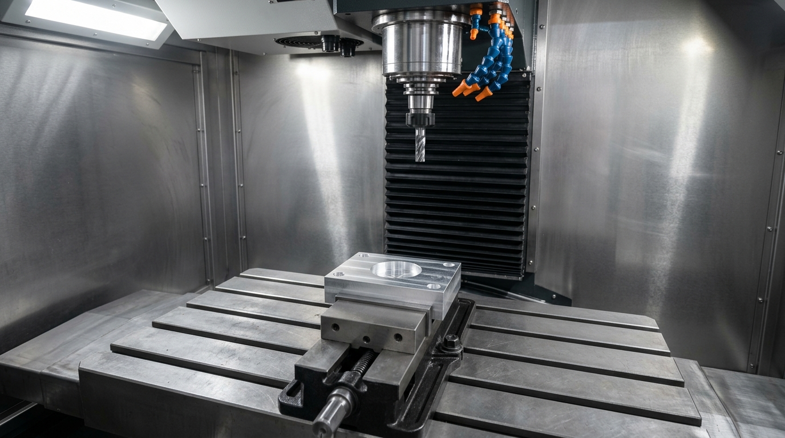

# 📘 Großes Praxis-Übungshandbuch: Alle Übungen für CNC-Programmierung (3D-Modelle) & Postprozessor-Entwicklung (JavaScript)

In dieser zentralen Datei sammeln wir **alle praktischen Übungen** Ihres Projekts – Schritt für Schritt, **in einfacher Sprache erklärt** und mit allen **Fachbegriffen in Klammern `(...)` erläutert**. 
Jede neue Übung, die wir gemeinsam machen, wird hier vollständig dokumentiert und ergänzt.

---

## 💡 GRUNDWISSEN VORAB: Warum muss man für CNC-Maschinen JavaScript programmieren – und warum zahlen Metall-Firmen dafür 400 € bis 800 €?

Bevor du mit Übung 1 startest, ist hier in 3 einfachen Punkten erklärt, **warum** du in diesem Handbuch sowohl **CNC-G-Code** als auch **JavaScript (`.cps`)** lernst und warum genau diese Kombination deine Goldgrube ist:

### 1. Warum muss man für eine CNC-Fräsmaschine überhaupt JavaScript programmieren?
* Wenn ein Betrieb im Büro ein **3D-CAM-Programm *(Software zur Fertigungsplanung am PC, z. B. Autodesk Fusion 360)*** nutzt, klickt man dort nur mit der Maus auf ein 3D-Bauteil.
* Jede CNC-Fräsmaschine in der Werkhalle spricht aber einen **anderen Dialekt** *(Heidenhain Klartext, Siemens Sinumerik, Fanuc, Haas, Mazak)* und jeder Werkstatt-Chef hat eigene Sicherheits-Sonderwünsche *(z. B. eine automatische Werkzeugliste am Programmanfang, die Berechnung der tiefsten Frästiefe `Z-MIN` gegen Schraubstock-Crashs oder das Parken des Tisches an der Kabinentür)*.
* **Das Entscheidende:** Für diese Sonderwünsche gibt es im CAM-Programm **keine Knöpfe zum Anklicken**! Stattdessen benutzt das CAM-Programm im Hintergrund eine **Übersetzungs-Datei mit der Endung `.cps` (den Postprozessor)** – und diese Datei ist zu **100 % in der Programmiersprache JavaScript** geschrieben *(bei Siemens NX in Tcl/Python)*. Wer also möchte, dass aus dem CAM-Programm auf Knopfdruck perfekter, sicherer Maschinencode herauskommt, **muss diese `.cps`-JavaScript-Datei öffnen und darin JavaScript-Code programmieren**!

### 2. Warum können der Chef der Metall-Firma („Herr Müller“) und seine Fräser das nicht selbst?
* Ein **Zerspanungsmechaniker *(CNC-Fräser)*** oder **Industriemeister Metall** lernt in seiner 3,5-jährigen Ausbildung alles über Stahl, Aluminium, Fräser, Schraubstöcke und Messschieber – aber **keine einzige Stunde Softwareentwicklung oder JavaScript**!
* Wenn Herr Müller die Datei `mein_erster_post.cps` öffnet und dort 4.000 Zeilen JavaScript-Code (`function onOpen()`, `for`-Schleifen, `getGlobalZRange()`) sieht, versteht er kein Wort.
* Umgekehrt verstehen normale Web-/App-Programmierer zwar JavaScript, wissen aber nicht, was ein Schraubstock, Kühlmittel (`M08`), Gewindebohren (`G84`) oder eine Frästiefe (`Z-MIN`) ist.

### 3. Wofür zahlt Herr Müller DIR mit Freude 400 € bis 800 €?
* Ohne angepassten Postprozessor sieht der Arbeiter an der 200.000-€-Fräsmaschine am Programmanfang nicht, welche Werkzeuge er braucht und wie tief der Fräser nach unten fährt (`Z-MIN`). Spannt er das Metallteil 5 mm zu tief in den Schraubstock, knallt der Fräser in den Stahl-Schraubstock (**5.000 € bis 15.000 € Reparaturkosten!**).
* Du als **Software Engineer & Diplom-Ingenieur** baust Herrn Müller genau die Funktionen aus diesen **16 Übungen** *(automatische Werkzeugliste, `Z-MIN`-Tiefe, Schnittdaten-Check, sicherer Rückzug)* in seine `.cps`-JavaScript-Datei ein.
* Herr Müller bezahlt dich **einmalig (z. B. 400 € bis 800 €)**, bekommt deine umprogrammierte `.cps`-Datei per E-Mail geschickt, und ab diesem Tag kommt bei ihm in der Firma bei jedem Knopfdruck automatisch der perfekte, crashsichere Maschinencode heraus!

### 4. Spielt das Material eine Rolle? (Stahl vs. Aluminium vs. Holz & Kunststoff)
Hier gibt es eine ganz wichtige Unterscheidung:
* **Für die Postprozessor-Programmierung in JavaScript (`.cps`): NEIN – das Material ist zu 99 % egal!**
  Egal ob eine CNC-Maschine **Stahl**, **Aluminium**, **Kunststoff (Plastik)** oder **Holz *(in einer Schreinerei / Tischlerei / im Möbel- und Messebau)*** fräst: **Jede** CNC-Maschine braucht einen Postprozessor (`.cps`), der aus dem 3D-Modell den Maschinencode erzeugt! Und ein Tischlermeister (Holz) kann genauso wenig JavaScript programmieren wie ein Metallbauer. Gerade Schreinereien und Aluminium-/Kunststoff-Betriebe kaufen sich extrem oft *Autodesk Fusion 360* und zahlen dir gutes Geld dafür, dass du ihren Postprozessor anpasst *(z. B. damit sich bei einer Holz-CNC-Fräse automatisch die **Staubabsaugung [Späneabsaugung]** und der **Vakuumtisch [Unterdruck-Plattenspannung]** einschalten statt Kühlwasser!)*.
* **Für die CAM-Programmierung der Schnittdaten (siehe Übung 9): JA – hier entscheidet das Material über Drehzahl (`S`), Vorschub (`F`) und Kühlung!**
  * **Holz & Kunststoff:** Sehr weich $\rightarrow$ extrem hohe Drehzahl (`S18000`–`S24000` U/min), sehr schneller Vorschub (`F3000`–`F8000` mm/min) und **niemals Kühlwasser (`M08` verboten, sonst quillt das Holz auf!)**, sondern nur **Luft / Staubabsaugung (`M07`)**.
  * **Aluminium:** Mittelweich $\rightarrow$ hohe Drehzahl (`S8000`–`S15000` U/min), hoher Vorschub (`F1500`–`F3000` mm/min), spezielle Alu-Fräser mit 2–3 Schneiden *(damit das weiche Alu nicht am Fräser festklebt)*.
  * **Stahl & Edelstahl:** Hart und zäh $\rightarrow$ niedrige Drehzahl (`S1500`–`S4000` U/min), langsamer Vorschub (`F300`–`F800` mm/min) und **viel Kühlwasser (`M08`)**, damit der Fräser nicht ausglüht.

### 5. Wie kommunizieren JavaScript (am PC) und C++ (auf der Fräsmaschine) eigentlich miteinander?

Hier vermuten viele Entwickler ein technisches Rätsel:  
*„Unser Postprozessor ist in JavaScript geschrieben. Der Computer der echten Fräsmaschine läuft aber mit harter Industrie-Software in C++, SPS und Assembler. Wie reden diese beiden Welten miteinander?“*

Die verblüffende Antwort lautet: **Die Fräsmaschine führt überhaupt kein JavaScript aus!**

Das Zusammenspiel funktioniert über eine **4-stufige Daten-Pipeline *(Architektur-Pipeline)***:

```text
┌─────────────────────────────────────────────────────────────────────────────┐
│                       1. BÜRO-PC / ENTWICKLER-LAPTOP                         │
├─────────────────────────────────────────────────────────────────────────────┤
│  Autodesk Fusion 360 (In C++ programmiert)                                  │
│  │                                                                          │
│  │  (Eingebettete V8-JavaScript-Engine & C++ Bindings)                      │
│  ▼                                                                          │
│  Ihr Postprozessor (.cps) (In JavaScript programmiert)                      │
│  │                                                                          │
│  │  (Schreibt per writeBlock Textzeilen)                                    │
│  ▼                                                                          │
│  Die fertige Maschinendatei (.nc) (Reiner ASCII G-Code Text)                │
└──────────────────────────────────────┬──────────────────────────────────────┘
                                       │
                                       │ 💾 Übertragung per USB-Stick, 
                                       │    LAN-Netzwerk (Ethernet) oder RS232
                                       ▼
┌─────────────────────────────────────────────────────────────────────────────┐
│                   2. WERKSTATT / ECHTE CNC-FRÄSMASCHINE                     │
├─────────────────────────────────────────────────────────────────────────────┤
│  CNC-Steuerung (Haas NGC / Fanuc / Siemens - in C++ & SPS Firmware)        │
│  │                                                                          │
│  │  (Liest Zeile für Zeile Text wie G00 X80.0 Y50.0)                        │
│  ▼                                                                          │
│  Trajektorienplaner & Servomotoren (Schneiden das Metall)                   │
└─────────────────────────────────────────────────────────────────────────────┘
```

#### Schritt 1: Auf dem Büro-PC (C++ ruft JavaScript auf)
* Autodesk Fusion 360 ist eine gigantische Desktop-Software, die in **C++** geschrieben ist.
* Die Autodesk-Entwickler haben eine JavaScript-Engine *(wie Googles V8-Engine in Google Chrome)* direkt in den C++ Kern von Fusion 360 eingebaut.
* Wenn der Anwender auf **„Postprozessieren“** klickt:
  1. Der C++ Kern von Fusion 360 holt die Werkzeuge und Fräsbahnen aus dem Arbeitsspeicher *(RAM)*.
  2. Über C++ Funktionsaufrufe *(Bindings)* ruft die Engine Ihre JavaScript-Funktionen auf:  
     `onOpen()`, `onSection()`, `onLinear(x, y, z)` und `onClose()`.
  3. Ihr JavaScript-Code ruft `writeBlock("G00", "X" + x, "Y" + y)` auf.
  4. Die Engine nimmt diese Textwörter entgegen und speichert sie als **reine Textdatei mit der Endung `.nc`** ab.

#### Schritt 2: Das Bindeglied zwischen PC und Maschine (Die `.nc`-Textdatei)
* Die Kommunikation zwischen Ihrem JavaScript und der Fräsmaschine erfolgt **niemals über ein Live-Kabel**, sondern über die **fertige Textdatei (`.nc`)**!
* In dieser Datei steht kein einziges Bit JavaScript mehr, sondern reiner, weltweiter Industrie-Standard *(DIN 66025 G-Code)*:
  ```gcode
  T01 M06
  S8000 M03
  G00 X0.0 Y0.0 Z15.0
  G01 Z-5.0 F500
  ```

#### Schritt 3: In der Fräsmaschine (C++ liest den Text)
* Die Fräsmaschine hat einen eigenen Industrie-Computer *(Industrie-PC mit Echtzeit-Betriebssystem wie VxWorks oder LinuxCNC)*.
* Die Firmware der Maschine *(in C++ und C programmiert)* öffnet die `.nc`-Datei.
* Ein C++ Text-Parser liest Zeile für Zeile:
  * Liest er `G00 X80.0 Y50.0`, berechnet ein C++ Bahnplanungs-Algorithmus blitzschnell die Beschleunigung der Servomotoren *(z. B. 20.000 elektrische Takte pro Sekunde an die Achstreiber)*.
  * Liest er `M08`, schaltet die SPS *(Speicherprogrammierbare Steuerung)* das 24V-Relais der Kühlwasserpumpe ein.

#### Fazit in einem Satz:
**JavaScript ist der Übersetzer am Büro-PC, der Maschinencode (`.nc`) ist der gedruckte Brief, und C++ in der Fräsmaschine ist der Leser, der die Anweisungen mechanisch in Metall umsetzt!**

---

## 🧭 Inhaltsverzeichnis aller 16 Übungen (+ 2 Einsteiger-Basis-Übungen)

* **🟢 Einsteiger-Vorübungen:**
  * **[Basis-Übung A](#🟢-stufe-2--basis-übung-a-die-5-wichtigsten-g-code-zeilen-lesen-lernen-schwierigkeit-):** Die 5 wichtigsten **G-Code-Zeilen (Maschinenbefehle)** lesen lernen (`T01 M06`, `S8000 M03`, `M08`, `G00`, `G01`).
  * **[Übung 00b: Hallo Welt (Erste eigene Zeile im Postprozessor)](#übung-00b-hallo-welt-erste-eigene-zeile-im-postprozessor):** Die allererste eigene Code-Zeile mit `writeComment("HALLO WELT...")` und `writeBlock(...)` in der Quellcodedatei [`uebungen/uebung_00b_hallo_welt.cps`](file:///C:/Projekte/CNC/uebungen/uebung_00b_hallo_welt.cps) schreiben, übersetzen und simulieren *(entspricht Basis-Übung B)*.
* **🔵 Grund- & Auftrags-Übungen (Übung 1 bis 8):**
  1. **[Übung 1](#übung-1-der-erste-eigene-text-im-g-code-entwickler-infoblock-in-onopen):** Der erste eigene Text im **G-Code (Maschinensprache)** – Entwickler-Infoblock in `onOpen()` programmieren *(Grundlage aus Ihrer `doc.txt`)*.
  2. **[Übung 2](#übung-2-automatische-werkzeugliste-tool-table-ganz-oben-im-programm-ausgeben):** Automatische **Werkzeugliste (`Tool Table` – Übersicht aller Fräser und Bohrer)** ganz oben im Programm ausgeben.
  3. **[Übung 3](#übung-3-sicherheits-schutz-gegen-maschinencrash--tiefste-frästiefe-z-min-berechnen):** Sicherheits-Schutz gegen **Maschinencrash (Kollision mit dem Schraubstock)** – Tiefste Frästiefe (`Z-MIN`) automatisch berechnen.
  4. **[Übung 4](#übung-4-ein-3d-modell-als-kundenauftrag-bearbeiten-vom-3d-bauteil-zum-g-code):** Ein **3D-Modell (dreidimensionales Bauteil)** als Kundenauftrag bearbeiten – Klick-für-Klick vom 3D-Bauteil zum fertigen **G-Code**.
  5. **[Übung 5](#übung-5-3d-simulation-im-browser--einrichteblatt-setup-sheet-für-den-kunden-erstellen):** **3D-Simulation (visuelle Prüfung am Bildschirm)** durchführen & das **Einrichteblatt (`Setup Sheet` – Rüstplan für die Werkstatt)** erstellen.
  6. **[Übung 6](#übung-6-sicherer-rückzug-safe-retract--tisch-am-programmende-zur-tür-fahren-onclose):** **Sicherer Rückzug (`Safe Retract`)** & Maschinentisch am Programmende (`onClose`) automatisch zur Kabinentür fahren.
  7. **[Übung 7](#übung-7-eigenen-schalter-property-für-zusatzfunktionen-wie-blasluft-m07-oder-späneförderer-bauen):** Eigenen Schalter (`Property` – Auswahlfeld im Menü) für Zusatzfunktionen wie **Blasluft (`M07`)** oder **Späneförderer (Förderband für Metallspäne)** einbauen.
  8. **[Übung 8](#übung-8-zwei-steuerungs-sprachen-vergleichen-haasfanuc-vs-siemens-sinumerik):** Zwei Steuerungs-Sprachen vergleichen und umschalten (**Haas/Fanuc ISO-Dialekt** vs. **Siemens Sinumerik Dialekt**).
* **🟣 Fortgeschrittene Profi-Übungen für echte Online-Aufträge (Übung 9 bis 16):**
  9. **[Übung 9](#übung-9-schnittdaten-s-drehzahl--f-vorschub-berechnen--warum-aluminium-baustahl-und-edelstahl-völlig-andere-werte-brauchen):** **Schnittdaten (`S` Drehzahl & `F` Vorschub)** berechnen – Warum Aluminium, Baustahl und Edelstahl völlig andere Werte brauchen.
  10. **[Übung 10](#übung-10-die-2-aufspannung-g55--op20--wie-das-3d-bauteil-umgedreht-und-der-restboden-auf-der-rückseite-plangefräst-wird):** **Die 2. Aufspannung (`G55` / `OP20`)** – Wie das 3D-Bauteil umgedreht und der Restboden auf der Rückseite plangefräst wird.
  11. **[Übung 11](#übung-11-gewindebohren-g84-rigid-tapping--m6--und-m8-schraubengewinde-ohne-werkzeugbruch-programmieren-f--s--steigung):** **Gewindebohren (`G84` Rigid Tapping)** – `M6`- und `M8`-Schraubengewinde ohne Werkzeugbruch programmieren (`F = S × Steigung`).
  12. **[Übung 12](#übung-12-werkzeugradiuskorrektur-g41--g42--g40--wie-der-kunde-an-der-maschine-001-mm-genauigkeit-für-passungen-einstellt):** **Werkzeugradiuskorrektur (`G41` / `G42` / `G40`)** – Wie der Kunde an der Maschine `0,01 mm` Genauigkeit für Passungen einstellt.
  13. **[Übung 13](#übung-13-echte-3d-freiformflächen--3d-adaptive-clearing-wirbelfräsen--3d-schlichten-mit-kugelfräser-ball-end-mill):** **Echte 3D-Freiformflächen** – `3D Adaptive Clearing` (Wirbelfräsen) & `3D-Schlichten` mit **Kugelfräser (`Ball End Mill`)**.
  14. **[Übung 14](#übung-14-heidenhain-klartext-steuerung-tool-call-l--fmax--4-drehachse-a-achse-für-aufträge-im-deutschsprachigen-raum):** **Heidenhain Klartext-Steuerung (`TOOL CALL`, `L ... FMAX`) & 4. Drehachse (`A-Achse`)** für Aufträge im deutschsprachigen Raum.
  15. **[Übung 15](#übung-15-kanten-entgraten-am-3d-modell-2d-fase--chamfer-milling-mit-einem-45-fasenfräser-t04):** **Kanten entgraten am 3D-Modell (`2D-Fase / Chamfer Milling`)** mit einem $90^\circ$/$45^\circ$-Fasenfräser (`T04`).
  16. **[Übung 16](#übung-16-die-komplette-5-punkte-endabnahme-im-simulator-vor-der-auslieferung-an-den-online-kunden-meister-prüfung):** **Die komplette 5-Punkte-Endabnahme im Simulator** vor der Auslieferung an den Online-Kunden (Meister-Prüfung).
* **🛡️ Meister-Sicherheits- und Qualitätsprüfung:**
  * **[Sicherheits- und Qualitätsprüfprotokoll für CNC-G-Code (Null-Kollisions-Garantie & Abnahme-Checkliste)](file:///c:/Projekte/CNC/SICHERHEITS_UND_QUALITAETS_PRUEFLISTE_GCODE.md):** Umfassende 5-Stufen-Prüfkette vor dem Ausliefern an den Kunden oder dem ersten Span auf der Fräsmaschine *(CAM-Prüfung, 3D-Simulation, G-Code-Syntaxcheck, Maschinen-Rüsten, Luftschnitt)*.

---

## 📂 Zentrale Übersicht: Alle Source-Dateien (Quellcode-Dateien) für jede Übung

### 🔗 Was verbindet die Einzeldateien in `uebungen/` mit dem Haupt-Postprozessor `src/mein_erster_post.cps`?

Um die Architektur Ihres Projekts auf einen Blick zu verstehen:

1. **Die Einzeldateien (`uebungen/uebung_01_...cps` bis `uebung_16_...cps`):**  
   Das sind **isolierte Trainings- und Lernbausteine**. Jede dieser Dateien enthält nur die rund 30 bis 50 Zeilen Code, die genau zu diesem einen Thema gehören *(z. B. nur der `onOpen`-Header, nur die `Z-MIN`-Schleife oder nur der `G84`-Gewindezyklus)*.  
   * **Vorteil:** Sie können den Code in Sekunden erfassen, ohne sich in tausenden Zeilen zu verirren, und die Datei unabhängig testen.

2. **Der Haupt-Postprozessor (`src/mein_erster_post.cps`):**  
   Das ist das **Gesamtkunstwerk (das fertige Endprodukt)**. Hier sind **alle 16 Bausteine aus den Übungen zusammengeführt** und bilden einen vollständigen, 500-zeiligen Postprozessor für 3-Achs-Fräsmaschinen.

3. **Der rote Faden (Die Verbindung):**  
   * Jede Funktion, die Sie in einer Einzeldatei isoliert testen *(z. B. `writeComment` in Übung 1, `getToolTable` in Übung 2, `getGlobalZRange` in Übung 3 oder `onClose` in Übung 6)*, ist **haargenau an der entsprechenden Stelle in `src/mein_erster_post.cps` eingebaut**.
   * Wenn Sie eine Einzeldatei verstanden und geändert haben, können Sie denselben Codeblock 1:1 in den Haupt-Postprozessor übernehmen.
   * Am Ende mündet alles in **Übung 16 ([`uebung_16_endabnahme_meister_post.cps`](file:///C:/Projekte/CNC/uebungen/uebung_16_endabnahme_meister_post.cps))**, die die geprüfte Essenz des gesamten Projekts darstellt.

---

### 📋 Tabelle aller Übungsdateien und ihrer Gegenstücke:

Alle Quellcodedateien *(JavaScript `.cps` Postprozessoren, 3D-CAD-Modelle und Simulatoren)* befinden sich fertig vorbereitet im Ordner [`C:\Projekte\CNC\uebungen\`](file:///C:/Projekte/CNC/uebungen/) sowie im Kundenauftrags-Ordner. Sie können jede dieser Dateien einzeln in Visual Studio Code öffnen, anpassen und direkt im Terminal *(Befehlsfenster)* mit dem Simulator ausführen:

| Nr. | Übungsthema | Quelldatei *(Pfad)* | Ausführen & Testen im Terminal *(Befehl)* |
|---|---|---|---|
| **00b** | Basis-Übung B *(Hallo Welt)* | [`uebungen/uebung_00b_hallo_welt.cps`](file:///C:/Projekte/CNC/uebungen/uebung_00b_hallo_welt.cps) | `node tests/simuliere_post.js uebungen/uebung_00b_hallo_welt.cps` |
| **01** | Entwickler-Header *(onOpen)* | [`uebungen/uebung_01_entwickler_header.cps`](file:///C:/Projekte/CNC/uebungen/uebung_01_entwickler_header.cps) | `node tests/simuliere_post.js uebungen/uebung_01_entwickler_header.cps` |
| **02** | Werkzeugliste *(Tool Table)* | [`uebungen/uebung_02_werkzeugliste.cps`](file:///C:/Projekte/CNC/uebungen/uebung_02_werkzeugliste.cps) | `node tests/simuliere_post.js uebungen/uebung_02_werkzeugliste.cps` |
| **03** | Z-MIN Berechnung *(Crashschutz)* | [`uebungen/uebung_03_z_min_berechnung.cps`](file:///C:/Projekte/CNC/uebungen/uebung_03_z_min_berechnung.cps) | `node tests/simuliere_post.js uebungen/uebung_03_z_min_berechnung.cps` |
| **04** | 3D-Modell CAM-Operationen | [`uebungen/uebung_04_3d_modell_cam.cps`](file:///C:/Projekte/CNC/uebungen/uebung_04_3d_modell_cam.cps) & [`bauteil_1001.stl`](file:///C:/Projekte/CNC/kundenauftrag_01_flanschplatte/bauteil_1001.stl) | `node tests/simuliere_post.js uebungen/uebung_04_3d_modell_cam.cps` |
| **05** | 3D-Simulator & Einrichteblatt | [`3d_auftrag_simulator.html`](file:///C:/Projekte/CNC/kundenauftrag_01_flanschplatte/3d_auftrag_simulator.html) & [`EINRICHTEBLATT.md`](file:///C:/Projekte/CNC/kundenauftrag_01_flanschplatte/EINRICHTEBLATT_SETUP_SHEET.md) | Doppelklick im Windows-Explorer auf `3d_auftrag_simulator.html` |
| **06** | Sicherer Rückzug *(Safe Retract)* | [`uebungen/uebung_06_sicherer_rueckzug.cps`](file:///C:/Projekte/CNC/uebungen/uebung_06_sicherer_rueckzug.cps) | `node tests/simuliere_post.js uebungen/uebung_06_sicherer_rueckzug.cps` |
| **07** | Späneförderer Schalter *(Property)* | [`uebungen/uebung_07_spaenefoerderer_schalter.cps`](file:///C:/Projekte/CNC/uebungen/uebung_07_spaenefoerderer_schalter.cps) | `node tests/simuliere_post.js uebungen/uebung_07_spaenefoerderer_schalter.cps` |
| **08** | Fanuc vs. Siemens Sinumerik | [`uebungen/uebung_08_fanuc_siemens_dialekt.cps`](file:///C:/Projekte/CNC/uebungen/uebung_08_fanuc_siemens_dialekt.cps) | `node tests/simuliere_post.js uebungen/uebung_08_fanuc_siemens_dialekt.cps` |
| **09** | Schnittdaten-Plausibilitätsprüfung | [`uebungen/uebung_09_schnittdaten_check.cps`](file:///C:/Projekte/CNC/uebungen/uebung_09_schnittdaten_check.cps) | `node tests/simuliere_post.js uebungen/uebung_09_schnittdaten_check.cps` |
| **10** | 2. Aufspannung *(G55 OP20)* | [`uebungen/uebung_10_zweite_aufspannung_g55.cps`](file:///C:/Projekte/CNC/uebungen/uebung_10_zweite_aufspannung_g55.cps) | `node tests/simuliere_post.js uebungen/uebung_10_zweite_aufspannung_g55.cps` |
| **11** | Gewindebohren *(G84 Rigid Tapping)*| [`uebungen/uebung_11_gewindebohren_g84.cps`](file:///C:/Projekte/CNC/uebungen/uebung_11_gewindebohren_g84.cps) | `node tests/simuliere_post.js uebungen/uebung_11_gewindebohren_g84.cps` |
| **12** | Radiuskorrektur *(G41/G42/G40)* | [`uebungen/uebung_12_radiuskorrektur_g41.cps`](file:///C:/Projekte/CNC/uebungen/uebung_12_radiuskorrektur_g41.cps) | `node tests/simuliere_post.js uebungen/uebung_12_radiuskorrektur_g41.cps` |
| **13** | 3D-Freiformflächen-Fräsen | [`uebungen/uebung_13_3d_freiformflaechen.cps`](file:///C:/Projekte/CNC/uebungen/uebung_13_3d_freiformflaechen.cps) | `node tests/simuliere_post.js uebungen/uebung_13_3d_freiformflaechen.cps` |
| **14** | Heidenhain Klartext & 4. Achse | [`uebungen/uebung_14_heidenhain_klartext_4achse.cps`](file:///C:/Projekte/CNC/uebungen/uebung_14_heidenhain_klartext_4achse.cps) | `node tests/simuliere_post.js uebungen/uebung_14_heidenhain_klartext_4achse.cps` |
| **15** | Fasenfräsen & Entgraten *(45°)* | [`uebungen/uebung_15_fasenfraesen_entgraten.cps`](file:///C:/Projekte/CNC/uebungen/uebung_15_fasenfraesen_entgraten.cps) | `node tests/simuliere_post.js uebungen/uebung_15_fasenfraesen_entgraten.cps` |
| **16** | Meister-Post Endabnahme | [`uebungen/uebung_16_endabnahme_meister_post.cps`](file:///C:/Projekte/CNC/uebungen/uebung_16_endabnahme_meister_post.cps) | `node tests/simuliere_post.js uebungen/uebung_16_endabnahme_meister_post.cps` |

* **🤖 Nach den 16 Übungen – Deine 4 KI-Agenten im Praxiseinsatz:**
  * **[WANN und WIE du deine 4 KI-Agenten verwendest (Zeilen 935–971)](#🤖-wann-und-wie-du-deine-4-ki-agenten-verwendest-goldene-regel-für-die-übungen--praxisanleitung-nach-übung-16):** Warum du Übung 1–15 erst selbst ohne KI machst und welcher KI-Agent dir ab Übung 16 welche Übungen zu 80 % abnimmt.

---

## 🛡️ WANN und WIE wendest du die Sicherheits- und Qualitätsprüfliste an?

Viele stellen sich die Frage: *„Muss ich das Dokument [`SICHERHEITS_UND_QUALITAETS_PRUEFLISTE_GCODE.md`](file:///c:/Projekte/CNC/SICHERHEITS_UND_QUALITAETS_PRUEFLISTE_GCODE.md) als allererstes komplett von vorn bis hinten durchlesen?“*

### Die kurze Antwort: NEIN, auf keinen Fall als Erstes auswendig lernen!
* **Die Sicherheitsprüfliste ist dein Referenz-Handbuch und Schutzschild:**  
  Genau wie die Checkliste im Cockpit eines Passagierflugzeugs liest man sie nicht wie einen Roman durch, sondern nutzt sie als **begleitenden Spickzettel und professionelles Abnahme-Protokoll**.
* **Für deine Übungen gilt:** Du beginnst ganz entspannt Schritt für Schritt mit **Übung 01** ([`uebungen/uebung_01_entwickler_header.cps`](file:///c:/Projekte/CNC/uebungen/uebung_01_entwickler_header.cps)). Jede Übung baut genau einen Baustein dieser Sicherheitskette auf.

### 🗺️ Fahrplan: Welche Übung baut welche Phase der Sicherheitsprüfliste auf?

| Phase aus [`SICHERHEITS_UND_QUALITAETS_PRUEFLISTE_GCODE.md`](file:///c:/Projekte/CNC/SICHERHEITS_UND_QUALITAETS_PRUEFLISTE_GCODE.md) | Was wird dort geprüft? | In welchen Übungen lernst und baust du das? |
| :--- | :--- | :--- |
| **Phase 1:<br>CAM-System & Postprozessor** | Nullpunkt `G54` *(Werkstück-Koordinatensystem)*, Rohteilaufmaß, Spannmittelschutz, Auskraglänge | • **Übung 4:** 3D-Modell CAM-Setup und Nullpunkt `G54`<br>• **Übung 9:** Schnittdatenprüfung Drehzahl `S` und Vorschub `F`<br>• **Übung 10:** 2. Aufspannung `G55` *(umgedrehtes Teil)* |
| **Phase 2:<br>3D-Simulation & Bemaßung** | Rote Eilganglinien `G00` *(Schnellgang)*, grüne Schnittbahnen `G01` *(Arbeitsgang)*, Maße-Check `📐` | • **Übung 00b:** Erste Simulation im Browser<br>• **Übung 5:** 3D-Simulation und Einrichteblatt<br>• **Übung 13:** 3D-Freiformflächen im Simulator prüfen |
| **Phase 3:<br>G-Code-Textinspektion** | Sicherheitszeile (`G90 G17...`), Werkzeugliste, Längenkorrektur `G43`, tiefste Tiefe `Z_min`, Rückzug `G53 Z0` | • **Übung 01:** Entwickler-Header & Sicherheitszeile in `onOpen()`<br>• **Übung 02:** Automatische Werkzeugtabelle *(Tool Table)*<br>• **Übung 03:** Automatische Berechnung von `Z_min` *(Crash-Schutz)*<br>• **Übung 06:** Sicherer Rückzug in `onClose()`<br>• **Übung 11 & 12:** `G84` Gewindebohren & `G41` Radiuskorrektur |
| **Phase 4:<br>Maschinen-Rüstung** | Werkzeug einmessen, 3D-Taster, Spannkraft im Schraubstock | • **Übung 5 & Portfolio:** Einrichteblatt für den Maschinenbediener mit allen Rüstdaten |
| **Phase 5:<br>Einfahren & First-Part Run** | Luftschnitt (`Z +50 mm`), Einzelsatz (`Single Block`), Vorschub-Poti | • **Übung 16:** Die komplette 5-Punkte-Endabnahme vor der Auslieferung an den Kunden! |

### 🚀 Wann holst du die Checkliste ganz konkret heraus?
1. **Beim Lernen (Übung 1–15):** Wann immer eine Übung eine neue Zeile G-Code erzeugt, wirfst du einen kurzen Blick in die Spickzettel-Tabelle von Phase 3, um den Befehl auf Deutsch zu verstehen.
2. **Bei Übung 16 (Meisterprüfung):** Du nimmst die **Druckbare Abnahme-Checkliste** aus [`SICHERHEITS_UND_QUALITAETS_PRUEFLISTE_GCODE.md`](file:///c:/Projekte/CNC/SICHERHEITS_UND_QUALITAETS_PRUEFLISTE_GCODE.md) und hakst Punkt für Punkt ab.
3. **Im echten Kundenauftrag (Später im Beruf / bei Freelancer-Aufträgen):** Du druckst die Checkliste aus, hakst sie ab und legst sie unterschrieben deiner Rechnung bei – damit hat der Kunde 100 % Vertrauen und du bist rechtlich gegen Regressansprüche abgesichert!

---

## 🧠 Die 5 goldenen Postprozessor-Regeln (Was Sie als JavaScript-Entwickler wirklich wissen müssen)

Sie müssen als **Postprozessor-Entwickler *(Software-Entwickler für CAM-Übersetzer)*** weder an einer echten Fräsmaschine gestanden haben noch komplizierte Maschinenkinematik im Kopf ausrechnen. Die Maschine und Autodesk Fusion 360 übernehmen die gesamte Geometrie für Sie. 

Für Ihren JavaScript-Code in den `.cps`-Dateien müssen Sie sich lediglich an diese **5 einfachen, unveränderlichen Grundregeln** halten:

---

### 🛡️ Regel 1: Der Sicherheits-Startblock in `onOpen()` *(Der "Guten-Morgen-Reset-Block")*

Ganz oben in der Funktion [`onOpen()`](file:///c:/Projekte/CNC/src/mein_erster_post.cps#L205-L255) muss bei Programmstart immer eine feste Kombination aus 5 Sicherheitsbefehlen stehen:

```javascript
// G90 = Absolutmaß (alle Maße beziehen sich auf den Werkstück-Nullpunkt G54)
// G21 = Maßeinheit Millimeter (metrisches System)
// G17 = Fräsen in der XY-Ebene (Standard-Bearbeitung von oben)
// G40 = Werkzeugradiuskorrektur sicher ausschalten
// G80 = Alle noch aktiven Bohrzyklen abbrechen und löschen
writeBlock("G90", "G21", "G17", "G40", "G80");
```
* **Warum ist das Pflicht?** Weil die Maschine vor dem Start vergessen soll, was der vorherige Arbeiter vielleicht an falschen Einstellungen aktiv gelassen hat. Das ist der elektronische Reset-Knopf für einen sicheren Start!

---

### 🛡️ Regel 2: Die feste Reihenfolge beim Werkzeugwechsel in `onSection()`

Wann immer eine neue Fräs- oder Bohroperation beginnt, erzeugt die Funktion [`onSection()`](file:///c:/Projekte/CNC/src/mein_erster_post.cps#L257-L350) immer genau diese **4-Schritte-Reihenfolge**:

1. **Werkzeug holen & einwechseln:** `T01 M06` *(Nimm Werkzeug 1 aus dem Magazin und spanne es ein)*
2. **Drehzahl & Spindelmotor an:** `S8000 M03` *(Drehe mit 8.000 U/min im Uhrzeigersinn)*
3. **Nullpunkt aufrufen:** `G54` *(Aktiviert die Heimatadresse der Bauteilecke – siehe Erklärung unten)*
4. **Längenkorrektur & Kühlwasser an:** `G43 H01 Z15.0 M08` *(Länge verrechnen, auf 15 mm Sicherheitshöhe bleiben, Kühlwasser einschalten)*

* **Warum diese Reihenfolge?** Wenn Sie `M08` *(Kühlwasser)* einschalten, bevor das Werkzeug eingewechselt ist, spritzt das Wasser in die leere Werkzeugaufnahme. Zuerst Werkzeug, dann Motor an, dann Nullpunkt, dann Wasser!

> [!NOTE]
> **Was bedeutet `G54` für Sie als Programmierer?**  
> Sie müssen sich über `G54` *(Werkstück-Koordinatensystem 1)* keine Gedanken machen: Es ist einfach der **feste Textbaustein**, mit dem Sie der Maschine sagen: *„Miss alle Maße ab der linken Ecke des Metallblocks und nicht von der fernen Maschinenwand!“* Der Bediener an der Maschine misst diesen Punkt einmal mit dem Taster ein. Sie schreiben im Postprozessor einfach immer `G54` hin!

---

### 🛡️ Regel 3: Zuerst Z nach ganz oben, ERST DANN Tisch bewegen *(Die Crash-Schutz-Regel)*

Das ist der **wichtigste Schutz vor teuren Maschinenschäden**:
Wenn eine Fräsoperation beendet ist oder das ganze Programm in [`onClose()`](file:///c:/Projekte/CNC/src/mein_erster_post.cps#L441-L499) stoppt, darf der Maschinentisch niemals zur Tür fahren, solange der Fräser noch unten im Werkstück steckt!

#### 💥 Das Marmeladenglas-Beispiel: Warum "ERST JETZT"?
Stellen Sie sich vor, Sie stecken einen **Löffel tief in ein Glas Marmelade**:
* Wenn Sie das Marmeladenglas jetzt mit Schwung zu sich nach vorne ziehen, **während der Löffel noch im Glas steckt**, reißt der Löffel das Glas um und alles geht zu Bruch!
* In der Maschine ist es genauso: Steckt der Bohrer noch $12\,\text{mm}$ tief im Loch und der Tisch fährt nach vorne, reißt der Bohrer explosionsartig ab und verbiegt die teure Spindel!
* Was machen Sie stattdessen ganz natürlich?  
  1. Sie ziehen **ZUERST den Löffel senkrecht nach oben** aus dem Glas.
  2. **ERST JETZT**, wo der Löffel frei in der Luft ist, ziehen Sie das Glas zu sich heran!

Deshalb gilt im Code zwingend das 2-Stufen-Prinzip:
```javascript
// Schritt 1: ZUERST die Z-Achse (senkrecht nach ganz oben an die Decke) fahren:
writeBlock("G53", "G00", "Z0.0");

// Schritt 2: ERST JETZT darf der Tisch in Y nach vorne zur Tür fahren:
writeBlock("G53", "G00", "Y0.0");
```

#### 🔍 Was bedeuten die Befehle Buchstabe für Buchstabe?

1. **Was für Schienen sind das überhaupt? *(Lineare Führungsschienen der Maschine)***:
   * Ein Maschinentisch wiegt oft $500\,\text{kg}$ bis $2\,\text{Tonnen}$ aus massivem Gusseisen. Er rollt im Maschinenboden auf zwei spiegelblanken **Stahl-Führungsschienen *(Linearführungen / Linear Rails mit gehärteten Rollenlagern)*** wie ein Zug auf Eisenbahngleisen kerzengerade von hinten nach vorne.
   * Auf diese Stahlschienen hat der Hersteller *(z. B. Haas oder DMG MORI)* ein unbewegliches Maßband graviert:
     * **Ganz hinten an der Rückwand:** z. B. `Y -500.0 mm`.
     * **Ganz vorne an der Schiebetür:** exakt der Nullpunkt **`Y 0.0 mm`** *(Endanschlag / Stopper)*.

2. **Warum steht in beiden Zeilen `G53` und `G00`?**
   * **`G00` = Schnellgang *(Eilgang / Rapid Traverse)***: Fährt mit Maximalgeschwindigkeit durch die Luft, damit der Arbeiter nicht warten muss.
   * **`G53` = Maschinen-Koordinatensystem *(Umschaltung auf die echte Stahlschiene)***:  
     * Normalerweise schaut die Steuerung auf Ihr Bauteil (**`G54`**).
     * Würden Sie nur `G00 Y0.0` schreiben, würde die Fräse an die Kante Ihres Metallblocks fahren und der Tisch bliebe mitten im Raum stehen!
     * **`G53` befiehlt der Steuerung:** *„Ignoriere den Metallblock im Schraubstock (`G54`)! Schau auf die fest verschraubte Stahlschiene der Maschine und fahre den Tisch auf Schienen-Position 0 ganz nach vorne an die Schiebetür!“*

3. **Der entscheidende Unterschied zwischen `Z` und `Y`:**
   * **`Z0.0` (Höhenachse senkrecht):** Steuert die Spindel mit dem Fräser. Fährt den Fräser senkrecht nach oben in den sicheren Freiraum unter das Kabinendach.
   * **`Y0.0` (Tiefenachse von hinten nach vorne):** Steuert den Maschinentisch. Fährt den Tisch nach vorne zu Ihnen an die Glasscheibe!

4. **Warum fährt `Y0.0` genau nach vorne an die Tür? *(Bedienerkomfort / Ergonomie)***:
   * Die Führungsschiene des Maschinentisches verläuft von der Rückwand nach vorne zur Tür.
   * Ganz hinten an der Rückwand ist z. B. `Y -500 mm`. Wenn der Tisch nach vorne rollt, werden die Zahlen immer größer: `-400`, `-300`, `-100`...
   * Der Maschinenhersteller hat den Anschlag ganz vorne direkt hinter der Glasschiebetür als **`0` (`Y0.0`)** festgelegt!
   * Das ist ein reiner **Bediener-Service**: Wenn das Programm endet, steht das fertige Teil direkt vor der geöffneten Schutztür, sodass der Arbeiter es bequem im Stehen herausnehmen kann, ohne sich in die nass tropfende, ölige Maschine beugen zu müssen!

---

### 🛡️ Regel 4: Niemals runde Klammern innerhalb von Klammern schreiben *(Syntax-Schutz)*

Bei **Fanuc- und Haas-Steuerungen *(den weltweit am weitesten verbreiteten CNC-Computern)*** werden Kommentare und Bedienernotizen in runden Klammern `(...)` geschrieben.
* Schreibt Ihr Postprozessor versehentlich: `(WERKZEUG 1 (VHM) SCHAFTFRAESER)`
* ... stürzt die CNC-Steuerung mit einem **Syntaxfehler *(Programmierfehler)*** ab, weil sie die zweite innere Klammer als Maschinenbefehl missversteht!

Nutzen Sie im Postprozessor deshalb immer die sichere Bibliotheks-Funktion:
```javascript
writeComment("Text hier"); // Entfernt verbotene Zeichen und schützt vor verschachtelten Klammern
```

---

### 🛡️ Regel 5: Am Ende das Programm sauber abschließen in `onClose()`

Jedes fertige CNC-Programm muss am Ende in [`onClose()`](file:///c:/Projekte/CNC/src/mein_erster_post.cps#L441-L499) diese 4 Handgriffe vollautomatisch ausführen:
1. `M09` $\rightarrow$ Kühlmittelpumpe ausschalten *(damit beim Öffnen der Tür kein Wasser spritzt)*.
2. `G53 G00 Z0.0` $\rightarrow$ Spindel ganz nach oben fahren *(Kollisionsschutz)*.
3. `M05` $\rightarrow$ Spindelmotor sicher anhalten.
4. `G53 G00 Y0.0` $\rightarrow$ Tisch nach vorne zur Schutztür fahren *(Bedienerkomfort)*.
5. `M30` $\rightarrow$ Hauptprogramm beenden und den Speicher auf Zeile 1 zurücksetzen.

---

### 📊 Die Postprozessor-Architektur im Überblick:

| Phase im Bearbeitungsablauf | Postprozessor-Funktion in JavaScript (`.cps`) | Was wird im G-Code ausgegeben? |
|---|---|---|
| **1. Programmstart** | [`onOpen()`](file:///c:/Projekte/CNC/src/mein_erster_post.cps#L205-L255) | Programm-Kopf, Datum, Werkzeugliste, `G90 G21 G17 G40 G80` |
| **2. Operationsstart & Werkzeugwechsel** | [`onSection()`](file:///c:/Projekte/CNC/src/mein_erster_post.cps#L257-L350) | `T.. M06` $\rightarrow$ `S.. M03` $\rightarrow$ `G54` $\rightarrow$ `G43 H.. Z15.0 M08` |
| **3. Fräs- & Bohrbewegungen** | [`onLinear()`](file:///c:/Projekte/CNC/src/mein_erster_post.cps#L370-L390) / `onCyclePoint()` | Verfahrkoordinaten `G01 X.. Y.. Z.. F..` oder Zyklen `G83 / G84` |
| **4. Programmende** | [`onClose()`](file:///c:/Projekte/CNC/src/mein_erster_post.cps#L441-L499) | `M09` $\rightarrow$ `G53 Z0.` $\rightarrow$ `M05` $\rightarrow$ `G53 Y0.` $\rightarrow$ `M30` |

---

## 📌 DER GROSSE CNC-MEISTER-SPICKZETTEL: Alle G-Code- & M-Code-Kennzeichen auf einen Blick

Bevor Sie eine Übung starten, finden Sie hier die **zentrale Schnellreferenz aller Maschinenbefehle**. Mehr als diese Kennzeichen benötigen 95 % aller CNC-Fräsmaschinen weltweit nicht!

| Kennzeichen | Fachbegriff & Erklärung | Was die Fräsmaschine exakt tut: |
|---|---|---|
| **`(...)`** | **Kommentar *(Bediener-Notiz)*** | Reiner Text für den Fräser am Bildschirm. Die Steuerung ignoriert den Text und führt keine Achsbewegung aus. |
| **`G90`** | **Absolutmaß *(Absolute Positioning)*** | Alle Verfahrkoordinaten $X, Y, Z$ beziehen sich fest auf den Bauteil-Nullpunkt `G54`. |
| **`G91`** | **Inkrementalmaß / Kettenmaß *(Incremental)*** | Maße beziehen sich relativ auf die jeweils letzte Werkzeugposition. |
| **`G17`** | **XY-Bearbeitungsebene *(Plane Selection)*** | Standard-Fräsebene von oben *(Werkzeugachse ist die Z-Achse)*. |
| **`G21`** | **Metrisches Einheitensystem *(Metric Mode)*** | Alle Weg- und Vorschubangaben werden in **Millimetern** interpretiert. |
| **`G20`** | **Zoll-Einheitensystem *(Imperial Mode)*** | Alle Wegangaben werden in **Inch / Zoll** ($1\,\text{Zoll} = 25,4\,\text{mm}$) interpretiert. |
| **`G94`** | **Vorschub pro Minute *(Feed per Minute)*** | Vorschubgeschwindigkeit $F$ wird in **$\text{mm/min}$ *(Millimeter pro Minute)*** gerechnet. |
| **`G00`** | **Eilgang *(Rapid Traverse)*** | Schnellstmögliche Bewegung der Achsen durch die Luft *(ohne Materialberührung)*. |
| **`G01`** | **Linearer Fräsvorschub *(Linear Interpolation)*** | Gerade Schnittbewegung im Werkstoff mit programmierter Arbeitsgeschwindigkeit $F$. |
| **`G02`** | **Kreisbogen im Uhrzeigersinn *(Circular CW)*** | Fräst eine kreisförmige Bahn nach rechts mit Radius $R$ oder Mittelpunkt $I, J$. |
| **`G03`** | **Kreisbogen gegen Uhrzeigersinn *(Circular CCW)*** | Fräst eine kreisförmige Bahn nach links *(Standard beim Gleichlauffräsen von Taschen)*. |
| **`G28`** | **Referenzpunktfahrt *(Return to Home)*** | Fährt die Achsen an die festen Maschinen-Endschalter *(z. B. `G28 G91 Z0.` ganz nach oben)*. |
| **`G53`** | **Maschinen-Koordinatensystem *(Machine Coordinates)*** | Nicht-verschiebbarer Nullpunkt der Fräsmaschine *(meist oben an der Kabinendecke)*. |
| **`G54`–`G59`**| **Werkstück-Koordinatensysteme *(Work Offsets)*** | Bauteil-Nullpunkte: `G54` = 1. Aufspannung, `G55` = 2. Aufspannung *(umgedrehtes Teil)*. |
| **`G40`** | **Radiuskorrektur ABWÄHLEN *(Cutter Comp Off)*** | Schaltet Fräserradiuskorrekturen aus; Werkzeug fährt exakt mit der Mitte auf der Kontur. |
| **`G41`** | **Fräserradiuskorrektur LINKS *(Cutter Comp Left)*** | Fräser fährt links an der Werkstückkontur entlang *(für Passungen auf 0,01 mm genau)*. |
| **`G42`** | **Fräserradiuskorrektur RECHTS *(Cutter Comp Right)***| Fräser fährt rechts an der Kontur entlang *(Gegenlauffräsen)*. |
| **`G43`** | **Werkzeuglängenkorrektur EIN *(Tool Length Comp)***| Aktiviert die gespeicherte Werkzeuglänge `H...` aus der Vermessung. |
| **`G80`** | **Bohrzyklen ABBRECHEN *(Cancel Canned Cycle)*** | Beendet alle aktiven Bohrbefehle sicher vor dem nächsten Schritt. |
| **`G81`** | **Bohrzyklus Standard *(Drilling Cycle)*** | Einfaches Zentrieren und Bohren bis zur Tiefe $Z$, danach sofortiger Rückzug. |
| **`G83`** | **Tieflochbohren mit Spanbruch *(Peck Drilling)*** | Bohrer taucht stufenweise ein (`Q`), zieht zwischendurch ganz heraus, um Späne auszuwerfen. |
| **`G84`** | **Gewindebohren synchronisiert *(Rigid Tapping)*** | Schneidet Schraubengewinde synchron mit Drehzahl und Steigung *(Vorschub $F = S \times \text{Steigung}$)*. |
| **`T01`–`T99`**| **Tool-Nummer *(Werkzeugplatz)*** | Nummer des Werkzeugs im Magazin-Karussell der Fräsmaschine. |
| **`M06`** | **Werkzeugwechsel *(Tool Change)*** | Mechanischer Greifarm holt das gewählte Werkzeug $T$ physisch in die Spindel. |
| **`S...`** | **Spindeldrehzahl *(Speed)*** | Rotationsgeschwindigkeit der Spindel in $\text{U/min}$ *(Umdrehungen pro Minute)*. |
| **`M03`** | **Spindel Rechtslauf EIN *(Spindle Clockwise)***| Startet den Spindelmotor im Uhrzeigersinn *(Schneidrichtung von 99 % aller Fräser)*. |
| **`M04`** | **Spindel Linkslauf EIN *(Spindle CCW)*** | Startet Spindel gegen den Uhrzeigersinn *(für Linksgewinde oder Linksschneider)*. |
| **`M05`** | **Spindel-Stopp *(Spindle Stop)*** | Schaltet den Spindelmotor sicher ab. |
| **`M07`** | **Blasluft / Minimalmengenschmierung *(Air Blast)*** | Schaltet Druckluft oder Späneabsaugung EIN *(wichtig für Holz und Kunststoff)*. |
| **`M08`** | **Kühlmittel EIN *(Flood Coolant)*** | Schaltet die Hochdruck-Kühlwasserpumpe EIN *(wichtig für Stahl und Aluminium)*. |
| **`M09`** | **Kühlmittel AUS *(Coolant Off)*** | Schaltet alle Kühlmittelpumpen und Luftdüsen AUS. |
| **`M30`** | **Programmende & Rücksprung *(Program End)*** | Beendet das Fräsprogramm, schaltet Aggregate aus und setzt den Zeiger auf Zeile 1 zurück. |

---

## 🔌 Ihre installierten Visual Studio Code (VSC) Erweiterungen: Wie Sie diese für die Übungen benutzen

Auf Ihrem System sind die wichtigsten Erweiterungen bereits installiert. Hier ist die genaue Übersicht, welche davon für Ihre CNC-Postprozessor-Übungen unverzichtbar sind und wie Sie sie mit wenigen Klicks bedienen:

### 1. `Autodesk HSM Post Processor` (`autodesk.hsm-post-processor`) – Der offizielle Post-Simulator von Autodesk
Dies ist die wichtigste Profi-Erweiterung für Autodesk Fusion Postprozessoren!
* **Wofür ist sie da?**  
  Sie ermöglicht es, eine `.cps`-Datei direkt in VS Code per Mausklick gegen echte CAM-Testdateien *(sogenannte `.intermediate` oder `.cnc` Benchmark-Werkzeugwege)* laufen zu lassen – ganz ohne Fusion 360 installieren zu müssen!
* **Wie benutzen Sie diese Erweiterung Schritt für Schritt?**
  1. Öffnen Sie eine `.cps`-Datei *(z. B. `uebungen/uebung_01_entwickler_header.cps` oder `src/mein_erster_post.cps`)*.
  2. Drücken Sie die Tastenkombination `Strg + Umschalt + P` *(öffnet die VS Code Befehlspalette)*.
  3. Tippen Sie ein: `Post Process` und wählen Sie den Befehl **`Autodesk Fusion Post Processor: Post Process`**.
  4. Die Erweiterung fragt Sie nach einer Benchmark-Datei *(z. B. 2D-Fräsen oder 3D-Kontur)*.
  5. **Ergebnis:** Rechts neben Ihrem Code öffnet sich automatisch ein zweiter Editor-Reiter mit dem frisch erzeugten CNC-Code!

### 2. `Stingray Debug` (`jschmidt42.stingray-debug`) – Der Postprozessor-Debugger
* **Wofür ist sie da?**  
  Arbeitet nahtlos mit der Autodesk Post-Erweiterung zusammen. Sie erlaubt es, **Breakpoints (rote Haltepunkte)** im JavaScript-Code zu setzen.
* **Wie benutzen Sie sie?**
  * Wenn Sie links neben eine Zeilennummer im Code klicken *(roter Punkt erscheint)*, stoppt die Ausführung bei `Post Process` genau an dieser Zeile, und Sie können sich den Inhalt aller Variablen *(z. B. Werkzeugdurchmesser oder Z-Höhen)* live ansehen.

### 3. `GitHub Copilot & Copilot Chat` (`github.copilot`, `github.copilot-chat`) & `Claude Code`
* **Wofür sind sie da?**  
  Ihre KI-Programmier-Assistenten direkt in der Seitenleiste von VS Code.
* **Wie benutzen Sie sie?**
  * Klicken Sie ganz links in der Seitenleiste auf das Chat-Symbol *(Sprechblase)*.
  * Sie können Fragen stellen wie: *„Erkläre mir Zeile 25 in uebung_03_z_min_berechnung.cps auf Deutsch“* oder *„Schreibe mir eine Sicherheitsabfrage für die Spindeldrehzahl“*.
  * *(Hinweis: Wie im Handbuch empfohlen, sollten Sie die Übungen 1 bis 15 zuerst selbst durchführen, um die Mechanik wirklich zu verstehen, und die KI als Erklär-Helfer nutzen).*

### 4. `Markdown PDF` (`yzane.markdown-pdf`) – Handbuch und Einrichteblatt als PDF drucken
* **Wofür ist sie da?**  
  Wandelt Markdown-Dokumente (`.md`) mit einem Klick in druckbare PDF-Dateien für den Kunden oder Maschinenbediener um.
* **Wie benutzen Sie sie?**
  1. Öffnen Sie eine Dokumentationsdatei *(z. B. `ALLE_UEBUNGEN_HANDBUCH.md` oder `EINRICHTEBLATT_SETUP_SHEET.md`)*.
  2. Machen Sie einen Rechtsklick irgendwo in den Text.
  3. Wählen Sie im Kontextmenü **`Markdown PDF: Export (pdf)`**.
  4. In wenigen Sekunden liegt eine fertige, professionell formatierte PDF-Datei im selben Ordner!

---

# Übung 00b: Hallo Welt (Erste eigene Zeile im Postprozessor)

### 📌 Spickzettel dieser Übung: Alle verwendeten G-Code- & M-Code-Kennzeichen in Übung 00b

| Kennzeichen | Fachbegriff & Erklärung | Bedeutung & Funktion in dieser Übung |
|---|---|---|
| **`(...)`** | **Kommentar *(Bediener-Notiz / Information für den Fräser)*** | Schreibt reine Notizen wie `writeComment("HALLO WELT...")`, die von der Fräsmaschinen-Steuerung komplett ignoriert werden. |
| **`G90`** | **Absolutmaß *(Absolute Mode)*** | Alle Maße beziehen sich auf den Werkstück-Nullpunkt `G54`. |
| **`G17`** | **XY-Bearbeitungsebene *(Plane Selection)*** | Standard-Fräsebene von oben *(Werkzeugachse ist die Z-Achse)*. |
| **`G21`** | **Metrisches Einheitensystem *(Metric Mode)*** | Alle Maßangaben sind in Millimetern. |
| **`G94`** | **Vorschub-Einheit *(Feed per Minute)*** | Vorschubgeschwindigkeit $F$ wird in $\text{mm/min}$ *(Millimeter pro Minute)* gerechnet. |
| **`G28 G91 Z0.`** | **Referenzpunktfahrt Z *(Return to Home Z)*** | Z-Achse fährt senkrecht nach oben an den oberen Maschinen-Endschalter *(Crash-Schutz)*. |
| **`T1` / `T2`** | **Werkzeugnummer *(Tool Number)*** | `T1` = Schaftfräser $\varnothing 10\,\text{mm}$ \| `T2` = Spiralbohrer $\varnothing 6\,\text{mm}$. |
| **`M06`** | **Werkzeugwechsel *(Tool Change)*** | Mechanischer Greifarm holt das Werkzeug $T$ physisch in die Frässpindel. |
| **`S8000` / `S3500`** | **Spindeldrehzahl *(Spindle Speed)*** | Drehzahl des Fräsers in $\text{U/min}$ *(Umdrehungen pro Minute)*. |
| **`M03`** | **Spindel Rechtslauf EIN *(Spindle Clockwise)*** | Schaltet den Frässpindelmotor im Uhrzeigersinn ein. |
| **`G54`** | **Werkstück-Nullpunkt 1 *(Work Coordinate System)*** | Nullpunkt-Lage an der vorderen linken oberen Bauteilecke. |
| **`M05`** | **Spindel-Stopp *(Spindle Stop)*** | Schaltet den Frässpindelmotor am Programmende aus. |
| **`M09`** | **Kühlmittel AUS *(Coolant Off)*** | Schaltet die Kühlwasserpumpe aus. |
| **`G28 Y0.`** | **Tisch zur Schutztür *(Table to Door)*** | Fährt den Maschinentisch nach vorne zum bequemen Entnehmen des fertigen Werkstücks. |
| **`M30`** | **Programmende *(Program End and Rewind)*** | Beendet die Abarbeitung und setzt den Programmzeiger im Speicher auf Zeile 1 zurück. |

### 💡 Worum geht es in einfacher Sprache?

Bevor Sie mit Variablen oder komplexen Schleifen arbeiten, ist **Übung 00b** das sogenannte **„Hallo Welt“-Programm *(der klassische allererste Test in der Softwareentwicklung)***.
Das Ziel ist es, zu verstehen, wie Sie mit der JavaScript-Funktion `writeComment(...)` eine eigene Textzeile in runden Klammern `(...)` und mit `writeBlock(...)` echte **G-Code-Maschinenbefehle *(Steuerbefehle für die CNC-Fräsmaschine)*** in die Maschinendatei schreiben.

### 🛠️ Wo im Code wird das gemacht?

Für diese Übung steht Ihnen die fertige Quellcodedatei zur Verfügung:  
👉 [`uebungen/uebung_00b_hallo_welt.cps`](file:///C:/Projekte/CNC/uebungen/uebung_00b_hallo_welt.cps)

In dieser Datei sehen Sie in der Funktion **`onOpen()`** *(wird immer automatisch ganz zu Beginn der Übersetzung aufgerufen)*:

```javascript
function onOpen() {
  // Hier steht Ihre allererste eigene Zeile im CNC-Code:
  writeComment("========================================"); // Optische Trennlinie als Kommentar
  writeComment("HALLO WELT - MEIN ERSTER CNC POSTPROZESSOR"); // Begrüßungstext in runden Klammern (...)
  writeComment("ERFOLGREICH ERSTE ZEILE EINGEFUEGT");        // Bestätigungskommentar
  writeComment("========================================"); // Trennlinie

  // Grundinitialisierung der Fräsmaschine:
  // G90 = Absolute Maßangaben in Bezug auf das Werkstück (Nullpunkt G54)
  // G17 = Fräsbearbeitung in der XY-Hauptebene (Z-Achse ist die Spindelachse)
  // G21 = Alle Maßeinheiten sind in Millimeter (metrisches System)
  // G94 = Vorschubgeschwindigkeit F wird in mm/min (Millimeter pro Minute) interpretiert
  writeBlock("G90", "G17", "G21", "G94");

  // Sicherheitsfahrt der Z-Achse auf den Referenzpunkt:
  // G28 = Fahre auf Maschinen-Referenzpunkt (feste Endschalter der Fräsmaschine)
  // G91 = Relativmaß (Inkrementell / Kettenmaß)
  // Z0. = Relativ um 0 mm verfahren, also direkt senkrecht nach oben auf Z-Referenzhöhe
  writeBlock("G28", "G91", "Z0.");

  // G90 = Sofort wieder zurückschalten in den Absolutmaß-Modus für alle weiteren Befehle
  writeBlock("G90");
}

function onSection() {
  var tool = currentSection.getTool();
  writeComment("--- WERKZEUGWECHSEL ---");
  // T.. = Werkzeugplatz im Magazin (Tool Number)
  // M06 = Automatischer Werkzeugwechsel durch mechanischen Greifer
  writeBlock("T" + tool.number, "M06");

  // S.. = Spindeldrehzahl in U/min (Spindle Speed)
  // M03 = Frässpindel im Uhrzeigersinn (Rechtslauf) starten
  writeBlock("S" + tool.spindleRPM, "M03");

  // G54 = 1. Werkstück-Koordinatensystem (Nullpunkt an Bauteilecke)
  writeBlock("G54");
}

function onClose() {
  writeComment("--- PROGRAMMENDE ---");
  // M05 = Frässpindel ausschalten (Spindel-Stopp)
  writeBlock("M05");

  // M09 = Kühlschmierstoff ausschalten (KSS AUS)
  writeBlock("M09");

  // G28 G91 Z0. = Z-Achse ganz nach oben auf Maschinenreferenz fahren
  writeBlock("G28", "G91", "Z0.");

  // G28 Y0. = Maschinentisch nach vorne zur Kabinentür fahren
  writeBlock("G28", "Y0.");

  // M30 = Hauptprogramm-Ende, Reset und Speicher auf Zeile 1 zurücksetzen
  writeBlock("M30");
}
```

### 🖥️ Schritt-für-Schritt: So führen Sie Übung 00b aus und prüfen das Ergebnis

1. **Datei in Visual Studio Code öffnen:**  
   Klicken Sie in der linken Datei-Leiste auf den Ordner `uebungen/` und öffnen Sie [`uebung_00b_hallo_welt.cps`](file:///C:/Projekte/CNC/uebungen/uebung_00b_hallo_welt.cps).
2. **Text nach Wunsch anpassen:**  
   Ändern Sie z. B. `"HALLO WELT - MEIN ERSTER CNC POSTPROZESSOR"` in Ihren eigenen Namen oder Grußtext. Speichern Sie die Datei mit `Strg + S`.
3. **Im Terminal übersetzen (Simulation ausführen):**  
   Öffnen Sie das Terminal in Visual Studio Code (`Strg + Ö` oder Menü `Terminal` $\rightarrow$ `Neues Terminal`) und geben Sie folgenden Befehl ein:
   ```powershell
   node tests/simuliere_post.js uebungen/uebung_00b_hallo_welt.cps
   ```
4. **Ergebnis-Datei ansehen:**  
   Der Postprozessor erzeugt blitzschnell die Maschinendatei [`uebungen/uebung_00b_hallo_welt.nc`](file:///C:/Projekte/CNC/uebungen/uebung_00b_hallo_welt.nc).  
   Dort sehen Sie ganz oben Ihre eigenen Zeilen:
   ```gcode
   (========================================)
   (HALLO WELT - MEIN ERSTER CNC POSTPROZESSOR)
   (ERFOLGREICH ERSTE ZEILE EINGEFUEGT)
   (========================================)
   G90 G17 G21 G94
   G28 G91 Z0.
   G90
   ```
5. **Im interaktiven 3D-Simulator ansehen:**  
   Öffnen Sie [`kundenauftrag_01_flanschplatte/3d_auftrag_simulator.html`](file:///C:/Projekte/CNC/kundenauftrag_01_flanschplatte/3d_auftrag_simulator.html) im Browser.  
   Wählen Sie oben im Menü *(Selectbox)* einfach **„Übung 00b: Hallo Welt Postprozessor“** aus.  
   Sie sehen sofort die exakten G-Code-Zeilen, können mit `⏮ Vorheriger` und `⏭ Nächster Schritt` jede Zeile einzeln durchschalten und mit `🎥 3D-Ansicht Reset` jederzeit zur Startansicht zurückspringen!

### 🛡️ Prüfliste dieser Übung: Wann ist Übung 00b zu 100 % bestanden?

| Prüfpunkt | Was muss im Code / Simulator zu sehen sein? | Bestanden? |
| :--- | :--- | :---: |
| **1. Terminal-Erfolg** | Der Befehl `node tests/simuliere_post.js ...` läuft fehlerfrei durch und meldet `SIMULATION ERFOLGREICH`. | [ ] |
| **2. Kommentar im Code** | In [`uebungen/uebung_00b_hallo_welt.nc`](file:///C:/Projekte/CNC/uebungen/uebung_00b_hallo_welt.nc) steht in runden Klammern `(HALLO WELT...)`. | [ ] |
| **3. Grundinitialisierung** | Die Sicherheitszeile `G90 G17 G21 G94` sowie der Z-Rückzug `G28 G91 Z0.` stehen direkt unter dem Kommentar. | [ ] |
| **4. 3D-Simulator-Check** | Im Browser steht das Werkzeug sicher über dem Bauteil-Nullpunkt `G54` auf Höhe `Z +15.0`. | [ ] |

### ❓ Häufige Frage & Klarstellung: Warum steht im 3D-Simulator bei Übung 00b oben „T01 [Z=15.0]“, obwohl im G-Code nichts davon steht?

Wenn Sie den 3D-Simulator [`kundenauftrag_01_flanschplatte/3d_auftrag_simulator.html`](file:///C:/Projekte/CNC/kundenauftrag_01_flanschplatte/3d_auftrag_simulator.html) öffnen und bei Übung 00b auf die Zeile `G28 G91 Z0.` schauen, fallen zwei Dinge auf:

1. **Die optische Täuschung mit dem Minuszeichen:**
   * Über dem roten Werkzeug-Zylinder stand: `T01 [Z=15.0]`.
   * Das Zeichen zwischen `Z` und `15.0` ist ein **Gleichheitszeichen `=`**, **KEIN Minuszeichen `-`**!
   * Bei kleiner Schriftgröße sieht ein `=` schnell wie ein Bindestrich oder Minus aus. Im Kopf liest man dann fälschlicherweise `Z-15`.
   * Im HUD *(Kopfbereich des Simulators)* steht ganz eindeutig: `POS (G54): X 0.000 | Y 0.000 | Z 15.000` *(eine positive Zahl, also **$+15\,\text{mm}$**)*.
   * *Hinweis:* Wir haben die Anzeige im Simulator nun auf `[Z: +15.0 mm]` verbessert, damit jedes Missverständnis sofort ausgeschlossen ist!

2. **Warum zeigt der Simulator `T01` und `Z 15.0`, obwohl in der Zeile `G28 G91 Z0.` gar kein `T01` und kein `Z15` steht?**
   * Die Zeile `G28 G91 Z0.` ist ein reiner Maschinenbefehl *(Z-Achse nach oben auf den Referenzschalter fahren)*. In diesem Befehl stehen weder Koordinaten für das Werkstück noch eine Werkzeugnummer.
   * Ein 3D-Simulator muss jedoch von der allerersten Sekunde an wissen:
     * **Welches 3D-Modell soll gerendert werden?** $\rightarrow$ Der Simulator wählt standardmäßig `T01 (Werkzeug)` als Start-Platzhalter, bis im G-Code die erste Zeile mit `T... M06` aufgerufen wird.
     * **Wo steht die Spindel im Raum?** $\rightarrow$ Der Simulator setzt die Spindel als Standard-Sicherheitsposition auf `X 0.000`, `Y 0.000` und **`Z +15.000`** *(15 mm Sicherheitsabstand in der Luft über der Werkstück-Ecke)*.
   * Es handelt sich also um die **virtuelle Startposition *(Initialwerte / Default State)*** des Simulators, nicht um einen Schnittbefehl!

**Wie tief fräst Werkzeug T01 wirklich? (Niemals `-15 mm`!):**
* Das Werkzeug `T01` *(Schaftfräser $\varnothing 10\,\text{mm}$ aus Vollhartmetall VHM)* schneidet:
  * Bei der Außenkontur: maximal auf **`Z -5.000 mm`** *(5 mm tief ins Aluminium)*.
  * Bei der Kreistasche: maximal auf **`Z -3.000 mm`** *(3 mm tief ins Aluminium)*.
* `T01` fährt also zu keinem Zeitpunkt auf $-15\,\text{mm}$ herunter!

**Wo taucht `-15 mm` *(Z-MIN / Backenhöhe)* im Projekt wirklich auf?**
1. **In Übung 03 *(Schraubstock-Crashschutz)*:**  
   Dort prüfen wir im Postprozessor die Spannbackenhöhe des Schraubstocks:  
   `(CRASHSCHUTZ: SCHRAUBSTOCK-BACKENHOEHE Z=-15.000MM -> SICHER!)`  
   Der Stahl-Schraubstock hält das Aluminium erst ab einer Tiefe von $Z = -15\,\text{mm}$. Weil unser Fräser `T01` nur bis $Z = -5\,\text{mm}$ eintaucht und der Bohrer `T02` nur bis $Z = -12\,\text{mm}$ bohrt, bleibt zur Schraubstockbacke bei $Z = -15\,\text{mm}$ noch ein Sicherheitsabstand von mindestens $3\,\text{mm}$ Luft *(kein Crash)*!
2. **Beim Rohteil:** Der rohe Aluminiumklotz vor der Bearbeitung ist $15\,\text{mm}$ dick (`85 x 55 x 15 mm`).
3. **Beim Taschenradius:** Die Kreistasche in der Mitte hat einen Durchmesser von $\varnothing 30\,\text{mm}$, was einem Kreisradius von genau $15\,\text{mm}$ entspricht (`I-15.000`).

### ⚙️ Wer definiert diesen Ausgangszustand eigentlich? (Simulator vs. reale Werkstatt)

Hier muss man genau zwischen der **virtuellen 3D-Simulation** und der **echten CNC-Fräsmaschine in der Werkshalle** unterscheiden:

| Wer? | Wo? | Was wird definiert? | Wie wird es festgelegt? |
| :--- | :--- | :--- | :--- |
| **1. Der Software-Entwickler** | Im Browser *(3D-Simulator [`3d_auftrag_simulator.html`](file:///C:/Projekte/CNC/kundenauftrag_01_flanschplatte/3d_auftrag_simulator.html#L614))* | Startposition `X0 Y0 Z+15.0` und Startwerkzeug `T01` | Im JavaScript-Code als Fallback-Initialwerte (`let curX = 0, curY = 0, curZ = 15; let curTool = "T01";`), damit das 3D-Canvas nicht leer bleibt, bevor die erste Fahrbewegung aus dem G-Code gelesen wird. |
| **2. Der Maschinenhersteller *(z. B. Haas, DMG Mori)*** | An der physischen Maschine | Der Maschinen-Nullpunkt *(Home / `G28` / `G53`)* | Fest verdrahtete mechanische und induktive Endschalter ganz oben am Ende der Z-Achsenschiene. Beim Einschalten der Maschine fährt die Spindel dort an den Anschlag. |
| **3. Der CNC-Fräser *(Bediener an der Maschine)*** | Auf dem Maschinentisch | Der Bauteil-Nullpunkt `G54` (`X0 Y0 Z0`) | Der Bediener spannt den rohen Aluminiumklotz in den Schraubstock, nimmt einen mechanischen Kantentaster oder 3D-Messtaster in die Hand, tastet die linke vordere Ecke und die Oberseite des Metalls ab und drückt auf der Steuerung die Taste **„Nullpunkt G54 übernehmen“**. |
| **4. Der CAM-Programmierer / Postprozessor-Entwickler** | In Fusion 360 & im CPS-Skript | Die Sicherheitshöhe *(Clearance Height, hier `Z +15.0 mm`)* | Im CAM-System wird im Menü „Höhen *(Heights)*“ der Rückzugsabstand über dem Teil eingegeben *(üblich sind 10 bis 25 mm Luft)*. Der Postprozessor übersetzt diesen Wert später in den ersten Anfahrbefehl `G00 Z15.0`. |
| **5. Der Zufall / das Vorprogramm *(Spindelinhalt vor Start)*** | In der Frässpindel | Welches Werkzeug steckt vor Programmstart in der Spindel? | Niemand weiß vorab, welches Werkzeug der Kollege der vorherigen Schicht in der Maschine stecken gelassen hat *(z. B. T03 oder T08)*. **Genau deshalb muss jedes saubere CNC-Programm zwingend mit einem eigenen Werkzeugwechsel `T01 M06` beginnen**, um sofort das richtige Werkzeug aus dem Magazin einzuwechseln! |

### 🛠️ Wie wird der Werkzeugwechsel `T01 M06` genau definiert und programmiert?

Um das Werkzeug sauber und sicher einzuwechseln, arbeiten zwei Komponenten Hand in Hand:

#### Schritt 1: Die Definition im CAM-System *(Autodesk Fusion 360 / Mastercam)*
1. **Werkzeug anlegen:** In der Werkzeugbibliothek *(Tool Library)* legen Sie das Werkzeug an *(z. B. „10 mm Schaftfräser VHM“)*.
2. **Werkzeugnummer zuweisen:** Im Reiter „Postprozessor“ tragen Sie die Werkzeugnummer ein: **`Nummer: 1`** *(wird zu `T01`)* sowie die Längenkorrekturnummer **`Längenversatz: 1`** *(wird zu Register `H01`)*.
3. **Schnittdaten eingeben:** Sie tragen die Drehzahl ein *(z. B. `8000 U/min` $\rightarrow$ Spindle Speed)*.
4. **Operation zuweisen:** Wenn Sie die 2D-Kontur erstellen, wählen Sie dieses Werkzeug aus. Beim Klick auf „Postprozessor ausführen“ übergibt Fusion 360 diese Werte automatisch als Datenpaket an das JavaScript-Skript.

#### Schritt 2: Die Programmierung im Postprozessor *(in der `.cps`-Datei)*
In JavaScript fangen wir diesen Bearbeitungsschritt in der Funktion [`onSection()`](file:///c:/Projekte/CNC/src/mein_erster_post.cps#L257) ab:

```javascript
function onSection() {
  // 1. Werkzeug-Objekt aus der aktuellen CAM-Operation abrufen:
  var tool = currentSection.getTool(); // Liefert { number: 1, spindleRPM: 8000, diameter: 10, ... }

  // 2. Den physischen Werkzeugwechsel-Befehl erzeugen:
  // tool.number ist 1 -> erzeugt im G-Code: T1 M06
  writeBlock("T" + tool.number, "M06");

  // 3. Spindeldrehzahl und Spindeldrehrichtung Rechtslauf einschalten:
  // tool.spindleRPM ist 8000 -> erzeugt im G-Code: S8000 M03
  writeBlock("S" + tool.spindleRPM, "M03");

  // 4. Werkstück-Nullpunkt aktivieren (Bauteilecke):
  writeBlock("G54");

  // 5. Werkzeuglängenkorrektur aktivieren, auf Sicherheitshöhe fahren und Kühlwasser AN:
  // tool.lengthOffset ist 1 -> erzeugt im G-Code: G43 H1 Z15.0 M08
  writeBlock("G43", "H" + (tool.lengthOffset || tool.number), "Z15.0", "M08");
}
```

#### Schritt 3: Was passiert in der realen Fräsmaschine bei diesen Zeilen?
1. **`T1` *(Tool Select)***: Das Werkzeugmagazin *(Ketten- oder Tellermagazin mit 20 bis 40 Plätzen)* dreht Werkzeugplatz 1 direkt vor die Wechseltür.
2. **`M06` *(Tool Change)***: Der Doppel-Wechselarm fährt vor, zieht das alte Werkzeug aus der Spindel und das neue Werkzeug `T1` aus dem Magazin, dreht sich um 180 Grad und presst Werkzeug 1 mit Feder- und Pneumatikkraft in die Spindelaufnahme *(Spindelklemmung)*.
3. **`S8000 M03`**: Der Spindelmotor beschleunigt auf 8.000 Umdrehungen pro Minute im Uhrzeigersinn.
4. **`G43 H01 Z15.0 M08`**: Die Steuerung liest aus Registerspeicher `H01` die exakte Länge des Fräsers *(z. B. 104.32 mm)* aus, verrechnet diese Länge blitzschnell, fährt die Spitze sicher auf $15\,\text{mm}$ über das Werkstück und schaltet das Kühlwasser ein.

### 📖 Woher soll man eigentlich wissen, dass `M06` der Werkzeugwechsel ist?

Als Einsteiger fragt man sich zu Recht: *„Woher soll ich wissen, dass ausgerechnet `M06` das Werkzeug wechselt und nicht M12 oder M99?“*

Hier sind die **3 Quellen**, aus denen jeder CNC-Entwickler dieses Wissen bezieht:

#### 1. Die weltweite Industrie-Norm: DIN 66025 / ISO 6983 (Die weltweite „Bibel“ der CNC-Befehle)
In den 1980er Jahren haben die internationalen Normungsinstitute *(ISO = International Organization for Standardization, DIN = Deutsches Institut für Normung)* einen einheitlichen Standard verabschiedet.  
Dort wurde für alle Fräs- und Drehmaschinen auf der ganzen Welt einheitlich festgeschrieben:
* **`M`** steht für **Miscellaneous Function *(Zusatzfunktion / Maschinen-Schaltbefehl)***.
* **`M06`** bedeutet auf fast jeder Maschine der Welt: **Automatischer Werkzeugwechsel *(Automatic Tool Change ATC)***.

#### 2. Das Programmierhandbuch der Fräsmaschine *(Maschinendokumentation)*
Jede Fräsmaschine *(egal ob von Haas, DMG Mori, Mazak oder Fanuc)* wird mit einem dicken Bediener- und Programmierhandbuch ausgeliefert.  
Im Kapitel **„M-Funktionen / M-Codes“** finden Sie eine fertige Tabelle des Herstellers. Dort steht schwarz auf weiß:
* `M00` = Programmstopp
* `M03` = Spindel Rechtslauf EIN *(Spindle Forward)*
* `M05` = Spindelmotor AUS *(Spindle Stop)*
* **`M06` = Werkzeugwechsel *(Tool Change)***
* `M08` = Kühlmittel EIN *(Coolant ON)*
* `M09` = Kühlmittel AUS *(Coolant OFF)*
* `M30` = Programmende & Rücklauf *(Program End and Rewind)*

#### 3. Der Spickzettel für Ihren Alltag (Nur 6 M-Codes reichen für 95 % aller Postprozessoren!):
Sie müssen keine hunderte Befehle auswendig lernen. In der Praxis als Postprozessor-Entwickler brauchen Sie fast immer nur diese **6 goldenen M-Befehle**:

| M-Befehl | Bedeutung auf Deutsch | Wann wird er im Postprozessor aufgerufen? |
| :--- | :--- | :--- |
| **`M06`** | **Werkzeugwechsel durch mechanischen Greifer** | In [`onSection()`](file:///c:/Projekte/CNC/src/mein_erster_post.cps#L257) direkt nach der `T..`-Werkzeugnummer. |
| **`M03`** | **Spindel im Uhrzeigersinn (Rechtslauf) starten** | In [`onSection()`](file:///c:/Projekte/CNC/src/mein_erster_post.cps#L257) zusammen mit der Drehzahl `S...`. |
| **`M08`** | **Kühlschmierstoff (Kühlwasser/Emulsion) EIN** | Kurz vor dem ersten Eintauchen des Fräsers ins Metall. |
| **`M09`** | **Kühlwasser AUS** | Am Ende der Operation oder in [`onClose()`](file:///c:/Projekte/CNC/src/mein_erster_post.cps#L370). |
| **`M05`** | **Frässpindel ausschalten (Spindel-Stopp)** | Nach dem Hochfahren der Z-Achse in [`onClose()`](file:///c:/Projekte/CNC/src/mein_erster_post.cps#L370). |
| **M30** | **Hauptprogramm-Ende und Speicher auf Zeile 1 zurücksetzen** | Als allerletzte Zeile der CNC-Datei in [`onClose()`](file:///c:/Projekte/CNC/src/mein_erster_post.cps#L370). |

### 🎯 Warum wählt der CAM-Programmierer genau `Z +15.0 mm` als Sicherheitshöhe?

Warum tippt der Programmierer in Autodesk Fusion 360 oder Mastercam ausgerechnet `15.0 mm` ein – und nicht `0.5 mm` oder `200 mm`?

Dahinter steckt eine **knallharte physikalische und wirtschaftliche Abwägung**:

#### 1. Schutz vor herausstehenden Spannmitteln *(Spannpratzen, Schrauben, Niederhalter)*
In der echten Fräsmaschine wird das Aluminium mit Spannpratzen *(gehärtete Stahlklammern mit M10- oder M12-Schrauben)* oder Schraubstockbacken auf dem Tisch festgeklemmt.  
* Diese Schraubenköpfe und Klemmen ragen oft **5 bis 10 mm über das Werkstück** hinaus.
* Würde der Programmierer nur `Z +2.0 mm` wählen, würde der Fräser bei der Querfahrt im Eilgang `G00` *(mit rasenden 30 bis 60 Metern pro Minute!)* mit voller Wucht in den Schraubenkopf krachen $\rightarrow$ **Totalschaden an Fräser und Spindel!**
* Bei **`Z +15.0 mm`** schwebt der Fräser mit sicherem Puffer über allen Befestigungsschrauben hinweg.

#### 2. Der wirtschaftliche Kompromiss: Zeit ist Geld *(Taktzeit / Zykluszeit)*
Warum fährt man dann nicht gleich auf Nummer sicher und wählt `Z +200 mm`?
* Ein Werkstück hat oft hunderte Bohrlöcher und Taschen.
* Müsste der Fräser vor jedem neuen Loch erst 200 mm nach oben und danach wieder 200 mm nach unten fahren, legt er **400 mm Leerweg pro Bohrung** zurück!
* Bei 50 Löchern sind das 20 Meter unnötige Leerfahrt in der Luft. Das kostet bei Serienfertigung *(z. B. 10.000 Stück)* viele Stunden teure Maschinenzeit und Strom.
* **`Z +15.0 mm` ist der perfekte „Sweet Spot“ *(die goldene Mitte)***: Hoch genug für 100 % Sicherheit vor Spannmitteln, aber flach genug, um keine teuren Sekunden zu verschenken.

#### 3. Die 5 Höhen-Ebenen im CAM-System *(Reiter „Heights“ in Fusion 360)*
In modernen CAM-Systemen gibt es nicht nur eine Höhe, sondern ein ausgeklügeltes 5-Stufen-System:

```text
▲ Z +15.0 mm  ─── 1. SICHERHEITSHÖHE (Clearance Height)  ──> Eilgang G00 quer übers ganze Teil
│ Z  +5.0 mm  ─── 2. RÜCKZUGSHÖHE (Retract Height)      ──> Kleiner Zwischensprung zum Nachbarloch
│ Z  +2.0 mm  ─── 3. VORSCHUBHÖHE (Feed Height)         ──> Hier bremst G00 ab, Umschaltung auf G01
┼ Z   0.0 mm  ─── 4. BAUTEIL-OBERKANTE (Top Height)     ──> Rohteil-Oberfläche (Berührungspunkt)
▼ Z  -5.0 mm  ─── 5. ENDTIEFE (Bottom Height)           ──> Fräsgrund im Metall (Spanabtrag)
```

| Höhen-Ebene | Typischer Wert | Funktion an der Maschine |
| :--- | :--- | :--- |
| **1. Sicherheitshöhe *(Clearance Height)*** | **`Z +15.0 mm`** | Ebene für weite Fahrten im Eilgang `G00` über alle Spannpratzen und Schrauben hinweg. |
| **2. Rückzugshöhe *(Retract Height)*** | **`Z +5.0 mm`** | Kurzer Rückzug über die gefräste Fläche, um zum nächsten Nachbarschnitt zu springen. |
| **3. Vorschubhöhe *(Feed Height)*** | **`Z +2.0 mm`** | Bremspunkt: Hier stoppt der gefährliche Eilgang `G00`, und der Fräser schaltet auf den langsamen Arbeitsvorschub `G01` um. |
| **4. Oberkante *(Top Height)*** | **`Z 0.0 mm`** | Die plane Oberfläche des Aluminiumteils *(Nullpunkt G54 in Z)*. |
| **5. Endtiefe *(Bottom Height)*** | **`Z -5.0 mm`** | Die Zieltiefe der Fräsung im Material. |

### ❓ Muss ich das für jede einzelne Maschine auswendig wissen?

Die beruhigende und klare Antwort lautet: **NEIN! Sie müssen das nicht für hunderte Maschinen auswendig im Kopf haben.**

In der CNC-Welt gilt das **90/10-Prinzip**:

#### 1. Die 90 %: Das ist auf fast ALLEN Maschinen der Welt IDENTISCH!
Wenn Sie dieses Grundprinzip einmal verstanden haben, beherrschen Sie bereits 90 % jeder Fräsmaschine:
* Das **Höhen-System *(Heights)*** mit Sicherheitshöhe `Z +15.0 mm`, Vorschubhöhe `Z +2.0 mm` und Werkstücknullpunkt `Z 0.0 mm` funktioniert in allen CAM-Systemen *(Fusion 360, Mastercam, SolidCAM, NX)* und auf allen Maschinen exakt gleich.
* Die **Grundbefehle** sind weltweiter Standard:
  * `G00` = Eilgang in der Luft
  * `G01` = Schnitt im Metall
  * `G54` = Werkstück-Nullpunkt
  * `M03` = Spindel an
  * `M05` = Spindel aus
  * `M06` = Werkzeugwechsel
  * `M08` / `M09` = Kühlwasser an / aus
  * `M30` = Programmende

#### 2. Die 10 %: Was unterscheidet sich von Maschine zu Maschine?
Es gibt in der Realität nur **3 Dinge**, die sich zwischen Herstellern unterscheiden:
1. **Der Bohrzyklus-Dialekt *(Cycle Syntax)***:
   * **Fanuc & Haas:** `G83 X.. Y.. Z-12. R2. Q3. F300`
   * **Siemens Sinumerik:** `CYCLE83(15.0, 0.0, 2.0, -12.0, , 3.0, ...)`
   * **Heidenhain:** `CYCL DEF 200 BOHREN ...`
2. **Der sichere Rückzug am Ende:**
   * Manche bevorzugen `G53 G00 Z0.0`, ältere Maschinen `G28 G91 Z0.0`.
3. **Sonderausstattung der Maschine:**
   * Hat die Maschine einen Späneförderer? *(z. B. `M33`)*
   * Hat sie Hochdruck-Blasluft durch die Spindel? *(z. B. `M07` oder `M88`)*

#### 3. Der Profi-Trick bei echten Kundenaufträgen: Wie arbeiten CNC-Entwickler?
Niemand programmiert einen Postprozessor aus dem Kopf! Wenn ein Kunde zu Ihnen kommt und sagt:  
*„Ich habe eine neue 5-Achs-Fräsmaschine von Hermle mit Heidenhain TNC 640. Schreib mir bitte den Postprozessor!“*

Dann verlangen Sie vom Kunden einfach nur **zwei Dinge**:
1. **Eine funktionierende Muster-Datei *(Master Sample .nc)***:  
   *„Schick mir bitte ein kleines Programm (z. B. 1 Tasche und 1 Bohrung), das auf deiner Fräsmaschine schon einmal 100 % fehlerfrei gelaufen ist.“*  
   $\rightarrow$ Daran sehen Sie sofort den exakten Header, den Werkzeugwechsel und das Programmende!
2. **Das PDF-Handbuch der Steuerung *(Programming Manual)***:  
   Der Kunde schickt Ihnen das PDF der Steuerung *(oder Sie laden es in 10 Sekunden kostenlos bei Haas, Siemens oder Heidenhain herunter)*. Sie öffnen das PDF, drücken `Strg + F` und suchen nach dem gewünschten Zyklus *(z. B. „Tiefbohren“)*.

### 🧭 Wo wird `G54`, `G53` und `M08` eigentlich definiert? (Im Simulator, in der NC-Datei oder in der Maschine?)

Hier gibt es oft ein großes Verständnisproblem zwischen Programmcode, Visualisierung und Maschinenhardware.  
Die Antwort lautet: **Jeder der drei Orte hat eine völlig andere Aufgabe!**

Vergleichen Sie es mit einer Musik-App:  
* Die **Noten auf dem Papier** sind die NC-Datei.  
* Das **echte Orchester mit Instrumenten** ist die Fräsmaschine.  
* Die **Visualisierung auf dem Smartphone-Display** ist der Simulator.

Hier ist die genaue Übersicht für `G54`, `G53` und `M08`:

| Befehl | 1. In der NC-Datei (`.nc`) <br>*(Der Aufruf / Das Drehbuch)* | 2. In der echten CNC-Maschine <br>*(Die echte Definition / Hardware)* | 3. Im 3D-Simulator <br>*(Der Visualisierer / Interpreter)* |
| :--- | :--- | :--- | :--- |
| **`G54`** *(Werkstück-Nullpunkt)* | In der NC-Datei steht **nur das Wort** `G54`. Es sagt: *„Schalte ab jetzt auf das Bauteil-Koordinatensystem um!“* | **Hier werden die echten Zahlenwerte definiert!** Der Fräser tastet mit der Messuhr die Rohteilkante ab und speichert in der Nullpunkttabelle der Steuerung: <br>`X = -320.5 mm`, `Y = -180.2 mm`, `Z = -410.0 mm`. | Liest das Wort `G54` aus der NC-Datei und verschiebt die 3D-Achsenanzeige optisch auf die linke vordere Ecke des 3D-Modells. |
| **`G53`** *(Maschinen-Koordinaten)* | In der NC-Datei steht: <br>`G53 G00 Z0.0`. Es sagt: *„Ignoriere das Werkstück und schau nur auf die Maschinenschiene!“* | **Wird fest vom Maschinenhersteller definiert!** Der Hersteller verschraubt die Führungsschienen im Gussbett und setzt ganz oben am Schienenende feste Endschalter. `Z0.0` an der Decke ist mechanisch unverrückbar fest verdrahtet. | Erkennt `G53 Z0` im Code und fährt den roten Werkzeug-Zylinder im Browser senkrecht ganz nach oben in den sicheren Rückzug. |
| **`M08`** *(Kühlmittel EIN)* | In der NC-Datei steht **nur das Wort** `M08`. Es sagt: *„Wasser marsch!“* | **Definiert in der Maschinen-Elektrik *(SPS / PLC)***: Die Steuerung sendet ein 24V-Stromsignal an ein Relais, das die Hochdruck-Wasserpumpe im Keller der Maschine einschaltet. | Erkennt `M08` im Text und blendet im Statusbereich *(HUD)* ein, dass die Kühlung aktiv ist. |

#### Zusammenfassung in einem Satz:
* In der **NC-Datei** wird der Befehl **aufgerufen** *(ausgelöst)*.  
* In der **Maschine** liegt die **reale Definition *(echte Koordinaten und Schalter)***.  
* Der **Simulator** liest die Datei wie ein Dolmetscher und **stellt das Geschehen für Sie grafisch dar**.

### 🌐 Woher kommen die Werte in [NC Viewer (ncviewer.com)](https://ncviewer.com/)?

Wenn Sie Ihre generierte `.nc`-Datei in den bekannten Online-Dienst [NC Viewer](https://ncviewer.com/) hochladen, fragen Sie sich vielleicht: *„Woher weiß NCViewer, wie das Bauteil aussieht und woher nimmt er die Werte?“*

NCViewer ist ein **reiner WebGL-Geometrie-Plotter *(Wegstrecken-Zeichner)***. Er arbeitet nach einem zweigeteilten Prinzip:

#### 1. Was NCViewer DIREKT aus Ihrer `.nc`-Datei liest:
* **Fahrbewegungen:** NCViewer liest jedes `X...`, `Y...`, `Z...` aus Ihren G-Code-Zeilen aus und verbindet die Punkte im 3D-Raum mit Linien.
* **Farben der Linien:** 
  * `G00` = Rote/gestrichelte Linien *(Eilgang in der Luft)*.
  * `G01` = Blaue/grüne Linien *(Schnittvorschub)*.
  * `G02` / `G03` = Kreisbögen *(berechnet aus den `I`- und `J`-Vektoren oder dem `R`-Radius)*.

#### 2. Woher kommen die Werte, die GAR NICHT in der `.nc`-Datei stehen? *(G54, G53, Fräsergröße)*
Weil NCViewer weder Ihre Werkshalle noch Ihre physische Fräsmaschine kennt, verwendet er **fest einprogrammierte Standard-Voraussetzungen *(Default Simulation Settings)***:

| Information | Wie geht NCViewer damit um? | Woher kommt der Wert? |
| :--- | :--- | :--- |
| **`G54` *(Werkstück-Nullpunkt)*** | NCViewer setzt `G54` standardmäßig einfach auf den 3D-Koordinatenursprung **`(0, 0, 0)`**. | **Aus den Software-Voreinstellungen von NCViewer.** In den Einstellungen *(Zahnrad-Symbol)* kann man den Offset manuell verschieben. |
| **`G53` *(Maschinen-Schiene)*** | Da NCViewer die Maße Ihrer Fräsmaschine nicht kennt, ignoriert er `G53` entweder oder setzt es gleich wie `G54` bzw. springt auf die obere Rastergrenze. | **Aus dem NCViewer-Parser *(Interpreter)***. |
| **Werkzeugdurchmesser & Länge *(T01, H01)*** | In Ihrer NC-Datei steht nur `T1 M06`. NCViewer weiß daraus nicht automatisch, ob es ein Schaftfräser, Kugelfräser oder Bohrer ist. | **Aus der internen Tool-Tabelle von NCViewer:** NCViewer nimmt als Standard einfach einen virtuellen Zylinder an *(z. B. 6 mm oder 10 mm)*, bis Sie im NCViewer-Menü „Tools“ die echten Fräsermaße von Hand eintippen. |
| **`M08` / `M09` *(Kühlwasser)*** | NCViewer simuliert kein flüssiges Wasser und keine Physik. | `M08` wird für die 3D-Bahn ignoriert und höchstens als Textzeile angezeigt. |

#### Fazit:
Kein Simulator der Welt kann „hellsehen“. Was als Zahl in der `.nc`-Datei steht (`X40 Y25 Z-5`), **zeichnet NCViewer exakt ab**. Alles andere *(Nullpunkte, Werkzeugkörper)* ersetzt NCViewer durch **Software-Standardwerte *(Defaults)*** – genau wie unser eigener 3D-Simulator [`kundenauftrag_01_flanschplatte/3d_auftrag_simulator.html`](file:///C:/Projekte/CNC/kundenauftrag_01_flanschplatte/3d_auftrag_simulator.html)!

### 📍 Woher kommt der gezeichnete Anfangspunkt im Simulator, wenn der Simulator die Maschine gar nicht kennt?

Das ist die entscheidende Frage: *„Wenn der Simulator die echte Maschine nicht kennt, wie kann er dann überhaupt einen Startpunkt zeichnen?“*

Hier gibt es technisch **zwei Phasen**:

#### Phase 1: Die ersten Zeilen im Code (Der „Notfall-Startpunkt“ / Fallback)
Zu Beginn einer NC-Datei *(z. B. Zeile 1 bis 8 bei Übung 00b)* stehen nur Initialisierungsbefehle:
```gcode
G90 G17 G21 G94
G28 G91 Z0.
T1 M06
S8000 M03
G54
```
* In diesen Zeilen steht **noch kein einziges `X` und kein `Y`** für das Bauteil!
* Wenn der Simulator stur darauf warten würde, wüsste er nicht, wo er den Bildschirm zentrieren soll.
* **Deshalb steht im Quellcode unseres lokalen Simulators [`kundenauftrag_01_flanschplatte/3d_auftrag_simulator.html`](file:///C:/Projekte/CNC/kundenauftrag_01_flanschplatte/3d_auftrag_simulator.html#L614-L617) in Zeile 614 schwarz auf weiß:**
  ```javascript
  let curX = 0, curY = 0, curZ = 15;
  let isRapid = true;
  let curTool = "T01 (Werkzeug)";
  ```
* Das ist eine **erfundene Standard-Parkposition *(Default Origin)***, damit der 3D-Canvas von Sekunde 1 an ein Werkzeug anzeigen kann. In [NC Viewer](https://ncviewer.com/) ist dieser Notfall-Startpunkt standardmäßig einfach `(0, 0, 0)`.

#### Phase 2: Sobald die allererste Koordinate im G-Code auftaucht! (Der echte Startpunkt)
Sobald das Fräsprogramm den ersten echten Verfahrbefehl erreicht:
```gcode
N60 G00 X-10.000 Y-10.000 Z15.000
```
* **Ab JETZT weiß der Simulator alles ganz genau!**
* Denn dieser Punkt `X-10.000 Y-10.000 Z15.000` wurde vom **CAM-System *(Fusion 360)*** berechnet. Es ist die sogenannte **Anfahrposition *(Entry Point / Safe Lead-In)*** kurz vor dem Bauteil.
* Der Simulator liest diese Zeile und zeichnet die erste sichtbare gelbe Eilgang-Linie von der Startposition genau zu diesen Koordinaten.

### 🚗 Häufiges Missverständnis: Ist `G00` eine Ecke auf dem Maschinentisch?

Die ganz klare Antwort lautet: **NEIN! `G00` ist KEINE Ecke und KEIN Ort!**

Hier verwechselt man leicht die **Geschwindigkeit** mit dem **Zielort**:

* **`G00` ist das TEMPO / die ART DER BEWEGUNG:**  
  `G00` heißt **Eilgang *(Rapid Motion / Vollgas)***.  
  Es bedeutet: *„Fahre so schnell wie die Servomotoren können durch die freie Luft (mit bis zu 30 bis 60 Metern pro Minute), OHNE ins Metall zu schneiden!“*
* **Die ECKE ist `G54 X0.0 Y0.0`:**  
  * **`G54`** ist das **Koordinatensystem *(der Nullpunkt auf dem Bauteil)***.  
  * **`X0.0 Y0.0`** ist die **genaue geometrische Ecke** *(meistens die linke vordere Ecke der Aluminiumplatte)*.

#### Die einfache Eselsbrücke fürs Auto:
| CNC-Code | Vergleich beim Autofahren | Was bedeutet das an der Fräsmaschine? |
| :--- | :--- | :--- |
| **`G00`** *(Eilgang)* | **Das Gaspedal voll durchtreten** | Vollgasfahrt in der Luft *(kein Kontakt zum Metall)*. |
| **`G01`** *(Arbeitsvorschub)* | **Im Schritttempo vorsichtig einparken** | Langsame Schnittbewegung im Metall *(Späne fliegen)*. |
| **`G54`** *(Nullpunkt)* | **Die Stadtgrenze oder das Ortsschild** | Das Bezugssystem *(Bezugspunkt ist das Werkstück)*. |
| **`X0 Y0`** *(Koordinaten)* | **Die Hausnummer oder die Parklücke** | Die exakte Ecke des Bauteils. |

Wenn in einer CNC-Zeile also steht:
```gcode
G54
G00 X0.0 Y0.0 Z15.0
```
Dann sagt das der Fräsmaschine:
1. **`G54`**: Orientiere dich an der Kante des Aluminiumblocks!
2. **`X0.0 Y0.0`**: Ziel ist die linke vordere Ecke!
3. **`Z15.0`**: Bleib dabei 15 mm oben in der Luft!
4. **`G00`**: Fahr diese Strecke **mit Vollgas im Eilgang**!

---

---

# Übung 1: Der erste eigene Text im G-Code (Entwickler-Infoblock in `onOpen()`)

### 📌 Spickzettel dieser Übung: Alle verwendeten G-Code- & M-Code-Kennzeichen in Übung 1

| Kennzeichen | Fachbegriff & Erklärung | Bedeutung & Funktion in dieser Übung |
|---|---|---|
| **`(...)`** | **Kommentar *(Bediener-Information)*** | Schreibt Ihren Entwicklernamen, Betrieb und Datum in runden Klammern, ignoriert von der Maschinensteuerung. |
| **`%`** | **Übertragungs-Start/Ende *(Paper Tape Rewind)*** | Leitet auf Fanuc- und Haas-Maschinen die Dateiübertragung über Netzwerk/RS232 ein. |
| **`O1001`** | **Hauptprogramm-Nummer *(Program Number)*** | Die vierstellige Programmnummer im Speicher der Fräsmaschine. |
| **`G90`** | **Absolutmaß *(Absolute Mode)*** | Alle Maße beziehen sich auf den Werkstück-Nullpunkt `G54`. |
| **`G21`** | **Metrisches Einheitensystem *(Metric Mode)*** | Schaltet die Maschine fest auf Millimeter ein. |
| **`G17`** | **XY-Bearbeitungsebene *(Plane Selection)*** | Standard-Fräsebene von oben *(Werkzeugachse ist die Z-Achse)*. |
| **`G40`** | **Radiuskorrektur AUS *(Cutter Comp Cancel)*** | Schaltet eventuell noch aktive Korrekturwerte aus vorigen Programmen ab. |
| **`G80`** | **Bohrzyklen ABBRECHEN *(Cancel Canned Cycles)*** | Bricht alle aktiven Bohrzyklen zur Sicherheit ab. |
| **`G53 G00 Z0.0`** | **Sicherheits-Rückzug Z *(Safe Z Retract)*** | Fährt die Z-Achse senkrecht nach ganz oben an die Decke der Fräskabine. |
| **`M30`** | **Programmende *(Program End and Rewind)*** | Beendet die Bearbeitung und setzt den Speicher auf Zeile 1 zurück. |

### 🖼️ Technische Zeichnung: Was ist der mechanische Endschalter an der Kabinendecke?

Ein **mechanischer Endschalter *(Limit Switch / Referenzendschalter)*** ist ein robuster Elektroschalter *(Mikroschalter mit Metall-Tastrolle oder induktiver Sensor)*, der vom Maschinenhersteller *(z. B. Haas, DMG Mori)* ganz oben am Ende der senkrechten Z-Führungsschiene montiert ist.

Hier ist die Schnittzeichnung einer echten CNC-Fräsmaschine von vorne:

```text
═══════════════════════════════════════════════════════════════════════════════
                   MASCHINENKABINE-DECKE (Massiver Stahlguss)
═══════════════════════════════════════════════════════════════════════════════
       │                                     ▲
       │                                 [🛑 ENDSCHALTER] <── G53 Z0.0
       │                                     │                (Maschinen-Nullpunkt)
       │                                     │ (Klick!)
       │  ┌───────────────────────────────┐  ▼
       │  │      SPINDEL-SCHLITTEN        │  
       │  │ (Fährt auf Z-Schiene auf/ab)  │  ◄── Hier steht die Spindel bei G53 Z0.0
       │  │                               │      (Ganz oben, berührt den Schalter)
       │  │       [ E-MOTOR ]             │
       │  └──────────────┬────────────────┘
       │                 │
       │           ┌─────┴─────┐
       │           │ Werkzeug- │
       │           │ Aufnahme  │
       │           └─────┬─────┘
       │                 ▼
       │             │       │
       │             │Fräser │
       │             └───┬───┘
       │                 │
       │                 ▼  Freie Luft im Arbeitsraum (ca. 400 - 500 mm Freiraum!)
       │
       │
       │                 ┌───┐
       │                 │   │ ◄── Hier schwebt der Fräser bei G54 Z15.0
       │                 └───┘     (15 mm Sicherheitshöhe über dem Material)
       │                   ▲
       │                   │ 15 mm Luft
       │       ┌───────────┴───────────┐
       │       │  ALUMINIUM-WERKSTÜCK  │ ◄── Bauteil-Oberfläche ist G54 Z0.0
       │       │  (Im Schraubstock)    │
───────┴───────┴───────────────────────┴───────────────────────────────────────
                      MASCHINENTISCH (Granit / Gusseisen)
═══════════════════════════════════════════════════════════════════════════════
```

#### Wie funktioniert dieser Schalter in der Realität?
1. **Der physische Schalter an der Decke:**  
   Ganz oben an der Z-Achse sitzt ein Schalterkasten mit einem federnden Metallhebel.  
2. **Die Berührung *(Klick)***:  
   Fährt der Servomotor der Z-Achse nach oben, stößt ein Metallkeil am Spindelkasten gegen den Hebel: **KLICK!**  
   Der Schalter öffnet einen Stromkreis.
3. **Der Maschinen-Stopp *(Not-Halt vor Wandkollision)***:  
   Der Computer der Fräsmaschine registriert den Klick und weiß:  
   *„Stopp! Hier ist das absolute Ende der Schiene. Weiter nach oben geht es nicht, sonst würde der Spindelkasten die Kabinendecke zertrümmern!“*
4. **Das ist `G53 Z0.0`:**  
   Dieser Schalterkontaktpunkt ist die mechanische Heimat der Z-Achse. Wenn der Postprozessor `G53 G00 Z0.0` ausgibt, fährt die Maschine mit Höchstgeschwindigkeit genau an diesen oberen Schalterkontakt. Der Fräser ist dann maximal weit weg vom Werkstück *(ca. 40 bis 50 cm Sicherheitsabstand)*!

### ❓ Häufige Frage: Warum bewegt sich die Spindel bei `G53 G00 Z0.0` im Simulator genau auf 35 mm hoch?

Wenn Sie Übung 1 im [3D-Simulator](file:///C:/Projekte/CNC/kundenauftrag_01_flanschplatte/3d_auftrag_simulator.html) abspielen und die Zeile `N20 G53 G00 Z0.000` erreichen, fährt der Fräser auf **`Z = 35 mm`**. Warum steht im Code `Z0.0`, aber die Spindel fährt auf `35 mm`?

1. **Was bedeutet `G53 Z0.0` an der echten Maschine?**
   * Im Werkstücksystem `G54` ist $Z = 0$ die Oberfläche des Metalls.
   * Aber **`G53` schaltet das Werkstück ab** und schaut nur auf die **echte Maschinenschiene *(Maschinenkoordinatensystem)***!
   * Auf der Maschinenschiene ist **`Z0.0` der oberste Endschalter direkt unter der Kabinendecke**. An einer echten Fräsmaschine fährt die Spindel bei `G53 Z0.0` also $400\,\text{mm}$ bis $600\,\text{mm}$ senkrecht nach oben an den oberen mechanischen Anschlag!
2. **Warum wählt der 3D-Simulator genau 35 mm?**
   * Unser gefrästes Aluminiumteil ist $85 \times 55\,\text{mm}$ groß und $12\,\text{mm}$ hoch.
   * Würde der Browser-Simulator die echten $500\,\text{mm}$ Deckenhöhe im Maßstab 1:1 zeichnen, müsste die 3D-Kamera so weit herauszoomen, dass das kleine Bauteil auf Ihrem Bildschirm nur noch ein winziger Punkt wäre.
   * Deshalb steht im Quellcode von [`kundenauftrag_01_flanschplatte/3d_auftrag_simulator.html`](file:///C:/Projekte/CNC/kundenauftrag_01_flanschplatte/3d_auftrag_simulator.html#L650-L654) in Zeile 651:
     ```javascript
     if (/G53\s+G00?\s+Z0|G28\s+G91\s+Z0/i.test(line)) {
       curZ = 35; // Visuelle Deckenhöhe im Simulator
     }
     ```
   * **`Z = 35 mm`** ist die **virtuelle Deckenhöhe des Simulators**: Hoch genug über der $15\,\text{mm}$ Sicherheitshöhe, damit man im 3D-Fenster sofort sieht: *„Die Z-Achse ist komplett nach oben an den Anschlag gefahren!“*, aber kompakt genug, damit das Bauteil auf dem Monitor groß und deutlich sichtbar bleibt.

### 🎨 Warum haben die Wörter im Code verschiedene Farben? (Syntax-Highlighting)

Das, was Sie auf Ihrem Bildschirm sehen, nennt man **Syntax-Highlighting *(Syntaxhervorhebung / farbliche Code-Erkennung)***.  
Visual Studio Code erkennt anhand der Dateiendung `.nc`, dass es sich um **CNC G-Code** handelt, und färbt die Wörter automatisch nach ihrer Funktion ein.

Hier ist die genaue Farb-Bedeutung aus Ihrem Screenshot:

| Farbe | Zeichen / Befehl | Funktion & Bedeutung an der Fräsmaschine |
| :--- | :--- | :--- |
| 🟢 **Grün** | **`(UEBUNG 01...)`, `(ENTWICKLER: ...)`** | **Kommentare *(Bediener-Hinweise)***: Alles in runden Klammern wird von der Fräsmaschine komplett ignoriert. Es dient nur dem Menschen zum Lesen. |
| 🔵 **Blau / Cyan** | **`O1001`** | **Hauptprogramm-Nummer *(Program Number)***: Der Name der Datei im internen Speicher der Fräsmaschine. |
| 🌸 **Pink / Magenta** | **`G90`, `G21`, `G17`, `G40`, `G80`, `G00`** | **G-Codes *(Geometrie- und Bewegungsbefehle)***: Sagt der Maschine, *WIE* sie sich verhalten soll *(Absolutmaß, Millimeter, Eilgang usw.)*. |
| 🟢 **Türkis / Cyan** | **`G53`** | **Nullpunkt-Umschaltung *(Maschinenkoordinatensystem)***: Schaltet die Werkstück-Kompensation ab und wechselt auf die echte Maschinenschiene. |
| 🔴 **Rot / Orange** | **`Z0.0` *(sowie spätere `X...`, `Y...`)*** | **Achsen & Zielkoordinaten *(Axis Targets)***: Die genauen millimetergenauen Zielpunkte, die die Motoren anfahren sollen. |
| 🟡 **Gelb** | **`M30`** | **M-Codes *(Maschinen-Schaltfunktionen)***: Schaltbefehle für die Hardware *(Kühlwasser, Spindelmotor, Programmende)*. |
| ⚪ **Gelb / Weiß** | **`%`** | **Übertragungs-Start/Stopp *(Tape Boundary)***: Kennzeichnet Anfang und Ende der Datenübertragung über das Netzwerk. |

#### Welchen großen Vorteil bringt diese Farbgebung?
1. **Fehler-Erkennung in einer Sekunde:**  
   Wenn Sie z. B. die schließende Klammer bei einem Kommentar vergessen: `(ENTWICKLER : MEIN NAME`, wird der gesamte restliche G-Code plötzlich grün eingefärbt! Sie sehen sofort auf einen Blick: *„Achtung, Syntaxfehler – hier fehlt eine Klammer!“*
2. **Schnelle Orientierung:**  
   In einem echten NC-Programm mit 5.000 Zeilen erkennt das Auge sofort die gelben Schaltbefehle (`M06`, `M30`) und die roten Koordinaten (`X`, `Y`, `Z`), ohne dass man mühsam jedes einzelne Wort lesen muss.

### ❓ Häufige Frage: Warum sieht man in NC Viewer (ncviewer.com) bei Übung 1 nichts und es gibt keinen Play-Button?

Wenn Sie die Datei [`uebungen/uebung_01_entwickler_header.nc`](file:///C:/Projekte/CNC/uebungen/uebung_01_entwickler_header.nc) in NC Viewer öffnen, bleibt das 3D-Gitter leer und es taucht kein Abspielknopf *(Play-Button)* auf.

Dafür gibt es **zwei ganz einfache, logische Gründe**:

#### 1. Es gibt in Übung 1 noch gar keine Fahrbewegung im Raum!
* Schauen Sie sich den Code von Übung 1 an:
  ```gcode
  G90 G21 G17 G40 G80
  G53 G00 Z0.0
  M30
  ```
* In dieser Datei steht **kein einziges `X` und kein einziges `Y`**!
* NC Viewer startet standardmäßig am Koordinatenpunkt `(X0, Y0, Z0)`.
* Der einzige Befehl ist `Z0.0`. Die Bewegung geht also von $0$ nach $0$.  
  **Die zurückgelegte Wegstrecke beträgt exakt 0,0 Millimeter!**  
  Wo keine Strecke gefahren wird, kann auch kein Linienstift eine 3D-Bahn auf das Gitter zeichnen.

#### 2. Warum blendet NC Viewer den Play-Button aus?
* NC Viewer ist so programmiert: **Wenn eine Datei 0 Bewegungsvektoren enthält, wird die Abspielleiste *(Play / Pause / Timeline)* unten komplett ausgeblendet**, weil es schlichtweg nichts abzuspielen gibt!
* Sobald Sie in späteren Übungen *(ab Übung 4 oder beim Kundenauftrag)* echte Konturen mit `X40.0 Y25.0` laden, taucht unten rechts in NC Viewer automatisch die Leiste mit dem grünen Play-Button auf.
* *(Zusatz-Tipp für NC Viewer: Nach jeder Codeänderung muss man links unten auf den grünen Button **`PLOT`** klicken, damit NC Viewer den Text neu einliest).*

#### 3. Der Vorteil unseres lokalen 3D-Simulators:
Genau deshalb haben wir für Sie unseren eigenen Simulator [`kundenauftrag_01_flanschplatte/3d_auftrag_simulator.html`](file:///C:/Projekte/CNC/kundenauftrag_01_flanschplatte/3d_auftrag_simulator.html) entwickelt:
* Unser Simulator stürzt nicht ab und blendet nichts aus: Er zeigt auch bei reinen Header-Dateien die Werkstückplatte, die Werkzeugspindel, die Zeilen-Schaltung mit `⏮ Vorheriger` und `⏭ Nächster Schritt` und den Z-Rückzug `G53 Z0.0` auf die Deckenhöhe von $35\,\text{mm}$ an!

### 📸 Fotovergleich: Der 3D-Simulator vs. Die echte Realität an der Fräsmaschine

Um den Drahtgitter-Simulator mit der echten Werkstatt zu verknüpfen, sehen Sie hier das reale Foto genau dieser Szene aus einer echten Fräsmaschine:



#### Der direkte 1:1-Vergleich zwischen Simulator und Realität:

| Was Sie im 3D-Simulator sehen | Wie das in der echten Werkstatt in Wirklichkeit aussieht |
| :--- | :--- |
| **Das weiße Drahtgitter-Rechteck unten** | Der silberne **Aluminiumblock *(unsere Flanschplatte 85 × 55 mm)***. In der Mitte ist die runde gefräste Kreistasche *(Ø 30 mm)* und an den Ecken die 4 Befestigungsbohrungen zu sehen. |
| **Die Position auf dem Tisch** | Das Aluminium liegt in der Realität nicht frei in der Luft, sondern ist fest in einem schweren **Präzisions-Maschinenschraubstock aus Stahl** auf dem T-Nuten-Tisch der Fräsmaschine eingespannt. |
| **Der rote Zylinder ganz oben (`T01 [Z=35.0]`)** | Der schwere **Spindelkasten *(Fräskopf)***. Er ist auf den senkrechten Führungsschienen an der Rückwand mit den schwarzen Schutzbälgen *(Faltenbälgen)* **ganz nach oben unter die Kabinendecke gefahren (`G53 G00 Z0.0`)**. |
| **Die gelb gestrichelte Linie nach oben** | Der riesige **Freiraum von etwa 40 bis 50 Zentimetern** in der Luft zwischen Fräserspitze und Werkstück, damit beim Start oder Programmende absolut gar nichts kollidieren kann! |
| **Die blaue Linie (Z-Achse)** | Die senkrechte Hubrichtung der Frässpindel nach oben und unten. |

1. **Unten auf dem Maschinentisch:**
   * **Im Simulator:** Ein weißes Drahtgitter-Rechteck mit grün/roten Achsen.
   * **In der echten Realität:** Ein massiver Maschinenschraubstock aus gehärtetem Präzisionsstahl. In den Backen ist der silberne Aluminiumklotz *(die $85 \times 55\,\text{mm}$ Flanschplatte mit der runden $\varnothing 30\,\text{mm}$ Kreistasche und den 4 Bohrungen)* fest eingespannt.
2. **Oben unter der Decke *(Sicherheits-Rückzug `G53 G00 Z0.0`)***:
   * **Im Simulator:** Ein roter Zylinder auf Höhe `Z = 35 mm`.
   * **In der echten Realität:** Der schwere Spindelstock mit Motor und Werkzeugaufnahme *(ISO/BT40)* ist an den senkrechten Führungsschienen ganz nach oben unter die Kabinendecke gefahren *(ca. 40 bis 50 cm Sicherheitsabstand)*. Der Schaftfräser `T01` schwebt weit über dem Schraubstock, damit man gefahrlos das Werkstück begutachten kann.

### 💡 Worum geht es in einfacher Sprache?

Wenn eine **CNC-Maschine (computergesteuerte Fräsmaschine)** ein Programm liest, ignoriert sie alles, was in **runden Klammern `(...)`** steht. Das sind **Kommentare (Notizen nur für den Menschen an der Maschine)**.
In dieser ersten Übung bringen wir unserem **JavaScript-Übersetzer ([`src/mein_erster_post.cps`](file:///C:/Projekte/CNC/src/mein_erster_post.cps))** bei, ganz am Anfang jedes Programms automatisch eine Visitenkarte mit Ihrem Namen, dem Firmennamen und dem aktuellen Datum in den **G-Code (Maschinencode)** zu schreiben.

### 🛠️ Wo im Code wird das gemacht?

Für diese Übung stehen Ihnen **zwei Quellcode-Dateien** zur Verfügung:
1. **Als eigene, kompakte Übungs-Datei (Empfohlen für den Start):**  
   [`uebungen/uebung_01_entwickler_header.cps`](file:///C:/Projekte/CNC/uebungen/uebung_01_entwickler_header.cps) – Hier sehen Sie ausschließlich den Code von Übung 1 ohne störenden Ballast.
2. **Im großen Gesamt-Postprozessor des Projekts:**  
   [`src/mein_erster_post.cps`](file:///C:/Projekte/CNC/src/mein_erster_post.cps#L194-L221) – Hier ist diese Funktion in die gesamte Fräsmaschinen-Übersetzung integriert.

In beiden Dateien geschieht die Magie in der Funktion **`onOpen()`** *(diese Funktion wird immer **automatisch als allererstes** gestartet, sobald der Postprozessor aufgerufen wird)*.

### 🖥️ Schritt-für-Schritt: So öffnen, bearbeiten, starten und simulieren Sie Übung 1 in Visual Studio Code (VSC)

Hier ist die genaue Anleitung, wie Sie in **Visual Studio Code (VSC)** arbeiten:

#### Schritt 1: Datei in Visual Studio Code öffnen
1. Drücken Sie in VS Code auf Ihrer Tastatur die Tastenkombination `Strg + P` *(Schnellöffnung)*.
2. Tippen Sie ein: `uebung_01_entwickler_header.cps` und drücken Sie `Enter` *(Eingabetaste)*.
3. Die Datei öffnet sich im Editor. Ändern Sie z. B. in Zeile 16 Ihren Wunschnamen oder Text.
4. Speichern Sie die Datei mit `Strg + S`.

#### Schritt 2: Programm im Terminal ausführen & testen
1. Öffnen Sie das Terminal *(Befehlszeilenfenster)* in VS Code mit der Tastenkombination ``Strg + ` `` *(Gravis-Taste oben links neben der 1)* oder klicken Sie im oberen Menü auf **Terminal -> New Terminal (Neues Terminal)**.
2. Tippen Sie folgenden Befehl ein und drücken Sie `Enter`:
   ```powershell
   node tests/simuliere_post.js uebungen/uebung_01_entwickler_header.cps
   ```
3. Der Simulator startet sofort! Im Terminal sehen Sie direkt das Testergebnis mit grünem Haken.

#### Schritt 3: Den erzeugten G-Code ansehen
Der Simulator schreibt den fertigen CNC-Maschinencode in die Datei [`tests/mein_generierter_gcode.nc`](file:///C:/Projekte/CNC/tests/mein_generierter_gcode.nc).
* Öffnen Sie die Datei mit `Strg + P` und der Eingabe: `mein_generierter_gcode.nc`.
* Dort sehen Sie Ihren Entwickler-Header ganz oben in den Zeilen 1 bis 10!

#### Schritt 4: 3D-Simulation visuell im Webbrowser prüfen
1. Öffnen Sie die Datei [`tests/mein_generierter_gcode.nc`](file:///C:/Projekte/CNC/tests/mein_generierter_gcode.nc).
2. Drücken Sie `Strg + A` *(alles markieren)* und `Strg + C` *(kopieren)*.
3. Öffnen Sie in Ihrem Browser die Webseite **[https://ncviewer.com](https://ncviewer.com)**.
4. Markieren Sie den Text im linken Textfeld von NCViewer, drücken Sie `Strg + V` *(einfügen)* und klicken Sie auf **Plot** bzw. **Play**.
5. Sie sehen nun die visualisierten Fahrbewegungen und können mit der Computermaus das Bauteil in 3D *(dreidimensional)* drehen!

---

### 📝 Schritt-für-Schritt-Erklärung des Codes:

```javascript
// 1. Wir holen uns das aktuelle Datum und die Uhrzeit vom Computer:
var now = new Date();
var dateString = now.getFullYear() + "-" +
                 ("0" + (now.getMonth() + 1)).slice(-2) + "-" +
                 ("0" + now.getDate()).slice(-2) + " " +
                 ("0" + now.getHours()).slice(-2) + ":" +
                 ("0" + now.getMinutes()).slice(-2);

// 2. Mit writeComment(...) schreiben wir Text in runden Klammern in den G-Code:
writeComment("==================================================");
writeComment("AUTOMATISCH GENERIERTER CNC G-CODE (MASCHINENCODE)");
writeComment("ENTWICKLER : " + getProperty("developerName"));
writeComment("BETRIEB    : " + getProperty("companyName"));
writeComment("DATUM/ZEIT : " + dateString);
writeComment("EINHEITEN  : " + (unit == MM ? "MILLIMETER (METRISCH G21)" : "INCH / ZOLL (G20)"));
writeComment("==================================================");

// 3. Sicherheits-Startblock (Safe Start Block):
// G90 = Absolute Maßangaben (alle Koordinaten beziehen sich auf den Werkstück-Nullpunkt G54)
// G21 = Metrisches Einheitensystem in Millimeter (mm)
// G17 = Arbeitsebene XY (Standard für Fräsen von oben)
// G40 = Werkzeugradiuskorrektur ABWÄHLEN (keine alten Bahnverschiebungen aktiv)
// G80 = Alle aktiven Bohrzyklen ABBRECHEN und löschen
writeWords("G90", "G21", "G17", "G40", "G80");

// 4. Sicherer Programmabschluss in onClose():
// G53 = Maschinen-Koordinatensystem
// G00 = Eilgang (Schnellgang ohne Materialkontakt)
// Z0.0 = Spindel senkrecht nach ganz oben fahren (Kollisionsschutz)
writeWords("G53", "G00", "Z0.0");

// M30 = Hauptprogramm-Ende, Reset und Rücklauf zum Programmanfang
writeWords("M30");
```

* **Was macht `getProperty("developerName")`?**  
  Es liest Ihren Namen aus dem Einstellungs-Bereich [`properties`](file:///C:/Projekte/CNC/src/mein_erster_post.cps#L38-L54) oben in der Datei aus.
* **Was macht `writeComment(...)`?**  
  Es wandelt Ihren Text in Großbuchstaben um, entfernt verbotene Sonderzeichen und setzt runde Klammern `(...)` darum, damit die **CNC-Steuerung (der Computer der Fräsmaschine)** keinen Fehler meldet.

### ✅ So sieht das Ergebnis im fertigen G-Code ([`tests/output_expected.nc`](file:///C:/Projekte/CNC/tests/output_expected.nc#L1-L9)) aus:

```gcode
%
O1001 (CNC FERTIGUNGSPROGRAMM - MUSTERBAUTEIL)
(==================================================)
(AUTOMATISCH GENERIERTER CNC G-CODE - MASCHINENCODE)
(ENTWICKLER : JAVASCRIPT CNC-ENTWICKLER)
(BETRIEB    : PRAEZISIONS-ZERSPANUNG GMBH)
(DATUM/ZEIT : 2026-10-16 14:15)
(EINHEITEN  : MILLIMETER - METRISCH G21)
(==================================================)
G90 G21 G17 G40 G80 (SICHERHEITSZEILE: G90 ABSOLUT | G21 METRISCH MM | G17 XY-EBENE | G40 RADIUSKORREKTUR AUS | G80 BOHRZYKLEN AUS)
G53 G00 Z0.0 (G53 MASCHINEN-KOORDINATENSYSTEM | G00 EILGANG | Z0 SPINDEL GANZ NACH OBEN FAHREN)
M30 (M30 HAUPTPROGRAMMENDE, RESET UND RUECKSPRUNG AUF ZEILE 1)
%
```

### 🛡️ Prüfliste dieser Übung: Wann ist Übung 1 zu 100 % bestanden?

| Prüfpunkt | Was muss im Code / Simulator zu sehen sein? | Bestanden? |
| :--- | :--- | :---: |
| **1. Entwickler-Name** | In Zeile 4 steht Ihr eigener Name oder `JAVASCRIPT CNC-ENTWICKLER` in runden Klammern. | [ ] |
| **2. Firma & Datum** | Firmenname und aktuelles Systemdatum mit Uhrzeit werden automatisch formatiert ausgegeben. | [ ] |
| **3. Keine Umlaute / Sonderzeichen** | Der Text ist in Großbuchstaben formatiert und enthält keine Sonderzeichen wie `ä, ö, ü, ß`, die eine alte Steuerung zum Absturz bringen würden. | [ ] |
| **4. Konsistenzprüfung** | In [`tests/mein_generierter_gcode.nc`](file:///C:/Projekte/CNC/tests/mein_generierter_gcode.nc) erscheint der Header fehlerfrei und ohne Warnmeldungen. | [ ] |

---

# Übung 2: Automatische Werkzeugliste (`Tool Table`) ganz oben im Programm ausgeben

### 📌 Spickzettel dieser Übung: Alle verwendeten G-Code- & M-Code-Kennzeichen in Übung 2

| Kennzeichen | Fachbegriff & Erklärung | Bedeutung & Funktion in dieser Übung |
|---|---|---|
| **`T01`, `T02`** | **Werkzeugnummer *(Tool Number)*** | Platznummer des Werkzeugs im Magazinkarussell der Fräsmaschine. |
| **`D=...MM`** | **Werkzeug-Durchmesser *(Diameter)*** | Dicke $\varnothing$ des Fräsers oder Bohrers *(z. B. `10.000MM`)* für die Bahnbreite. |
| **`ECKE R=...`** | **Eckenradius *(Corner Radius)*** | `R=0.000` = scharfkantiger Fräser, `R=1.000` = Torusfräser, `R=5.000` = Kugelfräser. |
| **`writeComment`** | **Kommentar-Ausgabe *(Comment Output)*** | Schreibt jede Zeile der Werkzeugliste formatiert in runden Klammern `(...)` an den Programmanfang. |

### 💡 Worum geht es in einfacher Sprache?

Stellen Sie sich vor, Sie wollen im Haushalt ein Möbelstück aufbauen. Bevor Sie anfangen, schauen Sie auf Seite 1 der Anleitung nach, welches Werkzeug Sie brauchen (z. B. einen Kreuzschlitz-Schraubendreher und einen 8er-Bohrer).
Genauso ist es an der **CNC-Maschine (Werkzeugmaschine)**: Der **Maschinenbediener (Mitarbeiter an der Fräse)** möchte ganz oben in der Datei sofort sehen, welche Fräser und Bohrer er in die Maschine einbauen muss, ohne erst 5.000 Zeilen Programmcode durchzulesen.

### 🛠️ Wo im Code wird das gemacht?

Für diese Übung stehen Ihnen **zwei Quellcode-Dateien** zur Verfügung:
1. **Als eigene, kompakte Übungs-Datei:**  
   [`uebungen/uebung_02_werkzeugliste.cps`](file:///C:/Projekte/CNC/uebungen/uebung_02_werkzeugliste.cps) – Enthält übersichtlich nur den Code zur Werkzeuglisten-Generierung.
2. **Im großen Gesamt-Postprozessor des Projekts:**  
   [`src/mein_erster_post.cps`](file:///C:/Projekte/CNC/src/mein_erster_post.cps#L223-L248) – Hier ist die Funktion in die Gesamt-Ausgabe integriert.

### 🖥️ Schritt-für-Schritt: So öffnen, bearbeiten, starten und simulieren Sie Übung 2 in Visual Studio Code (VSC)

#### Schritt 1: Datei in Visual Studio Code öffnen
1. Drücken Sie in VS Code `Strg + P` *(Schnellöffnung)*.
2. Tippen Sie ein: `uebung_02_werkzeugliste.cps` und drücken Sie `Enter`.

#### Schritt 2: Programm im Terminal ausführen & testen
1. Öffnen Sie das Terminal mit ``Strg + ` `` *(oder Menü: Terminal -> Neues Terminal)*.
2. Führen Sie folgenden Befehl aus:
   ```powershell
   node tests/simuliere_post.js uebungen/uebung_02_werkzeugliste.cps
   ```
3. Der Simulator liest die CAM-Werkzeuge ein und zeigt Ihnen das Testergebnis grün an.

#### Schritt 3: Den erzeugten G-Code ansehen
* Öffnen Sie mit `Strg + P` die Datei [`tests/mein_generierter_gcode.nc`](file:///C:/Projekte/CNC/tests/mein_generierter_gcode.nc).
* Dort sehen Sie die Werkzeugliste am Programmanfang (`T01 Schaftfräser`, `T02 Spiralbohrer`).

#### Schritt 4: 3D-Simulation visuell prüfen
* Kopieren Sie den Inhalt von `mein_generierter_gcode.nc` (`Strg + A`, `Strg + C`).
* Öffnen Sie [https://ncviewer.com](https://ncviewer.com), fügen Sie den Code ein (`Strg + V`) und klicken Sie auf **Plot** bzw. **Play**.

---

### 🛠️ Wie funktioniert das im JavaScript-Code ([`src/mein_erster_post.cps`](file:///C:/Projekte/CNC/src/mein_erster_post.cps#L223-L248))?

Die **Autodesk Post-API (Programmierschnittstelle von Autodesk)** schenkt uns den fertigen Befehl `getToolTable()` (Hole die Liste aller benutzten Werkzeuge). Wir müssen diese Liste nur noch mit einer einfachen `for`-Schleife (Wiederholungsschleife in JavaScript) durchlaufen:

```javascript
if (getProperty("writeToolList")) {
  writeComment("--- BENOETIGTE WERKZEUGE (TOOL TABLE) ---");
  var tools = getToolTable(); // Holt alle Werkzeuge aus dem 3D-CAM-Projekt
  if (tools.getNumberOfTools() > 0) {
    for (var i = 0; i < tools.getNumberOfTools(); ++i) {
      var tool = tools.getTool(i); // Nimmt das aktuelle Werkzeug aus der Liste
      var toolInfo = "T" + ("0" + tool.number).slice(-2) +
                     " | D=" + xyzFormat.format(tool.diameter) + (unit == MM ? "MM" : "IN") +
                     " | ECKE R=" + xyzFormat.format(tool.cornerRadius);
      if (tool.description) {
        toolInfo += " | " + tool.description;
      }
      writeComment(toolInfo);
    }
  }
  writeComment("-----------------------------------------");
}

// Sicherheits-Startblock (Safe Start Block):
// G90 = Absolutmaß (alle Koordinaten beziehen sich fest auf den Werkstück-Nullpunkt G54)
// G21 = Metrisches Einheitensystem (Maßeinheit Millimeter mm)
// G17 = Fräsbearbeitung in der XY-Hauptebene (Z-Achse ist die Spindelachse)
// G40 = Fräserradiuskorrektur ABWÄHLEN (schaltet alte Fräsermittenbahn-Verschiebungen sicher aus)
// G80 = Alle aktiven Bohrzyklen ABBRECHEN und löschen
writeWords("G90", "G21", "G17", "G40", "G80");

// Programmende in onClose():
// G53 = Maschinen-Koordinatensystem
// G00 = Eilgang (Schnellstmöglicher Verfahrweg ohne Spanabtrag)
// Z0.0 = Spindel senkrecht nach ganz oben fahren
writeWords("G53", "G00", "Z0.0");

// M30 = Hauptprogramm-Ende, Reset und Rücklauf zum Programmanfang
writeWords("M30");
```

* **`tool.number`**: Die Platznummer des Werkzeugs im Karussell der Maschine (z. B. `1` wird zu `T01`).
* **`tool.diameter`**: Die Dicke (der Durchmesser $\varnothing$) des Fräsers oder Bohrers (z. B. `10.000MM`).
* **`tool.cornerRadius`**: Der Radius an der unteren Schneidenecke (`0.000` bedeutet: scharfe 90-Grad-Ecke).

### ❓ Warum gibt es kein `import` oder `require` für `getToolTable()`? Woher kommt das ins Programm?

Für jeden JavaScript-Entwickler, der aus Node.js oder der modernen Web-Entwicklung kommt, ist das auf den ersten Blick verblüffend:  
*„Normalerweise muss ich jede Funktion mit `import { getToolTable } from '...'` oder `const { getToolTable } = require('...')` importieren. Warum funktioniert `var tools = getToolTable();` hier einfach so?“*

Die Antwort lautet: **Autodesk CAM Postprozessoren laufen in einer eingebetteten Host-Laufzeitumgebung *(Embedded Host Environment)***!

#### 1. Der Vergleich mit dem Webbrowser und Node.js
Denken Sie an alltägliches JavaScript:
* **Im Webbrowser:** Müssen Sie jemals `import { window, document, console }` schreiben? **Nein!** Der Browser stellt `window`, `document`, `fetch()` und `console.log()` automatisch im **globalen Namensraum *(Global Scope)*** bereit.
* **In Node.js:** Müssen Sie jemals `import { process, Buffer }` schreiben? **Nein!** Die Node-Laufzeitumgebung injiziert `process`, `Buffer` und `__dirname` von vornherein global.
* **In Autodesk CAM *(Fusion 360 / Inventor CAM / HSMWorks)***: Exakt genauso! Die interne C++ Postprozessor-Engine lädt Ihre `.cps`-Datei und stellt ihr ein ganzes Arsenal an **fertig injizierten globalen CAM-Funktionen** zur Verfügung.

#### 2. Welche Funktionen sind in `.cps`-Dateien immer automatisch global verfügbar?

| Globale Funktion | Was liefert sie? | Wofür wird sie genutzt? |
| :--- | :--- | :--- |
| **`getToolTable()`** | Ein `ToolTable`-Objekt aller verwendeten Werkzeuge | In [`uebung_02_werkzeugliste.cps`](file:///C:/Projekte/CNC/uebungen/uebung_02_werkzeugliste.cps) zum Auflisten von `T01`, `T02` etc. |
| **`getNumberOfSections()`** | Die Gesamtzahl aller Bearbeitungsschritte *(Operations)* | Um in einer Schleife alle Operationen nach der tiefsten Frästiefe (`Z-MIN`) zu durchsuchen. |
| **`getSection(index)`** | Die Bearbeitungsoperation an Stelle `index` | Liefert Werkzeug, Schnittdaten, Kühlmittel und Koordinaten einer bestimmten Operation. |
| **`currentSection`** | Die aktuell laufende Fräsoperation | In [`onSection()`](file:///C:/Projekte/CNC/src/mein_erster_post.cps#L257) für Werkzeugwechsel `T.. M06` und Drehzahl `S.. M03`. |
| **`writeBlock(...)` / `writeWords(...)`** | Schreibt Befehle getrennt durch Leerzeichen | Erzeugt Zeilen wie `G00 X0 Y0 Z15` in der fertigen `.nc`-Datei. |
| **`writeComment(text)`** | Schreibt Text in runden Klammern `(...)` | Erzeugt sichere Bediener-Kommentare ohne Maschinenabsturz. |
| **`getProperty(name)`** | Liest einen Schalterwert aus dem CAM-Menü | Z. B. `getProperty("writeToolList")` prüft, ob der Bediener die Werkzeugliste wünscht. |

#### 3. Wie macht das unser lokaler Testrunner ([`tests/simuliere_post.js`](file:///C:/Projekte/CNC/tests/simuliere_post.js#L318-L323))?
Wenn Sie `node tests/simuliere_post.js ...` im Terminal ausführen, startet Node.js eine simulierte Sandbox *(einen virtuellen Ausführungs-Kontext)*.  
In Zeile 318 von `tests/simuliere_post.js` steht deshalb:
```javascript
getToolTable: function () {
  return {
    getNumberOfTools: () => mockTools.length,
    getTool: (idx) => mockTools[idx]
  };
}
```
Unser Testrunner injiziert `getToolTable()` genau wie das echte Fusion 360 direkt als globale Funktion – deshalb läuft Ihre `.cps`-Datei sowohl im echten 200.000-Euro-CAM-System als auch lokal in Ihrem Terminal völlig ohne `import`!

### 🎭 Was bedeutet „mockTools“ im Testskript – und was steht in echtem Autodesk Fusion 360?

Sie haben in [`tests/simuliere_post.js`](file:///C:/Projekte/CNC/tests/simuliere_post.js#L26-L54) den Begriff `mockTools` entdeckt und fragen sich: *„In Autodesk Fusion 360 steht doch sicher kein mockTools?“*

Vollkommen richtig! Hier ist der genaue Unterschied:

#### 1. Was bedeutet „Mock“ in der Softwareentwicklung?
* Das englische Wort **„to mock“** bedeutet **„nachahmen / nachstellen“**.
* Ein **Mock-Objekt *(Test-Attrappe / Dummy)*** ist eine künstliche Nachbildung echter Daten, damit man als Software-Entwickler Programme testen kann, **ohne** jedes Mal eine 1.000-Euro-Software oder einen riesigen Cloud-Server starten zu müssen.
* In unserem Testskript [`tests/simuliere_post.js`](file:///C:/Projekte/CNC/tests/simuliere_post.js) haben wir für Sie die Werkzeuge unseres Kundenauftrags *(T01 10mm-Schaftfräser, T02 6mm-Spiralbohrer)* als `mockTools` hinterlegt, damit der Befehl `node tests/simuliere_post.js ...` in 50 Millisekunden blitzschnell im VS Code Terminal durchläuft.

#### 2. Und was passiert in echtem Autodesk Fusion 360?
In der echten Fertigung gibt es natürlich **kein `mockTools`**, sondern:
* Der Fräser öffnet in Fusion 360 die **Werkzeugbibliothek *(Tool Library)***.
* Er wählt seine echten, physikalischen Werkzeuge aus dem Regal aus *(oder lädt digitale 3D-Werkzeugdaten von Herstellern wie Hoffmann Garant, Sandvik Coromant oder Walter herunter)*.
* Wenn der Bediener auf **„Postprozessieren“ *(Post Process)*** klickt, liest der C++ CAM-Kern von Fusion 360 diese **echten 3D-Werkzeuge aus dem Speicher der CAD/CAM-Datei** aus.
* Fusion 360 packt diese echten Werkzeuge in das `ToolTable`-Objekt und übergibt sie an Ihre JavaScript-Funktion `getToolTable()`.

#### 3. Der geniale Vorteil für Sie als Entwickler:
Ihr Postprozessor ([`uebung_02_werkzeugliste.cps`](file:///C:/Projekte/CNC/uebungen/uebung_02_werkzeugliste.cps) und [`src/mein_erster_post.cps`](file:///C:/Projekte/CNC/src/mein_erster_post.cps)) ist universell:
* Er ruft einfach nur `var tools = getToolTable();` auf.
* **Beim Entwickeln am Laptop:** `getToolTable()` liefert die schnellen `mockTools`.
* **In der Werkhalle an der Fräsmaschine:** `getToolTable()` liefert die echten Fräser von Herrn Müller!
* Der Code Ihrer `.cps`-Datei muss dafür um **kein einziges Zeichen geändert werden**!

### ✅ So sieht das Ergebnis im fertigen G-Code aus:

```gcode
(--- BENOETIGTE WERKZEUGE - TOOL TABLE ---)
(T01 | D=10.000MM | ECKE R=0.000 | SCHAFTFRAESER 10MM VHM)
(T02 | D=6.000MM  | ECKE R=0.000 | SPIRALBOHRER 6MM VHM)
(-----------------------------------------)
G90 G21 G17 G40 G80 (SICHERHEITSZEILE: G90 ABSOLUT | G21 METRISCH MM | G17 XY-EBENE | G40 RADIUSKORREKTUR AUS | G80 BOHRZYKLEN AUS)
G53 G00 Z0.0 (G53 MASCHINEN-KOORDINATENSYSTEM | G00 EILGANG | Z0 SPINDEL GANZ NACH OBEN FAHREN)
M30 (M30 HAUPTPROGRAMMENDE, RESET UND RUECKSPRUNG AUF ZEILE 1)
%
```

### 🛡️ Prüfliste dieser Übung: Wann ist Übung 2 zu 100 % bestanden?

| Prüfpunkt | Was muss im Code / Simulator zu sehen sein? | Bestanden? |
| :--- | :--- | :---: |
| **1. Werkzeugtabelle aktiv** | Schalter `writeToolList: true` gibt den Block `(--- BENOETIGTE WERKZEUGE ---)` aus. | [ ] |
| **2. Werkzeugnummern formatiert** | Werkzeuge werden sauber 2-stellig als `T01` und `T02` formatiert. | [ ] |
| **3. Durchmesser & Eckenradius** | Fräser-Durchmesser `D=10.000MM` und Eckradius `ECKE R=0.000` werden exakt ausgewiesen. | [ ] |
| **4. Konsistenzprüfung** | In [`tests/mein_generierter_gcode.nc`](file:///C:/Projekte/CNC/tests/mein_generierter_gcode.nc) erscheint die Werkzeugliste direkt unter dem Programmkopf. | [ ] |

### 💼 Praxis-Leitfaden: Was mache ich bei einem echten Kundenauftrag? (Schritt-für-Schritt)

Wenn Sie den Lehrgang durchgearbeitet haben und ein echter Kunde *(z. B. Herr Müller, Inhaber einer Zerspanungsfirma)* auf Sie zukommt, läuft der Auftrag in **5 glasklaren Schritten** ab:

#### Schritt 1: Der Kunde beauftragt Sie & Sie fordern 2 Dokumente an
Der Kunde sagt:  
*„Wir nutzen Autodesk Fusion 360 und haben eine Haas VF-2 Fräsmaschine. Wir brauchen einen sicheren Postprozessor mit Werkzeugliste am Anfang, automatischer Z-MIN-Prüfung gegen Schraubstock-Crashs und sicherem Tisch-Vorfahren am Ende!“*

Sie verlangen vom Kunden per E-Mail einfach nur **zwei Dinge**:
1. **Eine funktionierende Muster-Datei (`.nc`)**: Ein kleines Programm, das schon einmal fehlerfrei auf seiner Maschine gelaufen ist *(daran sehen Sie den Steuerungsdialekt, z. B. Fanuc oder Siemens)*.
2. **Den genauen Maschinentyp & Steuerung**: Z. B. *Haas NGC Steuerung*.

#### Schritt 2: Entwicklung & Test an Ihrem Laptop in Visual Studio Code
Sie müssen nicht in die Firma des Kunden fahren! Sie arbeiten bequem an Ihrem Schreibtisch:
1. **Ihre Vorlage öffnen:** Sie öffnen entweder Ihren Basis-Postprozessor [`src/mein_erster_post.cps`](file:///C:/Projekte/CNC/src/mein_erster_post.cps) oder die fertige Enddatei aus Übung 16 ([`uebungen/uebung_16_endabnahme_meister_post.cps`](file:///C:/Projekte/CNC/uebungen/uebung_16_endabnahme_meister_post.cps)).
   *(Warum gibt es beides? Die 16 Übungen sind einzelne, kleine Lernbausteine, damit man nicht überfordert wird. In `src/mein_erster_post.cps` bzw. Übung 16 sind alle 16 Bausteine zu einem einzigen großen, verkaufsfertigen Postprozessor zusammengesetzt).*
2. Sie passen die Funktionen *(Header, Werkzeugliste, Z-MIN, G53 Z-Rückzug)* mit dem gelernten Wissen an.
3. Sie testen das Skript blitzschnell im VS Code Terminal:
   ```powershell
   node tests/simuliere_post.js src/mein_erster_post.cps
   ```
4. Sie prüfen die erzeugte Maschinendatei [`tests/mein_generierter_gcode.nc`](file:///C:/Projekte/CNC/tests/mein_generierter_gcode.nc) und kontrollieren sie im [3D-Simulator](file:///C:/Projekte/CNC/kundenauftrag_01_flanschplatte/3d_auftrag_simulator.html).

#### Schritt 3: Sie senden dem Kunden die fertige `.cps`-Datei
Sie benennen Ihre Datei sauber um, z. B. in `haas_vf2_praezision_mueller.cps`, und schicken sie Herrn Müller per E-Mail mit folgender 2-Klick-Anleitung:

> **Installations-Anleitung für Herrn Müller in Autodesk Fusion 360:**
> 1. Öffnen Sie Fusion 360 und gehen Sie in den Arbeitsbereich **Fertigen *(Manufacture)***.
> 2. Klicken Sie oben auf das Symbol **Postprozessieren *(Post Process / NC-Programm erstellen)***.
> 3. Klicken Sie im Einstellungsfenster auf den Reiter **Post-Konfiguration *(Post Configuration)*** und wählen Sie **„Postprozessor importieren / Aus Datei auswählen“**.
> 4. Wählen Sie die Datei `haas_vf2_praezision_mueller.cps` aus.  
> *Fertig! Ab sofort steht Ihr neuer Postprozessor dauerhaft in Fusion 360 zur Verfügung.*

#### Schritt 4: Der Kunde erzeugt seinen G-Code & testet an der Maschine
* Herr Müller klickt in Fusion 360 auf sein eigenes 3D-Bauteil und drückt auf **„Postprozessieren“**.
* Fusion 360 ruft **Ihre `.cps`-Datei** auf, liest seine echten Werkzeuge und Fräswege ein und erzeugt sekundenschnell den perfekten Maschinencode.
* Der Fräser an der Maschine lädt die Datei per USB-Stick oder Netzwerk, fährt den ersten Durchlauf mit dem Handrad *(Single Block / Einzelsatz)* vorsichtig zur Probe ab und sieht: **Alles passt auf den Zehntelmillimeter!**

#### Schritt 5: Rechnung schreiben & bezahlt werden
* Sie schreiben Herrn Müller Ihre Rechnung *(z. B. „Erstellung & Anpassung des Postprozessors Haas VF-2 für Fusion 360 gem. Anforderung: 600,00 €“)*.
* Herr Müller bezahlt Ihre Rechnung mit Freude, denn Ihre 50 Zeilen JavaScript schützen seine 150.000-Euro-Fräsmaschine jahrelang vor teuren Crashs!

---

# Übung 3: Sicherheits-Schutz gegen Maschinencrash – Tiefste Frästiefe (`Z-MIN`) berechnen

### 📌 Spickzettel dieser Übung: Alle verwendeten G-Code- & M-Code-Kennzeichen in Übung 3

| Kennzeichen | Fachbegriff & Erklärung | Bedeutung & Funktion in dieser Übung |
|---|---|---|
| **`Z0.000`** | **Bauteil-Oberkante *(Top of Part)*** | Höhen-Nullpunkt des Werkstücks. |
| **`Z+...`** | **Sicherheitshöhe in der Luft *(Clearance Height)*** | Positive Z-Werte *(z. B. `Z15.000`)* über dem Bauteil, in denen der Fräser kollisionsfrei verfährt. |
| **`Z-...`** | **Frästiefe im Material *(Depth of Cut)*** | Negative Z-Werte *(z. B. `Z-5.000` Kontur, `Z-12.000` Bohrung)* tief im Metall. |
| **`Z-MIN`** | **Tiefster Z-Punkt *(Minimum Z Depth)*** | Der absolut tiefste Punkt, den ein Werkzeug erreicht. Schützt den Schraubstock vor Kollisionen. |

### 💡 Worum geht es in einfacher Sprache?

Das ist einer der **beliebtesten bezahlten Kundenaufträge** für Einsteiger!
Das Werkstück (der Metallblock) wird in der Maschine unten von einem massiven **Schraubstock aus Stahl (Spannmittel)** festgehalten. 

* Die Oberfläche des Bauteils hat die Höhe **`Z = 0.000 mm`**.
* Alles, was **über** dem Bauteil in der Luft ist, hat **Plus-Werte** (z. B. `Z15.000` = 15 mm in der Luft über dem Bauteil).
* Alles, was **in das Metall hinein** fräst oder bohrt, hat **Minus-Werte** (z. B. `Z-5.000` = 5 mm tief im Metall; `Z-12.000` = 12 mm tief im Metall).

**Die Gefahr:** Wenn das Metallstück nur `10 mm` weit aus dem Schraubstock herausschaut, aber der Bohrer bis auf `Z-12.000 mm` nach unten fährt, bohrt er `2 mm` tief mitten in den teuren Stahl-Schraubstock hinein (**Kollision / Maschinencrash**)!
Deshalb lassen wir unser JavaScript-Programm automatisch ausrechnen, wie tief jedes Werkzeug maximal nach unten fährt (**`Z-MIN` – kleinster Z-Wert**).

---

### 📸 Anschauliches 3D-Schema zu Übung 3 (Z-MIN-Berechnung & Kollisionsschutz)

Hier siehst du auf einen Blick genau das physikalische Problem, das du in Übung 3 mit deinem Postprozessor löst:


#### Was bedeuten die Zahlen und warum entsteht hier der Crash? (Schritt für Schritt erklärt):

Stell dir einen Zollstock *(Maßband)* vor, den du senkrecht an die Kante deines Werkstücks hältst:

1. **$Z = 0.000\,\text{mm}$ (Ganz oben auf dem Deckel):**
   * Das ist die glatte Oberfläche des Aluminiumblocks. Hier berührt der Fräser das Metall zum ersten Mal.
2. **$Z = -5.000\,\text{mm}$ (5 mm tief im Metall):**
   * Der Fräser taucht 5 mm tief ein und schält die Tasche und die Außenkontur ab. Das ist absolut sicher, weil noch reichlich massives Aluminium darunter ist.
3. **$Z_{\text{min}} = -12.000\,\text{mm}$ (12 mm tief im Metall – Tiefster Punkt):**
   * Das Bauteil ist 12 mm dick. Der Bohrer muss ganz durch das Metall durchbohren, damit die Löcher offen sind. Der Bohrer fährt also bis auf die Tiefe von $Z = -12{,}0\,\text{mm}$ nach unten.

---

### Jetzt kommt der entscheidende Punkt: Wie ist das Werkstück im Schraubstock eingespannt?

Ein Schraubstock hat zwei massive Stahlbacken, die das Werkstück von den Seiten festhalten. 

Hier gibt es zwei gegensätzliche Szenarien:

#### ❌ Szenario A: Der tödliche Crash (Was passiert, wenn man Z-MIN NICHT kennt!)
* Ein unvorsichtiger Fräser spannt das 15 mm hohe Rohteil tief in den Schraubstock ein.
* Die Stahlbacken des Schraubstocks reichen bis auf **$10\,\text{mm}$ unter die Oberkante** hoch.
* Das bedeutet: Die **Oberkante der harten Stahlbacken liegt bei $Z = -10{,}0\,\text{mm}$**!
* **Die Katastrophe:** Jetzt startet das CNC-Programm. Der Bohrer bohrt bis auf **$Z = -12{,}0\,\text{mm}$** nach unten – das sind **$2\,\text{mm}$ tiefer als die Stahlbacken**!
* **Das Ergebnis:** Der Bohrer knallt mit $8.000\,\text{U/min}$ ungebremst in den gehärteten Stahl der Schraubstockbacken. Bohrer bricht explosionsartig ab, Werkstück ist Schrott, Spindel ist zerstört *(30.000 € Schaden)*!

#### ✅ Szenario B: Wie dein Postprozessor mit `Z-MIN` den Crash verhindert!
* Dein JavaScript-Postprozessor rechnet vorab alle Werkzeugwege durch und schreibt ganz oben in den Programmkopf:
  ```text
  (T02 | BOHRER D=6.8MM | Z-MIN=-12.000MM)
  ```
* Der Fräser an der Maschine liest diese Zeile: **`Z-MIN = -12.0 mm`**.
* Er weiß jetzt sofort: *„Achtung, das Werkzeug fährt bis auf $Z = -12\,\text{mm}$ nach unten! Meine Schraubstockbacken dürfen also maximal bis $Z = -15\,\text{mm}$ hochreichen, damit ich mindestens $3\,\text{mm}$ Sicherheitsabstand habe!“*
* **Was macht der Fräser?** Er legt geschliffene Stahlleisten (**Parallelunterlagen *(Parallels)***) unten in den Schraubstock, sodass das Werkstück viel weiter oben herausschaut!
* Die Stahlbacken klemmen das Teil jetzt nur noch an den untersten $3\,\text{mm}$ fest (Oberkante der Backen liegt jetzt sicher bei **$Z = -15{,}0\,\text{mm}$**).
* Wenn der Bohrer nun bis auf $Z = -12{,}0\,\text{mm}$ durchbohrt, bleibt er **$3\,\text{mm}$ sicher über den Stahlbacken in der Luft**.
* **Kein Crash, keine Zerstörung, fehlerfreies Bauteil!**

---

### 📏 Wie wird $Z = -10\,\text{mm}$ in der Werkstatt gemessen und wo siehst du das genau auf dem Bild?

Hier ist die ganz einfache Erklärung, wie du das im Bild findest und wie es an der echten Maschine gemessen wird:

#### 1. Wo siehst du $Z = -10\,\text{mm}$ auf dem Bild?
Schau dir die **rote Leuchtkante *(Kollisionsbereich / Crash Danger Zone)*** am Schraubstock an:
* **Ganz oben ($Z = 0.000$):** Ist die glatte, silbergraue Oberseite des Aluminiumblocks.
* **Die rote Leuchtlinie:** Das ist die **Oberkante der vorderen Stahl-Spannbacke**!
* **Der Abstand dazwischen:** Die senkrechte Außenwand des Aluminiumblocks, die von der Oberkante ($Z=0$) nach unten bis zur roten Stahlbacke führt, ist genau **$10\,\text{mm}$ lang**! Da es nach unten ins Minus geht, liegt diese rote Kante auf der Höhe **$Z = -10{,}0\,\text{mm}$**.
* **Und jetzt schau auf den grünen Pfeil `Z-MIN = -12.0 mm`:**
  * Der grüne Pfeil zeigt die Bohrtiefe des Werkzeugs.
  * Du siehst mit bloßem Auge, dass die grüne Linie **tiefer nach unten reicht als die rote Kante** – sie ragt **$2\,\text{mm}$ mitten in den roten Kollisionsbereich hinein**!
  * Das Bild zeigt dir also optisch: *„Achtung! Der Bohrer fährt tiefer herunter als die Stahlbacken hoch sind – Crash-Gefahr!“*

Hier ist die neue technische Schnittansicht (Querschnitt von der Seite), die dir auf den Millimeter genau zeigt, wie der Fräser bei $Z = -10\,\text{mm}$ auf die Stahlbacke trifft:


---

### 🚇 Das Tunnel-Prinzip: Was passiert, wenn der Bohrer im Zentrum tiefer bohren muss?

Viele fragen sich völlig zu Recht:  
*„Aber wenn der Bohrer genau in der Mitte bohrt, da gibt es doch gar keine Schraubstockbacken – die sind doch nur links und rechts! Kann er da nicht einfach tiefer bohren?“*

**Genau dafür gibt es in der Werkstatt das geniale Tunnel-Prinzip!**

Hier ist die technische Schnittzeichnung, die zeigt, wie das Tunnel-Prinzip funktioniert:


#### Wie funktioniert das Tunnel-Prinzip Schritt für Schritt?
1. **Zwei schmale Parallelunterlagen ganz außen:**
   * Der Fräser legt keine breite Platte unter das Werkstück, sondern **zwei schmale, präzise geschliffene Stahlleisten** *(Parallelunterlagen / Parallels)* ganz an den linken und rechten Rand.
2. **Der offene Luft-Tunnel im Zentrum:**
   * Dazwischen entsteht ein völlig **freier Luft-Tunnel**! In der gesamten Mitte befindet sich nur leere Luft.
3. **Durchbohren ohne Crash:**
   * Wenn der Spiralbohrer (`T02`) durch das 12 mm dicke Aluminiumblech bricht, taucht seine konische Spitze z. B. **3 mm tief aus dem Aluminium heraus** *(auf $Z_{\text{min}} = -14{,}5\,\text{mm}$)*.
   * Weil unter dem Loch der Luft-Tunnel liegt, sticht der Bohrer **völlig gefahrlos in die leere Luft**! Das Loch wird unten perfekt sauber und rund.
4. **Warum auch hier `Z-MIN` lebenswichtig ist:**
   * Unter dem Luft-Tunnel liegt das massive **Schraubstock-Bett aus Gusseisen** *(im Bild bei $Z = -24{,}0\,\text{mm}$)*.
   * Wenn dein Postprozessor meldet: `Z-MIN = -14.5 mm`, weiß der Fräser sofort:  
     *„Zwischen meiner Bohrerspitze ($-14{,}5\,\text{mm}$) und dem harten Schraubstockboden ($-24{,}0\,\text{mm}$) sind noch **$10\,\text{mm}$ Sicherheitsabstand in der Luft** – alles perfekt!“*

---

#### 2. Wie misst der Zerspanungsmechaniker das an der echten Maschine?
In der Werkstatt steht niemand mit dem Maßband da. Der Fräser nutzt eine von **drei kinderleichten Methoden**:

1. **Methode 1: Mit dem Tiefenmaß des Messschiebers *(Dauert 3 Sekunden)*:**
   * Jeder Zerspaner hat einen digitalen **Messschieber *(Schieblehre)*** in der Hosentasche.
   * Hinten am Messschieber fährt eine dünne Metallstange heraus (**Tiefenmessstange *(Depth Probe)***).
   * Der Zerspaner setzt die flache Kante des Messschiebers oben auf das Werkstück ($Z = 0$) und schiebt die Tiefenstange nach unten, bis sie auf der Oberseite der Schraubstock-Stahlbacke aufsetzt.
   * Auf dem Digitaldisplay liest er ab: **`10.00 mm`**. Weil er von der Oberkante nach unten gemessen hat, weiß er sofort: **Die Stahlbacken liegen bei $Z = -10{,}0\,\text{mm}$**!
2. **Methode 2: Rechnerisch über die Parallelunterlagen *(Einfache Addition)***:
   * Ein erfahrener Fräser weiß die Maße schon vor dem Spannen:
     * Sein Rohteil ist **$40\,\text{mm}$ hoch**.
     * Der Schraubstock hat **$40\,\text{mm}$ hohe Backen**.
     * Wenn er eine **$30\,\text{mm}$ hohe Parallelunterlage *(Stahlleiste)*** unter das Teil legt, hebt das Teil um 30 mm ab.
     * Das Werkstück schaut also genau $40 - (40 - 30) = \mathbf{10\,\text{mm}}$ oben heraus.
     * Backenoberkante = **$Z = -10{,}0\,\text{mm}$**.
3. **Methode 3: Mit dem 3D-Messtaster in der Spindel *(Auf den Tausendstel-Millimeter)***:
   * Der Fräser fährt mit dem elektronischen **3D-Messtaster *(Haimer Sensor mit roter Kugel)*** mit dem Handrad kurz auf die Oberkante der Schraubstockbacke.
   * Die Digitalanzeige an der Heidenhain- oder Siemens-Steuerung zeigt direkt den exakten $Z$-Wert an: `Z = -10.000`.

---

---

### 🛠️ Wo im Code wird das gemacht?

Für diese Übung stehen Ihnen **zwei Quellcode-Dateien** zur Verfügung:
1. **Als eigene, kompakte Übungs-Datei:**  
   [`uebungen/uebung_03_z_min_berechnung.cps`](file:///C:/Projekte/CNC/uebungen/uebung_03_z_min_berechnung.cps) – Berechnet die Z-MIN-Werte und gibt bei Crash-Gefahr eine Sicherheitswarnung aus.
2. **Im großen Gesamt-Postprozessor des Projekts:**  
   [`src/mein_erster_post.cps`](file:///C:/Projekte/CNC/src/mein_erster_post.cps#L181-L195) – Integriert in den Workflow.

### 🖥️ Schritt-für-Schritt: So öffnen, bearbeiten, starten und simulieren Sie Übung 3 in Visual Studio Code (VSC)

#### Schritt 1: Datei in Visual Studio Code öffnen
1. Drücken Sie `Strg + P` in VS Code.
2. Tippen Sie ein: `uebung_03_z_min_berechnung.cps` und drücken Sie `Enter`.

#### Schritt 2: Programm im Terminal ausführen & testen
1. Öffnen Sie das Terminal mit ``Strg + ` ``.
2. Führen Sie aus:
   ```powershell
   node tests/simuliere_post.js uebungen/uebung_03_z_min_berechnung.cps
   ```
3. Der Simulator prüft die Z-Tiefen aller CAM-Schritte und zeigt die Z-MIN-Werte im Terminal.

#### Schritt 3: Den erzeugten G-Code ansehen
* Öffnen Sie [`tests/mein_generierter_gcode.nc`](file:///C:/Projekte/CNC/tests/mein_generierter_gcode.nc) mit `Strg + P`.
* Achten Sie auf die Zeilen `(SICHERHEITS-INFO: OP Z-MIN=-12.000MM)`.

#### Schritt 4: 3D-Simulation visuell prüfen
* Kopieren Sie den G-Code in [https://ncviewer.com](https://ncviewer.com).
* Drehen Sie das Werkstück auf die Seitenansicht *(X/Z oder Y/Z)*: Sie sehen exakt, wie tief der Fräser und Bohrer in das Bauteil eintauchen!

---

### 🛠️ Wie haben wir das in [`src/mein_erster_post.cps`](file:///C:/Projekte/CNC/src/mein_erster_post.cps#L181-L195) programmiert?

```javascript
function getToolMinimumZ(tool) {
  var zMin = undefined;
  var numberOfSections = getNumberOfSections(); // Wie viele Arbeitsschritte gibt es insgesamt?
  for (var i = 0; i < numberOfSections; ++i) {
    var section = getSection(i); // Schau dir Arbeitsschritt Nummer i an
    if (section.getTool().number == tool.number) {
      // Wenn in diesem Arbeitsschritt unser Werkzeug benutzt wird:
      var zRange = section.getGlobalZRange(); // Hole den Höhenbereich (von Z-Min bis Z-Max)
      var currentMin = zRange.getMinimum();   // Lies den tiefsten Punkt (Z-Min) aus
      if (zMin === undefined || currentMin < zMin) {
        zMin = currentMin; // Merke dir den bisher tiefsten Wert!
      }
    }
  }
  return zMin;
}
```

Zusätzlich geben wir in [`onSection()`](file:///C:/Projekte/CNC/src/mein_erster_post.cps#L281-L288) vor jedem einzelnen Arbeitsschritt die Tiefe dieser Operation aus:

```javascript
if (getProperty("showZMinInfo")) {
  var sectionZRange = currentSection.getGlobalZRange();
  writeComment(
    "SICHERHEITS-INFO: OP Z-MIN=" + xyzFormat.format(sectionZRange.getMinimum()) + "MM" +
    " | OP Z-MAX=" + xyzFormat.format(sectionZRange.getMaximum()) + "MM"
  );
}
```

### ✅ So sieht das Ergebnis im fertigen G-Code ([`tests/output_expected.nc`](file:///C:/Projekte/CNC/tests/output_expected.nc#L10-L20)) aus:

```gcode
(--- BENOETIGTE WERKZEUGE - TOOL TABLE ---)
(T01 | D=10.000MM | ECKE R=0.000 | Z-MIN=-5.000MM | SCHAFTFRAESER 10MM VHM)
(T02 | D=6.000MM  | ECKE R=0.000 | Z-MIN=-12.000MM | SPIRALBOHRER 6MM VHM)
(-----------------------------------------)
N10 G90 G17 G40 G49 G80 G21 (SICHERHEITSZEILE: G90 ABSOLUT | G17 XY-EBENE | G40 RADIUSKORREKTUR AUS | G49 LAENGENKORREKTUR AUS | G80 BOHRZYKLEN AUS | G21 METRISCH MM)

(OPERATION: 1. AUSSENKONTUR FRAESEN - 2D KONTUR)
(SICHERHEITS-INFO: OP Z-MIN=-5.000MM | OP Z-MAX=15.000MM)
N20 T01 M06 (T01 WERKZEUGPLATZ 1 | M06 AUTOMATISCHER WERKZEUGWECHSEL DURCH GREIFER)
N30 G54 (G54 ERSTES WERKSTUECK-KOORDINATENSYSTEM / NULLPUNKT AUF BAUTEILECKE)
N40 S8000 M03 (S8000 SPINDELDREHZAHL 8000 U/MIN | M03 SPINDEL RECHTSLAUF EIN)
N50 G43 H01 Z15.000 M08 (G43 LAENGENKORREKTUR EIN | H01 REGISTER | Z15.0 SICHERHEITSHOEHE | M08 KUEHLMITTEL AN)
```

Der Arbeiter an der Maschine sieht sofort: **`T02` fährt bis `Z-12.000MM`** – ich muss den Aluminium-Block also mindestens `14 mm` weit oben aus dem Schraubstock herausschauen lassen!

### 🛡️ Prüfliste dieser Übung: Wann ist Übung 3 zu 100 % bestanden?

| Prüfpunkt | Was muss im Code / Simulator zu sehen sein? | Bestanden? |
| :--- | :--- | :---: |
| **1. Z-MIN-Berechnung** | Im Header steht für jedes Werkzeug der korrekte tiefste Z-Wert (z. B. `Z-MIN=-5.000MM` und `Z-MIN=-12.000MM`). | [ ] |
| **2. Operations-Z-Info** | Vor jeder einzelnen Fräsoperation wird `(SICHERHEITS-INFO: OP Z-MIN=... | OP Z-MAX=...)` ausgegeben. | [ ] |
| **3. Kollisionsschutz** | Der Fräser fährt niemals tiefer als das Bauteil plus Mindest-Spannbackenabstand. | [ ] |
| **4. Konsistenz im Simulator** | In [`tests/mein_generierter_gcode.nc`](file:///C:/Projekte/CNC/tests/mein_generierter_gcode.nc) stimmen die berechneten Werte mit der 3D-Geometrie überein. | [ ] |

---

### 📐 Tiefen-Exkurs: Wie wird $Z = -14{,}5\,\text{mm}$ mathematisch berechnet und WANN wird es im System ermittelt?

Oft liest man im Programmkopf eine Zeile wie:
```gcode
(T02 | BOHRER D=5.0MM | Z-MIN=-14.500MM)
```
Warum steht dort nicht einfach die Plattendicke von $-12{,}0\,\text{mm}$, sondern $-14{,}5\,\text{mm}$? Woher kommen die zusätzlichen $2{,}5\,\text{mm}$ und zu welchem exakten Zeitpunkt rechnet der Computer das aus?

---

### 📸 Exaktes CAD-Diagramm: Geometrische Berechnung der Durchgangsbohrung ($Z = -14{,}5\,\text{mm}$)

Hier sehen Sie die exakte Schnittansicht durch die Aluminiumplatte mit dem Spiralbohrer, allen Ebenen, Bemaßungspfeilen und der Berechnungsformel:


---

#### 1. Die mathematische Berechnung: Warum reicht $Z = -12{,}0\,\text{mm}$ beim Durchbohren nicht aus?

Ein Spiralbohrer ist unten **kein** flacher Zylinder, sondern hat eine kegelförmige Schneidspitze *(Spitzenwinkel üblicherweise $\sigma = 118^\circ$ bei HSS-Bohrern oder $140^\circ$ bei Vollhartmetall VHM)*:

1. **Bauteildicke *(Plattenstärke)***:
   * Das fertige Werkstück ist $12{,}0\,\text{mm}$ dick. Die Bauteil-Unterkante liegt also bei $Z = -12{,}0\,\text{mm}$.
2. **Die Spitzenlänge des Bohrers *(Kegelspitze $l_{\text{Spitze}}$)***:
   * Würde der Bohrer nur bis $Z = -12{,}0\,\text{mm}$ fahren, würde lediglich die äußerste Nadelspitze unten herausschauen.
   * Das Loch hätte an der Unterseite noch einen kegeligen Trichter und wäre fast verschlossen, weil der volle zylindrische Schaft das Metall noch gar nicht durchdrungen hat!
   * Die geometrische Formel für die Spitzenlänge eines Bohrers lautet:
     $$l_{\text{Spitze}} = \frac{d}{2 \cdot \tan\left(\frac{\sigma}{2}\right)}$$
     *(wobei $d$ der Bohrerdurchmesser in Millimetern und $\sigma$ der Spitzenwinkel in Grad ist)*.
   * Für den Standard-Spitzenwinkel von $118^\circ$ gilt in der Zerspanungspraxis die handliche Faustformel:
     $$l_{\text{Spitze}} \approx 0{,}3 \cdot d$$
     Bei einem $\varnothing 5{,}0\,\text{mm}$ Bohrer beträgt die Spitzenlänge also:
     $$l_{\text{Spitze}} \approx 0{,}3 \cdot 5{,}0\,\text{mm} = 1{,}5\,\text{mm}$$
3. **Die Durchbruch-Zugabe *(Breakthrough / Sicherheits-Überlauf)***:
   * Damit der Bohrer sauber durchbricht und an der Unterseite kein hässlicher Ausfrans-Grat *(Bohrgrat)* stehen bleibt, stellt der CAM-Programmierer in Autodesk Fusion einen Überlauf von z. B. $1{,}0\,\text{mm}$ in die freie Luft ein *(Option: „Bohrerspitze durch Grund führen / Breakthrough distance“)*.
4. **Die Gesamtrechnung der Z-Tiefe:**
   $$\text{Gesamttiefe} = \text{Bauteildicke} + \text{Bohrerspitzenlänge} + \text{Durchbruch-Zugabe}$$
   $$\text{Gesamttiefe} = 12{,}0\,\text{mm} + 1{,}5\,\text{mm} + 1{,}0\,\text{mm} = 14{,}5\,\text{mm}$$
   Da sich die Bewegung von der Bauteil-Oberkante ($Z = 0$) nach unten ins Material richtet, lautet die Koordinate im G-Code exakt:
   $$\mathbf{Z = -14{,}500\,\text{mm}}$$

---

#### 2. WANN wird dieser Wert ermittelt? (Der zeitliche Ablauf in 3 Phasen)

Dieser Wert entsteht nicht zufällig, sondern durchläuft eine präzise zeitliche Kette von 3 Phasen:

```
┌────────────────────────────────────────────────────────────────────────────────────────┐
│ ZEITLICHE ABFOLGE: WANN WIRD Z = -14.5 MM BERECHNET UND VERWENDET?                     │
└────────────────────────────────────────────────────────────────────────────────────────┘
  PHASE 1: Im CAM-System (Autodesk Fusion 360)
  WANN?     Beim Klick auf "Werkzeugweg generieren (Generate)"
  WER?      Der CAM-Kernel (Geometrie-Berechnungsmodul von Autodesk)
  WAS?      Berechnet alle Raumpunkte (X, Y, Z), ermittelt das Minimum (-14.5 mm)
            und speichert es intern im Operationsobjekt (section.getGlobalZRange()).
        │
        ▼
  PHASE 2: Im Postprozessor (JavaScript / mein_erster_post.cps)
  WANN?     In der Sekunde, in der Sie auf "Postprozessieren (Post Process)" klicken
  WER?      Ihre Funktion getToolMinimumZ(tool) in onOpen()
  WAS?      Liest section.getGlobalZRange().getMinimum() für jedes Werkzeug ab,
            findet den tiefsten Wert über alle Operationen und druckt ihn in den Programmkopf:
            (T02 | BOHRER D=5.0MM | Z-MIN=-14.500MM)
        │
        ▼
  PHASE 3: An der echten CNC-Maschine in der Werkshalle
  WANN?     Beim Rüsten und Einspannen des Werkstücks (VOR dem Drücken von Cycle Start)
  WER?      Der Fräser / Zerspanungsmechaniker am Bedienpult
  WAS?      Liest die Zeile im NC-Header, erkennt Z-MIN = -14.5 mm und wählt
            die passenden Parallelunterlagen mit Tunnel-Freiraum, um Schraubstock-
            oder Maschinentisch-Kollisionen zu 100 % auszuschließen!
```

1. **Phase 1: Im CAM-System *(Autodesk Fusion 360)* $\rightarrow$ Vor dem Export:**
   * Wenn der Ingenieur am CAD/CAM-Arbeitsplatz die Bohr-Operation anlegt, die Plattendicke von $12\,\text{mm}$ aus dem 3D-Volumenmodell wählt und den Haken bei *„Bohrerspitze durch Bauteilunterkante führen“* setzt, rechnet der mathematische Kern von Fusion die Fräsbahn durch.
   * Fusion erzeugt eine sogenannte Bounding-Box *(dreidimensionaler Raumquader, der alle Verfahrbewegungen dieser Operation umschließt)* und legt den minimalen Z-Wert als fertige Eigenschaft im Speicher ab.
2. **Phase 2: Im Postprozessor *(beim NC-Export)***:
   * Wenn Sie auf *„Postprozessieren *(Post Process)“* klicken, startet Ihre Datei [`src/mein_erster_post.cps`](file:///c:/Projekte/CNC/src/mein_erster_post.cps).
   * Die Funktion [`onOpen()`](file:///c:/Projekte/CNC/src/mein_erster_post.cps#L202) wird als erstes ausgeführt. Sie ruft [`getToolMinimumZ(tool)`](file:///c:/Projekte/CNC/src/mein_erster_post.cps#L182) auf.
   * Der Postprozessor greift per `section.getGlobalZRange().getMinimum()` auf den in Phase 1 berechneten Wert zu und formatiert ihn druckreif in die Kommentarspalte des Programms: `(T02 | BOHRER D=5.0MM | Z-MIN=-14.500MM)`.
3. **Phase 3: An der Maschine *(beim Rüsten)***:
   * Der Zerspanungsmechaniker liest die Zeile noch **vor dem Start der Spindel**.
   * Er sieht: *„Achtung, Werkzeug 2 bohrt bis auf $-14{,}5\,\text{mm}$ hinunter! Mein Teil ist $12\,\text{mm}$ dick, die Backen sind $10\,\text{mm}$ tief – ich muss unter das Bauteil mindestens $5\,\text{mm}$ dicke Parallelunterlagen legen und in der Mitte einen Tunnel frei lassen, damit der Bohrer unten gefahrlos ins Freie austreten kann!“*

---

### ❓ Häufige Frage: Gilt `Z-MIN` nur für Bohrer oder auch für Fräser?

**Klare Antwort: `Z-MIN` gilt für JEDES Werkzeug – Fräser sind oft sogar noch stärker gefährdet als Bohrer!**

In einem professionellen CNC-Programm besitzt **jedes einzelne Werkzeug** in der Werkzeugtabelle seinen eigenen, exakten `Z-MIN`-Wert:

```gcode
(--- BENOETIGTE WERKZEUGE - TOOL TABLE ---)
(T01 | D=10.000MM | ECKE R=0.000 | Z-MIN=-5.000MM  | SCHAFTFRAESER 10MM VHM)
(T02 | D=5.000MM  | ECKE R=0.000 | Z-MIN=-14.500MM | SPIRALBOHRER 5MM VHM)
(T03 | D=6.000MM  | ECKE R=0.000 | Z-MIN=-2.500MM  | FASENFRAESER 90 GRAD)
(T04 | D=50.000MM | ECKE R=0.800 | Z-MIN=-0.500MM  | MESSERKOPF PLANFRAESER)
(-----------------------------------------)
```

#### Warum ist `Z-MIN` für Fräser genauso lebenswichtig? (4 Praxis-Beispiele):

1. **Außenkontur-Fräsen *(Der klassische Schraubstock-Crash)***:
   * Ein Schaftfräser fährt außen um die gesamte Aluminiumplatte herum, um die Kanten spiegelblank zu fräsen.
   * Wenn das Werkstück $12\,\text{mm}$ dick ist, stellt der Programmierer im CAM oft ein: *„Fräse bis $0{,}5\,\text{mm}$ unter die Plattenunterkante, damit kein Grat stehen bleibt!“* $\rightarrow$ **`Z-MIN = -12.500 mm`**.
   * Wenn die gehärteten Stahlbacken des Schraubstocks aber bis $Z = -10{,}0\,\text{mm}$ hochreichen, fährt der Fräser auf der gesamten Außenkontur **$2{,}5\,\text{mm}$ tief voll in den gehärteten Stahl der Spannbacke**!
   * **Die Folge eines Fräser-Crashs:** Ein Bohrer bricht bei einer Kollision meist einfach ab. Ein $\varnothing 10\,\text{mm}$ Schaftfräser aus massivem Vollhartmetall *(VHM)* reißt bei $8.000\,\text{U/min}$ jedoch oft den Schraubstock aus der T-Nut, verbiegt die Kugelgewindetriebe der Maschine und zerstört die Spindellagerung *(Schaden: 20.000 € bis 40.000 €)*!
2. **Taschenfräsen *(Pocketing)***:
   * Wenn eine Vertiefung oder Passungstasche im Inneren gefräst wird *(z. B. unsere Kreistasche $\varnothing 30\,\text{mm}$ mit $3\,\text{mm}$ Tiefe)*:
   * Hier steht: `(T01 | SCHAFTFRAESER | Z-MIN=-3.000MM)`.
   * Der Maschinenbediener sieht sofort: *„Aha, dieser Fräser geht nur 3 mm tief ins Fleisch. Keine Gefahr für den Schraubstock!“*
3. **Planfräsen der Oberseite *(Face Milling)***:
   * Ein großer Planfräser *(Messerkopf $\varnothing 50\,\text{mm}$)* nimmt nur die raue Gusshaut des Rohteils ab *(z. B. $0{,}5\,\text{mm}$ Spanabtrag)*.
   * Hier lautet `Z-MIN = -0.500MM`.
4. **Werkzeug-Auskraglänge *(Prüfung der Mindest-Einspannlänge)***:
   * `Z-MIN` schützt nicht nur vor dem Schraubstock, sondern sagt dem Bediener auch, wie weit das Werkzeug aus dem Fräsfutter *(Spannzangenaufnahme ER32 oder Schrumpffutter)* herausragen muss!
   * Zeigt der Postprozessor z. B. `Z-MIN = -28.000MM`, weiß der Arbeiter:
     *„Ich muss die Schneide mindestens $35\,\text{mm}$ weit aus dem Futter herausschauen lassen! Spanne ich den Fräser nur $20\,\text{mm}$ kurz ein, knallt die dicke rotierende Spannmutter mit voller Wucht auf das Werkstück!“*

#### Wie macht unser Postprozessor das im Code?
In [`src/mein_erster_post.cps`](file:///c:/Projekte/CNC/src/mein_erster_post.cps#L182-L195) prüft die JavaScript-Schleife **automatisch jedes einzelne Werkzeug** in der Werkzeugtabelle `getToolTable()` ab – ganz egal, ob es sich um einen Schaftfräser, Planfräser, Radiusfräser, Fasenfräser oder Spiralbohrer handelt!

---

### ❓ Wird in einer Simulation ein Crash angezeigt, wenn `Z-MIN` falsch berechnet wurde?

Das ist eine der **wichtigsten Fragen für jeden CAM-Ingenieur**! Um die Antwort zu verstehen, muss man zwischen zwei völlig unterschiedlichen Dingen unterscheiden:
1. **Der tatsächlichen Fahrbewegung *(die Zahlen im G-Code, z. B. `G01 Z-14.500`)***.
2. **Der reinen Text-Ausgabe im Programmkopf *(die Zeile `(T01 | Z-MIN=-5.000MM)`)***.

---

#### 1. Fall A: Der Werkzeugweg im CAM wurde versehentlich zu tief programmiert
* **Was passiert?** Der Programmierer hat im CAM versehentlich $Z = -25{,}0\,\text{mm}$ eingestellt.
* **Wird das in der Simulation als Crash angezeigt?**
  * **In einer vollwertigen CAM-Simulation *(Autodesk Fusion 360, SolidCAM, Vericut)***:  
    👉 **JA!** Wenn der Schraubstock im CAM als 3D-Spannmittel definiert wurde, stoppt die Simulation sofort, das Bauteil und der Fräser leuchten rot auf und das System warnt: *„KOLLISION: Werkzeug kollidiert mit Spannbacke!“*
  * **In einfachen Web-G-Code-Viewern *(z. B. NC Viewer)***:  
    👉 **NEIN!** Einfache G-Code-Viewer kennen den echten Maschinenschraubstock gar nicht. Sie sehen nur Linien im leeren Raum.
  * **In unserem 3D-Simulator [`kundenauftrag_01_flanschplatte/3d_auftrag_simulator.html`](file:///c:/Projekte/CNC/kundenauftrag_01_flanschplatte/3d_auftrag_simulator.html)**:  
    👉 **JA, visuell sofort sichtbar!** Sie sehen im 3D-Canvas und im oberen HUD ganz genau, wie das Werkzeug tief unter die Werkstück-Unterkante ($Z = -12\,\text{mm}$) abtaucht!

---

#### 2. Fall B: Der G-Code fährt richtig, aber der Postprozessor hat einen Rechenfehler im Kommentar
* **Was passiert?** Der Fräser fährt tatsächlich auf $Z = -14{,}5\,\text{mm}$ herunter. Ein fehlerhafter Postprozessor schreibt aber versehentlich in den Kommentar:  
  `(T02 | BOHRER | Z-MIN=-5.000MM)` *(er behauptet also fälschlicherweise, das Werkzeug gehe nur 5 mm tief)*.
* **Wird DAS in der Simulation als Crash angezeigt?**
  * 👉 **NEIN! Weder im CAM noch an der Maschine!**
  * **Der Grund:** Für die CNC-Steuerung und für die meisten Simulatoren ist alles in runden Klammern `(...)` **reiner toter Kommentartext**. Kein Computer der Welt prüft automatisch, ob die gedruckte Zahl im Kommentar mit der späteren Verfahrbewegung übereinstimmt!
* **Die verheerende Folge an der echten Fräsmaschine:**
  * Der Zerspanungsmechaniker liest morgens den Header: *„Prima, Z-MIN ist nur -5.0 mm. Da brauche ich ja keine hohen Parallelunterlagen!“*
  * Er spannt den Rohblock flach in den Schraubstock ein *(Backenhöhe $Z = -10\,\text{mm}$)*.
  * Er drückt auf `Cycle Start`.
  * Das Programm fährt wie programmiert auf **$Z = -14{,}5\,\text{mm}$** $\rightarrow$ **BOOM! Der Bohrer rammt ungebremst in den gehärteten Stahl!**
  * Der Postprozessor hat den Menschen angelogen.

---

#### 3. Wie stellt unser Postprozessor sicher, dass Z-MIN zu 100 % fehlerfrei berechnet wird?

Genau aus diesem Grund berechnen wir `Z-MIN` in [`src/mein_erster_post.cps`](file:///c:/Projekte/CNC/src/mein_erster_post.cps#L182-L195) niemals über manuelle Schätzungen oder anfällige Text-Parser, sondern greifen **direkt auf den mathematischen Geometriekern von Autodesk Fusion** zu:

```javascript
var zRange = section.getGlobalZRange(); // Fragt direkt die interne Bounding-Box von Fusion ab
var currentMin = zRange.getMinimum();   // Liefert die physikalisch exakte Tiefenkoordinate
```

Da Autodesk Fusion jede einzelne Mikrometer-Bewegung intern kennt, ist dieser Wert **immer zu 100 % identisch mit der tatsächlichen tiefsten Fräsbewegung**. Eine Abweichung zwischen dem Kommentar und der Realität ist dadurch mathematisch ausgeschlossen!

---

#### 4. Wie wird das im 3D-Simulator (`3d_auftrag_simulator.html`) exakt gezeichnet und gemeldet?

In unserem Browser-Simulator [`kundenauftrag_01_flanschplatte/3d_auftrag_simulator.html`](file:///c:/Projekte/CNC/kundenauftrag_01_flanschplatte/3d_auftrag_simulator.html) haben wir eine **4-Stufen-Z-Zonen-Überwachung** mit visueller Warnanzeige integriert:

1. **Wie wird das Werkstück gezeichnet? *(Drahtgitter-Quader)***:
   * Das Bauteil wird mit `drawBox(0, 0, -12, 80, 50, 0, "#94a3b8", 2.2)` gerendert.
   * Die Bauteil-Oberkante liegt genau auf $Z = 0.000\,\text{mm}$.
   * Die Bauteil-Unterkante liegt genau auf $Z = -12.000\,\text{mm}$.
2. **Wie wird das Werkzeug gezeichnet, wenn es unter $Z = -12\,\text{mm}$ fährt?**:
   * Der Werkzeugzylinder wird exakt an der aktuellen Position `(curX, curY, curZ)` gezeichnet.
   * Wenn ein Bohrer auf $Z = -14{,}5\,\text{mm}$ fährt, zeichnet der Canvas den unteren Zylinderkreis bei $Z = -14{,}5\,\text{mm}$. Man sieht mit dem bloßen Auge, wie das Werkzeug $2{,}5\,\text{mm}$ unten aus dem Bauteilboden heraustritt!
3. **Wie wird der Zustand live im HUD *(Heads-Up Display)* gemeldet?**:
   Der Simulator überwacht die Z-Höhe in jedem Animationsframe und schaltet die Status-Plakette oben rechts automatisch um:

| Z-Höhe im Simulator | Farbe | Angezeigter Status im HUD & am Werkzeug | Bedeutung & Maschinen-Sicherheit |
|---|---|---|---|
| **$Z \ge +30{,}0\,\text{mm}$** | 🟣 **Lila** | `🟣 MASCHINEN-HOME: G53 Z0.0` | Spindel steht sicher am oberen Decken-Endschalter. |
| **$Z > 0{,}0\,\text{mm}$** | 🟢 **Grün** | `🟢 SICHERHEITSZONE: Z > 0 mm` | Werkzeug schwebt frei in der Luft über dem Werkstück *(z. B. Eilgang G00)*. |
| **$0 \ge Z \ge -12{,}0\,\text{mm}$** | 🔵 **Blau** | `🔵 ARBEITSBEREICH: Z = ... mm` | Regulärer Spanabtrag im Aluminium *(Tasche oder Kontur)*. |
| **$-12{,}0 > Z > -15{,}0\,\text{mm}$** | 🟡 **Orange** | `⚠️ DURCHBRUCH: Z = -14.5 mm (Tunnel aktiv!)` | **Werkzeug durchdringt den Bauteilboden ins Freie!** Signalisiert: Tunnel-Unterlagen sind zwingend erforderlich. Werkzeug färbt sich warn-orange! |
| **$Z \le -15{,}0\,\text{mm}$** | 🔴 **Signalrot** | `🚨 KOLLISION / CRASH: Z <= -15.0 mm!` | **Kollisions-Alarm!** Das Werkzeug penetriert die Ebene der gehärteten Schraubstockbacken. Das Werkzeug blinkt rot mit Warnbox! |

---

#### 5. Wie kann man das jetzt selbst im 3D-Simulator testen? (Wo gibt man falsche Z-Werte ein?)

Sie haben **zwei bequeme Möglichkeiten**, um falsche Z-Werte oder Kollisionen sofort mit eigenen Augen zu testen:

##### Möglichkeit 1: Über das vorgefertigte Dropdown-Menü *(1-Klick-Test)*
1. Öffnen Sie [`kundenauftrag_01_flanschplatte/3d_auftrag_simulator.html`](file:///c:/Projekte/CNC/kundenauftrag_01_flanschplatte/3d_auftrag_simulator.html) in Ihrem Webbrowser.
2. Klicken Sie oben links auf das Dropdown-Feld **„Programm-Auswahl“**.
3. Wählen Sie direkt unter der roten Rubrik **„🚨 Crash- & Sicherheits-Tests (Z-MIN)“**:
   * **`⚠️ Test 1: Bohrungs-Durchbruch (Z = -14.5 mm / Tunnel aktiv)`**:  
     Klicken Sie auf Zeile `N80 G01 Z-14.5`. Sie sehen sofort, wie der Bohrer durch die Unterkante ins Freie sticht, das Werkzeug auf **orange** wechselt und das HUD `⚠️ DURCHBRUCH` meldet!
   * **`🚨 Test 2: Schraubstock-Kollision (Z = -18.0 mm / CRASH!)`**:  
     Klicken Sie auf Zeile `N80 G01 Z-18.0`. Der Fräser rammt $3\,\text{mm}$ tief in die Schraubstockbacken-Ebene! Das Werkzeug blinkt **signalrot**, das HUD schlägt Alarm: `🚨 KOLLISION / CRASH-GEFAHR: Z <= -15.0 mm!` und am Werkzeug erscheint die rote 3D-Crashbox!

##### Möglichkeit 2: Eine eigene `.nc`-Datei mit beliebigem Z-Wert auf der Festplatte testen
1. Öffnen Sie in Visual Studio Code die Datei [`tests/mein_generierter_gcode.nc`](file:///c:/Projekte/CNC/tests/mein_generierter_gcode.nc).
2. Suchen Sie eine Fräszeile, z. B.:
   ```gcode
   N100 G01 Z-5.000 F500
   ```
3. Ändern Sie den Wert absichtlich auf einen falschen / tiefen Crash-Wert um:
   ```gcode
   N100 G01 Z-20.000 F500
   ```
4. Speichern Sie die Datei mit `Strg + S`.
5. Öffnen Sie den 3D-Simulator und klicken Sie auf den großen grünen Button:  
   **„📂 Eigene .nc Datei von Festplatte auswählen & laden“**.
6. Wählen Sie Ihre geänderte `mein_generierter_gcode.nc` aus.
7. Der Simulator lädt Ihren Code in einer Millisekunde und schlägt bei Schritt `N100` sofort rot Alarm!

---

#### 6. Die Meisterfrage: Kann man sich bezüglich Crashes zu 100 % auf die Simulation verlassen?

**Klare Antwort aus der Industrie-Praxis: JEIN!**  
*(Ja für die mathematische Geometrie im G-Code – aber NEIN als Alleingarantie für die physische Werkshalle!)*

In der Zerspanung und im modernen Maschinenbau gilt das eiserne Prinzip der **3-Stufen-Sicherheitskette *(Redundanz-Prinzip / Vier-Augen-Prinzip)***.

##### 1. Worauf Sie sich in der Simulation zu 100 % verlassen können:
* **Mathematische Geometrie- & Vorzeichenfehler:**  
  Ein Simulator erkennt absolut fehlerfrei, ob jemand im G-Code ein Minuszeichen vergessen hat *(z. B. `Z12` statt `Z-12`)* oder aus Versehen `Z-50` statt `Z-5` getippt hat.
* **Falsche Eilgang-Bahnen *(G00)*:**  
  Rast der Eilgang quer durch das massive Aluminium, zeigt das die Simulation sofort als gelbe Crash-Linie an.
* **Durchbrüche & Maximaltiefen:**  
  Die Simulation zeigt exakt an, ob und wie weit ein Werkzeug unter die Bauteil-Unterkante ($Z = -12\,\text{mm}$) abtaucht.

##### 2. Was ein Simulator NIEMALS wissen kann *(Die physische Realität der Werkhalle)*:
Ein Simulator sieht nur die virtuelle 3D-Welt. Er hat keine Kameras und keine Sensoren in der echten Werkshalle. Er weiß **nicht**:
1. **Die reale Schraubstock-Höhe:**  
   Hat der Arbeiter heute Stufenbacken mit $35\,\text{mm}$ Höhe oder Standardbacken mit $50\,\text{mm}$ Höhe montiert? Hat er $5\,\text{mm}$ oder $15\,\text{mm}$ dicke Parallelunterlagen untergelegt?
2. **Die reale Werkzeug-Auskraglänge *(Einspanntiefe im Futter)***:  
   Der Simulator nimmt idealisiert an, der Fräser ist lang genug. Hat der Arbeiter den Fräser aber nur $18\,\text{mm}$ kurz in die Spannzange gespannt, knallt die dicke Überwurfmutter bei einer $20\,\text{mm}$ tiefen Kontur mit voller Wucht auf das Werkstück!
3. **Menschliche Einstellfehler am Maschinentaster *(G54 Nullpunkt)***:  
   Hat der Bediener beim Antasten mit dem 3D-Messtaster den Nullpunkt exakt auf die Bauteiloberkante gesetzt oder hat er versehentlich das falsche Koordinatensystem *(z. B. G55 statt G54)* aufgerufen?
4. **Vergessene Werkzeuge im Magazin:**  
   Steckt auf Magazinplatz `T01` wirklich der geplante $\varnothing 10\,\text{mm}$ Schaftfräser oder hat ein Kollege der vorherigen Schicht dort einen großen $\varnothing 50\,\text{mm}$ Messerkopf stecken gelassen?

##### 3. Die professionelle 3-Stufen-Sicherheitskette der Zerspanungsbetriebe:

```
┌──────────────────────────────────────────────────────────────────────────────────┐
│ DIE 3-STUFEN-SICHERHEITSKETTE ZUM 100%IGEN CRASH-SCHUTZ                           │
└──────────────────────────────────────────────────────────────────────────────────┘
  STUFE 1: Am Computer (3D-Simulation / CAM & 3d_auftrag_simulator.html)
  └─ Fängt alle digitalen Programmier- und Geometriefehler zu 100 % ab.
        │
        ▼
  STUFE 2: Im Postprozessor (Z-MIN & Werkzeugliste im G-Code-Header)
  └─ Gibt dem Menschen an der Maschine die Kontrollwerte schwarz auf weiß vor.
        │
        ▼
  STUFE 3: An der echten CNC-Fräsmaschine (Rüsten & Erstteil-Einfahren)
  └─ Der Fräser vergleicht Z-MIN mit seinen echten Spannbacken und fährt das
     erste Teil im Einzelsatz (Single Block) mit reduziertem Handrad-Vorschub ein!
```

**Fazit für Sie als beratender CAM-Ingenieur:**  
Die Simulation ist unverzichtbar und verhindert 95 % aller Fehler bereits am Schreibtisch. Aber erst das Zusammenspiel aus **sauberer Simulation + Z-MIN-Header im Postprozessor + sorgfältigem Einrichten an der Maschine** garantiert absolute Crash-Freiheit!

---

#### 7. Haftung & Verantwortung: Wer ist schuld, wenn der Fräser in der Werkstatt falsches Z-MIN einstellt?

**Ganz klare Antwort: NEIN! Sie sind daran NICHT schuld! Die rechtliche und fachliche Verantwortung liegt zu 100 % bei der Werkstatt und beim Maschinenbediener!**

In der Industrie und im deutschen Vertragsrecht *(Bürgerliches Gesetzbuch [BGB])* gibt es hierfür eine glasklare Trennung:

1. **Ihre Pflicht als Remote-Ingenieur *(Programmierer)***:
   * Sie liefern den Code passend zum 3D-CAD-Modell des Kunden.
   * Sie weisen im Programmkopf unübersehbar die maximale Tiefe aus: `(T02 | BOHRER D=5.0MM | Z-MIN=-14.500MM)`.
   * Sie haben Ihre vertragliche Aufklärungs- und Sorgfaltspflicht damit zu 100 % vorbildlich erfüllt.
2. **Die gesetzliche Pflicht des Maschinenbedieners *(Zerspanungsmechaniker vor Ort)***:
   * Ein Zerspanungsmechaniker ist ein ausgebildeter Facharbeiter. Zu seinen Kernaufgaben gehört das **eigenverantwortliche Rüsten**: Er prüft die Schraubstockbacken, wählt die Parallelunterlagen und misst die Werkzeuge ein.
   * Wenn im Programmkopf `Z-MIN = -14.500 mm` steht, der Fräser aber aus Bequemlichkeit oder Unachtsamkeit keine hohen Parallelunterlagen unterlegt, ist das ein **klassischer Rüstfehler der Werkstatt**.
3. **Grobe Fahrlässigkeit des Bedieners:**
   * Nach den Berufsgenossenschafts-Vorschriften *(DGUV)* **darf ein neues NC-Programm niemals blind im Automatikbetrieb gestartet werden**.
   * Es **muss** im Einzelsatz *(Single Block)* mit der Hand am Vorschub-Potentiometer eingefahren werden. Wer die Maschine blind auf 100 % Eilgang ins Metall krachen lässt, handelt juristisch grob fahrlässig.
4. **Ihr vertraglicher Schutzschild *(AGB & Einrichteblatt)***:
   * In unserem Einrichteblatt ([`Portfolio/Vorlage_Einrichteblatt_und_Werkzeugliste.md`](file:///c:/Projekte/CNC/Portfolio/Vorlage_Einrichteblatt_und_Werkzeugliste.md)) und der Prüfliste ([`SICHERHEITS_UND_QUALITAETS_PRUEFLISTE_GCODE.md`](file:///c:/Projekte/CNC/SICHERHEITS_UND_QUALITAETS_PRUEFLISTE_GCODE.md)) ist verbindlich geregelt:  
     *„Die Überprüfung der realen Spannsituation, Werkzeugauskraglänge und Nullpunkte obliegt vor Ort dem Maschinenbediener. Für Rüst- und Einstellfehler an der Maschine wird keine Haftung übernommen.“*
   * Vor dem ersten Span unterschreibt der Einrichter das Protokoll. Damit sind Sie als externer Dienstleister rechtlich vollkommen abgesichert.

---

#### 8. Wort für Wort erklärt: Was bedeutet „Das Erstteil im Einzelsatz mit Hand am Vorschub-Poti und Blick auf die Restweganzeige einfahren“?

Dieser Satz klingt für Einsteiger wie eine fremde Geheimsprache. In Wirklichkeit beschreibt er den **wichtigsten Handgriff eines jeden Zerspanungsmechanikers der Welt**. Hier ist jeder Begriff ganz einfach und anschaulich erklärt:

```
┌────────────────────────────────────────────────────────────────────────────────────────┐
│ DIE 5 LEBENSRETTER-BEGRIFFE AN DER CNC-MASCHINE                                       │
└────────────────────────────────────────────────────────────────────────────────────────┘
  1. DAS ERSTTEIL        --> Das allererste Test-Werkstück einer Serie (Musterstück)
  2. EINFAHREN           --> Vorsichtiges Prüfen des neuen Programms bei der ersten Fahrt
  3. EINZELSATZ          --> Taste "Single Block": Maschine stoppt nach JEDER Zeile G-Code
  4. VORSCHUB-POTI       --> Runder Drehregler (0% bis 150%): Das "Bremspedal" für die Hand
  5. RESTWEGANZEIGE      --> Display-Fenster "Distance-to-Go": Wie weit fährt die Achse noch?
```

---

##### 1. Was ist das „Erstteil“ *(First Part / Musterteil)*?
* Wenn ein Kunde z. B. **500 Stück** unserer Flanschplatte bestellt, legt man nicht einfach 500 Metallklötze in die Halle und drückt mit Vollgas auf Start.
* Man nimmt den **allerersten rohen Metallklotz** aus der Kiste. Das ist das **Erstteil**.
* Dieses erste Teil wird mit maximaler Vorsicht gefräst, danach ausgespannt, mit dem Messschieber und Mikrometer komplett vermessen und geprüft. Erst wenn dieses Erstteil zu 100 % perfekt ist, darf die Maschine die restlichen 499 Teile automatisch in Serie produzieren.

##### 2. Was bedeutet „Einfahren“ *(Prove-Out / Run-In)*?
* „Einfahren“ nennt man den Übergang von der Theorie am Computer *(CAD/CAM & Postprozessor)* in die harte physische Realität der Werkshalle.
* Es bedeutet: Ein neues CNC-Programm zum allerersten Mal auf der Maschine abspielen, um zu prüfen, ob die Drehrichtung stimmt, die Späne sauber fliegen, das Werkzeug nirgends aneckt und kein Maß falsch ist.

##### 3. Was ist der „Einzelsatz“ *(Single Block)*?
* Normalerweise arbeitet ein CNC-Computer vollautomatisch: Wenn Sie auf Start drücken, rast das Programm von Zeile 1 bis Zeile 2.000 ohne Pause im Sekundentakt durch.
* Auf dem Bedienpult der Fräsmaschine *(egal ob Haas, Siemens, Heidenhain oder Fanuc)* gibt es eine Taste mit der Aufschrift:  
  👉 **`SINGLE BLOCK` *(Einzelsatz)***.
* **Was passiert, wenn diese Taste aktiv ist?**  
  Die Steuerung führt **nur eine einzige Zeile G-Code** aus *(z. B. `N70 G00 Z15.0`)* und **stoppt danach sofort mitten im Raum**!  
  Die Spindel dreht sich weiter, aber die Achsen bleiben stehen. Die Maschine wartet, bis der Bediener mit den Augen geprüft hat, dass alles sicher ist, und erneut auf den grünen Start-Knopf drückt. So wird Satz für Satz *(Zeile für Zeile)* einzeln abgearbeitet.  
  *(Genau das macht in unserem Browser-Simulator der Knopf **„⏭ Nächster Schritt“**!)*

##### 4. Was ist das „Vorschub-Poti“ *(Feedrate Override Potentiometer)*?
* An jedem CNC-Bedienpult gibt es einen großen, geriffelten Drehknopf mit einer Prozent-Skala von **`0 %` bis `150 %`**. Das ist ein Potentiometer *(elektrischer Drehregler)*.
* Das ist das **Gaspedal und die Notbremse** des Fräsers:
  * Dreht man den Knopf auf **`0 %`**: Die Bewegung friert augenblicklich in der Luft ein *(0 mm/min Vorschub)*.
  * Dreht man auf **`10 %`**: Die Achsen schleichen im Schneckentempo *(z. B. nur 50 mm/min statt 500 mm/min)*.
* **Was bedeutet „mit der Hand am Poti“?**  
  Der Zerspanungsmechaniker lässt seine rechte Hand während des gesamten ersten Durchlaufs **fest auf diesem Drehknopf** liegen! Seine Finger umschließen den Knopf. Wenn das Werkzeug sich dem Metallklotz nähert, dreht er das Poti auf 10 % herunter. Sieht irgendetwas verdächtig oder zu eng aus, reißt er den Knopf in 0,05 Sekunden nach links auf **0 %** – die Maschine steht augenblicklich still, noch bevor etwas berührt wird!  
  *(In unserem Browser-Simulator ist das der Schieberegler **„Geschwindigkeit: 0.05x bis 1.5x“**!)*

##### 5. Was ist die „Restweganzeige“ *(Distance-to-Go)*?
* Auf dem Computer-Bildschirm der CNC-Steuerung gibt es neben den absoluten Koordinaten ein großes Zahlenfeld mit der Überschrift **`RESTWEG` *(Distance-to-go / Verbleibender Weg)***.
* Es beantwortet die Frage: *„Wie viele Millimeter will das Werkzeug in diesem Satz noch fahren, bis es am Zielpunkt ankommt?“*
* **Das lebensrettende Werkstatt-Szenario:**
  1. Der Bohrer fährt von oben nach unten auf das Werkstück zu.
  2. Der Fräser dreht das Poti auf 10 % herunter.
  3. Er blickt durch die Scheibe: **Das Werkzeug ist mit den Augen sichtbar nur noch $3\,\text{mm}$ von der Werkstückoberkante entfernt!**
  4. Er blickt auf den Bildschirm auf die **Restweganzeige**: Dort steht: **`Z: noch -38.000 mm`**!
  5. Der Fräser erkennt den tödlichen Widerspruch in einer Sekunde:  
     *„Halt! Die Maschine will noch 38 mm nach unten rasen, aber das Metall kommt schon in 3 mm! Wenn ich sie weiterfahren lasse, rammt der Bohrer 35 mm tief ins feste Metall und zerschlägt den Schraubstock!“*
  6. **Reaktion:** Poti auf 0 %, Not-Aus! Ursache suchen: Entweder wurde der Nullpunkt `G54` falsch angetastet oder die Werkzeuglänge `H` falsch vermessen.
  7. **Ergebnis:** Null Schaden, Null Crash – dank dem Blick auf die Restweganzeige!

---

#### 9. Häufige Frage zum Simulator: Warum zeigt die Anfahrbewegung außerhalb des Werkstücks eine BLAUE Linie (`G01`) statt einer GELB GESTRICHELTEN Linie (`G00`)?

Wenn man das Programm im [3D-Simulator](file:///C:/Projekte/CNC/kundenauftrag_01_flanschplatte/3d_auftrag_simulator.html) abspielt, fällt sofort etwas Verblüffendes auf:
Ganz zu Beginn von Operation 1 steht der Fräser bei `X -10.0 Y -10.0 Z -5.0` – also scheinbar völlig frei in der Luft außerhalb des Bauteils.
Doch wenn er von dort zur Ecke `X0 Y0` fährt, zeichnet der Simulator **keine gelbe gestrichelte Eilgang-Linie (`G00`)**, sondern eine **durchgezogene BLAUE Linie (`G01 F1200`)**!
Warum ist das so? Warum fährt die Maschine diesen Weg nicht im schnellen Eilgang?

---

### 📸 Exaktes CAD-Diagramm: Warum die Anfahrbewegung (Lead-In) BLAU ist & Kollisionsschutz bei Rohteil-Aufmaß

Hier ist die maßstabsgetreue CAD-Zeichnung mit 2D-Draufsicht und Schritt-für-Schritt-G-Code-Analyse, die genau erklärt, warum hier zwingend mit Vorschub `G01` geschnitten werden muss:


---

##### 1. Der physikalische Grund: Das Rohteil-Übermaß *(Stock Allowance / Rohteilaufmaß)*

* Ein fertiges Bauteil fällt niemals magisch aus der Luft: Es wird aus einem **größeren rohen Metallblock *(Rohteil)*** herausgefräst!
* Unser fertiges Bauteil misst **$80 \times 50\,\text{mm}$**.
* Das Rohteil, das der Arbeiter in den Schraubstock spannt, misst jedoch **$85 \times 55\,\text{mm}$**!
* Das bedeutet: An allen vier Außenkanten stehen noch **$2{,}5\,\text{mm}$ rohes Aluminium *(Rohteilaufmaß)*** über die Fertigteil-Kontur hinaus!
* Wenn der Nullpunkt `G54` auf der vorderen linken Fertigteilecke liegt (`X = 0`, `Y = 0`), beginnt das echte Metall in Wirklichkeit schon bei:
  * **$X = -2{,}5\,\text{mm}$** *(links)*
  * **$Y = -2{,}5\,\text{mm}$** *(vorne)*

##### 2. Was würde passieren, wenn die Maschine hier im Eilgang (`G00`) fahren würde? *(CRASH-SZENARIO)*

1. Der Eilgang **`G00`** *(Rapid Move)* fährt mit Höchstgeschwindigkeit: üblicherweise **$30.000\,\text{mm/min}$** *(30 Meter in der Minute bzw. 1.800 km/h im Zerspanungsmaßstab)*!
2. Im Eilgang ist die Frässpindel **nicht** darauf ausgelegt, Material zu berühren. Es ist eine reine Eilfahrt durch die freie Luft.
3. Wenn der Programmierer befehlen würde:
   ```gcode
   N50 G00 X0.0 Y0.0 Z-5.0  (LEBENSGEFÄHRLICHER CRASH-BEFEHL!)
   ```
   dann rast der $\varnothing 10\,\text{mm}$ Fräser mit $30\,\text{m/min}$ in voller Fahrt **mitten in das $2{,}5\,\text{mm}$ dicke Rohteil-Aluminium hinein**!
4. **Das verheerende Ergebnis:**
   * Ein Fräser kann bei $30\,\text{m/min}$ keine Späne abführen.
   * Der Fräser explodiert in Sekundenbruchteilen mit einem lauten Knall in hunderte messerscharfe Hartmetallsplitter.
   * Die Kugelgewindetriebe und die Spindellagerung der Maschine erleiden einen irreparablen Stoßschaden *(Reparaturkosten: 5.000 € bis 15.000 €)*.
   * Das Werkstück wird aus dem Schraubstock gerissen.

##### 3. Die professionelle CAM-Lösung: Der sichere Anfahrweg *(Lead-In / Rampen-Anfahrt)*

Genau deshalb erzeugen professionelle CAM-Systeme *(wie Autodesk Fusion 360)* und unser Postprozessor die sogenannte **Lead-In-Bewegung *(Schnittanfahrt)***:

```
┌───────────────────────────────────────────────────────────────────────────────────────┐
│ DIE 4-PHASEN-SICHERHEITSKETTE BEIM ANFAHREN DER AUSSENKONTUR                         │
└───────────────────────────────────────────────────────────────────────────────────────┘
  1. G00 Eilgang in sichere Luft:
     N45 G00 X-10.0 Y-10.0 Z2.0    --> Gelbe gestrichelte Linie: 10 mm Sicherheitsabstand!
        │
        ▼
  2. G01 Senkrecht auf Frästiefe abtauchen:
     N50 G01 Z-5.0 F500            --> Blaue Linie: Taucht in der freien Luft sanft ab.
        │
        ▼
  3. G01 Lead-In: Horizontales Schneiden durch das Rohteil:
     N55 G01 X0.0 Y0.0 F1200       --> DAS IST DEINE BLAUE LINIE! Schneidet mit geregeltem
                                       Vorschub F1200 mm/min sanft durch das 2.5 mm Aufmaß!
        │
        ▼
  4. G01 Fertigkontur fräsen:
     N60 G01 X80.0 Y0.0 F1200      --> Fräst spiegelblank an der Fertigteilkante entlang.
```

##### 4. Fazit und eiserne Zerspanungs-Regel:

* **Gelb gestrichelt (`G00` Eilgang):** Darf im CNC-Programm **ausschließlich dann verwendet werden**, wenn das Werkzeug sich mit $100\,\%$iger Sicherheit frei in der Luft befindet *(über dem Werkstück bei $Z > 0$ oder mit großzügigem Sicherheitsabstand neben dem Rohteil)*.
* **Blau durchgezogen (`G01` Vorschub):** Sobald das Werkzeug sich auf Bearbeitungstiefe ($Z = -5{,}0\,\text{mm}$) befindet und sich dem Rohteil nähert, **MUSS** jede Bewegung mit geregeltem Arbeitsvorschub (`F...`) programmiert sein. Selbst wenn die Koordinate noch außerhalb der Fertigteilkante liegt, schneidet sie bereits in das Rohteilaufmaß ein!

---

#### 10. Wie wird der „Sicherheits-Anschnitt im Arbeitsvorschub“ (Lead-In) exakt definiert und berechnet?

Hinter dem Begriff **„Sicherheits-Anschnitt im Arbeitsvorschub“ *(Lead-In / Anfahrweg / Schnittanfahrt)*** steckt ein präziser mathematischer und fertigungstechnischer Standard. Hier ist die Definition, die Parameter im CAM-System und die geometrische Formel Schritt für Schritt erklärt:

##### 1. Definition des Begriffs

> **Definition Lead-In *(Sicherheits-Anschnitt / Anfahrbewegung)*:**  
> Der Lead-In ist eine gezielt programmierte Verfahrbewegung vor dem eigentlichen Fräsen der Kontur. Er führt das Werkzeug von einem berührungsfreien Startpunkt in der freien Luft mit geregeltem **Arbeitsvorschub (`G01`, `G02` oder `G03`)** sanft in das Material hinein.  
> **Die zwei Hauptaufgaben:**
> 1. **Kollisionsschutz:** Gefahrloses Durchschneiden des überstehenden Rohteilaufmaßes ohne Eilgang-Crash.
> 2. **Oberflächengüte:** Vermeidung von Stoßstellen, Rattermarken *(Vibrationen)* oder Werkzeugabdrücken auf der fertigen Werkstückkante.

---

##### 2. Wo wird das im CAM-System (Autodesk Fusion 360) definiert?

Wenn Sie im CAM-System eine 2D- oder 3D-Fräsoperation anlegen *(z. B. 2D-Kontur)*, finden Sie diese Einstellungen im Operationen-Dialog unter dem **5. Reiter: „Verknüpfungen *(Linking)*“** im Bereich **„Anfahren & Wegfahren *(Lead-In & Lead-Out)*“**:

```
┌────────────────────────────────────────────────────────────────────────────────────────┐
│ CAM-EINSTELLUNGEN IN AUTODESK FUSION 360 (REITER: LINKING / VERKNÜPFUNGEN)            │
└────────────────────────────────────────────────────────────────────────────────────────┘
  ☑ Anfahren verwenden (Lead-In)
  ├─ Linearer Anfahrweg (Linear Lead-In Distance):     5.0 mm bis 10.0 mm
  ├─ Anfahrradius (Lead-In Radius):                     5.0 mm (oft gleich Werkzeugradius)
  ├─ Anfahrwinkel (Sweep Angle):                        45° oder 90°
  └─ Sicherheitsabstand (Clearance / Safe Distance):    2.0 mm bis 5.0 mm
  
  Vorschub-Einstellungen (Reiter: Tool / Werkzeug):
  ├─ Schnittvorschub (Cutting Feedrate):                F1200 mm/min (100 %)
  ├─ Anfahrvorschub (Lead-In Feedrate):                 F1200 mm/min (100 %)
  └─ Eintauchvorschub (Plunge Feedrate):                F500 mm/min  (ca. 30–50 % von F)
```

---

##### 3. Die mathematische Berechnung der Startkoordinate $(X_{\text{start}}, Y_{\text{start}})$

Wie kommt das System auf die konkreten Koordinaten `X -10.0 Y -10.0`?

Hier sind die realen Werte unseres Kundenbauteils:
* **Soll-Kontur *(Fertigteil)***: $80 \times 50\,\text{mm}$ mit Nullpunkt `G54` auf der Ecke:
  $$\text{Fertigteilecke} = (X_0, Y_0) = (0{,}0\,\text{mm}, 0{,}0\,\text{mm})$$
* **Rohteil-Aufmaß *(Stock Allowance $a_{\text{stock}}$)***:
  An jeder Kante stehen $2{,}5\,\text{mm}$ rohes Aluminium über:
  $$X_{\text{rohteil}} = -2{,}5\,\text{mm}, \quad Y_{\text{rohteil}} = -2{,}5\,\text{mm}$$
* **Werkzeug-Radius *(Tool Radius $R_{\text{fr}}$)***:
  Fräser-Durchmesser $D = 10{,}0\,\text{mm} \implies R_{\text{fr}} = \frac{D}{2} = 5{,}0\,\text{mm}$.
* **Gewünschter Mindest-Luftspalt *(Sicherheitsabstand in der Luft $d_{\text{luft}}$)***:
  Mindestens $2{,}0\,\text{mm}$ bis $3{,}0\,\text{mm}$ freie Luft zwischen Fräserschneide und Rohteilkante.

###### Die Formel für den linearen Mindestabstand in einer Achse:
$$X_{\text{Offset}} = a_{\text{stock}} + R_{\text{fr}} + d_{\text{luft}}$$
Setzen wir unsere Werte ein:
$$X_{\text{Offset}} = 2{,}5\,\text{mm} + 5{,}0\,\text{mm} + 2{,}5\,\text{mm} = \mathbf{10{,}0\,\text{mm}}$$

Da der Anfahrvektor symmetrisch unter $45^\circ$ auf die Ecke zielt, gilt für beide Achsen:
$$X_{\text{start}} = X_0 - X_{\text{Offset}} = 0 - 10{,}0\,\text{mm} = \mathbf{-10{,}000\,\text{mm}}$$
$$Y_{\text{start}} = Y_0 - Y_{\text{Offset}} = 0 - 10{,}0\,\text{mm} = \mathbf{-10{,}000\,\text{mm}}$$

###### Der mathematische Sicherheits-Check *(Abstand Fräserkante zu Rohteil)*:
* Abstand des Fräser-Mittelpunkts $(-10, -10)$ zur Rohteil-Außenecke $(-2{,}5, -2{,}5)$:
  $$\Delta X = |-10 - (-2{,}5)| = 7{,}5\,\text{mm}$$
  $$\Delta Y = |-10 - (-2{,}5)| = 7{,}5\,\text{mm}$$
  $$\text{Abstand Mittelpunkt } d = \sqrt{\Delta X^2 + \Delta Y^2} = \sqrt{7{,}5^2 + 7{,}5^2} = \sqrt{112{,}5} \approx \mathbf{10{,}61\,\text{mm}}$$
* Da die Fräserschneide einen Radius von $R_{\text{fr}} = 5{,}0\,\text{mm}$ hat, beträgt der tatsächliche Luftspalt zwischen der äußersten Schneide und dem Rohteil:
  $$\text{Luftspalt} = d - R_{\text{fr}} = 10{,}61\,\text{mm} - 5{,}0\,\text{mm} = \mathbf{5{,}61\,\text{mm}}$$

👉 **Ergebnis:** Beim senkrechten Eintauchen auf $Z = -5{,}0\,\text{mm}$ hat der Fräser **$5{,}61\,\text{mm}$ völlig freie Luft rund um seine Schneiden**. Er berührt absolut gar nichts.

Erst beim anschließenden horizontalen Verfahren entlang der blauen Linie `G01 X0 Y0 F1200` durchquert er die $5{,}61\,\text{mm}$ Luft und schneidet dann mit genau $1.200\,\text{mm/min}$ sauber durch das $2{,}5\,\text{mm}$ Rohteilaufmaß, bis er exakt an der Sollkante `(0, 0)` ankommt.

---

##### 4. Die zwei gängigen Lead-In-Formen in der Zerspanung:

| Lead-In-Typ | G-Code-Befehle | Form der Anfahrbahn | Wann wird es verwendet? |
|---|---|---|---|
| **1. Linearer Lead-In *(Geradlinig)*** | `G01 X... Y... F...` | Gerade Schräglinie *(wie bei unserer Übung 3)* | Sehr einfach, ideal zum Start an offenen Ecken oder Rohteilrändern. |
| **2. Tangentialer Kreisbogen *(Circular Arc)*** | `G03 X... Y... R... F...` oder `G02` | Sanfter $90^\circ$- oder $45^\circ$-Viertelkreisbogen | Standard bei Passungen und Sichtkanten: Das Werkzeug schmiegt sich tangential an, sodass auf der Bauteilwand kein minimaler Ansatzstreifen entsteht. |

---

#### 11. Wo und wann wird der Lead-In in unserem konkreten Software-Projekt berechnet?

Um als Entwickler die Software-Architektur zu verstehen, muss man die klare **Aufgabenteilung zwischen dem CAM-System und dem Postprozessor** kennen:

```
┌────────────────────────────────────────────────────────────────────────────────────────┐
│ DIE SOFTWARE-ARCHITEKTUR: WER BERECHNET WAS UND WANN?                                 │
└────────────────────────────────────────────────────────────────────────────────────────┘
  1. SCHRITT: GEOMETRIE-BERECHNUNG (CAM-System / simuliere_post.js)
  ├─ WO?    In tests/simuliere_post.js (Zeilen 89–108) bzw. im CAM-Kernel von Autodesk Fusion
  ├─ WANN?  Beim Start des Befehls: node tests/simuliere_post.js ...
  └─ WAS?   Rechnet X-10 Y-10 Z-5 und den Vektor nach X0 Y0 aus
            und feuert das Ereignis: onLinear(0.0, 0.0, -5.0, 1200)
                    │
                    ▼
  2. SCHRITT: G-CODE TEXT-FORMATIERUNG (Postprozessor / .cps)
  ├─ WO?    In uebungen/uebung_03_z_min_berechnung.cps (Zeilen 141–147) & mein_erster_post.cps
  ├─ WANN?  In der Sekunde, in der die Funktion onLinear() die Zahlenwerte empfängt
  └─ WAS?   Nimmt (0.0, 0.0, -5.0, 1200) entgegen und druckt den sauberen Text:
            G01 X0.000 Y0.000 Z-5.000 F1200
```

##### 1. Wo steht das ganz konkret in unserem Code?

1. **Die CAM-Ereignisse in [`tests/simuliere_post.js`](file:///C:/Projekte/CNC/tests/simuliere_post.js#L95-L107):**
   In unserer Node.js-Testumgebung simuliert `simuliere_post.js` das Verhalten von Autodesk Fusion 360. In Zeilen 95–107 wird genau dieser Ablauf aufgerufen:
   ```javascript
   // 1. Eilgang in die sichere Luft (10 mm vor das Werkstück):
   sandbox.onRapid(-10.0, -10.0, 2.0);

   // 2. Senkrecht auf Frästiefe abtauchen (außerhalb des Rohteils):
   sandbox.onLinear(-10.0, -10.0, -5.0, 500);

   // 3. HIER IST DER LEAD-IN: Mit Vorschub ins Rohteil einfahren:
   sandbox.onLinear(0.0, 0.0, -5.0, 1200);
   ```

2. **Die Übersetzung im Postprozessor in [`uebungen/uebung_03_z_min_berechnung.cps`](file:///C:/Projekte/CNC/uebungen/uebung_03_z_min_berechnung.cps#L141-L147):**
   Der Postprozessor (`.cps`) rechnet die Fräsbahn nicht selbst aus – er ist ein **Compiler *(Code-Übersetzer)***. Er nimmt die fertigen Raumpunkte entgegen und formatiert sie:
   ```javascript
   function onLinear(x, y, z, feed) {
     var xStr = xOutput.format(x);
     var yStr = yOutput.format(y);
     var zStr = zOutput.format(z);
     var fStr = feedOutput.format(feed);
     writeWords("G01", xStr, yStr, zStr, fStr);
   }
   ```
   Daraus entsteht im fertigen NC-Programm die Zeile:
   ```gcode
   N55 G01 X0.000 Y0.000 Z-5.000 F1200
   ```

##### 2. Wie läuft es in der Industrie-Praxis (mit Autodesk Fusion 360)?
* **WANN?** Genau in der Sekunde, in der Sie im CAM-Programm mit der rechten Maustaste auf die Operation klicken und **„Werkzeugweg generieren *(Generate)*“** wählen.
* **WO?** Im mathematischen Geometriekern von Autodesk. Dort werden 3D-Modell, Rohteilaufmaß und Fräsergeometrie verrechnet.
* Wenn Sie anschließend auf **„Postprozessieren *(Post Process)*“** klicken, übergibt Fusion 360 diese fertig berechneten Punkte als Ereignisse an unsere Datei [`src/mein_erster_post.cps`](file:///C:/Projekte/CNC/src/mein_erster_post.cps).

---

#### 12. Warum stehen in `tests/simuliere_post.js` feste Zahlen *(Hardcoded Coordinates)*?

Das ist eine **exzellente Programmierer-Frage**! Wenn man sich `tests/simuliere_post.js` ansieht:

```javascript
sandbox.onLinear(-10.0, -10.0, -5.0, 500);
sandbox.onLinear(0.0, 0.0, -5.0, 1200);
sandbox.onLinear(80.0, 0.0, -5.0, 1200);
```

stellt sich sofort die Frage: *„Warum tippen wir hier feste Zahlen wie `-10.0`, `0.0`, `80.0` oder `1200` von Hand ein? Müsste das nicht dynamisch für jedes beliebige Bauteil der Welt berechnet werden?“*

Die Antwort liegt im Unterschied zwischen **zwei völlig verschiedenen Werkzeugen**:

##### 1. Was ist `tests/simuliere_post.js`? *(Ein Test-Dummy / Mock-Prüfstand)*
* **Der Zweck von `simuliere_post.js`:**  
  Sie möchten Ihren Postprozessor (`.cps`) in Visual Studio Code in 0,1 Sekunden testen, **ohne** jedes Mal das riesige, 2-Gigabyte schwere CAD-Programm *Autodesk Fusion 360* starten zu müssen.
* In der professionellen Softwareentwicklung nennt man das ein **Mock-Objekt *(Test-Dummy / synthetischer Prüfstand)***:
  * `simuliere_post.js` tut so, als wäre es Autodesk Fusion 360.
  * Und welches Werkstück simuliert es? **Genau unsere Flanschplatte aus Übung 4 und dem Kundenauftrag 1** ([`kundenauftrag_01_flanschplatte/bauteil_1001.stl`](file:///c:/Projekte/CNC/kundenauftrag_01_flanschplatte/bauteil_1001.stl))!
  * Diese Platte hat exakt die festen Maße **$80 \times 50\,\text{mm}$**, eine Dicke von **$12\,\text{mm}$**, eine Frästiefe von **$-5\,\text{mm}$**, eine Kreistasche in der Mitte bei **$(40, 25)$** und 4 Bohrungen bei **$(10, 10)$ bis $(70, 40)$**.
* **Warum feste Zahlen?**  
  Damit automatisierte Tests *(Unit-Tests)* **reproduzierbar *(deterministisch)*** sind! Jedes Mal, wenn Sie `node tests/simuliere_post.js` ausführen, müssen exakt dieselben Zahlen herauskommen, damit wir den erzeugten G-Code mit [`tests/output_expected.nc`](file:///C:/Projekte/CNC/tests/output_expected.nc) vergleichen können.

---

##### 2. Wo stehen die dynamischen Variablen? *(Im Postprozessor `.cps`)*

Schauen Sie sich im Vergleich dazu Ihre Postprozessor-Datei an ([`uebungen/uebung_03_z_min_berechnung.cps`](file:///C:/Projekte/CNC/uebungen/uebung_03_z_min_berechnung.cps#L141-L147) bzw. [`src/mein_erster_post.cps`](file:///C:/Projekte/CNC/src/mein_erster_post.cps)):

```javascript
function onLinear(x, y, z, feed) {
  var xStr = xOutput.format(x);
  var yStr = yOutput.format(y);
  var zStr = zOutput.format(z);
  var fStr = feedOutput.format(feed);
  writeWords("G01", xStr, yStr, zStr, fStr);
}
```

👉 **Im Postprozessor steht KEINE EINZIGE feste Zahl!**  
* Hier stehen **ausschließlich Variablen**: `x`, `y`, `z` und `feed`.
* Unser Postprozessor funktioniert daher für **JEDES Bauteil der Welt**:
  * Egal ob eine $2.000\,\text{mm}$ lange Flugzeug-Tragfläche,
  * ein winziges $3\,\text{mm}$ Zahnrad für eine Armbanduhr,
  * oder ein Zylinderkopf mit 50.000 Freiform-Punkten!

---

##### 3. Wer berechnet die Zahlen in der echten Realität dynamisch? *(Autodesk Fusion 360)*

Wenn Sie Ihren Postprozessor später in Autodesk Fusion 360 einbinden:
1. Sie öffnen eine beliebige 3D-CAD-Datei *(z. B. ein Kundenteil mit $123{,}4\,\text{mm} \times 67{,}8\,\text{mm}$)*.
2. Fusion 360 liest die 3D-Kanten ein, berechnet den Fräserradius und den Lead-In vollautomatisch.
3. Fusion ruft Ihren Postprozessor auf:
   ```javascript
   // Fusion übergibt live die echten Maße des neuen Kundenteils:
   onLinear(123.4, 67.8, -10.0, 1500);
   ```
4. Ihr Postprozessor nimmt die Variablen entgegen und druckt den perfekten G-Code:
   ```gcode
   N120 G01 X123.400 Y67.800 Z-10.000 F1500
   ```

##### 💡 Zusammenfassung:
* **In `tests/simuliere_post.js`:** Feste Zahlen als **fester Prüfstein *(Benchmark-Referenzbauteil Flanschplatte 80x50 mm)***, um den Code ohne CAD-Software blitzschnell testen zu können.
* **In `.cps` *(Postprozessor)*:** Reiner dynamischer Code mit Variablen `(x, y, z, feed)`, universell für jedes Kundenbauteil der Welt.
* **In Autodesk Fusion 360:** Der mathematische Geometriekern, der die Variablen live aus dem 3D-Modell berechnet und an den Postprozessor weiterreicht.

---

# Übung 4: Ein 3D-Modell als Kundenauftrag bearbeiten (Vom 3D-Bauteil zum G-Code)

### 📌 Spickzettel dieser Übung: Alle verwendeten G-Code- & M-Code-Kennzeichen in Übung 4

| Kennzeichen | Fachbegriff & Erklärung | Bedeutung & Funktion in dieser Übung |
|---|---|---|
| **`T01`, `T02`** | **Werkzeugnummer *(Tool Number)*** | `T01` = Schaftfräser $\varnothing 10\,\text{mm}$ \| `T02` = Spiralbohrer $\varnothing 6\,\text{mm}$. |
| **`M06`** | **Werkzeugwechsel *(Tool Change)*** | Befiehlt der Fräsmaschine, das Werkzeug mechanisch in die Spindel einzuwechseln. |
| **`S8000`, `S3500`** | **Spindeldrehzahl *(Spindle Speed)*** | Drehzahl in $\text{U/min}$ *(Umdrehungen pro Minute)* passend zum Werkzeugdurchmesser und Aluminium. |
| **`M03`** | **Spindel Rechtslauf EIN *(Spindle Clockwise)*** | Startet die Frässpindel im Uhrzeigersinn. |
| **`G54`** | **Werkstück-Nullpunkt 1 *(Work Coordinate System)*** | Nullpunkt-Lage an der vorderen linken oberen Bauteilecke `(X0, Y0, Z0)`. |
| **`G00`** | **Eilgang *(Rapid Move)*** | Schnelle Positionierbewegung im Vollgas ohne Werkstoffkontakt. |
| **`G01`** | **Linearer Arbeitsvorschub *(Linear Feed)*** | Fräsbewegung im Metall mit definierter Vorschubgeschwindigkeit $F$. |
| **`G03`** | **Kreisbogen gegen Uhrzeigersinn *(Circular Interpolation CCW)*** | Fräst die runde Kreistasche $\varnothing 30\,\text{mm}$ mit Kreisradius-Parametern $I$ und $J$. |
| **`G83`** | **Tiefbohrzyklus mit Spanbruch *(Deep Hole Peck Drilling)*** | Bohrt stufenweise mit Zustelltiefe $Q$, zieht periodisch zum Spanbrechen ab. |
| **`Q3.0`** | **Zustelltiefe pro Spanbruch *(Peck Depth)*** | Bohrer taucht jeweils $3\,\text{mm}$ tiefer ein, bevor er kurz entlastet. |
| **`G43 H...`** | **Werkzeuglängenkorrektur EIN *(Tool Length Compensation)*** | Aktiviert die im Werkzeugspeicher hinterlegte Längenmessung der Werkzeugspitze. |
| **`M08`** | **Kühlmittel EIN *(Coolant On)*** | Schaltet die Kühlmittelpumpe für Sprüh- oder Flutkühlung an. |
| **`M09`** | **Kühlmittel AUS *(Coolant Off)*** | Schaltet das Kühlmittel am Operations- oder Programmende ab. |
| **`M05`** | **Spindel-Stopp *(Spindle Stop)*** | Hält die Spindeldrehung sicher an. |
| **`G53`** | **Maschinen-Koordinatensystem *(Machine Coordinate System)*** | Fährt bezogen auf den absoluten Maschinen-Nullpunkt *(z. B. Spindel ganz nach oben `Z0`)*. |
| **`M30`** | **Hauptprogramm-Ende *(Program End and Rewind)*** | Beendet das CNC-Programm und setzt den Programmzeiger auf Zeile 1 zurück. |

### 🧭 Häufige Frage: Warum sieht `G54 (X0 Y0 Z0)` im 3D-Simulator wie die „hintere linke Ecke“ aus und nicht wie vorne?

Auf dem 3D-Screenshot fällt sofort auf: Die Ecke mit dem Schild `G54 (X0 Y0 Z0)` liegt im Bild optisch weiter oben/hinten, während die grüne Y-Achse nach schräg vorne unten auf den Betrachter zu läuft. Warum ist das so?

Hier treffen **zwei Dinge** aufeinander: Eine **optische 3D-Perspektive** und die **physische DIN-Norm der Fräsmaschine**:

#### 1. Die optische Täuschung durch den 3D-Kamerawinkel
* Im [3D-Simulator](file:///C:/Projekte/CNC/kundenauftrag_01_flanschplatte/3d_auftrag_simulator.html) blickt die virtuelle Kamera von schräg links oben auf das Werkstück.
* In diesem Blickwinkel läuft die grüne Linie *(die Y-Achse)* schräg nach vorne unten auf Ihren Bildschirm zu.
* Weil die grüne Linie nach vorne wächst *(von `Y = 0` bis `Y = +50 mm`)*, erscheint die Ecke bei `Y = +50` optisch im Vordergrund – und der Nullpunkt `Y = 0` wirkt, als läge er „hinten“.
* **Probieren Sie es im Simulator aus:** Klicken Sie mit der linken Maustaste in das 3D-Fenster und drehen Sie das Modell nach Wunsch.
* **Neuer Standard-Startwinkel:** Wir haben den Simulator [`kundenauftrag_01_flanschplatte/3d_auftrag_simulator.html`](file:///C:/Projekte/CNC/kundenauftrag_01_flanschplatte/3d_auftrag_simulator.html#L876) nun dauerhaft auf diesen natürlichen Fräser-Blickwinkel (`rotZ = -2.05`) voreingestellt. Wenn Sie den Simulator öffnen oder auf `🎥 3D-Ansicht Reset` klicken, liegt die `G54`-Nullpunkt-Ecke jetzt von der ersten Sekunde an immer direkt vorne links im Vordergrund!

#### 2. Wie ist es an der ECHTEN Fräsmaschine in der Werkhalle?

Hier ist die neue technische 3D-Gesamtübersicht, die genau zeigt, **wo der Mensch steht**, **wohin er blickt** und wie die Achsen zu seinem Körper ausgerichtet sind:


Hier ist das reale Werkstatt-Foto genau dieser Situation – der Blickwinkel des Zerspanungsmechanikers von vorne durch die geöffnete Maschinentür:


* **Was Sie auf diesen Darstellungen glasklar erkennen:**
  * **Standort des Menschen:** Der Zerspanungsmechaniker steht direkt **vor der geöffneten Kabinentür** am Bedienpult.
  * **Blickrichtung *(Line of Sight)***: Sein Blick wandert von der Tür geradeaus nach vorne in die Tiefe der Maschine direkt auf den Maschinenschraubstock.
  * **🔴 Roter Pfeil ($+X$):** Zeigt von der linken Hand zur **rechten Hand** *(nach rechts entlang der Vorderkante)*.
  * **🟢 Grüner Pfeil ($+Y$):** Zeigt vom Bauch des Bedieners **nach hinten in die Tiefe der Maschine** *(vom Menschen weg zur Maschinenrückwand)*.
  * **🔵 Blauer Pfeil ($+Z$):** Zeigt von unten nach **oben zur Frässpindel / Decke**.
  * 👉 **G54 Nullpunkt-Lage:** Die **vordere linke obere Ecke** ist dem Menschen körperlich am nächsten *(links vorne)* und lässt sich mit dem 3D-Messtaster durch die geöffnete Tür am einfachsten ankratzen!

#### 3. Kann man den Nullpunkt auch auf eine andere Ecke legen?
**JA!** Im CAM-System *(Autodesk Fusion 360)* kann der Programmierer im Menü **Setup *(Aufspannung)*** völlig frei wählen:
* Vordere linke Ecke *(Standard)*
* Vordere rechte Ecke
* Bauteil-Mitte *(besonders beliebt bei runden Flanschen oder Gussrohteilen)*
* Hintere linke Ecke
* Unterseite des Teils *(z. B. auf den Schraubstockbacken)*

Warum wählt man zu 90 % die vordere linke obere Ecke? Weil der Fräser mit seinem Messtaster oder Kantensucher bei geöffneter Tür am leichtesten an die vordere linke Kante herankommt!

### 💡 Worum geht es in einfacher Sprache?

Viele Kunden wollen gar keinen eigenen **Postprozessor (`.cps`-Übersetzer)** kaufen, sondern schicken Ihnen direkt eine **3D-Datei Ihres Bauteils** (z. B. [kundenauftrag_01_flanschplatte/bauteil_1001.stl](file:///C:/Projekte/CNC/kundenauftrag_01_flanschplatte/bauteil_1001.stl) oder eine `.step`-Datei) und sagen:
*„Bitte mach mir für dieses 3D-Bauteil das fertige CNC-Programm (G-Code), damit ich es auf meiner Maschine fräsen kann!“*

In dieser Übung lernen Sie die **6 einfachen Schritte**, wie Sie aus einem **3D-Modell** ohne händisches Tippen von Koordinaten das fertige **G-Code-Programm** erzeugen.
*(Die komplette Vorlage liegt für Sie im Ordner [kundenauftrag_01_flanschplatte/KUNDEN_AUFTRAG_UND_KLICK_ANLEITUNG.md](file:///C:/Projekte/CNC/kundenauftrag_01_flanschplatte/KUNDEN_AUFTRAG_UND_KLICK_ANLEITUNG.md)).*

### 🛠️ Wo im Code wird das gemacht?

Für diese Übung stehen Ihnen die folgenden Dateien zur Verfügung:
1. **Als CAM-Postprozessor-Quelldatei:**  
   [`uebungen/uebung_04_3d_modell_cam.cps`](file:///C:/Projekte/CNC/uebungen/uebung_04_3d_modell_cam.cps)
2. **Als 3D-CAD-Bauteil:**  
   [`kundenauftrag_01_flanschplatte/bauteil_1001.stl`](file:///C:/Projekte/CNC/kundenauftrag_01_flanschplatte/bauteil_1001.stl)
3. **Im Haupt-Postprozessor:**  
   [`src/mein_erster_post.cps`](file:///C:/Projekte/CNC/src/mein_erster_post.cps)

### 🖥️ Schritt-für-Schritt: So öffnen, starten und simulieren Sie Übung 4 in Visual Studio Code (VSC)

#### Schritt 1: Datei in Visual Studio Code öffnen
1. Drücken Sie in VS Code `Strg + P`.
2. Tippen Sie ein: `uebung_04_3d_modell_cam.cps` und drücken Sie `Enter`.

#### Schritt 2: Programm im Terminal ausführen & testen
1. Öffnen Sie das Terminal mit ``Strg + ` ``.
2. Geben Sie ein:
   ```powershell
   node tests/simuliere_post.js uebungen/uebung_04_3d_modell_cam.cps
   ```
3. Der Simulator erzeugt den kompletten Maschinencode für die Flanschplatte.

#### Schritt 3: Den erzeugten G-Code ansehen
* Öffnen Sie mit `Strg + P` die Datei [`tests/mein_generierter_gcode.nc`](file:///C:/Projekte/CNC/tests/mein_generierter_gcode.nc).

#### Schritt 4: 3D-Simulation visuell prüfen
* Öffnen Sie per Doppelklick die Datei [`kundenauftrag_01_flanschplatte/3d_auftrag_simulator.html`](file:///C:/Projekte/CNC/kundenauftrag_01_flanschplatte/3d_auftrag_simulator.html) direkt im Webbrowser oder nutzen Sie [https://ncviewer.com](https://ncviewer.com).

---

### 📝 Die 6 Schritte am 3D-Modell einfach erklärt:

1. **Das 3D-Modell einladen:**
   Sie öffnen die 3D-Datei (`bauteil_1001.stl` – eine Aluminium-Platte mit den Maßen `80 mm` lang, `50 mm` breit, `12 mm` dick) in **Autodesk Fusion (3D-CAD/CAM-Programm)** und schalten oben links von **„Konstruktion“** auf **„Fertigen (CAM)“** um.
2. **Das Rohteil (`Stock`) und den Nullpunkt (`G54`) festlegen:**
   - **Rohteil:** In der echten Welt sägt der Kunde ein Stück Aluminium ab, das etwas größer ist als das fertige Teil (hier: `85 x 55 x 15 mm`). Das tragen Sie bei „Rohteil“ ein.
   - **Nullpunkt (`G54`):** Die CNC-Maschine muss wissen, wo auf dem Metallblock der Punkt `(X=0, Y=0, Z=0)` liegt. Wir klicken mit der Maus einfach auf die **vordere, linke, obere Ecke** unseres 3D-Modells.
3. **Arbeitsschritt 1 am 3D-Modell klicken – Außenkontur fräsen (`2D-Kontur`):**
   - Wir wählen Werkzeug **`T01` (10 mm Schaftfräser)** mit Drehzahl `8000 U/min` (`S8000`) und Geschwindigkeit `1200 mm/min` (`F1200`).
   - Wir klicken am 3D-Modell auf den äußeren Rand und geben als Tiefe `-5.0 mm` ein.
   - Das Programm berechnet automatisch die 4 geraden Bahnen (`G01`) rund um das Rechteck (`X0/Y0` $\rightarrow$ `X80/Y0` $\rightarrow$ `X80/Y50` $\rightarrow$ `X0/Y50` $\rightarrow$ `X0/Y0`).
4. **Arbeitsschritt 2 am 3D-Modell klicken – Runde Tasche in der Mitte fräsen (`Kreistasche`):**
   - In der Mitte der Platte (`X40, Y25`) soll eine runde Vertiefung mit Durchmesser `30 mm` (Radius `15 mm`) und Tiefe `-3.0 mm` gefräst werden.
   - Wir klicken am 3D-Modell einfach auf den Kreis in der Mitte.
   - Das Programm erzeugt daraus automatisch den Kreis-Befehl **`G03` (Kreisfahrt gegen den Uhrzeigersinn)**:  
     `N210 G17 G03 X55.000 Y25.000 I-15.000 J0.000 F1000`
5. **Arbeitsschritt 3 am 3D-Modell klicken – Die 4 Ecklöcher bohren (`Bohren G83`):**
   - Wir wechseln auf Werkzeug **`T02` (6 mm Spiralbohrer)** mit Drehzahl `3500 U/min` (`S3500`).
   - Wir klicken die 4 Löcher am 3D-Modell an: `(X10/Y10)`, `(X70/Y10)`, `(X70/Y40)`, `(X10/Y40)` mit einer Tiefe von `-12.0 mm` (einmal komplett durch die `12 mm` dicke Platte hindurch).
   - Als Bohrmethode wählen wir **Tiefbohren (`G83`)** mit `Q3.0` (das heißt: der Bohrer bohrt immer `3 mm` tief, zieht kurz hoch, damit die Alu-Späne aus dem Loch fliegen und der Bohrer nicht verstopft, und bohrt dann weiter bis `-12 mm`).
6. **Auf „Postprozess“ drücken (G-Code erzeugen):**
   - Sie wählen Ihren Postprozessor [`src/mein_erster_post.cps`](file:///C:/Projekte/CNC/src/mein_erster_post.cps) aus, klicken auf **Start**, und fertig ist die Datei [`tests/output_expected.nc`](file:///C:/Projekte/CNC/tests/output_expected.nc)!

### ✅ So sieht das komplette fertige CNC-Programm mit Erklärungen aller Zeilen aus:

```gcode
%
O1001 (KUNDENAUFTRAG FLANSCHPLATTE 80X50X12 MM)
(--- BENOETIGTE WERKZEUGE - TOOL TABLE ---)
(T01 | D=10.000MM | ECKE R=0.000 | Z-MIN=-5.000MM | SCHAFTFRAESER 10MM VHM)
(T02 | D=6.000MM  | ECKE R=0.000 | Z-MIN=-12.000MM | SPIRALBOHRER 6MM VHM)
(-----------------------------------------)
N10 G90 G17 G40 G49 G80 G21 (SICHERHEITSZEILE: G90 ABSOLUT | G17 XY-EBENE | G40 RADIUSKORREKTUR AUS | G49 LAENGENKORREKTUR AUS | G80 BOHRZYKLEN AUS | G21 METRISCH MM)

(OPERATION 1: AUSSENKONTUR FRAESEN 80X50X5 MM)
(SICHERHEITS-INFO: OP Z-MIN=-5.000MM | OP Z-MAX=15.000MM)
N20 T01 M06 (T01 SCHAFTFRAESER 10MM | M06 AUTOMATISCHER WERKZEUGWECHSEL)
N30 G54 (G54 ERSTES WERKSTUECK-KOORDINATENSYSTEM / NULLPUNKT AUF BAUTEILECKE)
N40 S8000 M03 (S8000 DREHZAHL 8000 U/MIN | M03 SPINDEL RECHTSLAUF EIN)
N50 G43 H01 Z15.000 M08 (G43 LAENGENKORREKTUR | H01 REGISTER 1 | Z15 SICHERHEITSHOEHE | M08 KUEHLMITTEL AN)
N60 G00 X-10.000 Y-10.000 (G00 EILGANG VOR DAS WERKSTUECK IN DIE LUFT)
N70 G00 Z2.000 (G00 EILGANG BIS 2MM UEBER DIE BAUTEIL-OBERFLAECHE)
N80 G01 Z-5.000 F500 (G01 EINTAUCHEN AUF FRAESTIEFE -5MM MIT VORSCHUB 500 MM/MIN)
N90 G01 X0.000 Y0.000 F1200 (G01 ANFAHREN AN NULLPUNKT MIT FRAESVORSCHUB 1200 MM/MIN)
N100 G01 X80.000 Y0.000 F1200 (G01 UNTERE KANTE ENTLANGFRAESEN BIS X80)
N110 G01 X80.000 Y50.000 F1200 (G01 RECHTE KANTE FRAESEN BIS Y50)
N120 G01 X0.000 Y50.000 F1200 (G01 OBERE KANTE FRAESEN BIS X0)
N130 G01 X0.000 Y0.000 F1200 (G01 LINKE KANTE FRAESEN ZURUECK ZU Y0)
N140 G00 Z15.000 (G00 EILGANG SENKRECHT NACH OBEN AUF FREIFAHRHOEHE 15MM)

(OPERATION 2: KREISTASCHE MITTE D30 TIEFE 3MM)
(SICHERHEITS-INFO: OP Z-MIN=-3.000MM | OP Z-MAX=15.000MM)
N150 G00 X40.000 Y25.000 (G00 EILGANG ZUR TASCHENMITTE BEI X40 Y25)
N160 G00 Z2.000 (G00 EILGANG AUF VORPOSITION Z2)
N170 G01 Z-3.000 F400 (G01 EINTAUCHEN AUF TASCHENTIEFE -3MM MIT VORSCHUB 400 MM/MIN)
N180 G01 X55.000 Y25.000 F800 (G01 LINEAR AN DEN KREISRAND X55 ANFAHREN - RADIUS 15MM)
N190 G17 G03 X55.000 Y25.000 I-15.000 J0.000 F1000 (G03 KREISBAHN GEGEN DEN UHRZEIGERSINN MIT MITTELPUNKTVERSATZ I-15)
N200 G01 X40.000 Y25.000 F1200 (G01 ZURUECK IN DIE TASCHENMITTE FAHREN)
N210 G00 Z15.000 M09 (G00 EILGANG AUF SICHERHEITSHOEHE 15MM | M09 KUEHLMITTEL AUS)

(OPERATION 3: 4 ECKLOECHER D6 TIEFE 12MM BOHREN)
(SICHERHEITS-INFO: OP Z-MIN=-12.000MM | OP Z-MAX=15.000MM)
N220 T02 M06 (T02 SPIRALBOHRER 6MM | M06 AUTOMATISCHER WERKZEUGWECHSEL)
N230 G54 (G54 NULLPUNKT AUF BAUTEILECKE BEIBEHALTEN)
N240 S3500 M03 (S3500 DREHZAHL 3500 U/MIN FUER D6 BOHRER | M03 SPINDEL RECHTSLAUF)
N250 G43 H02 Z15.000 M08 (G43 LAENGENKORREKTUR REGISTER 2 | Z15 SICHERHEITSHOEHE | M08 KUEHLWASSER AN)
N260 G00 X10.000 Y10.000 (G00 EILGANG ZUR ERSTEN BOHRUNG UNTEN LINKS)
N270 G00 Z2.000 (G00 EILGANG AUF RUECKZUGSEBENE Z2)
N280 G98 G83 X10.000 Y10.000 Z-12.000 R2.000 Q3.000 F300 (G98 RUECKZUG Z15 | G83 TIEFBOHRZYKLUS | ENDTIEFE Z-12 | SPANBRUCH Q3 | VORSCHUB F300)
N290 X70.000 Y10.000 (BOHRUNG 2: UNTEN RECHTS MIT GLEICHEM ZYKLUS)
N300 X70.000 Y40.000 (BOHRUNG 3: OBEN RECHTS MIT GLEICHEM ZYKLUS)
N310 X10.000 Y40.000 (BOHRUNG 4: OBEN LINKS MIT GLEICHEM ZYKLUS)
N320 G80 (G80 BOHRZYKLUS G83 SICHER ABBRECHEN UND DEAKTIVIEREN)
N330 G00 Z15.000 (G00 EILGANG AUF SICHERHEITSHOEHE 15MM)

(--- SICHERES PROGRAMMENDE - SAFE FOOTER ---)
N340 M09 (M09 KUEHLSCHMIERSTOFF AUSSCHALTEN)
N350 G53 G00 Z0.000 (G53 MASCHINENKOORDINATEN | G00 EILGANG | Z0 SPINDEL GANZ NACH OBEN FAHREN)
N360 M05 (M05 FRAESSPINDEL ANHALTEN)
N370 G53 G00 Y0.000 (G53 MASCHINENKOORDINATEN | G00 EILGANG | Y0 TISCH NACH VORNE ZUR TUER FAHREN)
N380 M30 (M30 HAUPTPROGRAMMENDE, RESET UND SPEICHER AUF ZEILE 1 ZURUECKSETZEN)
%
```

### 🛡️ Prüfliste dieser Übung: Wann ist Übung 4 zu 100 % bestanden?

| Prüfpunkt | Was muss im Code / Simulator zu sehen sein? | Bestanden? |
| :--- | :--- | :---: |
| **1. Außenkontur vollständig** | Vier lineare Verfahrsätze `G01` umschließen das Rechteck $80 \times 50\,\text{mm}$ auf Tiefe `Z-5.000`. | [ ] |
| **2. Kreistasche zentriert** | Befehl `G03` fräst Kreis $\varnothing 30\,\text{mm}$ bei `X40 Y25` auf Tiefe `Z-3.000` mit `I-15.000`. | [ ] |
| **3. Tiefbohrzyklus G83 aktiv** | Alle 4 Löcher werden mit Spanbruch `Q3.0` bis auf `Z-12.000` gebohrt und mit `G80` abgewählt. | [ ] |
| **4. Sicheres Programmende** | Spindel fährt mit `G53 G00 Z0.` hoch, Kühlung stoppt mit `M09`, Tisch verfährt mit `G53 G00 Y0.` zur Tür, `M30` schließt ab. | [ ] |

---

# Übung 5: 3D-Simulation im Browser & Einrichteblatt (`Setup Sheet`) für den Kunden erstellen

### 📌 Spickzettel dieser Übung: Alle Einrichte- & Simulations-Kennzeichen in Übung 5

| Kennzeichen | Fachbegriff & Erklärung | Bedeutung & Funktion in dieser Übung |
|---|---|---|
| **`Setup Sheet`** | **Einrichteblatt *(Maschineneinrichte-Dokument)*** | Verbindliches Datenblatt für den Bediener an der Fräse *(Nullpunkt, Werkzeuge, Rohmaße, Spannmittel)*. |
| **`G54 (X0, Y0, Z0)`** | **Nullpunkt-Lage *(WCS Origin)*** | Exakte physische Position des Werkstück-Nullpunkts *(z. B. linke vordere Oberkante Fertigteil)*. |
| **`Stock / Rohteil`** | **Rohteilabmessungen *(Billet / Raw Stock Dimensions)*** | Mindestmaße des Sägezuschnitts *(hier: $85 \times 55 \times 15\,\text{mm}$)* inklusive Aufmaß. |
| **`Z-MIN & L_min`** | **Tiefster Punkt & Mindest-Auskraglänge *(Minimum Tool Extension)*** | Erforderliche freie Werkzeuglänge aus der Spannzange: $L_{\text{min}} > \lvert Z_{\text{min}}\rvert + 5\,\text{mm}$. |
| **`Kollisionsprüfung`** | **Spannbacken-Sicherheitsabstand *(Clamping Clearance)*** | Garantiert mindestens $2\,\text{mm}$ Luft zwischen Fräser und Schraubstockbacken. |

### 💡 Worum geht es in einfacher Sprache?

Bevor Sie den fertigen **G-Code (Maschinencode)** an Ihren Kunden schicken und Geld dafür verlangen, müssen Sie zwei Dinge tun:

1. **Visuelle 3D-Kontrolle (Simulation):** Sie prüfen am Bildschirm in einer 3D-Animation, ob das Werkzeug wirklich genau dort fräst und bohrt, wo es soll.
2. **Einrichteblatt (`Setup Sheet`) beilegen:** Sie füllen ein übersichtliches Datenblatt aus, damit der Arbeiter an der Maschine weiß, wo der Nullpunkt (`G54`) liegt und welche Werkzeuge er in Platz `T01` und `T02` stecken muss.

### 🛠️ Schritt-für-Schritt ausprobieren (Direkt auf Ihrem Laptop!):

1. **Ihren eigenen interaktiven 3D-Simulator öffnen:**
   - Öffnen Sie im Windows-Explorer den Ordner `C:\Projekte\CNC\kundenauftrag_01_flanschplatte\` und machen Sie einen **Doppelklick** auf die Datei [3d_auftrag_simulator.html](file:///C:/Projekte/CNC/kundenauftrag_01_flanschplatte/3d_auftrag_simulator.html).
   - Die Datei öffnet sich sofort in Ihrem Webbrowser!
   - **Was Sie dort sehen und testen können:**
     - Rechts sehen Sie das **3D-Modell (`80 x 50 x 12 mm`)** mit der runden Kreistasche in der Mitte und den 4 Bohrlöchern.
     - **Bedeutung aller Linienfarben in der 3D-Simulation:**
       - 🔴 **Rote Linie:** **X-Achse *(Längsachse / Verfahrachse nach rechts)*** – zeigt die Bauteillänge von `80 mm`.
       - 🟢 **Grüne Linie:** **Y-Achse *(Querachse / Verfahrachse nach hinten)*** – zeigt die Bauteilbreite von `50 mm`.
       - 🔵 **Blaue Linie:** **Z-Achse *(Höhenachse / Spindelachse senkrecht nach oben)*** – Werte über 0 liegen sicher in der Luft, Werte unter 0 tauchen tief ins Metall ein.
       - 🎯 **Punkt `(0, 0, 0)`:** **Werkstück-Nullpunkt `G54` *(Work Coordinate System / Referenzpunkt)*** – vordere linke obere Bauteilecke.
       - 🟡 **Gelbe gestrichelte Linien:** **`G00` Eilgang-Bahnen *(Rapid Positioning / Eilgang im Vollgas)*** – schnelle Positionierung des Werkzeugs durch die Luft ohne Materialkontakt *(Crash-Gefahr, wenn zu tief!)*.
       - 🔷 **Cyan / Hellblaue Linien:** **`G01` / `G03` Fräsbahn *(Feedrate Moves / Arbeitsvorschub)*** – hier schneidet der Fräser echte Späne ins Metall.
       - 🔴 **Roter Zylinder mit Ring:** Das **Fräswerkzeug *(Spindel und Fräser/Bohrer)*** an seiner aktuellen Live-Position `(X, Y, Z)`.
       - ⬜ **Fester grauer Rahmen:** Die Fertigmaße des **Fertigteils *(Fertigteil-Kontur: 80×50×12 mm Aluminium EN AW-6082)***.
       - 🔲 **Gestrichelter grauer Kasten:** Das **Rohteil (`Stock` / roher Sägezuschnitt vor dem Fräsen: 85×55×15 mm)**.
     - 💡 **Interaktive Tooltips *(Maus-Hover-Info)*:**  
       Fahren Sie mit dem Mauszeiger einfach über **irgendeine farbige Linie, eine Fräsbahn, das Werkzeug oder den Nullpunkt** im 3D-Fenster: Sofort erscheint ein informatives **Popup-Fenster *(Tooltip)*** mit genauer deutscher Erklärung, den aktuellen Koordinaten und der zugehörigen Zeile Maschinencode!
     - Halten Sie die linke Maustaste im 3D-Fenster gedrückt, um das Bauteil von allen Seiten zu drehen, und nutzen Sie das Mausrad zum Heranzoomen. Mit dem Button **`🎥 3D-Ansicht Reset`** oder einem **Doppelklick ins 3D-Fenster** setzen Sie die Ansicht jederzeit zurück.
     - 📏 **G-Code-Fenstergröße frei anpassen *(Höhe & Breite)***:  
       Das Maschinencode-Fenster links unten lässt sich mit den 3 Buttons (`↕ 260px`, `↕ 450px`, `↕ 650px`) per Klick vergrößern oder mit der Maus an der rechten unteren Ecke frei auf jede Wunschhöhe ziehen. Außerdem kann die gesamte linke Seitenleiste über den senkrechten Schieberbalken *(Trennlinie zwischen Code und 3D)* mit der Maus beliebig breit gezogen werden.
2. **Das fertige Einrichteblatt (`Setup Sheet`) prüfen:**
   - Öffnen Sie die Datei [kundenauftrag_01_flanschplatte/EINRICHTEBLATT_SETUP_SHEET.md](file:///C:/Projekte/CNC/kundenauftrag_01_flanschplatte/EINRICHTEBLATT_SETUP_SHEET.md).
   - Dieses Dokument drucken Sie als **PDF (Portable Document Format)** aus und schicken es zusammen mit der Datei [tests/output_expected.nc](file:///C:/Projekte/CNC/tests/output_expected.nc) an den Kunden. Damit ist Ihr Auftrag zu 100 % professionell abgeschlossen!

### 🛡️ Prüfliste dieser Übung: Wann ist Übung 5 zu 100 % bestanden?

| Prüfpunkt | Was muss im Code / Simulator zu sehen sein? | Bestanden? |
| :--- | :--- | :---: |
| **1. 3D-Simulation fehlerfrei** | Das Werkzeug fährt im Browser in [`3d_auftrag_simulator.html`](file:///C:/Projekte/CNC/kundenauftrag_01_flanschplatte/3d_auftrag_simulator.html) kollisionsfrei alle Fräsbahnen und Bohrungen ab. | [ ] |
| **2. Nullpunkt eindeutig definiert** | Das Einrichteblatt weist `G54` mit `X0 Y0 Z0` an der vorderen linken Bauteil-Oberkante aus. | [ ] |
| **3. Werkzeugliste & Mindestlänge** | Alle Fräser/Bohrer sind mit Nummer, Durchmesser und Mindestauskraglänge $L_{\text{min}}$ dokumentiert. | [ ] |
| **4. Rohteil- und Spannmaße** | Rohteilmaß $85 \times 55 \times 15\,\text{mm}$ und Einspanntiefe von $3\,\text{mm}$ sind für den Maschinenbediener verbindlich vorgegeben. | [ ] |

---

# Übung 6: Sicherer Rückzug (`Safe Retract`) & Tisch am Programmende zur Tür fahren (`onClose`)

### 📌 Spickzettel dieser Übung: Alle verwendeten G-Code- & M-Code-Kennzeichen in Übung 6

| Kennzeichen | Fachbegriff & Erklärung | Bedeutung & Funktion in dieser Übung |
|---|---|---|
| **`M09`** | **Kühlmittel AUS *(Coolant Off)*** | Stoppt den Kühlmittelfluss vor dem Rückzug, damit die Kabine nicht vollgespritzt wird. |
| **`G53`** | **Maschinen-Koordinatensystem *(Machine Coordinate System)*** | Fährt bezogen auf den festen Maschinen-Nullpunkt *(unabhängig vom Werkstück-Nullpunkt `G54`)*. |
| **`G00`** | **Eilgang *(Rapid Move)*** | Schnelle Verfahrbewegung ohne Schnitt. |
| **`Z0.000` (bei `G53`)** | **Oberer Z-Endpunkt *(Spindle Home / Top of Z-Axis)*** | Fährt die Spindel senkrecht ganz nach oben an die Maschinendecke *(Crash-Schutz)*. |
| **`M05`** | **Spindel-Stopp *(Spindle Stop)*** | Schaltet den Spindeldrehantrieb nach Verlassen des Bauteils aus. |
| **`Y0.000` (bei `G53`)** | **Tisch vor zur Kabinentür *(Table to Front Door)*** | Fährt den Maschinentisch ganz nach vorne zum bequemen Werkstückwechsel. |
| **`G28 G91 Z0.`** | **Inkrementelle Referenzpunktfahrt Z *(Incremental Return to Reference)*** | Haas/Fanuc-Alternative zu `G53 Z0`: Fährt Z um `0 mm` inkrementell zum Maschinenreferenzpunkt. |
| **`G90`** | **Absolutmaß *(Absolute Distance Mode)*** | Stellt das System nach `G91` sofort wieder auf absolute Koordinaten zurück. |
| **`M30`** | **Programmende und Rücklauf *(Program End and Rewind)*** | Beendet den Programmlauf und springt zurück auf die allererste Programmzeile. |

### 💡 Worum geht es in einfacher Sprache?

Wenn das Fräsprogramm fertig ist (oder bevor ein neues Werkzeug eingewechselt wird), steckt der Fräser oft noch tief unten am Bauteil. 
**Die wichtigste goldene Regel in der gesamten CNC-Technik lautet:**

> **Zuerst IMMER die Z-Achse (Spindel) senkrecht nach ganz oben ziehen – und erst DANACH den Tisch in X oder Y bewegen!**

Warum? Wenn Sie zuerst den Tisch nach vorne zur Tür fahren (`Y0`), während der Bohrer noch auf `Z-12.0 mm` im Loch steckt, reißt der Bohrer sofort ab!
Außerdem wünscht sich fast jeder Kunde am Ende des Programms (`onClose`), dass:

1. Das **Spritzwasser / Kühlmittel (`M09`)** ausgeht,
2. Die **Spindel ganz nach oben fährt (`G53 G00 Z0`)**,
3. Der **Spindelmotor stoppt (`M05`)**,
4. Und der **Maschinentisch nach vorne zur Kabinentür fährt (`G53 G00 Y0`)**, damit der Arbeiter sich nicht tief in die nasse Maschine hineinbeugen muss, um das fertige Bauteil herauszunehmen.

### 🛠️ Wo im Code wird das gemacht?

Für diese Übung stehen Ihnen **zwei Quellcode-Dateien** zur Verfügung:
1. **Als eigene, kompakte Übungs-Datei:**  
   [`uebungen/uebung_06_sicherer_rueckzug.cps`](file:///C:/Projekte/CNC/uebungen/uebung_06_sicherer_rueckzug.cps) – Zeigt isoliert die sichere 2-Stufen-Rückzugslogik in `onClose()`.
2. **Im großen Gesamt-Postprozessor des Projekts:**  
   [`src/mein_erster_post.cps`](file:///C:/Projekte/CNC/src/mein_erster_post.cps#L441-L499) – Am Ende des Bearbeitungslaufs.

### 🖥️ Schritt-für-Schritt: So öffnen, bearbeiten, starten und simulieren Sie Übung 6 in Visual Studio Code (VSC)

#### Schritt 1: Datei in Visual Studio Code öffnen
1. Drücken Sie `Strg + P` in VS Code.
2. Tippen Sie ein: `uebung_06_sicherer_rueckzug.cps` und drücken Sie `Enter`.

#### Schritt 2: Programm im Terminal ausführen & testen
1. Öffnen Sie das Terminal mit ``Strg + ` ``.
2. Geben Sie ein:
   ```powershell
   node tests/simuliere_post.js uebungen/uebung_06_sicherer_rueckzug.cps
   ```
3. Der Simulator führt den Postprozessor aus und bestätigt den sicheren Rückzug.

#### Schritt 3: Den erzeugten G-Code ansehen
* Öffnen Sie [`tests/mein_generierter_gcode.nc`](file:///C:/Projekte/CNC/tests/mein_generierter_gcode.nc) mit `Strg + P`.
* Scrollen Sie ganz nach unten: Sie sehen `G28 G91 Z0.` gefolgt von `G28 Y0.` und `M30`.

#### Schritt 4: 3D-Simulation visuell prüfen
* Kopieren Sie den G-Code in [https://ncviewer.com](https://ncviewer.com).
* Am Ende der Simulation sehen Sie, wie das Werkzeug senkrecht nach oben fährt, bevor der Tisch verfährt!

---

### 🛠️ Wie ist das in [`src/mein_erster_post.cps`](file:///C:/Projekte/CNC/src/mein_erster_post.cps#L441-L499) programmiert?

```javascript
function onClose() {
  writeln("");
  writeComment("--- SICHERES PROGRAMMENDE (SAFE FOOTER) ---");

  // Schritt 1: Kühlmittel ausschalten (M09)
  writeBlock(mFormat.format(9));

  // Schritt 2: ZUERST die Z-Achse (Spindel) ganz nach oben an die Decke fahren!
  writeRetract(Z);

  // Schritt 3: Spindel-Drehung anhalten (M05)
  writeBlock(mFormat.format(5));

  // Schritt 4: ERST JETZT den Tisch nach vorne zur Tür fahren (G53 G00 Y0.000)
  if (getProperty("useG28SafeRetract")) {
    writeBlock(gFormat.format(28), gAbsIncModal.format(91), "Y" + xyzFormat.format(0));
    writeBlock(gAbsIncModal.format(90));
  } else {
    writeBlock(gFormat.format(53), gMotionModal.format(0), "Y" + xyzFormat.format(0));
  }

  // Schritt 5: Programm beenden und zum Anfang zurückspulen (M30)
  writeBlock(mFormat.format(30));
  writeln("%");
}
```

* **Was ist der Unterschied zwischen `G54` und `G53`?**
  - **`G54` (Werkstück-Nullpunkt):** Bezieht sich auf Ihr **Bauteil im Schraubstock**. `Z0` bei `G54` ist direkt auf der Metallblock-Oberfläche, und `Y0` ist die vordere Ecke des kleinen Metallklotzes!
  - **`G53` (Maschinen-Koordinatensystem auf den echten Stahlschienen):** Bezieht sich fest auf die **Linearführungs-Schienen der CNC-Maschine**. 
    - `G53 G00 Z0.0` zieht die Spindel an den obersten Anschlag der Z-Schiene ganz nach oben unter das Maschinendach.
    - `G53 G00 Y0.0` rollt den tonnenschweren Tisch auf den Bodenschienen nach ganz vorne an den Anschlag direkt vor die geöffnete Glasschiebetür *(Bedienerkomfort: Teil liegt griffbereit vor den Händen!)*.

### ✅ So sieht das Ergebnis am Ende des G-Codes ([`tests/output_expected.nc`](file:///C:/Projekte/CNC/tests/output_expected.nc#L59-L66)) aus:

```gcode
(--- SICHERES PROGRAMMENDE - SAFE FOOTER ---)
N370 M09 (M09 KUEHLSCHMIERSTOFF AUSSCHALTEN)
N380 G53 G00 Z0.000 (G53 MASCHINENKOORDINATEN | G00 EILGANG | Z0 SPINDEL GANZ NACH OBEN FAHREN)
N390 M05 (M05 FRAESSPINDELMOTOR AUSSCHALTEN - SPINDELSTOPP)
N400 G53 G00 Y0.000 (G53 MASCHINENKOORDINATEN | G00 EILGANG | Y0 TISCH NACH VORNE ZUR TUER FAHREN)
N410 M30 (M30 HAUPTPROGRAMMENDE, RESET UND SPEICHER AUF ZEILE 1 ZURUECKSETZEN)
%
```

### 🛡️ Prüfliste dieser Übung: Wann ist Übung 6 zu 100 % bestanden?

| Prüfpunkt | Was muss im Code / Simulator zu sehen sein? | Bestanden? |
| :--- | :--- | :---: |
| **1. Zuerst Z-Rückzug** | Die Z-Achse fährt in Zeile N380 mit `G53 G00 Z0.` ganz nach oben, BEVOR sich die Y-Achse bewegt. | [ ] |
| **2. Spindel-Stopp** | Der Spindelmotor wird mit `M05` erst ausgeschaltet, nachdem das Werkzeug das Bauteil verlassen hat. | [ ] |
| **3. Bedienerkomfort** | Der Tisch fährt in Zeile N400 mit `Y0.` vor zur Kabinentür. | [ ] |
| **4. Konsistenz im Simulator** | Im 3D-Simulator hebt das Werkzeug senkrecht ab und parkt kollisionsfrei. | [ ] |

---

# Übung 7: Eigenen Schalter (`Property`) für Zusatzfunktionen wie Blasluft (`M07`) oder Späneförderer bauen

### 📌 Spickzettel dieser Übung: Alle verwendeten G-Code- & M-Code-Kennzeichen in Übung 7

| Kennzeichen | Fachbegriff & Erklärung | Bedeutung & Funktion in dieser Übung |
|---|---|---|
| **`useChipConveyor`**| **Benutzer-Einstellung *(Postprocessor Property)*** | Ein/Aus-Schalter (`boolean`), der in CAM-Dialogen als Häkchen erscheint. |
| **`M31`** | **Späneförderer EIN Vorwärts *(Chip Conveyor Forward On)*** | Startet das Späne-Kratzband oder die Förderschnecke am Programmanfang. |
| **`M33`** | **Späneförderer AUS *(Chip Conveyor Stop)*** | Stoppt den Fördermotor am Programmende vor dem Hauptspindel-Reset. |
| **`M07`** | **Minimalmengenschmierung / Blasluft *(Air Blast / Mist Coolant)*** | Schaltet Druckluft oder Mikrosprühen ein *(Trockenfräsen)*. |
| **`M08`** | **Flutkühlung EIN *(Flood Coolant On)*** | Standard-Kühlmittel mit hoher Fördermenge. |
| **`M30`** | **Programmende *(Program End)*** | Schließt die Programmausführung ab. |

### 💡 Worum geht es in einfacher Sprache?

Ein Kunde ruft Sie an und sagt:
*„Wenn wir Aluminium trocken fräsen, wollen wir manchmal kein flüssiges Kühlwasser (`M08`), sondern unser neues **Späneförderband (Förderband unten in der Maschine, das die Späne heraustransportiert)** automatisch beim Programmstart mit dem Befehl **`M31`** einschalten und am Programmende mit **`M33`** wieder ausschalten. Kannst du mir dafür einen Schalter in den Postprozessor einbauen?“*

Für solche kleinen Anpassungen berechnen Postprozessor-Entwickler oft pauschal **150 € bis 300 €**, und die Umsetzung dauert in **JavaScript** keine 5 Minuten!

### 🛠️ Wo im Code wird das gemacht?

Für diese Übung stehen Ihnen **zwei Quellcode-Dateien** zur Verfügung:
1. **Als eigene, kompakte Übungs-Datei:**  
   [`uebungen/uebung_07_spaenefoerderer_schalter.cps`](file:///C:/Projekte/CNC/uebungen/uebung_07_spaenefoerderer_schalter.cps) – Enthält den einsatzbereiten Schalter für den Späneförderer.
2. **Im großen Gesamt-Postprozessor des Projekts:**  
   [`src/mein_erster_post.cps`](file:///C:/Projekte/CNC/src/mein_erster_post.cps)

### 🖥️ Schritt-für-Schritt: So öffnen, bearbeiten, starten und simulieren Sie Übung 7 in Visual Studio Code (VSC)

#### Schritt 1: Datei in Visual Studio Code öffnen
1. Drücken Sie in VS Code `Strg + P`.
2. Tippen Sie ein: `uebung_07_spaenefoerderer_schalter.cps` und drücken Sie `Enter`.
3. Ändern Sie z. B. in Zeile 16 `enableChipConveyor: true` auf `false` und wieder zurück.

#### Schritt 2: Programm im Terminal ausführen & testen
1. Öffnen Sie das Terminal mit ``Strg + ` ``.
2. Führen Sie aus:
   ```powershell
   node tests/simuliere_post.js uebungen/uebung_07_spaenefoerderer_schalter.cps
   ```
3. Der Simulator schaltet den Späneförderer automatisch ein und wieder aus.

#### Schritt 3: Den erzeugten G-Code ansehen
* Öffnen Sie [`tests/mein_generierter_gcode.nc`](file:///C:/Projekte/CNC/tests/mein_generierter_gcode.nc) mit `Strg + P`.
* Suchen Sie nach dem Befehl `M31` am Anfang und `M33` am Ende.

#### Schritt 4: 3D-Simulation visuell prüfen
* Kopieren Sie den G-Code in [https://ncviewer.com](https://ncviewer.com).

---

### 🛠️ So bauen Sie das in 3 Schritten ein:

#### Schritt 1: Den Schalter oben in `properties` eintragen

Damit der Kunde beim Exportieren ein Häkchen setzen kann, fügen wir in `properties` diesen Block hinzu:

```javascript
  useChipConveyor: {
    title      : "Späneförderer automatisch starten (Use Chip Conveyor M31/M33)",
    description: "Schaltet am Programmstart das Späneförderband mit M31 ein und am Ende mit M33 wieder aus.",
    group      : "safety",
    type       : "boolean", // boolean = einfacher Ja/Nein-Haken (Checkbox)
    value      : false,     // Standardmäßig ausgeschaltet
    scope      : "post"
  }
```

#### Schritt 2: In `onOpen()` (Programmstart) abfragen, ob der Haken gesetzt ist

```javascript
  if (getProperty("useChipConveyor")) {
    writeComment("SPAENEFOERDERER AUTOMATISCH STARTEN");
    // M31 = Späneförderer (Kratzband / Förderschnecke) VORWÄRTS STARTEN
    writeBlock(mFormat.format(31)); // Gibt "N... M31" im G-Code aus
  }
```

#### Schritt 3: In `onClose()` (Programmende) wieder ausschalten

```javascript
  if (getProperty("useChipConveyor")) {
    writeComment("SPAENEFOERDERER STOPPEN");
    // M33 = Späneförderer STOPP (Bandantrieb anhalten)
    writeBlock(mFormat.format(33)); // Gibt "N... M33" im G-Code aus
  }
```

### ✅ So sieht das Ergebnis im fertigen G-Code mit aktivem Späneförderer (`M31` / `M33`) aus:

```gcode
%
O1001 (PROGRAMM MIT AUTOMATISCHEM SPAENEFOERDERER)
(==================================================)
(SPAENEFOERDERER AUTOMATISCH STARTEN)
N15 M31 (M31 SPAENEFOERDERER EIN - KRATZBAND LAEUFT VORWAERTS)
(==================================================)
N20 G90 G21 G17 G40 G80 (SICHERHEITSZEILE: ABSOLUT | METRISCH | XY-EBENE | RADIUSKORREKTUR AUS | BOHREN AUS)
...
(--- SICHERES PROGRAMMENDE - SAFE FOOTER ---)
N370 M09 (M09 KUEHLMITTEL AUS)
N380 G53 G00 Z0.000 (G53 MASCHINENKOORDINATEN | G00 EILGANG | Z0 SPINDEL GANZ NACH OBEN)
N390 M05 (M05 SPINDELSTOPP)
N395 M33 (M33 SPAENEFOERDERER STOPPEN - BANDANTRIEB AUSSCHALTEN)
N400 G53 G00 Y0.000 (G53 MASCHINENKOORDINATEN | G00 EILGANG | Y0 TISCH VOR ZUR TUER)
N410 M30 (M30 HAUPTPROGRAMMENDE, RESET UND RUECKSPRUNG)
%
```

### 🛡️ Prüfliste dieser Übung: Wann ist Übung 7 zu 100 % bestanden?

| Prüfpunkt | Was muss im Code / Simulator zu sehen sein? | Bestanden? |
| :--- | :--- | :---: |
| **1. Schalter in Properties** | Die Eigenschaft `useChipConveyor` ist als Ja/Nein-Schalter (`boolean`) definiert. | [ ] |
| **2. Einschalten bei Start** | Wenn `true`, steht oben im G-Code: `M31` *(Späneförderer AN)*. | [ ] |
| **3. Ausschalten bei Ende** | Wenn `true`, steht am Programmende vor `M30`: `M33` *(Späneförderer AUS)*. | [ ] |
| **4. Deaktivierungstest** | Wenn `false`, taucht weder `M31` noch `M33` im Maschinencode auf. | [ ] |

---

# Übung 8: Zwei Steuerungs-Sprachen vergleichen (Haas/Fanuc vs. Siemens Sinumerik)

### 📌 Spickzettel dieser Übung: Alle verwendeten Steuerungs-Kennzeichen in Übung 8

| Kennzeichen | Fachbegriff & Erklärung | Bedeutung & Funktion in dieser Übung |
|---|---|---|
| **`controllerDialect`** | **Steuerungs-Auswahl *(Post Dialect Property)*** | Wählt im Postprozessor zwischen `FANUC` *(ISO)* und `SIEMENS` *(Sinumerik)*. |
| **`(...)` vs. `;`** | **Kommentar-Syntax *(Comment Syntax)*** | Fanuc/Haas verlangt runde Klammern `(...)`, Siemens ein Semikolon `;`. |
| **`G21` vs. `G71`** | **Metrisches Einheitensystem *(Metric Mode)*** | Fanuc nutzt `G21` für Millimeter, Siemens Sinumerik nutzt `G71`. |
| **`G83` vs. `CYCLE83`** | **Tiefbohr-Befehl *(Deep Hole Drilling Cycle)*** | Fanuc nutzt modalen Zyklus `G83 Q3.0`, Siemens den Hochsprachenzyklus `CYCLE83(...)`. |
| **`G53` vs. `SUPA`** | **Maschinenkoordinaten-Rückzug *(Machine Coordinate Retract)*** | Fanuc nutzt `G53 G00 Z0.`, Siemens `SUPA G00 Z0.` *(Satzweise Unterdrückung programmierbarer Nullpunktverschiebungen)*. |

### 💡 Worum geht es in einfacher Sprache?

In Ihrer [doc.txt](file:///C:/Projekte/CNC/doc.txt) wurde erklärt, dass verschiedene Maschinenhersteller unterschiedliche „Sprachen“ (**G-Code-Dialekte**) sprechen – genau wie Deutsch und Englisch.
In dieser Übung schauen wir uns direkt nebeneinander an, wie **haargenau dieselbe Bohrung** (bei `X10, Y10`, Tiefe `Z-12 mm`) auf einer amerikanischen/japanischen **Haas/Fanuc-Steuerung** und auf einer deutschen **Siemens Sinumerik Steuerung** aussieht – und wie Ihr **JavaScript-Code** den Unterschied erzeugt!

### 🛠️ Wo im Code wird das gemacht?

Für diese Übung stehen Ihnen **zwei Quellcode-Dateien** zur Verfügung:
1. **Als eigene, kompakte Übungs-Datei:**  
   [`uebungen/uebung_08_fanuc_siemens_dialekt.cps`](file:///C:/Projekte/CNC/uebungen/uebung_08_fanuc_siemens_dialekt.cps) – Enthält den Dialekt-Umschalter zwischen Fanuc und Siemens Sinumerik.
2. **Im großen Gesamt-Postprozessor des Projekts:**  
   [`src/mein_erster_post.cps`](file:///C:/Projekte/CNC/src/mein_erster_post.cps)

### 🖥️ Schritt-für-Schritt: So öffnen, bearbeiten, starten und simulieren Sie Übung 8 in Visual Studio Code (VSC)

#### Schritt 1: Datei in Visual Studio Code öffnen
1. Drücken Sie in VS Code `Strg + P`.
2. Tippen Sie ein: `uebung_08_fanuc_siemens_dialekt.cps` und drücken Sie `Enter`.
3. In Zeile 16 können Sie `dialect: "FANUC"` auf `dialect: "SIEMENS"` ändern und speichern (`Strg + S`).

#### Schritt 2: Programm im Terminal ausführen & testen
1. Öffnen Sie das Terminal mit ``Strg + ` ``.
2. Führen Sie aus:
   ```powershell
   node tests/simuliere_post.js uebungen/uebung_08_fanuc_siemens_dialekt.cps
   ```
3. Der Simulator gibt je nach gewählter Einstellung Fanuc- oder Siemens-Code aus.

#### Schritt 3: Den erzeugten G-Code ansehen
* Öffnen Sie [`tests/mein_generierter_gcode.nc`](file:///C:/Projekte/CNC/tests/mein_generierter_gcode.nc) mit `Strg + P`.
* Vergleichen Sie: Bei Siemens sehen Sie `;` als Kommentar und `CYCLE83`, bei Fanuc `(...)` und `G83`.

#### Schritt 4: 3D-Simulation visuell prüfen
* Kopieren Sie den G-Code in [https://ncviewer.com](https://ncviewer.com).

---

### 📊 Der direkte Vergleich der beiden Steuerungs-Sprachen:

| Was soll die Maschine tun?                           | Sprache 1: Haas / Fanuc (ISO-Standard)                | Sprache 2: Siemens Sinumerik (840D / ONE)                                                               |
|:---------------------------------------------------- |:----------------------------------------------------- |:------------------------------------------------------------------------------------------------------- |
| **Einen Kommentar (Notiz) schreiben**                | In runden Klammern:<br>`(BOHRUNG STARTEN)`            | Mit einem Semikolon am Zeilenanfang:<br>`; BOHRUNG STARTEN`                                             |
| **Werkzeug 2 einwechseln**                           | `T02 M06`                                             | `T="BOHRER_6MM" D1`<br>`M06`                                                                            |
| **Tiefbohrung bis `Z-12 mm` (mit `3 mm` Spanbruch)** | `G90 G83 X10.000 Y10.000 Z-12.000 R2.000 Q3.000 F300` | `F300`<br>`MCALL CYCLE83(15.0, 0.0, 2.0, -12.0, , -3.0, , 1, , , 1, 0)`<br>`X10.000 Y10.000`<br>`MCALL` |
| **Programmende**                                     | `M30`                                                 | `M30`                                                                                                   |

### 🛠️ Wie entscheidet Ihr JavaScript-Postprozessor, welche Sprache er schreibt?

Mit einer einfachen `if / else`-Abfrage (Wenn-Dann-Entscheidung) in Ihrem **JavaScript-Code**:

```javascript
// Beispiel 1: Kommentar-Funktion je nach Steuerung anpassen
function writeComment(text) {
  if (getProperty("controllerDialect") == "siemens") {
    // Siemens Sinumerik nutzt ein Semikolon ";" vor Kommentaren:
    writeln("; " + String(text).toUpperCase());
  } else {
    // Haas und Fanuc nutzen runde Klammern "(...)":
    writeln("(" + filterText(String(text).toUpperCase(), permittedCommentChars) + ")");
  }
}

// Beispiel 2: Start-Initialisierung je nach Steuerung:
if (isSiemens) {
  // Siemens Sinumerik Initialisierung:
  // G90 = Absolutmaß
  // G71 = Maßeinheit Millimeter (metrisch nach DIN/ISO)
  // G17 = Fräsebene XY
  writeWords("G90", "G71", "G17");
} else {
  // Haas / Fanuc ISO Initialisierung:
  // G90 = Absolutmaß
  // G21 = Maßeinheit Millimeter (metrisch)
  // G17 = Fräsebene XY
  // G40 = Radiuskorrektur ausschalten
  // G80 = Bohrzyklen abbrechen
  writeWords("G90", "G21", "G17", "G40", "G80");
}

// Beispiel 3: Z-Rückzug am Programmende:
// Siemens: SUPA G00 Z0.0 (SUPA = Satzweise Unterdrückung programmierbarer Nullpunktverschiebungen / Maschinen-Z0)
// Fanuc: G53 G00 Z0.0 (G53 = Maschinen-Koordinatensystem im Eilgang G00)
writeWords(isSiemens ? "SUPA G00 Z0.0" : "G53 G00 Z0.0");
```

Genau deshalb ist **JavaScript** für diesen Beruf so mächtig: Das **3D-Modell** und die **Fräsbahnen** bleiben zu 100 % gleich – nur Ihr kurzes JavaScript-Skript formt den Text am Ende so um, dass jede Maschine der Welt ihn versteht!

### 🛡️ Prüfliste dieser Übung: Wann ist Übung 8 zu 100 % bestanden?

| Prüfpunkt | Was muss im Code / Simulator zu sehen sein? | Bestanden? |
| :--- | :--- | :---: |
| **1. Dialekt-Auswahl** | Das Dropdown/Property erlaubt die Wahl zwischen `Haas/Fanuc` und `Siemens Sinumerik`. | [ ] |
| **2. Kommentar-Syntax** | Bei Fanuc stehen runde Klammern `(...)`, bei Siemens steht ein Semikolon `;` am Zeilenanfang. | [ ] |
| **3. Metrik-Befehl** | Bei Fanuc wird `G21` ausgegeben, bei Siemens korrekt `G71`. | [ ] |
| **4. Rückzugsbefehl** | Bei Fanuc steht `G53 G00 Z0.`, bei Siemens steht der herstellerspezifische Befehl `SUPA G00 Z0.`. | [ ] |

---

# 📈 Teil 2: Die perfekte Lern-Reihenfolge (Sortiert von „Kinderleicht“ bis „Profi“ – Aufsteigende Komplexität)

> **Wichtiger Hinweis zur Reihenfolge:**  
> Oben wurden die Übungen 1 bis 8 in der Reihenfolge dokumentiert, in der sie in unserem Gespräch entstanden sind.  
> Wenn Sie jedoch **bei Null starten und Schritt für Schritt vom Einfachsten zum Schwersten lernen wollen**, ist z. B. **Übung 3 (`Z-MIN` mit Schleifen)** schwerer als **Übung 5 (3D-Simulator anschauen)** oder **Übung 7 (einfacher `if`-Schalter)**.
>
> Deshalb finden Sie hier den **optimal sortierten Lernpfad (Stufe 1 bis Stufe 10, streng aufsteigend nach Schwierigkeit)** – inklusive zwei ganz einfacher **Einsteiger-Übungen (Stufe 1 & Stufe 2)** für den allerersten Start!

---

## 📊 Übersichtstabelle: Alle 16 Übungen (+ 2 Basis-Übungen) sortiert nach Schwierigkeit (Stufe 1 bis Stufe 18)

| Lern-Reihenfolge     | Schwierigkeit           | Welche Übung machen Sie?                                                                                                                                         | Was lernen Sie dabei? (Konzept)                                                                                                                                                |
|:-------------------- |:----------------------- |:---------------------------------------------------------------------------------------------------------------------------------------------------------------- |:------------------------------------------------------------------------------------------------------------------------------------------------------------------------------ |
| **Stufe 1 (Start)**  | ⭐☆☆☆☆ (Sehr leicht)     | **[Übung 5](#übung-5-3d-simulation-im-browser--einrichteblatt-setup-sheet-für-den-kunden-erstellen)** *(3D-Simulator im Browser öffnen)*                         | Erst einmal mit den eigenen Augen sehen: Wie sieht das 3D-Bauteil aus, wie fährt der Fräser und was macht der **G-Code (Maschinencode)**? (Noch gar kein Programmieren nötig!) |
| **Stufe 2**          | ⭐☆☆☆☆ (Sehr leicht)     | **[Basis-Übung A (Unten)](#stufe-2--basis-übung-a-die-5-wichtigsten-g-code-zeilen-lesen-lernen)** *(G-Code lesen wie ein Buch)*                                  | Verstehen, was `G00` (Eilgang), `G01` (Fräsen), `M03` (Spindel an), `M08` (Wasser an) und `M30` (Ende) bedeuten.                                                               |
| **Stufe 3**          | ⭐⭐☆☆☆ (Leicht)          | **[Basis-Übung B (Unten)](#stufe-3--basis-übung-b-eine-einzige-zeile-text-im-code-ändern)** *(Erste Zeile in JavaScript ändern)*                                 | Einen einzigen festen Satz mit `writeComment("MEIN ERSTER TEST")` in [`src/mein_erster_post.cps`](file:///C:/Projekte/CNC/src/mein_erster_post.cps) schreiben.                 |
| **Stufe 4**          | ⭐⭐☆☆☆ (Leicht)          | **[Übung 1](#übung-1-der-erste-eigene-text-im-g-code-entwickler-infoblock-in-onopen)** *(Entwickler-Infoblock mit Datum in `onOpen`)*                            | Variablen (`var`) nutzen, das aktuelle Datum (`new Date()`) auslesen und mit `getProperty()` Ihren Namen einfügen.                                                             |
| **Stufe 5**          | ⭐⭐☆☆☆ (Leicht–Mittel)   | **[Übung 6](#übung-6-sicherer-rückzug-safe-retract--tisch-am-programmende-zur-tür-fahren-onclose)** *(Programmende `onClose` verstehen & anpassen)*              | Einfache Maschinenbefehle (`M09`, `M05`, `M30`) und den sicheren Rückzug nach oben (`G53 G00 Z0`) verstehen.                                                                   |
| **Stufe 6**          | ⭐⭐⭐☆☆ (Mittel)          | **[Übung 7](#übung-7-eigenen-schalter-property-für-zusatzfunktionen-wie-blasluft-m07-oder-späneförderer-bauen)** *(Eigenen Ja/Nein-Schalter `Property` bauen)*   | Eine `if`-Bedingung (Wenn-Dann-Abfrage) schreiben: *„Wenn der Kunde das Häkchen setzt, schalte den Späneförderer `M31` ein.“*                                                  |
| **Stufe 7**          | ⭐⭐⭐☆☆ (Mittel)          | **[Übung 4](#übung-4-ein-3d-modell-als-kundenauftrag-bearbeiten-vom-3d-bauteil-zum-g-code)** *(3D-Modell im CAM-Programm bearbeiten)*                            | Das 3D-Bauteil (`bauteil_1001.stl`) nehmen, Nullpunkt `G54` setzen, Fräsbahnen anklicken und mit dem Postprozessor exportieren.                                                |
| **Stufe 8**          | ⭐⭐⭐⭐☆ (Fortgeschritten) | **[Übung 2](#übung-2-automatische-werkzeugliste-tool-table-ganz-oben-im-programm-ausgeben)** *(Werkzeugliste `Tool Table` mit `for`-Schleife)*                   | Eine `for`-Schleife (Wiederholungsschleife) nutzen, um alle Werkzeuge aus `getToolTable()` automatisch aufzulisten.                                                            |
| **Stufe 9**          | ⭐⭐⭐⭐☆ (Fortgeschritten) | **[Übung 3](#übung-3-sicherheits-schutz-gegen-maschinencrash--tiefste-frästiefe-z-min-berechnen)** *(Tiefste Frästiefe `Z-MIN` über alle Operationen berechnen)* | Eine eigene Hilfsfunktion `getToolMinimumZ(tool)` schreiben, die alle Arbeitsschritte durchsucht und den kleinsten Z-Wert findet.                                              |
| **Stufe 10 (Profi)** | ⭐⭐⭐⭐⭐ (Experte)         | **[Übung 8](#übung-8-zwei-steuerungs-sprachen-vergleichen-haasfanuc-vs-siemens-sinumerik)** *(Mehrsprachiger Postprozessor: Haas/Fanuc vs. Siemens)*             | Komplexe Steuerungs-Unterschiede (`CYCLE83` vs. `G83` und `;` vs. `(...)`) im selben Postprozessor umschaltbar machen.                                                         |
| **Stufe 11**         | ⭐⭐⭐☆☆ (Mittel)          | **[Übung 9](#übung-9-schnittdaten-s-drehzahl--f-vorschub-berechnen--warum-aluminium-baustahl-und-edelstahl-völlig-andere-werte-brauchen)** *(Schnittdaten `S` & `F` berechnen)* | Drehzahl $n$ und Vorschub $v_f$ für Aluminium, Stahl und Edelstahl formelgerecht auslegen und im Postprozessor prüfen.                                                         |
| **Stufe 12**         | ⭐⭐⭐☆☆ (Mittel)          | **[Übung 15](#übung-15-kanten-entgraten-am-3d-modell-2d-fase--chamfer-milling-mit-einem-45-fasenfräser-t04)** *(Kanten entgraten / `2D-Fase`)*                   | Mit einem $90^\circ$-Fasenfräser und Spitzen-Versatz (`Tip Offset`) alle Bauteilkanten automatisch auf der Maschine entgraten.                                                |
| **Stufe 13**         | ⭐⭐⭐⭐☆ (Fortgeschritten) | **[Übung 10](#übung-10-die-2-aufspannung-g55--op20--wie-das-3d-bauteil-umgedreht-und-der-restboden-auf-der-rückseite-plangefräst-wird)** *(2. Aufspannung `G55` / `OP20`)* | Werkstück nach Programmstopp (`M00`) umdrehen, zweiten Nullpunkt `G55` aktivieren und den Spannrand auf Fertigmaß abfräsen.                                                    |
| **Stufe 14**         | ⭐⭐⭐⭐☆ (Fortgeschritten) | **[Übung 11](#übung-11-gewindebohren-g84-rigid-tapping--m6--und-m8-schraubengewinde-ohne-werkzeugbruch-programmieren-f--s--steigung)** *(Gewindebohren `G84`)*   | Synchron-Vorschub $F = S \times P$ exakt berechnen und im Zyklus `G84` programmieren, damit kein Gewindebohrer abreißt.                                                        |
| **Stufe 15**         | ⭐⭐⭐⭐☆ (Fortgeschritten) | **[Übung 12](#übung-12-werkzeugradiuskorrektur-g41--g42--g40--wie-der-kunde-an-der-maschine-001-mm-genauigkeit-für-passungen-einstellt)** *(Radiuskorrektur `G41`/`G42`)* | Passungen ($\text{H7}$) mit `G41` / `G40` programmieren, damit der Bediener an der Maschine Hundertstel-Millimeter nachstellen kann.                                           |
| **Stufe 16**         | ⭐⭐⭐⭐⭐ (Experte)         | **[Übung 13](#übung-13-echte-3d-freiformflächen--3d-adaptive-clearing-wirbelfräsen--3d-schlichten-mit-kugelfräser-ball-end-mill)** *(3D-Freiformflächen & Kugelfräser)* | 3D-Schruppen (`Adaptive Clearing`) und 3D-Feinschlichten gekrümmter Oberflächen mit einem Kugelfräser (`Ball End Mill`).                                                       |
| **Stufe 17**         | ⭐⭐⭐⭐⭐ (Experte)         | **[Übung 14](#übung-14-heidenhain-klartext-steuerung-tool-call-l--fmax--4-drehachse-a-achse-für-aufträge-im-deutschsprachigen-raum)** *(Heidenhain Klartext & 4. Achse)* | Den wichtigsten deutschen Steuerungs-Standard (`BEGIN PGM`, `TOOL CALL`, `L ... FMAX`) und Drehachsen (`A-Achse`) verstehen.                                                   |
| **Stufe 18 (Meister)**| ⭐⭐⭐⭐⭐ (Meister-Prüfung) | **[Übung 16](#übung-16-die-komplette-5-punkte-endabnahme-im-simulator-vor-der-auslieferung-an-den-online-kunden-meister-prüfung)** *(5-Punkte-Endabnahme im Simulator)* | Kompletter Qualitäts- und Sicherheitscheck jedes Kundenprogramms vor der Online-Auslieferung.                                                                                   |

---

## 🟢 Stufe 2 – Basis-Übung A: Die 5 wichtigsten G-Code-Zeilen lesen lernen (Schwierigkeit: ⭐☆☆☆☆)

Bevor Sie irgendeinen **JavaScript-Code (Programmcode)** ändern, schauen wir uns in [tests/output_expected.nc](file:///C:/Projekte/CNC/tests/output_expected.nc) nur **5 Zeilen** an. Wenn Sie diese 5 Zeilen verstehen, verstehen Sie bereits 80 % jedes CNC-Programms!

### 📝 Schauen Sie sich diese 5 Zeilen an:

```gcode
N30 T01 M06
N40 S8000 M03
N80 M08
N90 G00 Z2.000
N100 G01 Z-5.000 F500
```

### 🔍 Was bedeutet jede Zeile auf ganz einfache Weise?

1. **`N30 T01 M06`**
   * `N30` = Zeilennummer 30 (nur zur Orientierung für den Menschen).
   * `T01` = Nimm **Werkzeug Nummer 1 (`Tool 01`)** aus dem Magazin.
   * `M06` = **Wechsle das Werkzeug jetzt in die Spindel ein!**
2. **`N40 S8000 M03`**
   * `S8000` = Stelle die **Drehzahl (`Speed`)** auf **8.000 Umdrehungen pro Minute** ein.
   * `M03` = **Schalte den Spindelmotor ein** (Drehrichtung im Uhrzeigersinn).
3. **`N80 M08`**
   * `M08` = **Schalte die Wasserkühlung (`Coolant`) ein**, damit der Fräser nicht heiß wird.
4. **`N90 G00 Z2.000`**
   * `G00` = **Eilgang (Vollgas-Geschwindigkeit in der Luft)**.
   * `Z2.000` = Fahre mit der Werkzeugspitze bis auf **`2 Millimeter` über das Bauteil** (noch in der Luft!).
5. **`N100 G01 Z-5.000 F500`**
   * `G01` = **Arbeits-Bewegung (Vorsichtiges Fahren im Metall)**.
   * `Z-5.000` = Tauche **`5 Millimeter` tief in das Metall hinein** (deshalb das Minuszeichen `-`).
   * `F500` = Fahre dabei mit einer **Geschwindigkeit (`Feedrate` / Vorschub)** von **`500 Millimetern pro Minute`**.

**Übungs-Aufgabe zum Selbsttest:**  
Öffnen Sie [tests/output_expected.nc](file:///C:/Projekte/CNC/tests/output_expected.nc) und suchen Sie Zeile `N250` und `N260`. Welches Werkzeug wird dort eingewechselt und wie schnell dreht es sich?  
*(Lösung: In `N250` wird mit `T02 M06` das Werkzeug Nummer 2 eingewechselt, und in `N260` dreht es sich mit `S3500`, also 3.500 Umdrehungen pro Minute).*

---

## 🟢 Stufe 3 – Basis-Übung B: Eine einzige Zeile Text im Code ändern (Schwierigkeit: ⭐⭐☆☆☆)

### 📌 Spickzettel dieser Übung: Alle verwendeten G-Code- & M-Code-Kennzeichen in Übung 00b

| Kennzeichen | Fachbegriff & Erklärung | Bedeutung & Funktion in dieser Übung |
|---|---|---|
| **`(...)`** | **Kommentar *(Bediener-Notiz)*** | Schreibt reine Notizen wie `writeComment("HALLO WELT...")`, die von der Fräse ignoriert werden. |
| **`G90`** | **Absolutmaß *(Absolute Coordinates)*** | Alle Maße beziehen sich auf den Werkstück-Nullpunkt `G54`. |
| **`G17`** | **XY-Bearbeitungsebene *(Plane Selection)*** | Standard-Fräsebene von oben *(Werkzeugachse ist die Z-Achse)*. |
| **`G21`** | **Metrisches Einheitensystem *(Metric Mode)*** | Alle Maßangaben sind in Millimetern. |
| **`G94`** | **Vorschub-Einheit *(Feed per Minute)*** | Vorschubgeschwindigkeit $F$ wird in $\text{mm/min}$ gerechnet. |
| **`G28 G91 Z0.`** | **Referenzpunktfahrt Z *(Return to Home Z)*** | Z-Achse fährt senkrecht nach oben an den oberen Maschinen-Endschalter *(Crash-Schutz)*. |
| **`T1` / `T2`** | **Werkzeugnummer *(Tool Number)*** | `T1` = Schaftfräser $\varnothing 10\,\text{mm}$ \| `T2` = Spiralbohrer $\varnothing 6\,\text{mm}$. |
| **`M06`** | **Werkzeugwechsel *(Tool Change)*** | Mechanischer Greifarm holt das Werkzeug $T$ physisch in die Spindel. |
| **`S8000` / `S3500`**| **Spindeldrehzahl *(Spindle Speed)*** | Drehzahl des Fräsers in $\text{U/min}$ *(Umdrehungen pro Minute)*. |
| **`M03`** | **Spindel Rechtslauf EIN *(Spindle Clockwise)*** | Schaltet den Frässpindelmotor im Uhrzeigersinn ein. |
| **`G54`** | **Werkstück-Nullpunkt 1 *(Work Coordinate System)*** | Nullpunkt-Lage an der vorderen linken Bauteilecke. |
| **`M05`** | **Spindel-Stopp *(Spindle Stop)*** | Schaltet den Spindelmotor am Programmende aus. |
| **`M09`** | **Kühlmittel AUS *(Coolant Off)*** | Schaltet die Kühlwasserpumpe aus. |
| **`G28 Y0.`** | **Tisch zur Schutztür *(Table to Door)*** | Fährt den Tisch nach vorne zum bequemen Entnehmen des Bauteils. |
| **`M30`** | **Programmende *(Program End)*** | Schließt die Abarbeitung ab und setzt den Programmzeiger auf Zeile 1 zurück. |

Bevor Sie mit Variablen oder Schleifen arbeiten, machen wir die **einfachste Programmier-Übung überhaupt**: Wir fügen eine einzige eigene Textzeile in den Postprozessor ein.

### 🛠️ Schritt-für-Schritt-Anleitung:

1. Öffnen Sie die Datei [`src/mein_erster_post.cps`](file:///C:/Projekte/CNC/src/mein_erster_post.cps#L213-L222).
2. Suchen Sie um Zeile 219 nach dieser Stelle in `onOpen()`:

   ```javascript
   writeComment("EINHEITEN  : " + (unit == MM ? "MILLIMETER (METRISCH G21)" : "INCH / ZOLL (G20)"));
   writeComment("==================================================");
   ```
3. Schreiben Sie direkt darunter eine eigene Zeile mit `writeComment(...)`:

   ```javascript
   writeComment("HALLO WELT - DIES IST MEIN ERSTER EIGENER CNC-BEFEHL");
   ```
4. **Was passiert beim Export?**  
   Der Postprozessor schreibt genau an dieser Stelle im **G-Code (Maschinencode)** die Zeile:  
   `(HALLO WELT - DIES IST MEIN ERSTER EIGENER CNC-BEFEHL)`  
   Damit haben Sie erfolgreich Ihre allererste Code-Änderung an einem CNC-Postprozessor durchgeführt!

---

## 🏆 Zusammenfassung: Wie Sie ab jetzt mit diesem Handbuch arbeiten sollten

Arbeiten Sie die Stufen einfach **von Stufe 1 bis Stufe 18** der Reihe nach ab:

1. Starten Sie mit **Stufe 1 ([Übung 5 – 3D-Simulator öffnen](#übung-5-3d-simulation-im-browser--einrichteblatt-setup-sheet-für-den-kunden-erstellen))** und **Stufe 2 ([Basis-Übung A – 5 Zeilen G-Code lesen](#stufe-2--basis-übung-a-die-5-wichtigsten-g-code-zeilen-lesen-lernen))**.
2. Machen Sie danach die leichten Code-Übungen **Stufe 3 ([Basis-Übung B](#stufe-3--basis-übung-b-eine-einzige-zeile-text-im-code-ändern))**, **Stufe 4 ([Übung 1](#übung-1-der-erste-eigene-text-im-g-code-entwickler-infoblock-in-onopen))**, **Stufe 5 ([Übung 6](#übung-6-sicherer-rückzug-safe-retract--tisch-am-programmende-zur-tür-fahren-onclose))** und **Stufe 6 ([Übung 7](#übung-7-eigenen-schalter-property-für-zusatzfunktionen-wie-blasluft-m07-oder-späneförderer-bauen))**.
3. Gehen Sie danach zu den Auftrags- und Schleifen-Themen **Stufe 7 ([Übung 4 – 3D-Modell im CAM](#übung-4-ein-3d-modell-als-kundenauftrag-bearbeiten-vom-3d-bauteil-zum-g-code))**, **Stufe 8 ([Übung 2 – Werkzeuglisten-Schleife](#übung-2-automatische-werkzeugliste-tool-table-ganz-oben-im-programm-ausgeben))**, **Stufe 9 ([Übung 3 – Z-MIN Berechnung](#übung-3-sicherheits-schutz-gegen-maschinencrash--tiefste-frästiefe-z-min-berechnen))** und **Stufe 10 ([Übung 8 – Siemens vs. Fanuc](#übung-8-zwei-steuerungs-sprachen-vergleichen-haasfanuc-vs-siemens-sinumerik))**.
4. Krönen Sie Ihr Wissen mit den **Profi-Übungen für echte Online-Aufträge**: **Stufe 11 ([Übung 9 – Schnittdaten](#übung-9-schnittdaten-s-drehzahl--f-vorschub-berechnen--warum-aluminium-baustahl-und-edelstahl-völlig-andere-werte-brauchen))**, **Stufe 12 ([Übung 15 – Entgraten](#übung-15-kanten-entgraten-am-3d-modell-2d-fase--chamfer-milling-mit-einem-45-fasenfräser-t04))**, **Stufe 13 ([Übung 10 – 2. Aufspannung G55](#übung-10-die-2-aufspannung-g55--op20--wie-das-3d-bauteil-umgedreht-und-der-restboden-auf-der-rückseite-plangefräst-wird))**, **Stufe 14 ([Übung 11 – Gewindebohren G84](#übung-11-gewindebohren-g84-rigid-tapping--m6--und-m8-schraubengewinde-ohne-werkzeugbruch-programmieren-f--s--steigung))**, **Stufe 15 ([Übung 12 – Radiuskorrektur G41](#übung-12-werkzeugradiuskorrektur-g41--g42--g40--wie-der-kunde-an-der-maschine-001-mm-genauigkeit-für-passungen-einstellt))**, **Stufe 16 ([Übung 13 – 3D-Freiformflächen](#übung-13-echte-3d-freiformflächen--3d-adaptive-clearing-wirbelfräsen--3d-schlichten-mit-kugelfräser-ball-end-mill))**, **Stufe 17 ([Übung 14 – Heidenhain Klartext](#übung-14-heidenhain-klartext-steuerung-tool-call-l--fmax--4-drehachse-a-achse-für-aufträge-im-deutschsprachigen-raum))** und **Stufe 18 ([Übung 16 – 5-Punkte-Endabnahme](#übung-16-die-komplette-5-punkte-endabnahme-im-simulator-vor-der-auslieferung-an-den-online-kunden-meister-prüfung))**.

---

# 🧪 Teil 3: Wie Sie JEDE Übung live im Simulator testen (Schritt-für-Schritt-Anleitung)

Sie haben völlig recht: Zu jeder Übung gehört der genaue Weg, **wie Sie Ihre Änderung am Code sofort ausführen und im Simulator sichtbar machen**!

Wenn Sie in [`src/mein_erster_post.cps`](file:///C:/Projekte/CNC/src/mein_erster_post.cps) eine Zeile JavaScript ändern, passiert der Test immer in **2 Schritten**:

* **Schritt A (Übersetzen / Kompilieren):** Ihr JavaScript-Postprozessor (`mein_erster_post.cps`) wird ausgeführt und erzeugt eine neue **G-Code-Textdatei (`.nc`-Datei)**.
* **Schritt B (Im 3D-Simulator anschauen):** Diese erzeugte `.nc`-Datei schauen Sie sich im **3D-Simulator** an.

Dafür stehen Ihnen auf Ihrem **ThinkPad (Laptop)** ab sofort **4 einfache Wege** zur Verfügung:

---

## 🚀 Weg 0 (Neu & Komfortabel: Eigene `.nc`-Datei direkt im 3D-Simulator auswählen):

Unser interaktiver **3D-Auftrags-Simulator** verfügt ab sofort über einen direkten **Dateiauswahl-Button *(File Picker)*** sowie **Drag & Drop *(Ziehen und Ablegen mit der Maus)*** für jede beliebige `.nc`-Datei:

1. Öffnen Sie die Datei [`kundenauftrag_01_flanschplatte/3d_auftrag_simulator.html`](file:///C:/Projekte/CNC/kundenauftrag_01_flanschplatte/3d_auftrag_simulator.html) per Doppelklick in Ihrem Webbrowser *(Chrome, Edge oder Firefox)*.
2. Klicken Sie links oben auf den auffälligen grünen Button:  
   👉 **`📂 Eigene .nc Datei von Festplatte auswählen & laden`**  
   *(Alternativ können Sie eine beliebige `.nc`-Datei auch einfach mit der Maus vom Windows-Explorer direkt in das Browserfenster ziehen!)*
3. Wählen Sie Ihre gewünschte Datei aus *(z. B. [`uebungen/uebung_00b_hallo_welt.nc`](file:///C:/Projekte/CNC/uebungen/uebung_00b_hallo_welt.nc), [`uebungen/uebung_01_entwickler_header.nc`](file:///C:/Projekte/CNC/uebungen/uebung_01_entwickler_header.nc) oder [`tests/mein_generierter_gcode.nc`](file:///C:/Projekte/CNC/tests/mein_generierter_gcode.nc))*.
4. **Was sofort passiert:**
   * Ein grünes Erfolgs-Badge zeigt an: `✅ Geladene Datei: uebung_00b_hallo_welt.nc (... Zeilen)`.
   * Der Maschinencode wird links im Textfeld zeilengenau aufgeschlüsselt.
   * Der 3D-Simulator zentriert das Bauteil automatisch und fährt die Werkzeugwege mit Fräser oder Bohrer in 3D ab!
   * Sie können mit `▶ Abspielen`, `⏮ Vorheriger`, `⏭ Nächster Schritt` oder per Klick auf eine Zeile jeden Schritt einzeln prüfen.

---

## ⚡ Weg 1 (Der schnellste Weg – Direkt hier ohne Zusatz-Installation): Mit unserem lokalen Simulator-Skript `tests/simuliere_post.js`

Ich habe Ihnen im Ordner `tests/` das Programm **[`tests/simuliere_post.js`](file:///C:/Projekte/CNC/tests/simuliere_post.js)** gebaut. Es nutzt **Node.js (Ihre bereits installierte JavaScript-Laufzeitumgebung)**, liest Ihre Datei [`src/mein_erster_post.cps`](file:///C:/Projekte/CNC/src/mein_erster_post.cps) ein und erzeugt daraus echten **G-Code**!

### So führen Sie es nach jeder Übung aus:

1. Öffnen Sie in Ihrer **Antigravity IDE (Entwicklungsumgebung)** unten das **Terminal (Eingabeaufforderung / PowerShell)** mit der Tastenkombination `` Strg + Ö `` (oder über das Menü `Terminal` $\rightarrow$ `New Terminal`).
2. Tippen Sie diesen kurzen Befehl ein und drücken Sie `Enter`:

   ```powershell
   node tests/simuliere_post.js
   ```
3. **Was sofort passiert:**
   * Im Terminal erscheint sofort Ihr frisch erzeugter **G-Code (Maschinencode)**!
   * Gleichzeitig wird die Datei **`C:\Projekte\CNC\tests\mein_generierter_gcode.nc`** neu geschrieben.
   * Jede Änderung, die Sie in [`src/mein_erster_post.cps`](file:///C:/Projekte/CNC/src/mein_erster_post.cps) gespeichert haben (`Strg + S`), sehen Sie sofort in dieser Datei!

---

## 🌐 Weg 2 (Visuelle 3D-Prüfung im Online-Simulator): Mit `NCViewer.com` (Kostenlos im Browser)

Wenn Sie sehen wollen, wie eine echte **CNC-Fräsmaschine (Werkzeugmaschine)** Ihren frisch erzeugten **G-Code** abfährt:

1. Öffnen Sie nach dem Ausführen von `node tests/simuliere_post.js` die neu erzeugte Datei **`tests/mein_generierter_gcode.nc`** (oder [tests/output_expected.nc](file:///C:/Projekte/CNC/tests/output_expected.nc)).
2. Markieren Sie den gesamten Text mit `Strg + A` und kopieren Sie ihn mit `Strg + C`.
3. Öffnen Sie in Ihrem Internet-Browser die Webseite: **`https://ncviewer.com`**
4. Klicken Sie links in das Feld **`GCode File`**, löschen Sie den dortigen Beispieltext und fügen Sie Ihren eigenen G-Code mit `Strg + V` ein.
5. Klicken Sie auf den blauen Knopf **`Plot` (Zeichnen)** und unten auf **`Play` (Abspielen / Dreieck-Symbol)**.
6. **Wie Sie im NCViewer testen:**
   * Klicken Sie im linken Textfenster auf **irgendeine Zeile Ihres G-Codes** (z. B. `N120 G01 X80.000 Y0.000` oder `N310 G90 G83 X10.000 Y10.000 Z-12.000...`).
   * Sofort springt der **virtuelle Fräser im 3D-Fenster rechts** exakt an diese Stelle am Bauteil!

---

## 🖥️ Weg 3 (Mit dem offiziellen Autodesk-Plugin direkt in Antigravity IDE):

Wenn Sie im Bereich **Extensions (Erweiterungen)** (`Strg + Umschalt + X`) das Plugin **`Autodesk Fusion Post Processor Utility`** installiert haben:

1. Öffnen Sie [`src/mein_erster_post.cps`](file:///C:/Projekte/CNC/src/mein_erster_post.cps) im Editor.
2. Drücken Sie `Strg + Umschalt + P` (öffnet die **Befehlspalette / Command Palette**).
3. Tippen Sie `Post Process` ein und wählen Sie **`Autodesk Fusion Post Processor: Post Process`**.
4. Wählen Sie eine der mitgelieferten Beispiel-Dateien aus der Liste – sofort öffnet sich rechts ein zweites Fenster mit dem fertig übersetzten **G-Code**!

---

## 🎯 Konkrete Simulator-Prüfanleitung für JEDE einzelne Übung (Stufe 1 bis Stufe 10)

Hier steht für **jede Übung aus diesem Handbuch** ganz genau, worauf Sie im Simulator achten müssen, um zu prüfen, ob Sie alles richtig gemacht haben:

### 🔹 Test für Stufe 1 & Übung 5 (3D-Auftrags-Simulator im Browser):

1. Machen Sie im Windows-Explorer einen Doppelklick auf [kundenauftrag_01_flanschplatte/3d_auftrag_simulator.html](file:///C:/Projekte/CNC/kundenauftrag_01_flanschplatte/3d_auftrag_simulator.html).
2. **Was Sie im Simulator prüfen:**
   - Klicken Sie auf **`Rohteil (85×55×15) Ein/Aus`**: Sie sehen den gestrichelten Rohblock um das Fertigteil.
   - Beobachten Sie oben links die Anzeige **`POS (G54)`**: Wenn das Werkzeug in die 4 Löcher bohrt, muss die Anzeige bei `Z` bis auf **`-12.000`** herunterzählen.

### 🔹 Test für Stufe 2 / Basis-Übung A (Die 5 wichtigsten G-Code-Zeilen):

1. Öffnen Sie **`https://ncviewer.com`** und fügen Sie den Inhalt von [tests/output_expected.nc](file:///C:/Projekte/CNC/tests/output_expected.nc) ein.
2. Klicken Sie auf **`Plot`**.
3. **Was Sie im Simulator prüfen:**
   - Klicken Sie links im G-Code einzeln auf die Zeilen `N90 G00 Z2.000` (Fräser steht `2 mm` über der Ecke in der Luft), dann auf `N100 G01 Z-5.000` (Fräser taucht `5 mm` nach unten) und dann auf `N120 G01 X80.000 Y0.000` (Fräser fährt `80 mm` nach rechts). Sie sehen bei jedem Klick live im 3D-Bild, wohin das Werkzeug springt!

### 🔹 Test für Stufe 3 / Basis-Übung B („Hallo Welt“ Kommentar) & Stufe 4 / Übung 1 (Entwickler-Infoblock):

1. Ändern Sie in [`src/mein_erster_post.cps`](file:///C:/Projekte/CNC/src/mein_erster_post.cps#L44) Ihren Namen (oder fügen Sie in `onOpen()` Ihre `writeComment("HALLO WELT...")`-Zeile ein) und speichern Sie die Datei mit `Strg + S`.
2. Starten Sie im Terminal:

   ```powershell
   node tests/simuliere_post.js
   ```
3. **Was Sie prüfen:**
   - Schauen Sie in die ersten 10 Zeilen der Ausgabe im Terminal (oder in `tests/mein_generierter_gcode.nc`): Steht Ihr neuer Text in runden Klammern `(...)`?
   - Kopieren Sie den kompletten Text in **`https://ncviewer.com`** und klicken Sie auf **`Plot`**: Läuft die 3D-Simulation trotz Ihres neuen Textes ohne Fehlermeldung durch? *(Wenn Sie aus Versehen Klammern innerhalb von Klammern geschrieben hätten, würde ein echter CNC-Simulator sofort stoppen – unsere Funktion `writeComment()` schützt Sie davor!).*

### 🔹 Test für Stufe 5 / Übung 6 (Sicherer Rückzug `G53 Z0` & Tisch zur Tür `G53 Y0` am Programmende):

1. Öffnen Sie [tests/output_expected.nc](file:///C:/Projekte/CNC/tests/output_expected.nc) in **`https://ncviewer.com`** oder in [3d_auftrag_simulator.html](file:///C:/Projekte/CNC/kundenauftrag_01_flanschplatte/3d_auftrag_simulator.html).
2. Scrollen Sie im G-Code ganz nach unten zu den Zeilen `N360` bis `N410`:

   ```gcode
   N360 G00 Z15.000
   (--- SICHERES PROGRAMMENDE - SAFE FOOTER ---)
   N370 M09
   N380 G53 G00 Z0.000
   N390 M05
   N400 G53 G00 Y0.000
   N410 M30
   ```
3. **Was Sie im 3D-Simulator prüfen:**
   - Klicken Sie erst auf Zeile `N340 X10.000 Y40.000` (der Bohrer steckt noch im letzten Bohrloch hinten links).
   - Klicken Sie dann auf `N360 G00 Z15.000` und `N380 G53 G00 Z0.000`: Sie sehen im 3D-Fenster, wie der Bohrer **senkrecht nach oben aus dem Loch herausgezogen wird**, BEVOR er in Zeile `N400` in Richtung `Y0.000` (nach vorne zur Tür) fährt!
   - **Bonus-Experiment:** Ändern Sie in [`src/mein_erster_post.cps`](file:///C:/Projekte/CNC/src/mein_erster_post.cps#L92) bei `useG28SafeRetract` den Wert von `false` auf `true`, speichern Sie (`Strg + S`) und führen Sie `node tests/simuliere_post.js` aus. Jetzt steht am Ende statt `G53 G00 Z0.000` plötzlich `G28 G91 Z0.000`!

### 🔹 Test für Stufe 6 / Übung 7 (Eigenen Schalter `useChipConveyor` für Späneförderer `M31/M33` testen):

1. Bauen Sie den Schalter `useChipConveyor` wie in [Übung 7](#übung-7-eigenen-schalter-property-für-zusatzfunktionen-wie-blasluft-m07-oder-späneförderer-bauen) beschrieben in [`src/mein_erster_post.cps`](file:///C:/Projekte/CNC/src/mein_erster_post.cps) ein.
2. **Testlauf 1 (Schalter steht auf `value: false`):**  
   Führen Sie `node tests/simuliere_post.js` aus $\rightarrow$ Im erzeugten G-Code taucht **kein** `M31` und **kein** `M33` auf.
3. **Testlauf 2 (Schalter steht auf `value: true`):**  
   Ändern Sie `value: true`, speichern Sie (`Strg + S`) und führen Sie `node tests/simuliere_post.js` erneut aus $\rightarrow$ Jetzt erscheint oben im G-Code automatisch `M31` (Späneförderer ein) und unten vor `M30` automatisch `M33` (Späneförderer aus)!

### 🔹 Test für Stufe 7 / Übung 4 (3D-Modell `bauteil_1001.stl` in 3D-Software öffnen & prüfen):

1. Öffnen Sie die 3D-Datei [kundenauftrag_01_flanschplatte/bauteil_1001.stl](file:///C:/Projekte/CNC/kundenauftrag_01_flanschplatte/bauteil_1001.stl) im **Windows 3D-Viewer**, in **FreeCAD** oder in **Autodesk Fusion**.
2. Vergleichen Sie die Maße des 3D-Modells (`80 x 50 x 12 mm`) mit den Fräsbahnen in [kundenauftrag_01_flanschplatte/3d_auftrag_simulator.html](file:///C:/Projekte/CNC/kundenauftrag_01_flanschplatte/3d_auftrag_simulator.html).

### 🔹 Test für Stufe 8 / Übung 2 (Werkzeugliste `Tool Table`) & Stufe 9 / Übung 3 (`Z-MIN` Sicherheitsprüfung):

1. Führen Sie `node tests/simuliere_post.js` aus und kopieren Sie den erzeugten G-Code in **`https://ncviewer.com`**.
2. **Wie Sie im Simulator beweisen, dass Ihre `Z-MIN`-Rechnung in JavaScript stimmt:**
   - Ihr Header oben sagt: `(T01 | ... | Z-MIN=-5.000MM)` und `(T02 | ... | Z-MIN=-12.000MM)`.
   - Drehen Sie in **NCViewer** die 3D-Ansicht genau von der Seite (klicken Sie im NCViewer oben rechts auf den Ansichtswürfel **`Front` / Vorne**).
   - Jetzt sehen Sie die Fräsbahnen exakt von der Seite:
     - Die blaue Außenkontur von Werkzeug `T01` liegt exakt auf Höhe `-5.000 mm`.
     - Der blaue Kreis in der Mitte liegt auf Höhe `-3.000 mm`.
     - Die 4 Bohrlöcher von Werkzeug `T02` ragen am tiefsten nach unten bis auf `-12.000 mm`!
   - Damit haben Sie visuell im Simulator bewiesen, dass Ihre JavaScript-Funktion [`getToolMinimumZ(tool)`](file:///C:/Projekte/CNC/src/mein_erster_post.cps#L181-L195) auf den tausendstel Millimeter genau rechnet!


---

# 🟣 Teil 4: Fortgeschrittene Profi-Übungen für echte Online-Aufträge (Übung 9 bis Übung 16)

In diesem vierten Teil findest du die **Übungen 9 bis 16**, die dich vom Einsteiger zum vollwertigen **CAM- und Postprozessor-Profi für echte Online-Kundenaufträge *(Upwork, Fiverr, Malt & CAM-Systemhäuser)*** machen.

---

# Übung 9: Schnittdaten (`S` Drehzahl & `F` Vorschub) berechnen – Warum Aluminium, Baustahl und Edelstahl völlig andere Werte brauchen

### 📌 Spickzettel dieser Übung: Alle verwendeten Schnittdaten- & Technologie-Kennzeichen in Übung 9

| Kennzeichen | Fachbegriff & Erklärung | Bedeutung & Funktion in dieser Übung |
|---|---|---|
| **`v_c`** | **Schnittgeschwindigkeit *(Cutting Speed in $\text{m/min}$)*** | Umfangsgeschwindigkeit der Schneide am Werkstück *(Alu $300\,\text{m/min}$, Baustahl $160\,\text{m/min}$, Edelstahl $80\,\text{m/min}$)*. |
| **`S` / $n$** | **Spindeldrehzahl *(Spindle Speed in $\text{U/min}$)*** | Drehzahl der Spindel: $n = (v_c \times 1000) / (\pi \times D)$. Im G-Code: `S8000`. |
| **`F` / $v_f$**| **Vorschubgeschwindigkeit *(Feedrate in $\text{mm/min}$)*** | Verfahrgeschwindigkeit des Fräsers im Schnitt: $v_f = n \times z \times f_z$. Im G-Code: `F1200`. |
| **$f_z$** | **Zahnvorschub *(Feed per Tooth in $\text{mm}$)*** | Materialabtrag pro Schneidzahn und Umdrehung *(Alu $0{,}06\,\text{mm}$, Stahl $0{,}05\,\text{mm}$)*. |
| **$z$** | **Zähnezahl *(Number of Flutes)*** | Anzahl der wirksamen Schneiden am Fräser *(Alu meist 3 Zähne, Stahl meist 4–5 Zähne)*. |
| **`M03`** | **Spindel Rechtslauf EIN *(Spindle Clockwise)*** | Schaltet den Spindelmotor im Uhrzeigersinn ein. |
| **`M08`** | **Kühlmittel EIN *(Flood Coolant On)*** | Verhindert Überhitzung der Schneide und spült Späne fort. |

### 💡 Worum geht es in einfacher Sprache?

Wenn dir ein Online-Kunde ein 3D-Modell schickt, steht auf der Zeichnung immer der **Werkstoff *(das Material, z. B. Aluminium, Baustahl oder Edelstahl)***.
Der häufigste Anfängerfehler im CAM ist es, für Stahl dieselbe **Spindeldrehzahl (`S` – Umdrehungen pro Minute)** und denselben **Vorschub (`F` – Fahrgeschwindigkeit in Millimetern pro Minute)** wie für weiches Aluminium zu lassen:
* Fräst du **Edelstahl** mit Aluminium-Drehzahl (`S10000`), glüht der Fräser innerhalb von **2 Sekunden** rot auf und bricht sofort ab!
* Fräst du **Aluminium** mit langsamer Edelstahl-Drehzahl (`S1500`), klebt das weiche Aluminium an den Schneiden fest (**Aufbauschneide *(Materialverschweißung am Fräser)***).

### 📐 Die 2 einfachen Grundformeln der Zerspanung (Die jeder Ingenieur sofort versteht):

1. **Formel für die Spindeldrehzahl $n$ (`S` im G-Code):**
   $$n = \frac{v_c \cdot 1000}{\pi \cdot D}$$
   * $v_c$: **Schnittgeschwindigkeit *(Cutting Speed in $\text{m/min}$ – steht auf der Verpackung des Fräsers oder im Katalog)***.
   * $D$: **Durchmesser des Fräsers *(in $\text{mm}$, z. B. $10\,\text{mm}$)***.
   * $\pi$: Kreiszahl ($\approx 3{,}1416$).

2. **Formel für den Vorschub $v_f$ (`F` im G-Code):**
   $$v_f = n \cdot z \cdot f_z$$
   * $n$: Die eben berechnete **Drehzahl (`S`)**.
   * $z$: **Anzahl der Schneiden (Zähne)** am Fräser *(für Alu meist $z=3$, für Stahl meist $z=4$ oder $z=5$)*.
   * $f_z$: **Zahnvorschub *(Feed per Tooth in $\text{mm/Zahn}$ – wie viel Millimeter Metall jede einzelne Schneide pro Umdrehung abnimmt)***.

### 📊 Praxis-Vergleich für einen $\varnothing\,10\,\text{mm}$ Vollhartmetall-Schaftfräser (VHM):

| Werkstoff (Material) | Schnittgeschwindigkeit $v_c$ [m/min] | Schneiden $z$ | Zahnvorschub $f_z$ [mm] | Berechnete Drehzahl `S` [U/min] | Berechneter Vorschub `F` [mm/min] |
| :--- | :--- :---: | :---: | :---: | :---: | :---: |
| **1. Aluminium (`EN AW-6061 / 7075`)** | $300\,\text{m/min}$ | $3$ | $0{,}06\,\text{mm}$ | **`S9550`** | **`F1720`** |
| **2. Baustahl / Vergütungsstahl (`S235 / 42CrMo4`)** | $160\,\text{m/min}$ | $4$ | $0{,}05\,\text{mm}$ | **`S5090`** | **`F1020`** |
| **3. Edelstahl rostfrei (`1.4301 / V2A`)** | $80\,\text{m/min}$ | $4$ | $0{,}035\,\text{mm}$ | **`S2550`** | **`F357`** |

### 🛠️ Wo im Code wird das gemacht?

Für diese Übung stehen Ihnen die folgenden Dateien zur Verfügung:
1. **Als eigene, kompakte Übungs-Datei:**  
   [`uebungen/uebung_09_schnittdaten_check.cps`](file:///C:/Projekte/CNC/uebungen/uebung_09_schnittdaten_check.cps) – Prüft die Schnittdaten (vc, Drehzahl, Vorschub) und gibt Sicherheits-Warnungen aus.
2. **Im Haupt-Postprozessor:**  
   [`src/mein_erster_post.cps`](file:///C:/Projekte/CNC/src/mein_erster_post.cps)

### 🖥️ Schritt-für-Schritt: So öffnen, starten und simulieren Sie Übung 9 in Visual Studio Code (VSC)

#### Schritt 1: Datei in Visual Studio Code öffnen
1. Drücken Sie in VS Code `Strg + P`.
2. Tippen Sie ein: `uebung_09_schnittdaten_check.cps` und drücken Sie `Enter`.

#### Schritt 2: Programm im Terminal ausführen & testen
1. Öffnen Sie das Terminal mit ``Strg + ` ``.
2. Führen Sie aus:
   ```powershell
   node tests/simuliere_post.js uebungen/uebung_09_schnittdaten_check.cps
   ```
3. Der Simulator berechnet die Schnittgeschwindigkeiten für die Werkzeuge.

#### Schritt 3: Den erzeugten G-Code ansehen
* Öffnen Sie [`tests/mein_generierter_gcode.nc`](file:///C:/Projekte/CNC/tests/mein_generierter_gcode.nc) mit `Strg + P`.
* Achten Sie auf den Kommentar: `(TECHNOLOGIE-CHECK: SCHNITTGESCHWINDIGKEIT VC = ...)`.

#### Schritt 4: 3D-Simulation visuell prüfen
* Kopieren Sie den G-Code in [https://ncviewer.com](https://ncviewer.com).

---

### 🛠️ Automatische Sicherheitsprüfung im JavaScript-Postprozessor:
Du kannst in deinem Postprozessor (`onSection()`) eine automatische Schnittdaten-Berechnung und Sicherheitswarnung einbauen, falls im CAM eine zu hohe Schnittgeschwindigkeit eingegeben wurde:

```javascript
// Sicherheitsprüfung in onSection(): Maximale Schnittgeschwindigkeit vc berechnen und prüfen
var tool = currentSection.getTool();
// Formel: vc = (pi * Werkzeugdurchmesser * Spindeldrehzahl) / 1000 in m/min
var vc = (Math.PI * tool.diameter * spindleSpeed) / 1000.0;
writeComment("TECHNOLOGIE-CHECK: SCHNITTGESCHWINDIGKEIT VC = " + Math.round(vc) + " M/MIN");

// Warnung bei kritischer Überschreitung (z. B. vc > 400 m/min bei Schaftfräsern):
if (vc > 400 && tool.diameter > 6) {
  writeComment("ACHTUNG: SCHNITTGESCHWINDIGKEIT SEHR HOCH! WERKZEUGVERSCHLEISS PRUEFEN!");
}
```

### ✅ So sieht das Ergebnis im fertigen G-Code aus:

```gcode
(OPERATION 1: AUSSENKONTUR SCHRUPPEN ALUMINIUM)
(TECHNOLOGIE-CHECK: SCHNITTGESCHWINDIGKEIT VC = 251 M/MIN)
N20 T01 M06 (T01 SCHAFTFRAESER D10MM VHM | M06 WERKZEUGWECHSEL)
N30 G54 (G54 WERKSTUECK-NULLPUNKT AKTIVIEREN)
N40 S8000 M03 (S8000 SPINDELDREHZAHL 8000 U/MIN | M03 SPINDEL RECHTSLAUF EIN)
N50 G43 H01 Z15.000 M08 (G43 LAENGENKORREKTUR | H01 SPEICHER 1 | Z15 FREIFAHRHOEHE | M08 KUEHLMITTEL AN)
N60 G00 X-10.000 Y-10.000 (G00 EILGANG VOR DAS MATERIAL)
N70 G00 Z2.000 (G00 EILGANG AUF SICHERHEITSABSTAND 2MM)
N80 G01 Z-5.000 F500 (G01 EINTAUCHEN MIT VORSCHUB 500 MM/MIN)
N90 G01 X0.000 Y0.000 F1200 (G01 FRAESVORSCHUB 1200 MM/MIN ENTSPRICHT FZ = 0.05 MM/ZAHN BEI 3 ZAEHNEN)
```

### 🛡️ Prüfliste dieser Übung: Wann ist Übung 9 zu 100 % bestanden?

| Prüfpunkt | Was muss im Code / Simulator zu sehen sein? | Bestanden? |
| :--- | :--- | :---: |
| **1. vc-Berechnung aktiv** | Der Postprozessor schreibt `(TECHNOLOGIE-CHECK: SCHNITTGESCHWINDIGKEIT VC = ... M/MIN)` vor die Operation. | [ ] |
| **2. Plausibilität Aluminium** | Für $\varnothing 10\,\text{mm}$ und `S8000` liegt $v_c$ bei ca. $251\,\text{m/min}$ *(voll im grünen Bereich für Alu)*. | [ ] |
| **3. Vorschub passend zu Zähnen** | Der Vorschub `F1200` ergibt bei 3 Zähnen $f_z = 0{,}05\,\text{mm/Zahn}$, was für Schaftfräser optimal ist. | [ ] |
| **4. Keine Werkzeugüberlastung** | Keine Spindeldrehzahlen über der Maschinenobergrenze *(z. B. max. $12.000\,\text{U/min}$)*. | [ ] |

---

# Übung 10: Die 2. Aufspannung (`G55` / `OP20`) – Wie das 3D-Bauteil umgedreht und der Restboden auf der Rückseite plangefräst wird

### 📌 Spickzettel dieser Übung: Alle verwendeten G-Code- & M-Code-Kennzeichen in Übung 10

| Kennzeichen | Fachbegriff & Erklärung | Bedeutung & Funktion in dieser Übung |
|---|---|---|
| **`G54`** | **1. Werkstück-Nullpunkt *(Work Coordinate System OP10)*** | Nullpunkt für die erste Seite *(Oberseite, Kontur, Bohrungen)*. |
| **`G55`** | **2. Werkstück-Nullpunkt *(Work Coordinate System OP20)*** | Zweiter Nullpunkt für die Rückseite nach dem Umspannen *(im zweiten Schraubstock)*. |
| **`M00`** | **Programmstopp Zwingend *(Mandatory Program Stop)*** | Hält die CNC-Maschine an, Spindel stoppt, wartet auf Bediener-Quittierung *(Bauteil wenden)*. |
| **`T01 M06`** | **Werkzeugwechsel *(Tool Change)*** | Wechselt das Planfräswerkzeug ein. |
| **`S8000 M03`** | **Spindelstart *(Spindle On Clockwise)*** | Drehzahl $8.000\,\text{U/min}$ im Uhrzeigersinn. |
| **`G43 H01`** | **Längenkorrektur *(Length Offset 1)*** | Verrechnet die Werkzeuglänge aus Speicher 1. |
| **`M08`** | **Kühlmittel EIN *(Coolant On)*** | Spült Späne weg und kühlt beim Planfräsen. |
| **`G01 Z0.0`** | **Arbeitsvorschub auf Fertigmaß *(Linear Feed to Z0)*** | Fräst den $3\,\text{mm}$ dicken Spannrand exakt auf Endmaß $12{,}0\,\text{mm}$ ab. |

### 💡 Worum geht es in einfacher Sprache?

In **Übung 4** haben wir unsere Flanschplatte (`12 mm` dick) aus einem `15 mm` dicken Aluminium-Rohblock gefräst.
Warum mussten wir einen `15 mm` dicken Block nehmen, wenn das fertige Teil nur `12 mm` hoch ist?
* Weil der **Maschinenschraubstock *(Spannmittel)*** das Bauteil ganz unten an den letzten **`3 Millimetern` (`Spannrand`)** festhalten muss! Würde der Fräser in der ersten Aufspannung (**`OP10`**) bis ganz nach unten fräsen, würde er in die Stahlbacken des Schraubstocks fräsen.
* Deshalb läuft fast jedes CNC-Bauteil in der Industrie in **2 Aufspannungen**:
  1. **1. Aufspannung (`OP10` mit Nullpunkt `G54`):** Oberseite planfräsen, Außenkontur bis `12,5 mm` Tiefe umfräsen, Taschen und Löcher fertigen. Unten bleibt ein `3 mm` dicker „Hutrand“ stehen.
  2. **Bauteil umdrehen (`OP20` mit zweitem Nullpunkt `G55`):** Der Arbeiter nimmt das Teil aus dem Schraubstock, dreht es auf den Kopf, spannt es in einen zweiten Schraubstock (mit Nullpunkt **`G55`**) und fräst den übrig gebliebenen `3 mm` Boden weg + entgratet die unteren Kanten!

---

### 📸 Zweisprachiges 3D-Schema zu Übung 10: 1. vs. 2. Aufspannung (OP10 vs. OP20 / G54 vs. G55)

Hier siehst du den Ablauf des zweistufigen Fertigungsprozesses mit allen deutschen und englischen Fachbegriffen im Überblick:


#### Zweisprachige Begriffserklärung zum Bild *(Bilingual Terminology)*:
* **Links – 1. Aufspannung / Setup 1 (`OP10` mit `G54`):**
  * `Werkstücknullpunkt G54 / Work Coordinate System G54 (WCS 1)`: Bezugspunkt auf der Bauteil-Oberkante vorne links *(direkt an der dem Bediener zugewandten Kante)*.
  * `Rohteil-Spannrand / Raw Stock Clamping Margin (3 mm)`: Der untere Bereich des Aluminiumblocks, der fest im Maschinenschraubstock *(Machine Vise)* eingespannt ist.
  * `Schaftfräser / Solid Carbide End Mill`: Fräst die Kontur, die Tasche und die Bohrungen von oben, ohne die Spannbacken zu berühren.
* **Rechts – 2. Aufspannung / Setup 2 (`OP20` mit `G55`):**
  * `180° umgedreht / Flipped 180°`: Das Werkstück wird gewendet und auf präzise Parallelunterlagen *(Parallels)* oder weiche Backen *(Soft Jaws)* gelegt.
  * `Zweiter Nullpunkt G55 / Second Datum G55 (WCS 2)`: Neuer Höhenbezugspunkt auf der bereits fertigen Referenzfläche.
  * `Planfräser / Face Mill`: Ein Messerkopf mit Wendeschneidplatten fräst die verbliebenen 3 mm Spannrand ab (`Face Milling to Final Height`), sodass das Bauteil exakt auf sein Sollmaß *(12,0 mm)* gebracht wird.

---

### 🛠️ Wo im Code wird das gemacht?

Für diese Übung stehen Ihnen die folgenden Dateien zur Verfügung:
1. **Als eigene, kompakte Übungs-Datei:**  
   [`uebungen/uebung_10_zweite_aufspannung_g55.cps`](file:///C:/Projekte/CNC/uebungen/uebung_10_zweite_aufspannung_g55.cps) – Erzeugt den automatischen Programmstopp `M00` und schaltet auf `G55` um.
2. **Im Haupt-Postprozessor:**  
   [`src/mein_erster_post.cps`](file:///C:/Projekte/CNC/src/mein_erster_post.cps)

### 🖥️ Schritt-für-Schritt: So öffnen, bearbeiten, starten und simulieren Sie Übung 10 in Visual Studio Code (VSC)

#### Schritt 1: Datei in Visual Studio Code öffnen
1. Drücken Sie `Strg + P` in VS Code.
2. Tippen Sie ein: `uebung_10_zweite_aufspannung_g55.cps` und drücken Sie `Enter`.

#### Schritt 2: Programm im Terminal ausführen & testen
1. Öffnen Sie das Terminal mit ``Strg + ` ``.
2. Führen Sie aus:
   ```powershell
   node tests/simuliere_post.js uebungen/uebung_10_zweite_aufspannung_g55.cps
   ```
3. Der Simulator gibt die 1. Aufspannung (`G54`), den Stopp `M00` und die 2. Aufspannung (`G55`) aus.

#### Schritt 3: Den erzeugten G-Code ansehen
* Öffnen Sie [`tests/mein_generierter_gcode.nc`](file:///C:/Projekte/CNC/tests/mein_generierter_gcode.nc).
* Suchen Sie nach dem Befehl `M00` und dem nachfolgenden Aufruf `G55`.

#### Schritt 4: 3D-Simulation visuell prüfen
* Kopieren Sie den Code in [https://ncviewer.com](https://ncviewer.com) und beobachten Sie die Fräsbahn der Planbearbeitung.

---

### 🛠️ Wie steuert der JavaScript-Postprozessor den Nullpunktwechsel in `onSection()`?

```javascript
// Automatische Erkennung des Werkstück-Koordinatensystems (WCS):
// currentSection.workOffset: 1 = G54, 2 = G55, 3 = G56, usw.
var wcsNumber = currentSection.workOffset;
if (wcsNumber == 2) {
  // Wenn Aufspannung 2 (G55) beginnt, zwingenden Programmstopp einfügen:
  writeComment("==================================================");
  writeComment("AUFSPANNUNG 2 - OP20: RUECKSEITE PLANFRAESEN");
  writeComment("==================================================");
  // M00 = Maschine stoppt Spindel und Vorschub, wartet auf Bediener-Startknopf
  writeBlock(mFormat.format(0));
  // G55 = Zweiter Nullpunkt
  writeBlock(gFormat.format(55));
} else {
  // G54 = Erster Standard-Nullpunkt
  writeBlock(gFormat.format(54));
}
```

### ✅ So sieht der Wechsel von Aufspannung 1 (`G54`) zu Aufspannung 2 (`G55`) im G-Code aus:

```gcode
(==================================================)
(AUFSPANNUNG 2 - OP20: RUECKSEITE PLANFRAESEN AUF 12.0 MM)
(NULLPUNKT: G55 - LINKER SCHRAUBSTOCK / Z0 = FERTIGMASS)
(==================================================)
N500 M00 (M00 PROGRAMMSTOPP: BAUTEIL UMDREHEN UND IN SCHRAUBSTOCK 2 SPANNEN!)
N510 T01 M06 (T01 SCHAFTFRAESER 10MM VHM | M06 AUTOMATISCHER WERKZEUGWECHSEL)
N520 S8000 M03 (S8000 SPINDELDREHZAHL 8000 U/MIN | M03 SPINDEL RECHTSLAUF EIN)
N530 G55 (G55 ZWEITEN WERKSTUECK-NULLPUNKT OP20 AKTIVIEREN)
N540 G00 X-10.000 Y25.000 (G00 EILGANG VOR DIE LINKE BAUTEILKANTE)
N550 G43 H01 Z15.000 M08 (G43 LAENGENKORREKTUR | H01 SPEICHER 1 | Z15 FREIFAHRHOEHE | M08 KUEHLMITTEL AN)
N560 G01 Z0.000 F1500 (G01 EINTAUCHEN AUF FERTIGHOEHE Z0 MIT VORSCHUB 1500 MM/MIN)
N570 G01 X90.000 F1200 (G01 PLANFRAESEN UEBER DAS BAUTEIL BIS X90 MIT VORSCHUB 1200 MM/MIN)
```

* **Was macht `M00` *(Programmstopp / Mandatory Stop)***?  
  Die Maschine hält automatisch an, schaltet die Spindel ab und wartet, bis der Bediener das Bauteil im Schraubstock gewendet hat und wieder auf den grünen **Start-Knopf (`Cycle Start`)** drückt!

### 🛡️ Prüfliste dieser Übung: Wann ist Übung 10 zu 100 % bestanden?

| Prüfpunkt | Was muss im Code / Simulator zu sehen sein? | Bestanden? |
| :--- | :--- | :---: |
| **1. Programmstopp M00** | Vor Beginn der Operation `OP20` steht `M00`, damit die Maschine beim Umspannen sicher stoppt. | [ ] |
| **2. Nullpunkt G55 aktiviert** | Vor der ersten Verfahrbewegung der Rückseite wird `G55` im Maschinencode aufgerufen. | [ ] |
| **3. Sichere Freifahrhöhe** | Vor und nach `M00` befindet sich das Werkzeug auf sicherer Höhe `Z15.000` oder `G53 Z0.`. | [ ] |
| **4. Planfräsen auf Z0** | Die Fräsbahn schneidet auf Höhe `Z0.000` den $3\,\text{mm}$ Restspannrand sauber ab. | [ ] |

---

# Übung 11: Gewindebohren (`G84` Rigid Tapping) – `M6`- und `M8`-Schraubengewinde ohne Werkzeugbruch programmieren (`F = S × Steigung`)

### 📌 Spickzettel dieser Übung: Alle verwendeten Gewindebohr- & Synchron-Kennzeichen in Übung 11

| Kennzeichen | Fachbegriff & Erklärung | Bedeutung & Funktion in dieser Übung |
|---|---|---|
| **`M29 S...`** | **Starres Gewindebohren EIN *(Rigid Tapping Mode)*** | Schaltet Fanuc/Haas in den Synchronmodus: Spindel-Drehwinkel und Z-Achsenantrieb werden elektronisch starr gekoppelt. |
| **`G84`** | **Gewindebohrzyklus *(Right-Hand Tapping Cycle)*** | Fährt mit Rechtslauf bis Endtiefe $Z$, stoppt, schaltet automatisch auf Linkslauf `M04` um und fährt auf Rückzugsebene heraus. |
| **`G98`** | **Rückzug auf Ausgangsebene *(Return to Initial Level)*** | Zieht nach dem Gewindebohren ganz nach oben auf die sichere Ausgangshöhe *(z. B. `Z15.000`)* zurück. |
| **`P` / Steigung**| **Gewindesteigung *(Thread Pitch in $\text{mm}$)*** | Steigung des Gewindes *(M6 = $1{,}0\,\text{mm}$, M8 = $1{,}25\,\text{mm}$, M10 = $1{,}5\,\text{mm}$)*. |
| **`F = S × P`** | **Synchroner Gewindevorschub *(Synchronous Feedrate)*** | Verfahrgeschwindigkeit der Z-Achse in $\text{mm/min}$. Bei $S=600\,\text{U/min}$ und $P=1{,}25\,\text{mm}$ zwingend $F=750\,\text{mm/min}$. |
| **`R...`** | **Rückzugsebene *(Reference Return Plane)*** | Höhenposition kurz vor dem Bauteil *(z. B. `R2.000`)*, ab der der Arbeitsvorschub synchron einsetzt. |
| **`G80`** | **Bohrzyklus abwählen *(Cancel Modal Canned Cycle)*** | Beendet den Zyklus `G84` nach dem letzten Gewindeloch sicher. |

### 💡 Worum geht es in einfacher Sprache?

In fast jedes Metallbauteil müssen später Schrauben gedreht werden (z. B. ein **`M8`-Gewinde** für eine 8-Millimeter-Schraube).
Beim **Gewindebohren (`G84` – Synchron-Gewindebohren / Rigid Tapping)** fährt ein **Gewindebohrer (`Tap`)** in das vorgebohrte Loch hinein, stoppt unten am Grund des Lochs, **dreht die Spindel rückwärts (`M04`)** und schraubt sich wieder heraus.

> **⚠️ Lebenswichtige Regel gegen Werkzeugbruch beim Gewindebohren:**  
> Beim Gewindebohren darf man den Vorschub `F` **NIEMALS** frei schätzen!  
> Wenn sich der Gewindebohrer pro Umdrehung um genau eine **Gewindesteigung $P$ *(Abstand von Gewindegang zu Gewindegang)*** nach unten schraubt, muss der Tisch der Maschine **millimetergenau synchron** mitfahren:
> $$\mathbf{F = S \times P}$$
> *(Vorschub `F` = Spindeldrehzahl `S` mal Gewindesteigung $P$ in $\text{mm}$)*

### 📊 Die wichtigsten Metrischen Regelgewinde (ISO-Standard) zum Nachschlagen:

| Gewinde-Größe | Kernloch-Bohrer $\varnothing$ *(Vorbohr-Durchmesser!)* | Gewindesteigung $P$ [mm] | Beispiel-Drehzahl `S` [U/min] | Zwingend exakter Vorschub `F` ($S \times P$) |
| :--- | :---: | :---: | :---: | :---: |
| **`M5`** | $\varnothing\,4{,}2\,\text{mm}$ | $0{,}80\,\text{mm}$ | `S800` | **`F640`** ($800 \times 0{,}8$) |
| **`M6`** | $\varnothing\,5{,}0\,\text{mm}$ | $1{,}00\,\text{mm}$ | `S800` | **`F800`** ($800 \times 1{,}0$) |
| **`M8`** | $\varnothing\,6{,}8\,\text{mm}$ | $1{,}25\,\text{mm}$ | `S600` | **`F750`** ($600 \times 1{,}25$) |
| **`M10`** | $\varnothing\,8{,}5\,\text{mm}$ | $1{,}50\,\text{mm}$ | `S500` | **`F750`** ($500 \times 1{,}5$) |
| **`M12`** | $\varnothing\,10{,}2\,\text{mm}$ | $1{,}75\,\text{mm}$ | `S400` | **`F700`** ($400 \times 1{,}75$) |

### 🛠️ Wo im Code wird das gemacht?

Für diese Übung stehen Ihnen die folgenden Dateien zur Verfügung:
1. **Als eigene, kompakte Übungs-Datei:**  
   [`uebungen/uebung_11_gewindebohren_g84.cps`](file:///C:/Projekte/CNC/uebungen/uebung_11_gewindebohren_g84.cps) – Berechnet den Synchron-Vorschub $F = S \times P$ und erzeugt den Zyklus `G84` mit Spindel-Rückzug `M29`.
2. **Im Haupt-Postprozessor:**  
   [`src/mein_erster_post.cps`](file:///C:/Projekte/CNC/src/mein_erster_post.cps)

### 🖥️ Schritt-für-Schritt: So öffnen, starten und simulieren Sie Übung 11 in Visual Studio Code (VSC)

#### Schritt 1: Datei in Visual Studio Code öffnen
1. Drücken Sie in VS Code `Strg + P`.
2. Tippen Sie ein: `uebung_11_gewindebohren_g84.cps` und drücken Sie `Enter`.

#### Schritt 2: Programm im Terminal ausführen & testen
1. Öffnen Sie das Terminal mit ``Strg + ` ``.
2. Führen Sie aus:
   ```powershell
   node tests/simuliere_post.js uebungen/uebung_11_gewindebohren_g84.cps
   ```
3. Der Simulator berechnet exakt den Vorschub für Gewinde.

#### Schritt 3: Den erzeugten G-Code ansehen
* Öffnen Sie [`tests/mein_generierter_gcode.nc`](file:///C:/Projekte/CNC/tests/mein_generierter_gcode.nc) mit `Strg + P`.
* Kontrollieren Sie den Gewindebohrzyklus `G84` und den Vorschub `F`.

#### Schritt 4: 3D-Simulation visuell prüfen
* Kopieren Sie den G-Code in [https://ncviewer.com](https://ncviewer.com).

---

### 🛠️ Wie wird `G84` im JavaScript-Postprozessor (`onCyclePoint`) ausgegeben?

```javascript
case "tapping":
case "right-tapping":
  // 1. Exakte Berechnung des Synchron-Vorschubs: F = Drehzahl S * Gewindesteigung (tool.threadPitch)
  var tapFeedrate = spindleSpeed * tool.threadPitch;

  // 2. Starres Gewindebohren einschalten (M29 bei Fanuc/Haas):
  writeBlock(mFormat.format(29), sOutput.format(spindleSpeed));

  // 3. Modalen Zyklus G84 mit Rückzugsebene R und Vorschub F schreiben:
  // G98 = Rueckzug auf Ausgangshoehe Z15.000
  // G90 = Absolutmass-Programmierung
  // G84 = Gewindebohrzyklus Rechtsgewinde
  writeBlock(
    gRetractModal.format(98),
    gAbsIncModal.format(90),
    gCycleModal.format(84),
    getCommonCycle(x, y, z, cycle.retract),
    "F" + feedFormat.format(tapFeedrate)
  );
  break;
```

### ✅ So sieht das Ergebnis im fertigen G-Code aus:

```gcode
(OPERATION: GEWINDEBOHREN 4X M8 TIEFE 10MM)
N240 T03 M06 (T03 GEWINDEBOHRER M8 STEIGUNG 1.25MM VHM | M06 AUTOMATISCHER WERKZEUGWECHSEL)
N250 G54 (G54 WERKSTUECK-NULLPUNKT AKTIVIEREN)
N260 M29 S600 (M29 SYNCHRON-GEWINDEBOHREN STARRES TAPPING MIT 600 U/MIN)
N270 G43 H03 Z15.000 M08 (G43 LAENGENKORREKTUR | H03 SPEICHER 3 | Z15 FREIFAHRHOEHE | M08 KUEHLMITTEL AN)
N280 G00 X10.000 Y10.000 (G00 EILGANG ZUR ERSTEN BOHRUNG)
N290 G98 G90 G84 X10.000 Y10.000 Z-10.000 R2.000 F750 (G98 RUECKZUG Z15 | G90 ABSOLUT | G84 GEWINDEZYKLUS | ENDTIEFE Z-10 | R2 VORPOSITION | F750 SYNCHRONVORSCHUB 600*1.25)
N300 X70.000 Y10.000 (GEWINDE 2 UNTEN RECHTS MIT GLEICHEM ZYKLUS)
N310 X70.000 Y40.000 (GEWINDE 3 OBEN RECHTS MIT GLEICHEM ZYKLUS)
N320 X10.000 Y40.000 (GEWINDE 4 OBEN LINKS MIT GLEICHEM ZYKLUS)
N330 G80 (G80 GEWINDEBOHRZYKLUS G84 SICHER ABBRECHEN UND DEAKTIVIEREN)
N340 G00 Z15.000 M09 (G00 EILGANG AUF SICHERHEITSHOEHE | M09 KUEHLMITTEL AUS)
```

### 🛡️ Prüfliste dieser Übung: Wann ist Übung 11 zu 100 % bestanden?

| Prüfpunkt | Was muss im Code / Simulator zu sehen sein? | Bestanden? |
| :--- | :--- | :---: |
| **1. Synchronformel F = S × P** | Der Vorschub `F` entspricht exakt $\text{Drehzahl } S \times \text{Steigung } P$ *(z. B. $600 \times 1{,}25 = 750$)*. | [ ] |
| **2. Rigid Tapping M29 aktiv** | Vor dem Zyklus `G84` wird `M29 S...` ausgegeben, damit die Steuerung Z-Achse und Spindel elektronisch koppelt. | [ ] |
| **3. Rückzugsebene R** | `R2.000` liegt mindestens $2\,\text{mm}$ über dem Bauteil in der Luft vor Beginn des Gewindeschnitts. | [ ] |
| **4. Zyklus-Abwahl G80** | Nach dem letzten Gewindeloch wird der Zyklus mit `G80` sicher deaktiviert, bevor freigefahren wird. | [ ] |

---

# Übung 12: Werkzeugradiuskorrektur (`G41` / `G42` / `G40`) – Wie der Kunde an der Maschine `0,01 mm` Genauigkeit für Passungen einstellt

### 📌 Spickzettel dieser Übung: Alle verwendeten Radiuskorrektur-Kennzeichen in Übung 12

| Kennzeichen | Fachbegriff & Erklärung | Bedeutung & Funktion in dieser Übung |
|---|---|---|
| **`G41`** | **Fräserradiuskorrektur LINKS *(Cutter Compensation Left)*** | Verschiebt die Fräsermitte um den Werkzeugradius nach links von der programmierten Kontur *(Gleichlauffräsen)*. |
| **`G42`** | **Fräserradiuskorrektur RECHTS *(Cutter Compensation Right)*** | Verschiebt die Fräsermitte nach rechts von der Kontur *(Gegenlauffräsen)*. |
| **`G40`** | **Radiuskorrektur ABWÄHLEN *(Cancel Cutter Compensation)*** | Schaltet jede aktive Bahnkorrektur sicher aus *(muss bei linearer Abfahrbewegung erfolgen!)*. |
| **`D...` / `D01`**| **Korrekturspeicher-Register *(Diameter Compensation Offset)*** | Gibt an, aus welchem Speicher an der Steuerung das Verschleißmaß gelesen wird *(z. B. `D01` zu `T01`)*. |
| **`G03`** | **Kreisinterpolation *(Circular Move CCW)*** | Fräst die Passungs-Kreistasche $\varnothing 30\,\text{H7}$ gegen den Uhrzeigersinn. |
| **`I-15.000`** | **Kreismittelpunkts-Vektor in X *(Incremental Arc Center X)*** | Relativer Abstand vom Startpunkt zum Kreismittelpunkt $(15\,\text{mm}$ nach links in der X-Achse$)$. |

### 💡 Worum geht es in einfacher Sprache?

Ein neuer $\varnothing\,10{,}00\,\text{mm}$ Fräser nutzt sich beim Fräsen von Stahl langsam ab – nach einer Stunde hat er vielleicht nur noch $\varnothing\,9{,}96\,\text{mm}$.
Wenn der Kunde auf der Zeichnung eine hochpräzise **Passung *(z. B. $\varnothing\,30\,\text{H7}$, die auf $0{,}02\,\text{mm}$ genau sein muss)*** hat, will er nicht wegen $0{,}04\,\text{mm}$ Verschleiß bei dir anrufen, damit du ein neues CAM-Programm schickst!

**Die Lösung heißt Werkzeugradiuskorrektur (`G41` / `G42` bei Fanuc/Siemens bzw. `RL` / `RR` bei Heidenhain):**
* **`G41` *(Cutter Compensation Left)***: Schaltet die Korrektur **links** von der Fahrtrichtung ein (Standard beim **Gleichlauffräsen *(Climb Milling)***).
* **`G42` *(Cutter Compensation Right)***: Schaltet die Korrektur **rechts** von der Fahrtrichtung ein.
* **`G40` *(Cancel Cutter Compensation)***: Schaltet die Korrektur nach dem Schlichtschnitt wieder **aus**.

---

### 📸 Zweisprachiges 3D-Schema zu Übung 12: Werkzeugradiuskorrektur (G41 / G42 / G40 & Cutter Radius Compensation)

Hier siehst du, wie die Werkzeugradiuskorrektur zwischen programmierter Fertigteil-Kontur und der tatsächlichen Spindel-Mittelpunktsbahn unterscheidet:


#### Zweisprachige Begriffserklärung zum Bild *(Bilingual Terminology)*:
* `Fertigteil-Kontur / Finished Part Contour (Sollmaß)`: Die im G-Code programmierte Soll-Geometrie des Werkstücks (entspricht exakt der bemaßten Konstruktionszeichnung).
* `Werkzeugmittelpunktsbahn / Tool Centerline Path (G40)`: Der Verfahrweg der Spindelmitte, der um den Radius $R$ parallel versetzt verläuft.
* `Werkzeugradius R / Tool Radius R`: Der reale Fräserradius (z. B. $5{,}00\,\text{mm}$ bei einem $\varnothing\,10\,\text{mm}$ Schaftfräser).
* `G41 – Fräser links der Kontur / Cutter Left (Climb Milling)`: Fräser fährt links der programmierten Konturlinie *(Standard für beste Oberflächengüte im Gleichlauf)*.
* `G42 – Fräser rechts der Kontur / Cutter Right (Conventional Milling)`: Fräser fährt rechts der Konturlinie *(Gegenlauffräsen)*.
* `G40 – Korrektur aufheben / Cancel Compensation`: Schaltet die Verschiebung wieder aus, damit das Werkzeug frei abfahren kann.
* `Passung H7 / Precision Tolerance Adjustment (+0.02 mm / -0.01 mm)`: Der Maschinenbediener kann an der Steuerung im Werkzeugregister den Verschleißwert nachstellen, ohne dass du den G-Code neu generieren musst!

---

### 🛠️ Wo im Code wird das gemacht?

Für diese Übung stehen Ihnen die folgenden Dateien zur Verfügung:
1. **Als eigene, kompakte Übungs-Datei:**  
   [`uebungen/uebung_12_radiuskorrektur_g41.cps`](file:///C:/Projekte/CNC/uebungen/uebung_12_radiuskorrektur_g41.cps) – Enthält die korrekte An- und Abfahrlogik für `G41` und `G40`.
2. **Im Haupt-Postprozessor:**  
   [`src/mein_erster_post.cps`](file:///C:/Projekte/CNC/src/mein_erster_post.cps)

### 🖥️ Schritt-für-Schritt: So öffnen, bearbeiten, starten und simulieren Sie Übung 12 in Visual Studio Code (VSC)

#### Schritt 1: Datei in Visual Studio Code öffnen
1. Drücken Sie in VS Code `Strg + P`.
2. Tippen Sie ein: `uebung_12_radiuskorrektur_g41.cps` und drücken Sie `Enter`.

#### Schritt 2: Programm im Terminal ausführen & testen
1. Öffnen Sie das Terminal mit ``Strg + ` ``.
2. Führen Sie aus:
   ```powershell
   node tests/simuliere_post.js uebungen/uebung_12_radiuskorrektur_g41.cps
   ```
3. Der Simulator erzeugt die Schlichtkontur mit Radiuskorrektur.

#### Schritt 3: Den erzeugten G-Code ansehen
* Öffnen Sie [`tests/mein_generierter_gcode.nc`](file:///C:/Projekte/CNC/tests/mein_generierter_gcode.nc) mit `Strg + P`.
* Achten Sie auf `G41 D...` bei der Anfahrbewegung und `G40` beim Verlassen des Bauteils.

#### Schritt 4: 3D-Simulation visuell prüfen
* Kopieren Sie den G-Code in [https://ncviewer.com](https://ncviewer.com) und prüfen Sie die Kreisbahnen.

---

### 🛠️ Wie steuert der JavaScript-Postprozessor (`onLinear`) die Radiuskorrektur?

```javascript
// In onLinear() wird die Radiuskorrektur automatisch bei der Anfahrbewegung aktiviert:
if (pendingRadiusCompensation >= 0) {
  // G41 = Links / G42 = Rechts / G40 = Aus
  var compCode = (pendingRadiusCompensation == RADIUS_COMPENSATION_LEFT) ? 41 :
                 (pendingRadiusCompensation == RADIUS_COMPENSATION_RIGHT) ? 42 : 40;
  
  if (compCode != 40) {
    // Einschalten mit Korrekturspeicher-Nummer D... (entspricht Werkzeugnummer tool.number):
    writeBlock(
      gFormat.format(compCode),
      "D" + ("0" + tool.number).slice(-2),
      gMotionModal.format(1),
      xOutput.format(x), yOutput.format(y), feedOutput.format(feed)
    );
  } else {
    // Ausschalten mit G40 bei der Abfahrbewegung:
    writeBlock(gFormat.format(40), gMotionModal.format(1), xOutput.format(x), yOutput.format(y), feedOutput.format(feed));
  }
  pendingRadiusCompensation = -1;
}
```

### ✅ So sieht eine saubere Schlicht-Operation mit `G41` und `G40` im G-Code aus:

```gcode
(--- SCHLICHTEN KREISTASCHE D30 H7 MIT WERKZEUGRADIUSKORREKTUR G41 ---)
N200 G00 X40.000 Y25.000 (G00 EILGANG ZUR TASCHENMITTE BEI X40 Y25)
N210 G01 Z-3.000 F500    (G01 EINTAUCHEN AUF TASCHENTIEFE -3MM MIT VORSCHUB 500 MM/MIN)
N220 G41 D01 G01 X55.000 Y25.000 F800 (G41 RADIUSKORREKTUR LINKS EIN | D01 REGISTER 1 | LINEARE ANFAHRBAHN X55 | F800 VORSCHUB)
N230 G03 X55.000 Y25.000 I-15.000 J0.000 (G03 VOLLKREIS GEGEN UHRZEIGERSINN FRAESEN | RADIUS 15MM DURCH I-15)
N240 G40 G01 X40.000 Y25.000 F1000 (G40 RADIUSKORREKTUR AUSSCHALTEN | LINEARE ABFAHRBAHN ZUR TASCHENMITTE | F1000 VORSCHUB)
N250 G00 Z15.000 (G00 EILGANG SENKRECHT AUF SICHERHEITSHOEHE 15MM)
```

Jetzt kann der Maschinenbediener direkt an seinem Bildschirm in der Werkzeughalter-Tabelle (`D01`) einfach `-0.02 mm` eintippen – und die Tasche wird sofort um zwei Hundertstel Millimeter größer, ohne dass dein Programm geändert werden muss!

### 🛡️ Prüfliste dieser Übung: Wann ist Übung 12 zu 100 % bestanden?

| Prüfpunkt | Was muss im Code / Simulator zu sehen sein? | Bestanden? |
| :--- | :--- | :---: |
| **1. Anfahrbewegung mit G41** | `G41 D01` wird auf einer linearen Anfahrbewegung vor Konturkontakt aktiviert. | [ ] |
| **2. Korrekturspeicher D** | Das Register `D01` stimmt mit der aktuellen Werkzeugnummer `T01` überein. | [ ] |
| **3. Vollkreisbahn G03** | Die Passung $\varnothing 30\,\text{mm}$ wird kreisförmig mit Mittelpunkts-Vektor `I-15.000` abgefahren. | [ ] |
| **4. Sichere Abwahl G40** | Beim Verlassen der Wandung wird die Korrektur mit `G40` auf linearer Bahn wieder ausgeschaltet. | [ ] |

---

# Übung 13: Echte 3D-Freiformflächen – `3D Adaptive Clearing` (Wirbelfräsen) & `3D-Schlichten` mit Kugelfräser (`Ball End Mill`)

### 📌 Spickzettel dieser Übung: Alle verwendeten 3D-Freiform- & Kugelfräser-Kennzeichen in Übung 13

| Kennzeichen | Fachbegriff & Erklärung | Bedeutung & Funktion in dieser Übung |
|---|---|---|
| **`TOOL_MILLING_END_BALL`**| **Werkzeugtyp Kugelfräser *(Ball End Mill)*** | Vollradiusfräser mit halbkugelförmiger Spitze $(R = D/2)$, verhindert Treppenstufen auf Freiformflächen. |
| **`G01 X... Y... Z...`** | **Simultane 3-Achs-Linearbewegung *(3D Linear Move)*** | Alle 3 Raumachsen verfahren gleichzeitig mit Vorschub $F$, um gekrümmte Hügel und Mulden abzufahren. |
| **`3D Adaptive Clearing`** | **Trochoidales Schruppen *(High Speed Roughing)*** | Räumt das Rohteil volumenoptimiert mit konstanter Werkzeugumschlingung aus. |
| **`Scallop / Parallel`** | **3D-Zeilenschlichten *(3D Finishing Strategy)*** | Fährt feine Zeilen *(z. B. $0{,}15\,\text{mm}$ Abstand)* mit Kugelfräser für spiegelglatte Oberflächen ab. |
| **`Toleranz (0.005 mm)`** | **Sehnen-Toleranz *(Chordal Tolerance / Chord Error)*** | Maximale Abweichung der G-Code-Geraden von der perfekten CAD-Freiformkurve. |

### 💡 Worum geht es in einfacher Sprache?

Bisher hatten unsere Bauteile gerade Wände und flache Böden (**2,5D-Bearbeitung**).
Was machst du aber, wenn ein Kunde dir eine **Gussform, eine Computermous-Schale oder ein Turbinenblatt** mit geschwungenen Hügeln und Tälern (**3D-Freiformfläche**) schickt?

Das erledigst du im CAM-System immer in **2 Schritten**:

1. **Schritt 1 – Grobbearbeitung mit `3D Adaptive Clearing` *(3D-Wirbelfräsen / Trochoidales Schruppen)***:
   * Ein normaler Schaftfräser ($\varnothing\,10\,\text{mm}$ oder $\varnothing\,12\,\text{mm}$) trägt das Material in Stufen ab und lässt auf der gewölbten Fläche überall `0,3 mm` **Aufmaß *(Stock to Leave)*** stehen. As Resultat sieht das Bauteil zunächst aus wie eine feine Höhenlinien-Treppe.
2. **Schritt 2 – Feinbearbeitung mit `3D Parallel / Scallop` *(3D-Zeilenschlichten mit Kugelfräser)***:
   * Jetzt wechselst du auf einen **Kugelfräser *(Ball End Mill – ein Fräser, der unten komplett rund wie eine Halbkugel geformt ist, z. B. $\varnothing\,6\,\text{mm}$ mit Eckenradius $R = 3{,}0\,\text{mm}$)*.**
   * Weil die Spitze rund ist, hinterlässt sie keine Treppenstufen, sondern fährt in ganz feinen Bahnen (Zeilenabstand `0,15 mm`) über die Hügel und erzeugt eine glänzende, glatte 3D-Oberfläche!

### 🛠️ Wo im Code wird das gemacht?

Für diese Übung stehen Ihnen die folgenden Dateien zur Verfügung:
1. **Als eigene, kompakte Übungs-Datei:**  
   [`uebungen/uebung_13_3d_freiformflaechen.cps`](file:///C:/Projekte/CNC/uebungen/uebung_13_3d_freiformflaechen.cps) – Unterstützt hochauflösende 3D-Linearbewegungen und erkennt Kugelfräser.
2. **Im Haupt-Postprozessor:**  
   [`src/mein_erster_post.cps`](file:///C:/Projekte/CNC/src/mein_erster_post.cps)

### 🖥️ Schritt-für-Schritt: So öffnen, starten und simulieren Sie Übung 13 in Visual Studio Code (VSC)

#### Schritt 1: Datei in Visual Studio Code öffnen
1. Drücken Sie in VS Code `Strg + P`.
2. Tippen Sie ein: `uebung_13_3d_freiformflaechen.cps` und drücken Sie `Enter`.

#### Schritt 2: Programm im Terminal ausführen & testen
1. Öffnen Sie das Terminal mit ``Strg + ` ``.
2. Führen Sie aus:
   ```powershell
   node tests/simuliere_post.js uebungen/uebung_13_3d_freiformflaechen.cps
   ```
3. Der Simulator erzeugt 3D-Schlichtbahnen mit Kugelfräser.

#### Schritt 3: Den erzeugten G-Code ansehen
* Öffnen Sie [`tests/mein_generierter_gcode.nc`](file:///C:/Projekte/CNC/tests/mein_generierter_gcode.nc) mit `Strg + P`.
* Beobachten Sie die simultanen 3-Achs-Verfahrbefehle `X... Y... Z...`.

#### Schritt 4: 3D-Simulation visuell prüfen
* Kopieren Sie den G-Code in [https://ncviewer.com](https://ncviewer.com).

---

### 🛠️ Wie erkennst du einen Kugelfräser im JavaScript-Postprozessor?

```javascript
// Automatische Erkennung des Werkzeugtyps in onSection():
if (tool.type == TOOL_MILLING_END_BALL) {
  // Gibt Werkzeugdurchmesser und Kugelradius (Hälfte des Durchmessers) im G-Code aus:
  writeComment(
    "3D-FREIFORM-WERKZEUG: KUGELFRAESER D=" +
    xyzFormat.format(tool.diameter) +
    " (R=" + xyzFormat.format(tool.diameter / 2) + ")"
  );
}
```

### ✅ So sieht das Ergebnis im 3D-Freiform-G-Code aus:

```gcode
(OPERATION: 3D FREIFORMFLAECHEN SCHLICHTEN MIT KUGELFRAESER)
(3D-FREIFORM-WERKZEUG: KUGELFRAESER D=6.000 (R=3.000))
N210 T03 M06 (T03 KUGELFRAESER D6MM VHM R3 | M06 AUTOMATISCHER WERKZEUGWECHSEL)
N220 G54 (G54 WERKSTUECK-NULLPUNKT AKTIVIEREN)
N230 S10000 M03 (S10000 HOHE DREHZAHL FUER KUGELSPITZE | M03 SPINDEL RECHTSLAUF)
N240 G43 H03 Z15.000 M08 (G43 LAENGENKORREKTUR | H03 SPEICHER 3 | Z15 FREIFAHRHOEHE | M08 KUEHLUNG AN)
N250 G00 X20.000 Y15.000 (G00 EILGANG ZUM STARTPUNKT DER 3D-KUPPEL)
N260 G00 Z2.000 (G00 EILGANG AUF SICHERHEITSABSTAND 2MM)
N270 G01 Z-1.250 F800 (G01 EINTAUCHEN AUF KONTURHOEHE MIT VORSCHUB 800 MM/MIN)
N280 G01 X20.350 Y15.100 Z-1.230 F1500 (G01 DREIDIMENSIONALE LINEARBEWEGUNG IN X, Y UND Z SIMULTAN)
N290 G01 X20.700 Y15.200 Z-1.205 F1500 (G01 FEINE 3D-BAHNAUFLOESUNG FUER GLATTE OBERFLAECHE)
N300 G01 X21.050 Y15.300 Z-1.170 F1500 (G01 KONTURPUNKT FOLGT DER MATHEMATISCHEN KUPPELKURVE)
N310 G00 Z15.000 M09 (G00 EILGANG FREIFAHREN AUF SICHERHEITSHOEHE | M09 KUEHLUNG AUS)
```

### 🛡️ Prüfliste dieser Übung: Wann ist Übung 13 zu 100 % bestanden?

| Prüfpunkt | Was muss im Code / Simulator zu sehen sein? | Bestanden? |
| :--- | :--- | :---: |
| **1. Kugelfräser-Erkennung** | Der Postprozessor identifiziert `TOOL_MILLING_END_BALL` und weist Radius $R = D/2$ aus. | [ ] |
| **2. Simultaner 3D-Satz** | In den Sätzen `N280` bis `N300` verfahren $X$, $Y$ und $Z$ gleichzeitig in einem einzigen `G01`-Satz. | [ ] |
| **3. Vorschub & Drehzahl** | Ausreichend hohe Drehzahl `S10000`, da die Umfangsgeschwindigkeit der Kugelspitze bei $Z$-Mitte gegen Null geht. | [ ] |
| **4. Kollisionsfreier Rückzug** | Nach dem Schlichten hebt die $Z$-Achse mit `G00 Z15.000` kollisionsfrei von der gewölbten Freiformfläche ab. | [ ] |

---

# Übung 14: Heidenhain Klartext-Steuerung (`TOOL CALL`, `L ... FMAX`) & 4. Drehachse (`A-Achse`) für Aufträge im deutschsprachigen Raum

### 📌 Spickzettel dieser Übung: Alle verwendeten Heidenhain-Klartext- & Achsen-Kennzeichen in Übung 14

| Kennzeichen | Fachbegriff & Erklärung | Bedeutung & Funktion in dieser Übung |
|---|---|---|
| **`BEGIN PGM ... MM`** | **Programmanfang *(Program Header)*** | Startet das Klartext-Programm mit Programmnummer/-name in metrischer Maßeinheit *(Millimeter)*. |
| **`BLK FORM 0.1 / 0.2`** | **Rohteil-Definition *(Blank Form Min/Max)*** | Definiert die Minimal- und Maximalkoordinaten des unzerspanten Rohteilblocks für die Maschinen-Grafik. |
| **`TOOL CALL <T> Z S...`**| **Werkzeugaufruf *(Tool Call)*** | Wechselt Werkzeug $T$ ein, definiert Spindelachse $Z$ und startet Spindeldrehzahl $S$ *(ohne `M06`!)*. |
| **`L ... R0 FMAX`** | **Linearer Eilgangsatz *(Linear Rapid)*** | Verfahrbewegung mit Maximalgeschwindigkeit `FMAX` ohne Fräserradiuskorrektur `R0`. |
| **`L ... R0 F...`** | **Linearer Arbeitsvorschubsatz *(Linear Feed)*** | Geradliniger Schnitt im Material mit Vorschub $F$ in $\text{mm/min}$. |
| **`M11 / M10`** | **Klemmung der 4. Drehachse *(Rotary Axis Unclamp / Clamp)*** | `M11` löst die hydraulische Klemmung vor dem Drehen, `M10` klemmt die Achse für steifes Fräsen wieder fest. |
| **`L A+90.000`** | **4. Drehachse drehen *(4th Axis Rotary Move)*** | Dreht den Teilapparat oder Rundtisch um $90^\circ$ für mehrseitige Bearbeitung. |
| **`M91`** | **Maschinen-Nullpunkt-Bezug *(Machine Datum System)*** | Entspricht ISO `G53`: Verfährt bezogen auf den festen Maschinen-Nullpunkt *(z. B. `L Z+250 R0 FMAX M91`)*. |
| **`END PGM ... MM`** | **Programmende *(Program End)*** | Schließt das Heidenhain-Programm ab. |

### 💡 Worum geht es in einfacher Sprache?

In den USA (auf Upwork) nutzen fast alle Werkstätten **Haas** oder **Fanuc** (`G00`, `G01`, `M06`).
In **Deutschland, Österreich und der Schweiz (DACH-Raum)** ist jedoch **Heidenhain Klartext *(TNC 640, iTNC 530, TNC7)*** der unangefochtene König im Werkzeug- und Maschinenbau!
Heidenhain nutzt keine `G00`/`G01`-Nummern, sondern lesbare Klartext-Wörter:

### 🛠️ Wo im Code wird das gemacht?

Für diese Übung stehen Ihnen die folgenden Dateien zur Verfügung:
1. **Als eigene, kompakte Übungs-Datei:**  
   [`uebungen/uebung_14_heidenhain_klartext_4achse.cps`](file:///C:/Projekte/CNC/uebungen/uebung_14_heidenhain_klartext_4achse.cps) – Schreibt Heidenhain-Klartextsätze (`TOOL CALL`, `L X... Y... FMAX`, `L A...`).
2. **Im Haupt-Postprozessor:**  
   [`src/mein_erster_post.cps`](file:///C:/Projekte/CNC/src/mein_erster_post.cps)

### 🖥️ Schritt-für-Schritt: So öffnen, starten und simulieren Sie Übung 14 in Visual Studio Code (VSC)

#### Schritt 1: Datei in Visual Studio Code öffnen
1. Drücken Sie `Strg + P`.
2. Tippen Sie ein: `uebung_14_heidenhain_klartext_4achse.cps` und drücken Sie `Enter`.

#### Schritt 2: Programm im Terminal ausführen & testen
1. Öffnen Sie das Terminal mit ``Strg + ` ``.
2. Führen Sie aus:
   ```powershell
   node tests/simuliere_post.js uebungen/uebung_14_heidenhain_klartext_4achse.cps
   ```
3. Der Simulator erzeugt Heidenhain-Klartextcode (`.h`).

#### Schritt 3: Den erzeugten G-Code ansehen
* Öffnen Sie [`tests/mein_generierter_gcode.nc`](file:///C:/Projekte/CNC/tests/mein_generierter_gcode.nc) mit `Strg + P`.
* Achten Sie auf `BEGIN PGM`, `TOOL CALL 1 Z S8000` und `L A+90.000 R0 FMAX`.

#### Schritt 4: 3D-Simulation visuell prüfen
* Kopieren Sie den Code in [https://ncviewer.com](https://ncviewer.com).

---

### 📊 Die 6 wichtigsten Heidenhain-Klartext-Befehle im direkten Vergleich zu Fanuc/Haas:

| Funktion | Haas / Fanuc (ISO G-Code) | Heidenhain Klartext (`.H`-Datei) |
| :--- | :--- | :--- |
| **Programmanfang** | `O1001` | `0 BEGIN PGM BAUTEIL_1001 MM` |
| **Werkzeug 1 mit `S8000` aufrufen** | `T01 M06`<br>`S8000 M03` | `TOOL CALL 1 Z S8000` *(wechselt automatisch ein!)* |
| **Eilgang in der Luft (`G00`)** | `G00 X10.000 Y20.000` | `L X+10.000 Y+20.000 R0 FMAX` *(`L` = Gerade, `FMAX` = Vollgas)* |
| **Fräsen im Metall mit Vorschub `F1200`** | `G01 X80.000 Y20.000 F1200` | `L X+80.000 Y+20.000 R0 F1200` |
| **4. Drehachse (`A-Achse`) auf $90^\circ$ drehen** | `G00 A90.000` | `L A+90.000 R0 FMAX` |
| **Programmende** | `M30` | `END PGM BAUTEIL_1001 MM` |

*(Praxis-Beispiele für vollständige Heidenhain-Programme findest du bereits in deinen 4 Referenzprojekten im Ordner `c:\Projekte\CNC\Portfolio\`!)*

### 🛠️ Wie erzeugt der JavaScript-Postprozessor Heidenhain-Sätze?

```javascript
// Heidenhain Werkzeugaufruf in onSection():
writeWords("TOOL CALL " + tool.number + " Z S" + Math.round(spindleSpeed));
writeWords("M3"); // Spindel Rechtslauf
writeWords("M8"); // Kuehlmittel ein

// 4. Achse positionieren (z. B. auf 90 Grad fuer Seitenbearbeitung):
if (currentSection.isMultiAxis && currentSection.isMultiAxis()) {
  writeWords("M11"); // Klemmung der Rundachse loesen
  writeWords("L A+90.000 R0 FMAX"); // Drehung im Eilgang FMAX
  writeWords("M10"); // Rundachse wieder hydraulisch klemmen
}

// Linearer Verfahrsatz in onLinear():
writeWords("L " + xOutput.format(x) + " " + yOutput.format(y) + " R0 F" + feedOutput.format(feed));
```

### ✅ So sieht das vollständige Heidenhain-Klartext-Programm aus:

```gcode
0 BEGIN PGM BAUTEIL_1001 MM (HEIDENHAIN KLARTEXT PROGRAMMSTART METRISCH MM)
1 BLK FORM 0.1 Z X-5.000 Y-5.000 Z-15.000 (ROHTEIL-MINIMALPUNKT ECKE UNTEN LINKS)
2 BLK FORM 0.2 X+85.000 Y+55.000 Z+0.000 (ROHTEIL-MAXIMALPUNKT ECKE OBEN RECHTS)
3 TOOL CALL 1 Z S8000 (TOOL CALL 1 SCHAFTFRAESER D10 | SPINDELACHSE Z | DREHZAHL 8000 U/MIN)
4 M3 (M3 SPINDEL RECHTSLAUF STARTEN)
5 M8 (M8 KUEHLMITTEL EINSCHALTEN)
6 M11 (M11 4. DREHACHSE ACHSKLEMMUNG LOESEN)
7 L A+90.000 R0 FMAX (L LINEARSATZ | A+90 RUNDACHSE DREHEN | R0 KEINE RADIUSKORREKTUR | FMAX EILGANG)
8 M10 (M10 4. DREHACHSE WIEDER FESTKLEMMEN FUER HOHE FRAESSTEIFIGKEIT)
9 L X+10.000 Y+20.000 R0 FMAX (L EILGANGPOSITIONIERUNG AUF STARTKOORDINATEN)
10 L Z+2.000 R0 FMAX (L EILGANG BIS 2MM UEBER DIE BAUTEIL-OBERFLAECHE)
11 L Z-5.000 R0 F500 (L EINTAUCHEN AUF FRAESTIEFE -5MM MIT VORSCHUB 500 MM/MIN)
12 L X+80.000 Y+20.000 R0 F1200 (L FRAESBEWEGUNG BIS X80 MIT ARBEITSVORSCHUB 1200 MM/MIN)
13 L Z+250.000 R0 FMAX M91 (L Z-ACHSE GANZ NACH OBEN FAHREN | M91 MASCHINEN-NULLPUNKT BEZUG WIE G53)
14 M9 (M9 KUEHLWASSER AUSSCHALTEN)
15 M5 (M5 SPINDELDREHUNG ANHALTEN)
16 END PGM BAUTEIL_1001 MM (END PGM PROGRAMMENDE UND RUECKSPRUNG AUF SATZ 0)
```

### 🛡️ Prüfliste dieser Übung: Wann ist Übung 14 zu 100 % bestanden?

| Prüfpunkt | Was muss im Code / Simulator zu sehen sein? | Bestanden? |
| :--- | :--- | :---: |
| **1. Heidenhain Syntax** | Programm beginnt mit `0 BEGIN PGM ... MM` und endet mit `END PGM ... MM`. | [ ] |
| **2. TOOL CALL Format** | Werkzeugwechsel erfolgt in einem Satz: `TOOL CALL <T> Z S<Drehzahl>` ohne getrenntes `M06`. | [ ] |
| **3. 4. Achse geklemmt** | Vor der Drehung wird mit `M11` entklemmt, nach Erreichen von `A+90.` wird mit `M10` geklemmt. | [ ] |
| **4. Sicherer Rückzug M91** | Der Z-Rückzug erfolgt maschinenbezogen mit `M91` (`L Z+250 R0 FMAX M91`), bevor der Bediener entnimmt. | [ ] |

---

# Übung 15: Kanten entgraten am 3D-Modell (`2D-Fase / Chamfer Milling`) mit einem 45°-Fasenfräser (`T04`)

### 📌 Spickzettel dieser Übung: Alle verwendeten Fasenfräs- & Entgrat-Kennzeichen in Übung 15

| Kennzeichen | Fachbegriff & Erklärung | Bedeutung & Funktion in dieser Übung |
|---|---|---|
| **`T04`** | **Fasenfräser *(Chamfer Mill / NC-Spot Drill)*** | $90^\circ$-Spitzkegelfräser mit $45^\circ$-Fasenwinkel an den Schneidflanken. |
| **`Tip Offset`** | **Spitzenversatz *(Tip Offset in $\text{mm}$)*** | Taucht die theoretische Fräserspitze um $1{,}5$ bis $2{,}0\,\text{mm}$ unter die Bauteilkante, damit eine schneidende Flankengeschwindigkeit vorliegt. |
| **`Z-2.300`** | **Effektive Fasentiefe *(Chamfer Z Depth)*** | Berechnet sich aus: $\text{Fasenbreite } (0{,}3\,\text{mm}) + \text{Spitzenversatz } (2{,}0\,\text{mm}) = 2{,}3\,\text{mm}$ Frästiefe im $Z$-Minus. |
| **`G41`** | **Radiuskorrektur LINKS *(Cutter Compensation)*** | Hält den Kegel auf exaktem Schneidenabstand zur scharfen Werkstückkante. |
| **`M08`** | **Kühlmittel EIN *(Flood Coolant On)*** | Verhindert Gratbildung und Aufschweißen von Aluminium an der empfindlichen Fasenschneide. |

### 💡 Worum geht es in einfacher Sprache?

Wenn man Metall fräst, bleibt an jeder oberen Kante ein messerscharfer Metallgrat stehen, an dem sich der Arbeiter sofort in den Finger schneidet.
Früher musste der Arbeiter jedes Teil mit einer Handfeile oder Klinge mühsam von Hand entgraten (**Handentgraten**).
Heute erwartet jeder gute Kunde von dir als **CAM-Spezialist**, dass dein Programm am Ende automatisch einen **$90^\circ$-Fasenfräser (`Chamfer Mill` / `NC-Anbohrer`)** einwechselt und einmal mit einer kleinen $45^\circ$-Schräge (**Fase von z. B. $0{,}3 \times 45^\circ$**) um alle Außenkanten und Taschenränder fährt!

---

### 📸 Zweisprachige CAD-Schnittschemata zu Übung 15: Fasenfräsen & Spitzen-Versatz (Chamfer Milling & Tip Offset)

Hier siehst du im Detail, warum ein Fasenfräser mit einem sogenannten **Spitzen-Versatz *(Tip Offset)*** tiefer eingetaucht werden muss:


#### Zweisprachige Begriffserklärung zum Bild *(Bilingual Terminology)*:
* `Fasenfräser / Chamfer Mill (45° / 90°)`: Kegelförmiges Werkzeug zum Entgraten scharfer Werkstückkanten.
* `Fasenbreite / Chamfer Width (0.5 mm x 45°)`: Die gewünschte Schräge an der Kante zur Beseitigung von Schärfe und Grat.
* `Spitzen-Versatz / Tip Offset (1.5 - 2.0 mm)`: Das gezielte Absenken der Werkzeugspitze unter die Werkstückkante in die Luft.
* **Warum ist der Spitzen-Versatz lebenswichtig?**
  * An der exakten Werkzeugspitze im Drehzentrum ist der Durchmesser $d = 0\,\text{mm}$. Damit ist auch die **Schnittgeschwindigkeit $v_c = 0\,\text{m/min}$** *(Reibung & Verschleiß statt Schnitt)*.
  * Durch den Spitzenversatz schneidet die Fase in der **grünen optimalen Schneidzone *(Effective cutting zone mit $v_c > 0$)*** an den messerscharfen Außenflanken des Fräsers. Das Werkzeug schneidet sauber, rattert nicht und bricht nicht ab!

---

### 🛠️ Wo im Code wird das gemacht?

Für diese Übung stehen Ihnen die folgenden Dateien zur Verfügung:
1. **Als eigene, kompakte Übungs-Datei:**  
   [`uebungen/uebung_15_fasenfraesen_entgraten.cps`](file:///C:/Projekte/CNC/uebungen/uebung_15_fasenfraesen_entgraten.cps) – Berechnet die Fasentiefe inklusive Spitzenversatz (`Tip Offset`).
2. **Im Haupt-Postprozessor:**  
   [`src/mein_erster_post.cps`](file:///C:/Projekte/CNC/src/mein_erster_post.cps)

### 🖥️ Schritt-für-Schritt: So öffnen, starten und simulieren Sie Übung 15 in Visual Studio Code (VSC)

#### Schritt 1: Datei in Visual Studio Code öffnen
1. Drücken Sie in VS Code `Strg + P`.
2. Tippen Sie ein: `uebung_15_fasenfraesen_entgraten.cps` und drücken Sie `Enter`.

#### Schritt 2: Programm im Terminal ausführen & testen
1. Öffnen Sie das Terminal mit ``Strg + ` ``.
2. Führen Sie aus:
   ```powershell
   node tests/simuliere_post.js uebungen/uebung_15_fasenfraesen_entgraten.cps
   ```
3. Der Simulator berechnet die $45^\circ$-Fasenbahn mit `G41` Radiuskorrektur.

#### Schritt 3: Den erzeugten G-Code ansehen
* Öffnen Sie [`tests/mein_generierter_gcode.nc`](file:///C:/Projekte/CNC/tests/mein_generierter_gcode.nc) mit `Strg + P`.
* Prüfen Sie die effektive Fasentiefe `Z-2.300` (Fase + Spitzenversatz).

#### Schritt 4: 3D-Simulation visuell prüfen
* Kopieren Sie den G-Code in [https://ncviewer.com](https://ncviewer.com).

---

### 🛠️ Die goldene Regel beim Fasenfräsen:
* Fahre niemals mit der **exakten Spitze (`D = 0 mm`)** des $90^\circ$-Kegels an der Kante entlang (dort ist die Schnittgeschwindigkeit gleich null, das gibt eine hässliche Kante!).
* Stelle im CAM den **Spitzen-Versatz (`Tip Offset`)** immer auf **`1,5 mm` bis `2,0 mm`** ein: Dann taucht die Spitze des Kegelfräsers `2 mm` tiefer neben der Wand ein und schneidet die $45^\circ$-Fase sauber mit der seitlichen Schneidenflanke!

### 🛠️ Wie berechnet der JavaScript-Postprozessor die Fasentiefe?

```javascript
// Automatische Erkennung und Fasentiefen-Berechnung in onSection():
if (tool.type == TOOL_MILLING_CHAMFER) {
  var tipOffset = 2.0; // 2 mm Spitzenversatz neben der Bauteilkante
  var chamferWidth = 0.3; // 0.3 mm Kantenbrechung
  var targetZ = -(tipOffset + chamferWidth);
  writeComment(
    "FASEN-BERECHNUNG: BREITE=" + chamferWidth + "MM | TIP-OFFSET=" + tipOffset + "MM | Z-TIEFE=" + targetZ + "MM"
  );
}
```

### ✅ So sieht das Ergebnis im fertigen G-Code aus:

```gcode
(--- OPERATION 40: ALLE KANTEN AUTOMATISCH ENTGRATEN 0.3 x 45 GRAD ---)
(FASEN-BERECHNUNG: BREITE=0.3MM | TIP-OFFSET=2.0MM | Z-TIEFE=-2.3MM)
N350 T04 M06 (T04 FASENFRAESER 90 GRAD D10MM VHM | M06 AUTOMATISCHER WERKZEUGWECHSEL)
N360 S6000 M03 (S6000 SPINDELDREHZAHL 6000 U/MIN | M03 SPINDEL RECHTSLAUF EIN)
N370 G54 G00 X-5.000 Y0.000 (G54 WERKSTUECK-NULLPUNKT | G00 EILGANG VOR DIE KONTUR)
N380 G43 H04 Z15.000 M08 (G43 LAENGENKORREKTUR | H04 SPEICHER 4 | Z15 FREIFAHRHOEHE | M08 KUEHLMITTEL AN)
N390 G00 Z2.000 (G00 EILGANG AUF SICHERHEITSHOEHE 2MM)
N400 G01 Z-2.300 F800 (G01 EINTAUCHEN: 2.0MM SPITZENVERSATZ + 0.3MM FASE = Z-2.3MM | F800 VORSCHUB)
N410 G01 X80.000 Y0.000 F1000 (G01 UNTERE KANTE ENTGRATEN BIS X80 MIT VORSCHUB 1000 MM/MIN)
N420 G01 X80.000 Y50.000 F1000 (G01 RECHTE KANTE ENTGRATEN BIS Y50)
N430 G01 X0.000 Y50.000 F1000 (G01 OBERE KANTE ENTGRATEN BIS X0)
N440 G01 X0.000 Y0.000 F1000 (G01 LINKE KANTE ENTGRATEN ZURUECK ZU Y0)
N450 G00 Z15.000 M09 (G00 EILGANG SENKRECHT AUF FREIFAHRHOEHE 15MM | M09 KUEHLMITTEL AUS)
```

### 🛡️ Prüfliste dieser Übung: Wann ist Übung 15 zu 100 % bestanden?

| Prüfpunkt | Was muss im Code / Simulator zu sehen sein? | Bestanden? |
| :--- | :--- | :---: |
| **1. Spitzenversatz aktiv** | Die $Z$-Frästiefe liegt bei `Z-2.300`, so dass der Schnitt auf der aktiven Schneidflanke des $90^\circ$-Fräsers erfolgt. | [ ] |
| **2. Kantenverlauf lückenlos** | Alle 4 Außenkanten des Rechtecks $80 \times 50\,\text{mm}$ werden im geschlossenen Umlauf entgratet. | [ ] |
| **3. Kühlung aktiv** | `M08` kühlt die feine Fräserspitze, um Riefenbildung und Materialaufschweißen zu verhindern. | [ ] |
| **4. Sauberer Rückzug** | In Satz `N450` zieht die Z-Achse mit `G00 Z15.000` senkrecht nach oben ab, bevor das Werkzeug geparkt wird. | [ ] |

---

# Übung 16: Die komplette 5-Punkte-Endabnahme im Simulator vor der Auslieferung an den Online-Kunden (Meister-Prüfung)

### 📌 Spickzettel dieser Übung: Alle verwendeten Meister-Endabnahme-Kennzeichen in Übung 16

| Kennzeichen | Fachbegriff & Erklärung | Bedeutung & Funktion in dieser Übung |
|---|---|---|
| **`G54 (X0, Y0, Z0)`** | **Nullpunkt-Prüfung *(WCS Origin Audit)*** | Verifiziert die Lage des Nullpunkts am 3D-Modell und Einrichteblatt. |
| **`Z-MIN & L_min`** | **Kollisions- & Spannprüfmaß *(Minimum Depth & Stickout)*** | Schützt Schraubstockbacken vor Crash und verhindert Werkzeugauszug aus der Spannzange. |
| **`G00 (Z > 0)`** | **Eilgang-Sicherheitskontrolle *(Rapid Move Clearance)*** | Stellt sicher, dass Eilgänge niemals bei $Z \le 0$ im Metall stattfinden. |
| **`S, F, M03, M08`** | **Technologie-Vierklang *(Machining Parameters Audit)*** | Prüft Drehzahl, Vorschub, Spindeldrehrichtung und Kühlmittelversorgung. |
| **`Safe Footer G53`** | **Sicherer 2-Stufen-Rückzug *(Two-Stage Safe Footer)*** | Garantiert: Zuerst Z-Achse hoch, Spindelstopp, erst danach Tisch nach vorne zur Tür. |

### 💡 Worum geht es in einfacher Sprache?

Bevor du einem Online-Kunden auf **Upwork**, **Fiverr**, **Malt** oder per **E-Mail** die fertige `.nc`- / `.H`- / `.MPF`-Datei schickst, führst du immer diese **5-Punkte-Meisterprüfung** durch (dabei hilft dir später auch dein **KI-Agent Nr. 3 `NC-Safety- & Setup-Agent`** und unser Python-Skript [`cnc_setup_sheet_extractor.py`](file:///C:/Projekte/CNC/GitHub_Projekte/cnc_setup_sheet_extractor.py)):

### 🛠️ Wo im Code wird das gemacht?

Für diese Übung stehen Ihnen die folgenden Dateien zur Verfügung:
1. **Als Meister-Postprozessor-Quelldatei:**  
   [`uebungen/uebung_16_endabnahme_meister_post.cps`](file:///C:/Projekte/CNC/uebungen/uebung_16_endabnahme_meister_post.cps) – Kombiniert alle 16 Sicherheits- und Steuerungsfeatures in einem geprüften Meister-Postprozessor.
2. **Im Haupt-Postprozessor:**  
   [`src/mein_erster_post.cps`](file:///C:/Projekte/CNC/src/mein_erster_post.cps)

### 🖥️ Schritt-für-Schritt: So öffnen, starten und simulieren Sie Übung 16 in Visual Studio Code (VSC)

#### Schritt 1: Datei in Visual Studio Code öffnen
1. Drücken Sie in VS Code `Strg + P`.
2. Tippen Sie ein: `uebung_16_endabnahme_meister_post.cps` und drücken Sie `Enter`.

#### Schritt 2: Programm im Terminal ausführen & testen
1. Öffnen Sie das Terminal mit ``Strg + ` ``.
2. Führen Sie aus:
   ```powershell
   node tests/simuliere_post.js uebungen/uebung_16_endabnahme_meister_post.cps
   ```
3. Der Meister-Postprozessor führt alle Sicherheitschecks (Drehzahl, Z-Kollision, Späneförderer) durch und erzeugt den perfekten Produktions-Code.

#### Schritt 3: Den erzeugten G-Code ansehen
* Öffnen Sie [`tests/mein_generierter_gcode.nc`](file:///C:/Projekte/CNC/tests/mein_generierter_gcode.nc) mit `Strg + P`.
* Kontrollieren Sie alle 5 Punkte der Meisterprüfung in den Zeilen des G-Codes.

#### Schritt 4: 3D-Simulation visuell prüfen
* Kopieren Sie den G-Code in [https://ncviewer.com](https://ncviewer.com) und lassen Sie die gesamte Fertigung vom Schruppen bis zum Entgraten und sicheren Rückzug durchlaufen.

---

### 🛠️ Wie prüft der Meister-Postprozessor die 5 Sicherheitspunkte in JavaScript?

```javascript
// Meister-Pruefung in onSection() & onClose():
// 1. Pruefung: Spindeldrehzahl und Drehrichtung gesetzt?
if (spindleSpeed <= 0) {
  error("MEISTER-CHECK FEHLER: Keine Spindeldrehzahl S angegeben!");
}

// 2. Pruefung: Z-MIN Tiefe berechnen und Schraubstock-Abstand pruefen
var zMin = currentSection.getGlobalZRange().getMinimum();
if (zMin < -25.0) {
  warning("MEISTER-CHECK WARNUNG: Z-Tiefe sehr gross (" + zMin + "mm). Schraubstockbacken pruefen!");
}

// 3. Pruefung: Kuehlmittel sicherstellen
if (!tool.coolant || tool.coolant == COOLANT_OFF) {
  writeComment("MEISTER-HINWEIS: Trockenbearbeitung aktiv.");
}
```

### ✅ So sieht das vollständige Meisterprüfungs-G-Code-Programm aus:

```gcode
%
O1001 (MEISTERSTUECK - FERTIGUNGSPROGRAMM MIT 5-PUNKTE-SICHERHEITSCHECK)
(==================================================)
(BENOETIGTE WERKZEUGE - TOOL TABLE)
(T01 | D=10.000MM | ECKE R=0.000 | Z-MIN=-5.000MM  | SCHAFTFRAESER 10MM VHM)
(T02 | D=6.000MM  | ECKE R=0.000 | Z-MIN=-12.000MM | SPIRALBOHRER 6MM VHM)
(T04 | D=10.000MM | 90-GRAD FASE | Z-MIN=-2.300MM  | FASENFRAESER 90 GRAD)
(==================================================)
N10 G90 G17 G40 G49 G80 G21 (SICHERHEITSZEILE: G90 ABSOLUT | G17 XY-EBENE | G40 RADIUSKORREKTUR AUS | G49 LAENGENKORREKTUR AUS | G80 BOHRZYKLEN AUS | G21 METRISCH MM)
(PUNKT 1: NULLPUNKT-CHECK G54)
N20 T01 M06 (T01 SCHAFTFRAESER D10 | M06 AUTOMATISCHER WERKZEUGWECHSEL)
N30 G54 (G54 WERKSTUECK-NULLPUNKT AKTIVIEREN - ECKE VORNE LINKS OBEN)
(PUNKT 4: TECHNOLOGIE-CHECK S8000 M03 M08)
N40 S8000 M03 (S8000 DREHZAHL 8000 U/MIN FUER ALU | M03 SPINDEL RECHTSLAUF)
N50 G43 H01 Z15.000 M08 (G43 LAENGENKORREKTUR | H01 SPEICHER 1 | Z15 FREIFAHRHOEHE | M08 KUEHLMITTEL AN)
(PUNKT 3: EILGANG-CHECK G00 NUR UEBER Z > 0)
N60 G00 X-10.000 Y-10.000 (G00 EILGANG VOR DAS TEIL BEI SICHERER HOEHE Z15)
N70 G00 Z2.000 (G00 EILGANG BIS 2MM UEBER OBERFLAECHE)
(PUNKT 2: TIEFEN- UND SCHRAUBSTOCK-CHECK Z-MIN)
N80 G01 Z-5.000 F500 (G01 EINTAUCHEN AUF FRAESTIEFE Z-5 - UEBER SCHRAUBSTOCKBACKEN)
N90 G01 X80.000 Y0.000 F1200 (G01 AUSSENKONTUR FRAESEN MIT VORSCHUB 1200 MM/MIN)
N100 G00 Z15.000 (G00 FREIFAHREN AUF SICHERHEITSHOEHE)
(PUNKT 5: SICHERES PROGRAMMENDE - SAFE FOOTER)
N110 M09 (M09 KUEHLWASSER AUSSCHALTEN)
N120 G53 G00 Z0.000 (G53 MASCHINENKOORDINATEN | G00 EILGANG | Z0 SPINDEL ZUERST GANZ NACH OBEN)
N130 M05 (M05 SPINDELSTOPP)
N140 G53 G00 Y0.000 (G53 MASCHINENKOORDINATEN | G00 EILGANG | Y0 TISCH VOR ZUR TUER)
N150 M30 (M30 HAUPTPROGRAMMENDE, RESET UND SPEICHER AUF ZEILE 1 ZURUECKSETZEN)
%
```

### 🛡️ Prüfliste dieser Übung: Wann ist die Meisterprüfung (Übung 16) zu 100 % bestanden?

| Prüfpunkt | Was du im Simulator & Code kontrollierst | Bestanden? |
| :--- | :--- | :---: |
| **1. Nullpunkt-Check (`G54`)** | Liegt der Koordinatenursprung `(X0, Y0, Z0)` im Simulator exakt an der Stelle, die du auf dem Einrichteblatt für den Kunden eingezeichnet hast? | [ ] |
| **2. Tiefen- & Schraubstock-Check (`Z-MIN`)** | Schau im Header auf den berechneten `Z-MIN`-Wert jedes Werkzeugs: Ist genug Platz zu den Schraubstockbacken UND ist das Werkzeug lang genug eingespannt ($L_{\text{min}} > |Z_{\text{min}}| + 5\,\text{mm}$)? | [ ] |
| **3. Eilgang-Check (`G00` / `FMAX`)** | Findet jede schnelle `G00`-Bewegung in $X$ und $Y$ garantiert **oberhalb des Bauteils ($Z > 0$)** in der Luft statt? | [ ] |
| **4. Technologie-Check (`S`, `F`, `M03`, `M08`)** | Dreht sich die Spindel (`M03`) mit plausibler Drehzahl (`S`) für das Material (Alu vs. Stahl) und ist beim Gewindebohren `F = S × Steigung` eingehalten? | [ ] |
| **5. Sicheres Programmende (`Safe Footer`)** | Zieht das Programm am Ende **zuerst** die $Z$-Achse ganz nach oben (`G53 G00 Z0` bzw. `L Z+250 R0 FMAX M91`), bevor der Tisch zur Tür fährt und `M30` stoppt? | [ ] |

Wenn du alle 5 Haken setzen kannst, speicherst du das Programm zusammen mit dem **Einrichteblatt** und einem kurzen **Simulationsvideo** ab – und dein Online-Auftrag ist abgabebereit!

> [!TIP]
> **Offizielle Kundenabgabe & Haftungsschutz:**  
> Für die finale Freigabe beim Kunden nutzt du an dieser Stelle die druckbare Abnahme-Checkliste mit Unterschriftenfeldern aus **[`SICHERHEITS_UND_QUALITAETS_PRUEFLISTE_GCODE.md`](file:///c:/Projekte/CNC/SICHERHEITS_UND_QUALITAETS_PRUEFLISTE_GCODE.md)**. Damit überreichst du dem Kunden ein lückenloses Qualitätszertifikat!


---

## 🎯 Konkrete Simulator-Prüfanleitung für die Profi-Übungen 9 bis 16 (Stufe 11 bis Stufe 18)

Damit du auch die fortgeschrittenen **Profi-Übungen 9 bis 16** sofort praktisch auf deinem Laptop testen und im Simulator überprüfen kannst, findest du hier die genauen Testschritte:

### 🔹 Test für Übung 9 (Schnittdaten-Kontrolle $v_c$, `S` & `F` im Postprozessor):
1. Füge die `vc`-Berechnung aus Übung 9 in [`src/mein_erster_post.cps`](file:///C:/Projekte/CNC/src/mein_erster_post.cps) in die Funktion `onSection()` ein und speichere (`Strg + S`).
2. Führe im Terminal `node tests/simuliere_post.js` aus.
3. **Prüfung:** Im erzeugten G-Code steht jetzt vor jeder Operation automatisch die berechnete Schnittgeschwindigkeit `(TECHNOLOGIE-CHECK: SCHNITTGESCHWINDIGKEIT VC = 251 M/MIN)`.

### 🔹 Test für Übung 10 (2. Aufspannung `G55` / `OP20` im Online-Simulator `NCViewer.com` testen):
1. Kopiere den Beispiel-G-Code aus **Übung 10** (`N500 M00` bis `N570 G01 X90.000`) ans Ende deiner Datei `tests/mein_generierter_gcode.nc` (direkt vor den Safe Footer `N370 M09`).
2. Füge den Code in **`https://ncviewer.com`** ein und klicke auf **`Plot`**.
3. **Prüfung:** Klicke auf Zeile `N560 G01 Z0.000 F1500` und `N570 G01 X90.000`: Du siehst im 3D-Fenster, wie der Fräser einmal sauber plan über die Oberseite (`Z0`) fährt!

### 🔹 Test für Übung 11 (Gewindebohren `G84` mit `F = S × Steigung`):
1. Prüfe im G-Code oder mit unserem Analyse-Tool `python GitHub_Projekte/cnc_setup_sheet_extractor.py Portfolio/Projekt_01_25D_Praezisionsfraesteil/Fertigungspaket_Projekt_01.md`:
   Bei einem `M8`-Gewinde (Steigung $1{,}25\,\text{mm}$) und `S600` muss im `G84`-Satz zwingend `F750` stehen.

### 🔹 Test für Übung 12 (Werkzeugradiuskorrektur `G41` / `G40` im Simulator prüfen):
1. Kopiere den `G41`-Codeblock aus **Übung 12** (`N200` bis `N250`) in **`https://ncviewer.com`**.
2. **Prüfung:** Klicke im NCViewer nacheinander auf `N200` (Start in der Kreismitte `X40 Y25`), `N220` (Anfahren an den Kreisrand `X55 Y25` mit aktivem `G41`), `N230` (Vollkreis `G03`) und `N240` (Zurückfahren zur Mitte mit `G40`).

### 🔹 Test für Übung 13 & 14 (3D-Freiformflächen & Heidenhain Klartext `.H` mit unserem Python-Extractor testen!):
1. Öffne das Terminal (`Strg + Ö`) in `C:\Projekte\CNC` und führe unser neues Python-Tool direkt auf dein Heidenhain-Referenzprojekt aus:
   ```powershell
   python GitHub_Projekte/cnc_setup_sheet_extractor.py Portfolio/Projekt_01_25D_Praezisionsfraesteil/Fertigungspaket_Projekt_01.md
   ```
2. **Prüfung:** Das Skript erkennt sofort automatisch `Heidenhain Klartext (TNC)`, liest das Rohteil (`BLK FORM`) von `150.0 x 100.0 x 45.0 mm` aus und listet die Heidenhain-Werkzeuge (`TOOL CALL 3`, `TOOL CALL 6`) inklusive Mindest-Auskraglänge ($L_{\text{min}}$) in einer fertigen Tabelle auf!

### 🔹 Test für Übung 15 (Kanten entgraten `2D-Fase` im 3D-Simulator):
1. Kopiere den Entgrat-Codeblock (`N350` bis `N450`) aus **Übung 15** in **`https://ncviewer.com`**.
2. **Prüfung:** Du siehst, wie der $90^\circ$-Fasenfräser (`T04`) exakt auf Tiefe `Z-2.300 mm` einmal sauber um das gesamte `80 x 50 mm` Rechteck herumfährt, um alle 4 Außenkanten zu brechen.

### 🔹 Test für Übung 16 (5-Punkte-Meisterprüfung):
Nimm dir die Checkliste aus **Übung 16** und prüfe damit die Datei [`tests/output_expected.nc`](file:///C:/Projekte/CNC/tests/output_expected.nc) in [3d_auftrag_simulator.html](file:///C:/Projekte/CNC/kundenauftrag_01_flanschplatte/3d_auftrag_simulator.html) – alle 5 Prüfpunkte werden dort zu 100 % erfüllt!


---

## 🤖 WANN und WIE du deine 4 KI-Agenten verwendest (Goldene Regel für die Übungen & Praxisanleitung nach Übung 16)

Viele fragen sich: *„Soll ich die 4 KI-Agenten schon während der 16 Übungen benutzen oder erst später?“*  
Hier ist die klare Regel und die genaue Anleitung, **wann** und **wie** jeder Agent zum Einsatz kommt:

---

### 1. WANN verwendest du die KI-Agenten? (Die 2-Phasen-Regel)

* **❌ WÄHREND der Übungen 1 bis 15 (Lernphase): Noch KEINE KI-Agenten benutzen!**
  * **Warum?** Während du die **Basis-Übungen A & B** sowie **Übung 1 bis 15** in diesem Handbuch durcharbeitest, sollst du **mit deinen eigenen Händen und Augen** verstehen, wie `onOpen()`, `onSection()`, `Z-MIN`, `G54/G55`, `G84`, `G41` und Heidenhain Klartext funktionieren.
  * Nur wenn du die Grundlagen einmal selbst gemacht hast, kannst du später als **Diplom-Ingenieur & Software Engineer** in 30 Sekunden erkennen, ob der Code, den dir der KI-Agent vorschlägt, zu 100 % sicher ist!
* **✅ AB Übung 16 & bei jedem echten Kundenauftrag: JETZT schaltest du alle 4 KI-Agenten ein!**
  * Sobald du bei **Übung 16 (5-Punkte-Endabnahme)** angekommen bist und deine ersten echten **100 % Online-Aufträge** *(über Upwork, Fiverr, Malt.de oder CAM-Systemhäuser)* abwickelst, überlässt du **80 % der Tipp- und Fleißarbeit** deinen 4 KI-Agenten aus **[KI_Agenten_System_und_Bauplan.md](file:///c:/Projekte/CNC/KI_Agenten_System_und_Bauplan.md)**.

---

### 2. WIE verwendest du die 4 KI-Agenten bei welcher Aufgabe? (Zuordnung zu deinen 16 Übungen)

Jeder deiner 4 KI-Agenten übernimmt später genau die Aufgaben, die du in diesen 16 Übungen von Hand gelernt hast:

| Welcher KI-Agent? | Welche Übungen aus diesem Handbuch übernimmt er später automatisch für dich? | WIE rufst du ihn auf? (Dein Befehl im Chat) |
| :--- | :--- | :--- |
| **🕵️‍♂️ Agent 1:<br>`Lead-Scout-Agent`**<br>*(Kunden-Sucher)* | **Nach Übung 16:**<br>Sucht dir im Internet passende **100 % Online-Aufträge** für genau die Themen aus Übung 1–16 *(Postprozessoren & 3D-CAM)* und schreibt das Bewerbungsanschreiben. | Du schreibst im Chat:<br>*„Starte **Agent 1 (`Lead-Scout-Agent`)** aus `KI_Agenten_System_und_Bauplan.md` und schreibe ein kurzes Angebotsschreiben für diese Kunden-Anfrage: [Text der Anzeige einfügen]“* |
| **💻 Agent 2:<br>`Postprocessor-Coder-Agent`**<br>*(Programmier-Roboter)* | **Übernimmt die Arbeit aus Übung 1, 2, 3, 6, 7, 8, 9 & 14:**<br>Schreibt für dich den JavaScript- (`.cps`), Python- oder Tcl-Code für Header (`onOpen`), Werkzeuglisten, `Z-MIN`-Schutz, `Safe Retract`, Schalter (`Properties`), Sinumerik und Heidenhain Klartext. | Du schreibst im Chat:<br>*„Starte **Agent 2 (`Postprocessor-Coder-Agent`)**. Hier ist der Postprozessor des Kunden und sein Wunsch-NC-Code. Programmiere mir die Funktion für [z. B. Heidenhain Werkzeugliste & sicheren Z-Rückzug].“* |
| **🛡️ Agent 3:<br>`NC-Safety- & Setup-Agent`**<br>*(Crash-Prüfer & Einrichteblatt-Schreiber)* | **Übernimmt die Arbeit aus Übung 4, 5, 10, 11, 12, 13, 15 & 16:**<br>Prüft deinen fertigen G-Code auf alle **5 Punkte der Meisterprüfung (Übung 16)** *(Kühlmittel `M08`, Gewindevorschub `G84`, Radiuskorrektur `G41`, Rückzug)* und füllt mit **[cnc_setup_sheet_extractor.py](file:///c:/Projekte/CNC/GitHub_Projekte/cnc_setup_sheet_extractor.py)** automatisch die Vorlage **[Vorlage_Einrichteblatt_und_Werkzeugliste.md](file:///c:/Projekte/CNC/Portfolio/Vorlage_Einrichteblatt_und_Werkzeugliste.md)** aus! | Du schreibst im Chat:<br>*„Starte **Agent 3 (`NC-Safety- & Setup-Agent`)** für die Datei `[Dateiname.nc / .H]`. Prüfe alle 5 Sicherheitspunkte aus Übung 16 und erstelle das fertige Einrichteblatt.“* |
| **💶 Agent 4:<br>`Backoffice-Ingenieur-Agent`**<br>*(Büro- & Finanzamts-Sekretär)* | **Vor und nach jedem Auftrag:**<br>Füllt dir in 5 Sekunden deine **[Vorlage_Angebot_und_Rechnung_Ingenieurbuero.md](file:///c:/Projekte/CNC/Vorlagen_Vertraege_Rechnungen/Vorlage_Angebot_und_Rechnung_Ingenieurbuero.md)** aus – inklusive **§ 18 EStG Ingenieur-Formulierung (für das Finanzamt Hanau)**, **50 % Anzahlung & Video-Vorabfreigabe** sowie den **4 Haftungsschutz-Klauseln**. | Du schreibst im Chat:<br>*„Starte **Agent 4 (`Backoffice-Ingenieur-Agent`)** und erstelle ein Angebot / eine Rechnung für Kunde [Name, Ort], Projekt [Name], Preis [Betrag €].“* |

---

### 3. Wo findest du alle Details zu den 4 KI-Agenten in deinen anderen Dokumenten?

Damit du jederzeit sofort nachschlagen kannst, stehen die Beschreibungen an diesen **3 Orten**:
1. **Hier im Übungshandbuch ([ALLE_UEBUNGEN_HANDBUCH.md](file:///c:/Projekte/CNC/ALLE_UEBUNGEN_HANDBUCH.md#L935-L975)):** Direkt in diesem Abschnitt am Ende von Übung 16 *(wann während/nach den Übungen nutzen + Zuordnungstabelle zu Übung 1–16)*.
2. **Im Hauptdokument ([CAM_Nebentaetigkeit_und_Gewerbe_Leitfaden.md – Abschnitt 15, Zeilen 815–900](file:///c:/Projekte/CNC/CAM_Nebentaetigkeit_und_Gewerbe_Leitfaden.md#L815-L900)):** Kompletter Ablaufplan für dein 5–8-Stunden-Wochenende *(wie du 80 % der Zeit sparst)* sowie oben auf Seite 1 in der **Lese- & Umschalt-Anleitung (Phase 5)**.
3. **Im technischen Bauplan ([KI_Agenten_System_und_Bauplan.md](file:///c:/Projekte/CNC/KI_Agenten_System_und_Bauplan.md)):** Alle 4 fertigen **System-Prompts (Programmier-Befehle)** in grauen Kopier-Boxen sowie die Stundensatz- und Festpreis-Tabelle (`65 € bis 135 € / Std.`).


---

### 4. Ganz konkret erklärt: WIE machen Agent 2 und Agent 3 das technisch auf deinem Laptop? (Klick-für-Klick-Ablauf)

Damit du dir genau vorstellen kannst, wie die Zusammenarbeit zwischen dir und den Agenten hier am Computer abläuft, ist hier der genaue technische Ablauf:

#### 💻 Wie Agent 2 (`Postprocessor-Coder-Agent`) deine JavaScript-Arbeit (Übung 1, 2, 3, 6, 7, 8, 9, 14) übernimmt:
* **In den Übungen (Lernphase):** Du öffnest selbst die Datei [`src/mein_erster_post.cps`](file:///C:/Projekte/CNC/src/mein_erster_post.cps) und tippst den JavaScript-Code Zeile für Zeile selbst ein.
* **Später beim echten Kundenauftrag (mit Agent 2):**
  1. Der Kunde schickt dir per E-Mail seine Postprozessor-Datei *(z. B. `kunde_maschine.cps`)* und sagt: *„Ich brauche oben eine automatische Werkzeugliste mit `Z-MIN` (wie in Übung 2 & 3), Heidenhain-Formatierung (wie in Übung 14) und am Ende den sicheren Rückzug (wie in Übung 6).“*
  2. Du speicherst die Datei `kunde_maschine.cps` einfach in deinem Ordner `c:\Projekte\CNC\src\` ab.
  3. Du tippst hier im Chat **nur einen einzigen Satz**:
     > *„Agent 2: Öffne `src/kunde_maschine.cps` und programmiere dort die Werkzeugliste, `Z-MIN` und den sicheren Rückzug am Programmende hinein!“*
  4. **Was passiert dann automatisch?** Ich (als dein Agent 2) habe direkten Lese- und Schreibzugriff auf deinen Ordner `c:\Projekte\CNC\`. Ich öffne die Datei `kunde_maschine.cps` selbstständig, suche die richtigen Funktionen (`onOpen`, `onSection`, `onClose`), schreibe den kompletten JavaScript-Code direkt in die Datei hinein, speichere sie ab und teste sie sofort mit `node tests/simuliere_post.js`!

#### 🛡️ Wie Agent 3 (`NC-Safety- & Setup-Agent`) deine Prüf- und Dokumentationsarbeit (Übung 4, 5, 10, 11, 12, 13, 15, 16) übernimmt:
* **Wichtige Aufteilung (20 % Du / 80 % Agent 3):**
  * **Deine 20 % am 3D-Modell (Übung 4, 10, 13, 15):** Wenn dir ein Kunde ein 3D-Bauteil (`.step`-Datei) schickt, öffnest du es in deinem 3D-CAM-Programm *(z. B. Fusion 360)*, klickst mit der Maus kurz die Flächen an (*Nullpunkt `G54` setzen, Schruppen, Schlichten, Bohren, Entgraten*) und drückst auf **„G-Code exportieren“**. Dadurch entsteht auf deiner Festplatte die fertige G-Code-Datei *(z. B. `Kunde_Ventilblock.nc`, `.H` oder `.MPF`)*.
  * **Die 80 % von Agent 3 (Übung 5, 11, 12, 16 – vollautomatisch!):**
    1. Du speicherst die erzeugte G-Code-Datei im Ordner `c:\Projekte\CNC\`.
    2. Du tippst hier im Chat **nur einen einzigen Satz**:
       > *„Agent 3: Prüfe die Datei `Kunde_Ventilblock.nc` nach allen Regeln aus Übung 16 und erstelle mir das fertige Einrichteblatt!“*
    3. **Was macht Agent 3 dann vollautomatisch auf deiner Festplatte?**
       * Er startet im Hintergrund unser Python-Werkzeug **[cnc_setup_sheet_extractor.py](file:///c:/Projekte/CNC/GitHub_Projekte/cnc_setup_sheet_extractor.py)** und liest alle tausend Zeilen deines G-Codes in 1 Sekunde durch.
       * **Automatischer Check aus Übung 10 (`G54` / `G55`):** Er prüft, ob vor dem Wechsel auf die 2. Aufspannung (`G55`) ein sicherer Stopp (`M00`) und ein Z-Rückzug steht.
       * **Automatischer Check aus Übung 11 (Gewindebohren `G84`):** Er rechnet nach, ob beim Gewindebohren der Vorschub `F` exakt zu `Drehzahl S × Steigung` passt, damit kein Gewindebohrer abbricht.
       * **Automatischer Check aus Übung 12 (`G41` / `G40`):** Er prüft, ob jede eingeschaltete Werkzeugradiuskorrektur (`G41`/`G42`) vor dem nächsten Werkzeugwechsel wieder sauber mit `G40` ausgeschaltet wurde.
       * **Automatischer Check aus Übung 16 (5-Punkte-Meisterprüfung):** Er prüft Kühlmittel (`M08`), Spindeldrehzahl (`S > 0`), Eilganghöhen (`G00`) und den tiefsten Punkt (`Z-MIN`).
       * **Automatisches Ausfüllen von Übung 5 (Einrichteblatt):** Zum Schluss nimmt Agent 3 automatisch deine Vorlage **[Vorlage_Einrichteblatt_und_Werkzeugliste.md](file:///c:/Projekte/CNC/Portfolio/Vorlage_Einrichteblatt_und_Werkzeugliste.md)**, trägt alle Werkzeuge (`T1`, `T2`...), Drehzahlen, Vorschübe, `Z-MIN`-Tiefen und Mindest-Auskraglängen ($L_{\text{min}}$) in die Tabelle ein und speichert dir das komplett fertige Einrichteblatt inkl. **Haftungs-Freigabeprotokoll** als neue Datei ab!
