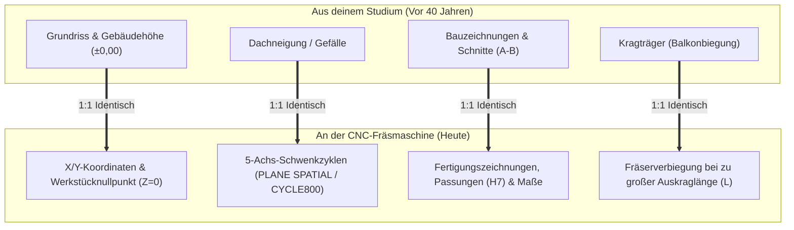
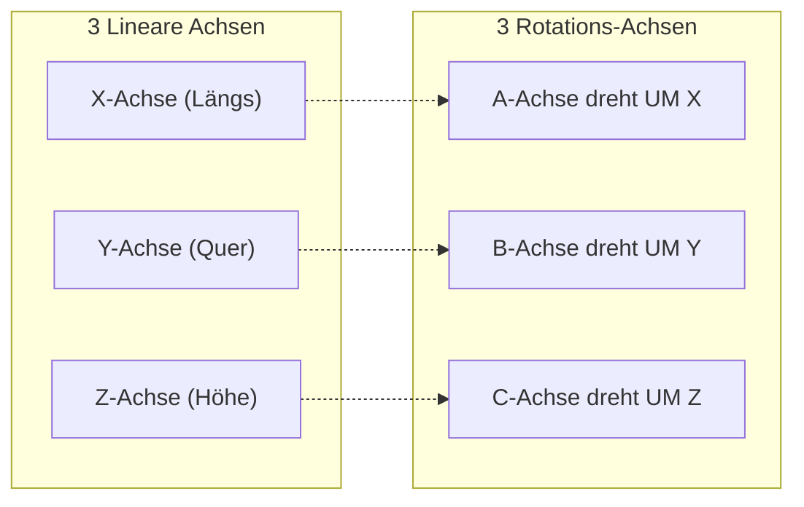
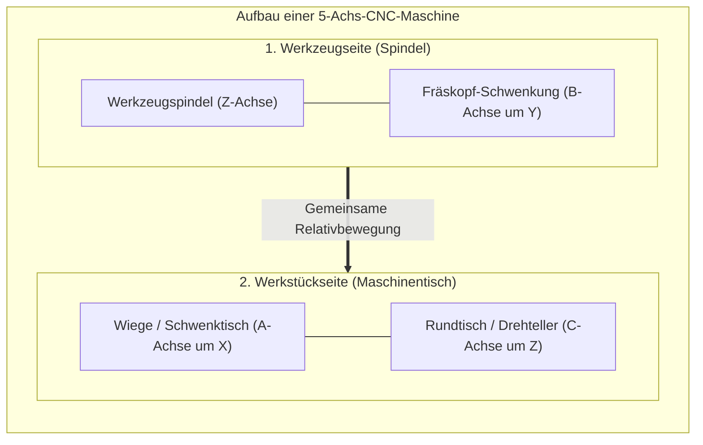
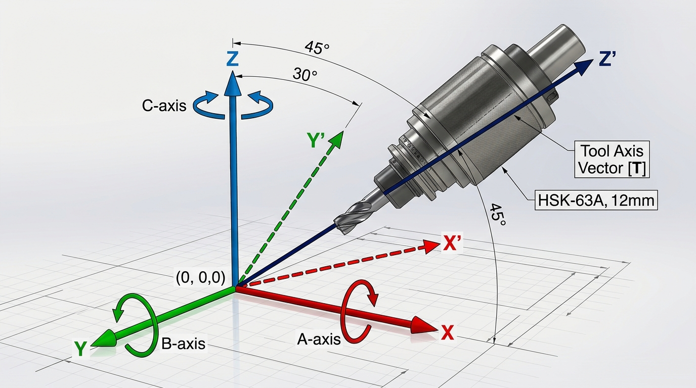
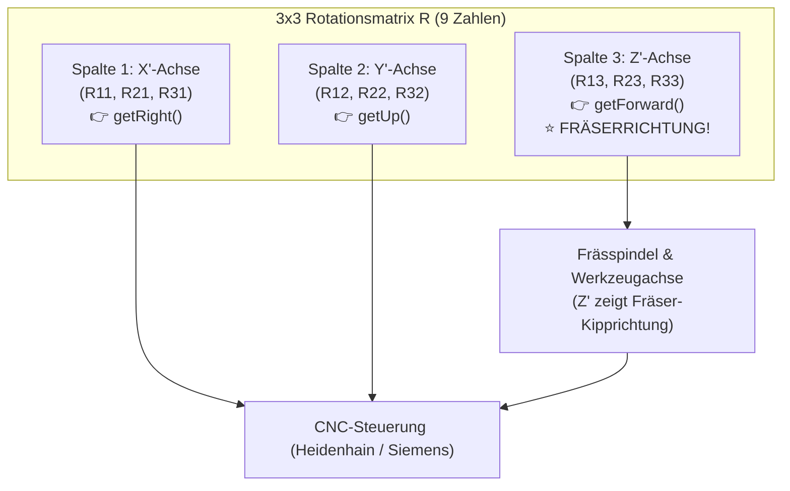

# Was du aus dem Bauingenieurwesen für CNC & CAM wirklich brauchst (Die 4 simplen Brücken)

Du hast vor 40 Jahren Bauingenieurwesen in Moskau studiert und diesen Beruf seitdem nicht mehr ausgeübt? **Das ist überhaupt kein Problem und völlig normal!**

Dieses Dokument nimmt dir jede Sorge und zeigt dir klipp und klar:
1. Was du aus dem Bauwesen **zu 100 % vergessen kannst** *(weil es an der Fräsmaschine niemanden interessiert)*.
2. Welche **4 einzigen simplen Grundgedanken** aus deinem Studium dir an der CNC-Fräse und im Postprozessor automatisch einen riesigen Vorsprung geben – ganz ohne Formeln oder Lehrbücher!

---

## 🧭 Inhaltsverzeichnis

1. [Die große Erleichterung: Was du zu 100 % vergessen kannst](#1-die-große-erleichterung-was-du-zu-100--vergessen-kannst)
2. [Die 4 simplen Brücken: Bauingenieurwesen $\rightarrow$ CNC-Fräsen](#2-die-4-simplen-brücken-bauingenieurwesen-rightarrow-cnc-fräsen)
   - [Brücke 1: Grundriss & Höhenkoten $\rightarrow$ Das 3D-Koordinatensystem (X, Y, Z)](#brücke-1-grundriss--höhenkoten-rightarrow-das-3d-koordinatensystem-x-y-z)
   - [Brücke 2: Dachschrägen & Rampen $\rightarrow$ 5-Achs-Schwenkebenen (PLANE SPATIAL / CYCLE800)](#brücke-2-dachschrägen--rampen-rightarrow-5-achs-schwenkebenen-plane-spatial--cycle800)
   - [Brücke 3: Baupläne & Schnitte lesen $\rightarrow$ Technische Zeichnungen & Toleranzen](#brücke-3-baupläne--schnitte-lesen-rightarrow-technische-zeichnungen--toleranzen)
   - [Brücke 4: Der Kragträger (Balkon) $\rightarrow$ Warum Fräser vibrieren oder abbrechen](#brücke-4-der-kragträger-balkon-rightarrow-warum-fräser-vibrieren-oder-abbrechen)
3. [Was hat dein Bauingenieur-Diplom mit Postprozessoren zu tun? (Die 10 % Ingenieur-Anteil im Detail)](#3-was-hat-dein-bauingenieur-diplom-mit-postprozessoren-zu-tun)
   - [3.1 Die logische Verknüpfung der Raumachsen: X, Y, Z und die Drehachsen A, B, C (DIN 66217)](#31-die-logische-verknüpfung-der-raumachsen-x-y-z-und-die-drehachsen-a-b-c-din-66217)
   - [3.2 Was ist eine Rotationsmatrix – und warum musst du sie NICHT von Hand rechnen?](#32-was-ist-eine-rotationsmatrix--und-warum-musst-du-sie-nicht-von-hand-rechnen)
   - [3.3 Wie das CAM-System die Vektoren liefert (forward.x, forward.y, forward.z)](#33-wie-das-cam-system-die-vektoren-liefert-forwardx-forwardy-forwardz)
   - [3.4 Die Übersetzung in Maschinencode: Die zwei Wege (Heidenhain vs. Siemens)](#34-die-übersetzung-in-maschinencode-die-zwei-wege-heidenhain-vs-siemens)
   - [3.5 Konkreter JavaScript-Code aus der Praxis (Auszug aus einer .cps-Datei)](#35-konkreter-javascript-code-aus-der-praxis-auszug-aus-einer-cps-datei)
4. [Direkter Begriffsvergleich: Baustelle vs. CNC-Maschine](#4-direkter-begriffsvergleich-baustelle-vs-cnc-maschine)
5. [Fazit: Dein Diplom für die Behörden – 4 simple Regeln für die Praxis](#5-fazit-dein-diplom-für-die-behörden--4-simple-regeln-für-die-praxis)

---

## 1. Die große Erleichterung: Was du zu 100 % vergessen kannst

Niemand in der Fertigungsindustrie erwartet von dir, dass du Betonmischungen berechnest oder Häuser planst. Folgende Dinge aus deinem Studium kannst du für CNC und CAM **vollständig aus deinem Gedächtnis streichen**:

* ❌ **Beton- und Stahlbetonbau *(Bewehrungspläne, Rissbreiten, Zementklassen)***: Brauchst du an einer Fräsmaschine zu 0,0 %.
* ❌ **Erd- und Grundbau *(Bodenmechanik, Setzungen, Fundamente, Pfahlgründungen)***: Brauchst du zu 0,0 %.
* ❌ **Bauphysik & Baurecht *(Wärmedämmung, Schallschutz, Brandschutz, Bauanträge)***: Brauchst du zu 0,0 %.
* ❌ **Schnee- und Windlasten nach Baunormen**: Brauchst du zu 0,0 %.

**Warum war dein Diplom dann trotzdem so wichtig?**
Weil dein offiziell in Deutschland anerkanntes Diplom beim **Finanzamt Hanau** der juristische Schlüssel ist, damit du als **Freiberufler nach § 18 EStG ohne Gewerbesteuer und ohne IHK** anerkannt bist! Für deine praktische Arbeit am PC brauchst du jedoch nur die folgenden 4 intuitiven Grundkonzepte.

---

## 2. Die 4 simplen Brücken: Bauingenieurwesen $\rightarrow$ CNC-Fräsen

Alles, was du an einer Fräsmaschine machst, ist im Grunde **ein winziges Gebäude aus Metall**, das von oben nach unten abgetragen wird:



---

### Brücke 1: Grundriss & Höhenkoten $\rightarrow$ Das 3D-Koordinatensystem (X, Y, Z)

Jeder Bauingenieur hat hunderte Male mit Koordinaten gearbeitet:

* **Auf der Baustelle:**
  * Der **Grundriss** eines Hauses hat eine Länge *(X-Richtung)* und eine Breite *(Y-Richtung)*.
  * Die **Höhe** *(Z-Richtung)* wird über eine Höhenkote gemessen: Der fertige Fußboden im Erdgeschoss ist **$\pm 0,00$**. Geht es nach oben in den 1. Stock, ist es positiv ($+2,80\,\text{m}$). Geht es nach unten in den Keller, ist es negativ ($-2,50\,\text{m}$).
* **An der CNC-Fräsmaschine:**
  * Genau dasselbe! Der Maschinentisch hat eine Länge *(Achse X)* und eine Tiefe *(Achse Y)*.
  * Die **Oberkante des Metallblocks** wird im CAM als **$Z = 0,00$ *(Werkstücknullpunkt `G54`)*** festgelegt.
  * Solange der Fräser in der Luft über dem Metall schwebt, sind die Werte positiv *(z. B. $Z+5,0\,\text{mm}$ als Sicherheitsabstand)*.
  * Taucht der Fräser ins Metall ein, um eine Tasche zu fräsen, werden die Z-Werte negativ *(z. B. $Z-15,0\,\text{mm}$)*!
* **Dein Vorteil:** Du musst kein räumliches Koordinatensystem neu lernen – du hast dieses Achsensystem seit deinem ersten Studientag im Blut!

---

### Brücke 2: Dachschrägen & Rampen $\rightarrow$ 5-Achs-Schwenkebenen (PLANE SPATIAL / CYCLE800)

Wenn eine moderne 5-Achs-Fräsmaschine ein Bauteil von der Seite oder schräg bearbeiten soll:

* **Auf der Baustelle:**
  * Ein Walmdach oder eine Parkhausrampe steht schräg im Raum. Um die Sparrenlänge oder das Gefälle zu berechnen, kippt man das Bezugssystem gedanklich in den Neigungswinkel des Daches.
* **An der CNC-Fräsmaschine:**
  * Wenn an einem Aluminiumblock eine schräge Bohrung mit $30^\circ$ Winkel angebracht werden soll, muss die Frässpindel oder der Maschinentisch um $30^\circ$ gekippt werden.
  * Die Steuerung macht das über einen einzigen Befehl:
    * Bei **Heidenhain**: `PLANE SPATIAL SPA+0 SPB+30 SPC+0 TURN FMAX`
    * Bei **Siemens**: `CYCLE800(..., 0, 30, 0, ...)`
* **Dein Vorteil:** Du verstehst sofort, dass ein Raumwinkel einfach nur aus drei Drehungen um die Raumachsen $X, Y, Z$ besteht. Du musst diesen Winkel nicht von Hand ausrechnen – das CAM-System berechnet die Zahlen, aber du verstehst auf den ersten Blick, was die Maschine da gerade tut!

---

### Brücke 3: Baupläne & Schnitte lesen $\rightarrow$ Technische Zeichnungen & Toleranzen

* **Auf der Baustelle:**
  * Du hast Baupläne gelesen mit Grundrissen, Seitenansichten und Schnittdarstellungen *(Schnitt A-A / Schnitt B-B)*. Du weißt, dass eine gestrichelte Linie eine verdeckte Kante ist und dass Schraffuren geschnittenes Material darstellen.
* **An der CNC-Fräsmaschine:**
  * Eine Maschinenbauzeichnung sieht zu 90 % genauso aus! Sie zeigt das Bauteil von oben, von vorne und im Schnitt *(Schnitt A-B)*, um zu zeigen, wie tief eine Bohrung ist.
  * **Der einzige kleine Unterschied:**
    * Auf dem Bau misst man in **Metern und Zentimetern** *(Toleranz: $\pm 1\,\text{cm}$)*.
    * Im Maschinenbau misst man in **Millimetern** *(Toleranz: oft $\pm 0,05\,\text{mm}$ oder bei einer Passung wie $\varnothing\,20\,\text{H7}$ im Bereich von $+0,02\,\text{mm}$)*.
* **Dein Vorteil:** Du kannst Zeichnungen und Schnitte bereits perfekt lesen. Du musst dich nur daran gewöhnen, dass die Maßeinheit immer Millimeter ($\text{mm}$) ist.

---

### Brücke 4: Der Kragträger (Balkon) $\rightarrow$ Warum Fräser vibrieren oder abbrechen

In der Technischen Mechanik hat jeder Bauingenieur die klassische **Balkentheorie *(Kragarm / einseitig eingespannter Träger)*** gelernt:

* **Im Bauwesen:**
  * Ein Balkon ist an der Hauswand fest eingespannt und ragt frei in die Luft hinaus *(Kragträger)*.
  * Je länger der Balkon nach vorne ragt, desto stärker biegt er sich durch, wenn Menschen darauf stehen. Die Durchbiegung $f$ steigt mit der **dritten Potenz der Länge ($L^3$)**! Ein doppelt so langer Balkon biegt sich bei gleicher Last $2^3 = \mathbf{8\text{-mal stärker}}$ durch!
* **An der CNC-Fräsmaschine:**
  * **Ein Fräser im Spannfutter ist exakt ein Kragträger!**
  * Das Spannfutter ist die Hauswand *(feste Einspannung)*. Der Fräser ist der Kragarm, der herausragt *(Auskraglänge $L$)*.
  * Die Schnittkraft des Metalls drückt seitlich auf die Fräserspitze.
  * **Was das für deine CAM-Praxis bedeutet:**
    * Ragt der Fräser nur $30\,\text{mm}$ aus dem Futter heraus, ist er extrem steif und fräst leise und maßgenau.
    * Ragt er unnötig $60\,\text{mm}$ heraus *(doppelte Länge!)*, biegt er sich **8-mal stärker** durch. Die Folge: Der Fräser fängt an laut zu kreischen *(Rattern)*, hinterlässt Rillen im Metall oder bricht mit lautem Knall ab!
* **Deine Faustregel als Ingenieur:**
  Spanne jeden Fräser immer **so kurz wie möglich und nur so lang wie nötig** ein!

---

## 3. Was hat dein Bauingenieur-Diplom mit Postprozessoren zu tun? (Die 10 % Ingenieur-Anteil im Detail)

Viele fragen sich am Anfang: *„Brauche ich für das Programmieren eines Postprozessors in JavaScript mathematisches Spezialwissen aus dem Bauingenieurwesen?“*

Die ehrliche Antwort lautet: **Zu 90 % brauchst du dafür deine Berufserfahrung als Senior Software Engineer!**
* Ein Postprozessor ist im Kern ein reiner **Software-Compiler / Transpiler**: Du verarbeitest Objekte, Strings, Arrays, Schleifen (`for/while`), Bedingungen (`if/else`) und formatierst Zeilen für eine Textdatei. Das machst du als Softwareentwickler bei der **Zollcon GmbH** jeden Tag im Schlaf!
* **Die verbleibenden 10 % sind die Verbindung zur Raumgeometrie**, die du aus deinem Studium kennst:
  1. Die **logische Zuordnung der Raumachsen** *(X, Y, Z zu den Drehachsen A, B, C nach DIN 66217)*.
  2. Das **Verständnis von Rotationsmatrizen & Richtungsvektoren** *(wie ein 3D-Vektor im Raum gekippt wird)*.

Hier ist genau erklärt, wie diese 10 % funktionieren – und warum du **keine einzige Formel von Hand ausrechnen musst**, weil das CAM-System die Vektoren bereits mundgerecht serviert:

---

### 3.1 Die logische Verknüpfung der Raumachsen: X, Y, Z und die Drehachsen A, B, C (DIN 66217)

Jede Werkzeugmaschine auf der Welt folgt der internationalen Norm **DIN 66217 *(Koordinatenachsen und Bewegungsrichtungen für numerisch gesteuerte Werkzeugmaschinen)***.

Die Zuordnung ist genial einfach nach dem Alphabet aufgebaut:

| Linearachse *(Geradlinige Bewegung)* | Zugehörige Drehachse *(Rotation)* | Wie man sich die Drehung ganz einfach vorstellt |
| :---: | :---: | :--- |
| **X-Achse** *(Links $\leftrightarrow$ Rechts)* | **A-Achse** *(Drehung um X)* | Wie ein Grillhähnchen-Spieß: Die Achse verläuft von links nach rechts, und das Werkstück dreht sich um diese Längsachse vor und zurück. |
| **Y-Achse** *(Vor $\leftrightarrow$ Zurück)* | **B-Achse** *(Drehung um Y)* | Wie eine Schaukel oder Wippe: Die Achse verläuft von vorne nach hinten, und der Tisch oder Fräskopf kippt nach links oder rechts. |
| **Z-Achse** *(Oben $\leftrightarrow$ Unten)* | **C-Achse** *(Drehung um Z)* | Wie ein Karussell, ein Plattenspieler oder der Schraubverschluss einer Flasche: Eine horizontale Drehscheibe rotiert um die senkrechte Z-Achse! |



* **Die Rechte-Hand-Regel *(Korkenzieher-Regel)***:
  * Nimm deine rechte Hand:
    * Daumen = **X** (zeigt nach rechts)
    * Zeigefinger = **Y** (zeigt nach vorne/oben)
    * Mittelfinger = **Z** (zeigt senkrecht nach oben)
  * Die positive Drehrichtung ($+A, +B, +C$) ist immer die Richtung, in die sich die Finger krümmen, wenn der Daumen in positive Achsrichtung zeigt *(Rechtsgewinde)*.



---

### 3.2 Was ist eine Rotationsmatrix – und wie funktioniert sie mit Sinus und Kosinus? (Das Geheimnis einfach gelüftet)

In deinem Moskauer Grundstudium vor 40 Jahren hast du in der Höheren Mathematik *(Lineare Algebra)* gelernt, wie man eine $3 \times 3$ Rotationsmatrix $\mathbf{R}$ aufstellt:

$$\mathbf{R} = \begin{pmatrix} R_{11} & R_{12} & R_{13} \\ R_{21} & R_{22} & R_{23} \\ R_{31} & R_{32} & R_{33} \end{pmatrix}$$

Viele empfinden Matrizen als trockenes Zahlengrab. Doch sobald man versteht, **was diese 9 Zahlen in der physischen Realität an einer Werkzeugmaschine bedeuten**, macht es sofort *„Klick“*:

#### 1. Der größte Aha-Effekt: Eine Matrix besteht einfach aus 3 Richtungsvektoren!


*Abbildung: 5-Achs-Koordinatentransformation. Das Referenz-Koordinatensystem (X, Y, Z) mit den Rotationsachsen A (um X), B (um Y) und C (um Z). Das transformierte Koordinatensystem (X', Y', Z') definiert die 3 Spalten der Rotationsmatrix R – wobei die Z'-Achse exakt die Werkzeugachse (den `forward`-Vektor) der Frässpindel darstellt!*

Eine $3 \times 3$ Rotationsmatrix ist kein Hexenwerk, sondern einfach nur eine Tabelle, in der die **drei neuen Raumachsen nebeneinander als Spalten** aufgeschrieben sind:

$$\mathbf{R} = \begin{pmatrix} \mathbf{X}' & \mathbf{Y}' & \mathbf{Z}' \end{pmatrix} = \begin{pmatrix} 
\color{blue}{X'_x} & \color{green}{Y'_x} & \color{red}{Z'_x} \\ 
\color{blue}{X'_y} & \color{green}{Y'_y} & \color{red}{Z'_y} \\ 
\color{blue}{X'_z} & \color{green}{Y'_z} & \color{red}{Z'_z} 
\end{pmatrix}$$

* **Spalte 1 *(blau: $R_{11}, R_{21}, R_{31}$)***: Zeigt, wohin die **neue X-Achse** im Raum zeigt.
* **Spalte 2 *(grün: $R_{12}, R_{22}, R_{32}$)***: Zeigt, wohin die **neue Y-Achse** im Raum zeigt.
* **Spalte 3 *(rot: $R_{13}, R_{23}, R_{33}$)***: **Das ist die Fräserachse!** Sie zeigt exakt, in welche Richtung der Fräser zielt *(genau das ist dein Vektor `forward`)*!



#### 2. Woher kommen Sinus ($\sin$) und Kosinus ($\cos$)?
Wenn sich eine Achse im Kreis um einen Winkel $\alpha$ dreht, beschreibt jede Spitze eines Einheitszeigers einen Kreis. Aus der Trigonometrie am Einheitskreis weißt du:
* Der **Kosinus $\cos(\alpha)$** gibt die Projektion auf die ursprüngliche Achse an *(wie viel von der alten Richtung bleibt erhalten)*.
* Der **Sinus $\sin(\alpha)$** gibt den Ausschlag in die um $90^\circ$ versetzte Achse an.

Hier sind die drei elementaren Grunddrehungen, die du damals hergeleitet hast:

##### A) Drehung um die Z-Achse *(C-Achse / horizontaler Drehtisch) um den Winkel $\gamma$*:
Die Z-Achse ändert sich nicht *(bleibt $0, 0, 1$)*. Die Drehung findet nur in der X-Y-Ebene statt:
$$\mathbf{R}_z(\gamma) = \begin{pmatrix} 
\cos\gamma & -\sin\gamma & 0 \\ 
\sin\gamma & \cos\gamma & 0 \\ 
0 & 0 & 1 
\end{pmatrix}$$

##### B) Drehung um die Y-Achse *(B-Achse / Schwenkkopf) um den Winkel $\beta$*:
Die Y-Achse ändert sich nicht *(bleibt $0, 1, 0$)*. X und Z drehen sich:
$$\mathbf{R}_y(\beta) = \begin{pmatrix} 
\cos\beta & 0 & \sin\beta \\ 
0 & 1 & 0 \\ 
-\sin\beta & 0 & \cos\beta 
\end{pmatrix}$$

##### C) Drehung um die X-Achse *(A-Achse / Wiege) um den Winkel $\alpha$*:
Die X-Achse ändert sich nicht *(bleibt $1, 0, 0$)*. Y und Z drehen sich:
$$\mathbf{R}_x(\alpha) = \begin{pmatrix} 
1 & 0 & 0 \\ 
0 & \cos\alpha & -\sin\alpha \\ 
0 & \sin\alpha & \cos\alpha 
\end{pmatrix}$$

#### 3. Ein kinderleichtes Rechenbeispiel: Drehung um die Z-Achse um $90^\circ$
Nehmen wir an, der Rundtisch deiner CNC-Maschine dreht sich um **$90^\circ$ nach links** *(Winkel $\gamma = 90^\circ$)*:
* Aus der Schule wissen wir: $\cos(90^\circ) = 0$ und $\sin(90^\circ) = 1$.
* Setzen wir das in die Matrix $\mathbf{R}_z$ ein:
  $$\mathbf{R}_z(90^\circ) = \begin{pmatrix} 
  0 & -1 & 0 \\ 
  1 & 0 & 0 \\ 
  0 & 0 & 1 
  \end{pmatrix}$$
* **Schau dir die Spalten an – es ist völlig logisch:**
  * **Spalte 1:** Der neue X-Vektor ist $(0, 1, 0)$ $\rightarrow$ Die X-Achse zeigt jetzt dorthin, wo vorher die positive Y-Achse war!
  * **Spalte 2:** Der neue Y-Vektor ist $(-1, 0, 0)$ $\rightarrow$ Die Y-Achse zeigt jetzt nach links ins Negative!
  * **Spalte 3:** Der Z-Vektor ist $(0, 0, 1)$ $\rightarrow$ Der Fräser steht unverändert senkrecht nach oben.

#### 4. Die Gesamtdrehung im Raum: Matrizenmultiplikation
Wenn eine 5-Achs-Maschine sowohl um B schwenkt als auch um C dreht, multipliziert man die Matrizen einfach hintereinander:
$$\mathbf{R} = \mathbf{R}_z(\gamma) \cdot \mathbf{R}_y(\beta) \cdot \mathbf{R}_x(\alpha)$$

* **Früher vor 40 Jahren:** Hast du das auf Rechenpapier Zeile mal Spalte gerechnet – 27 Multiplikationen und Additionen, bei denen man sich leicht um ein Vorzeichen verrechnete.
* **Heute im CAM-System & Postprozessor:**
  * Das CAM-System führt diese Matrizenmultiplikation **in 0,0001 Sekunden intern aus**.
  * Die **3. Spalte dieser fertigen Matrix** ist genau das, was das CAM-System dir in JavaScript als Vektor übergibt:
    ```javascript
    var forward = currentSection.workPlane.getForward();
    // forward.x = R[0][2]
    // forward.y = R[1][2]
    // forward.z = R[2][2]
    ```
  * Du musst also nicht mehr rechnen – aber du **verstehst jetzt glasklar, woher diese Zahlen kommen**: Sie sind einfach die Projektionen des Fräsers im Raum über Sinus und Kosinus!

---

### 3.3 Wie das CAM-System die Vektoren liefert: `forward.x`, `forward.y`, `forward.z`

In der JavaScript-Programmierschnittstelle *(CAM-API)* deines Postprozessors liefert dir das CAM-System für jede Bearbeitungsoperation *(Section)* ein fertiges Ebenen-Objekt namens **`currentSection.workPlane`**.

Aus diesem Objekt holst du dir mit einem einzigen Befehl den **Richtungsvektor der Werkzeugachse *(Tool Vector / Normalenvektor)***:

```javascript
// Im JavaScript-Postprozessor:
var forward = currentSection.workPlane.getForward();
```

Was steckt in diesem `forward`-Vektor? Es sind einfach **drei Zahlen**, die die Richtung des Fräsers im 3D-Raum beschreiben *(als Einheitsvektor mit der Länge $1,0$)*:

* **Fall 1: Normale Standard-Bearbeitung von oben:**
  * Der Fräser steht senkrecht nach unten in Z:
  * `forward.x = 0.0`
  * `forward.y = 0.0`
  * `forward.z = 1.0`
  * *(Bedeutet: Null Grad Schwenkung – Standard 3-Achs-Fräsen!)*
* **Fall 2: Schräge Bohrung oder geschwenkte Tasche:**
  * Wenn der Fräser z. B. um $45^\circ$ zur Y-Achse gekippt ist:
  * `forward.x = 0.0`
  * `forward.y = 0.7071`  *(weil $\sin(45^\circ) \approx 0,7071$)*
  * `forward.z = 0.7071`  *(weil $\cos(45^\circ) \approx 0,7071$)*

Du siehst: Das CAM-System hat die trigonometrische Rechnung längst für dich erledigt! Du hast die drei fertigen Zahlen `forward.x`, `forward.y` und `forward.z` direkt als Variablen in JavaScript griffbereit.

---

### 3.4 Die Übersetzung in Maschinencode: Die zwei Wege (Heidenhain vs. Siemens)

Deine eigentliche Ingenieuraufgabe als Postprozessor-Entwickler besteht nun nur noch darin, diese Vektoren in den **richtigen Befehlssatz der jeweiligen CNC-Steuerung** zu übersetzen.

Dafür gibt es in der Praxis zwei Wege:

#### Weg A: Die Steuerung rechnet selbst über Raumwinkel (Eulersche Winkel)
Die meisten modernen CNC-Steuerungen *(Heidenhain TNC 640 / TNC7 oder Siemens Sinumerik 840D / ONE)* wollen gar keine Vektoren sehen, sondern **drei einfache Raum-Drehwinkel *(Euler-Winkel um X, Y und Z)***:

1. **Wie dein Postprozessor das in JavaScript löst:**
   Das CAM-System hat dafür eine eingebaute Konvertierungsfunktion:
   ```javascript
   var abc = currentSection.workPlane.toABC(); 
   // Liefert z. B.: abc.x = 15.0°, abc.y = 30.0°, abc.z = 0.0°
   ```
2. **Was dein Postprozessor daraus in den Maschinencode schreibt:**
   * **Für Heidenhain Klartext:**
     `PLANE SPATIAL SPA+15.000 SPB+30.000 SPC+0.000 TURN FMAX SEQ-`
   * **Für Siemens Sinumerik:**
     `CYCLE800(4, "TABLE", 200000, 57, 0, 0, 0, 15.0, 30.0, 0.0, 0, 0, 0, -1, 1)`

Die CNC-Maschine liest diesen Satz, verrechnet ihren Schwenkrundtisch vollautomatisch und schwenkt die Achsen mit Eilganggeschwindigkeit millimetergenau in Position!

#### Weg B: Direkte Vektorausgabe (Bei 5-Achs-Simultanbearbeitung)
Wenn sich der Fräser während des Schnitts kontinuierlich im Raum dreht *(z. B. beim Schlichten einer Turbinenschaufel oder eines Impellers)*, übergibt dein Postprozessor bei jeder Bewegung neben den Koordinaten $X, Y, Z$ direkt den **Richtungsvektor des Fräsers**:

* **Bei Heidenhain (mit `FUNCTION TCPM`):**
  `L X+120.450 Y+35.200 Z+14.800 TX+0.0000 TY+0.7071 TZ+0.7071 F1500`
  *(Hier stehen `TX, TY, TZ` direkt für deine Vektoren `forward.x, forward.y, forward.z`!)*
* **Bei Siemens Sinumerik (mit `TRAORI`):**
  `N105 X120.450 Y35.200 Z14.800 A3=0.0000 B3=0.7071 C3=0.7071 F1500`
  *(Hier stehen `A3, B3, C3` für den Vektor der Werkzeugorientierung!)*

---

### 3.5 Konkreter JavaScript-Code aus der Praxis (Auszug aus einer `.cps`-Datei)

Damit du als Software Engineer siehst, wie einfach dieser Code in deiner Postprozessor-Datei aussieht, hier ein echter Auszug aus der Funktion `onSection()`:

```javascript
function onSection() {
    // 1. Prüfen, ob diese Operation geschwenkt ist (mehr als 3 Achsen)
    if (currentSection.isMultiAxis()) {
        // 5-Achs-Simultan: Vektormodus aktivieren
        writeBlock("FUNCTION TCPM F CONT RST AXIS SPATIAL PATHCTRL VECTOR");
    } else if (!currentSection.workPlane.isXY()) {
        // 3+2-Achsen angestellt: Wir holen uns den Richtungsvektor
        var forward = currentSection.workPlane.getForward();
        
        // Das CAM berechnet für uns die Euler-Winkel SPA, SPB, SPC
        var eulerAngles = currentSection.workPlane.toABC();
        
        // Ausgabe des perfekten Heidenhain-Schwenksatzes in die NC-Datei:
        writeBlock(
            "PLANE SPATIAL" +
            " SPA" + spatialFormat.format(eulerAngles.x) +
            " SPB" + spatialFormat.format(eulerAngles.y) +
            " SPC" + spatialFormat.format(eulerAngles.z) +
            " TURN FMAX SEQ-"
        );
    } else {
        // Standard 3-Achsen: Keine Drehung nötig
        writeBlock("PLANE RESET TURN FMAX");
    }
}
```

**Erkennst du, wie vertraut sich das anfühlt?**
* Das ist zu **95 % klassisches Software Engineering**: Eine `if`-Bedingung, Methodenaufrufe und String-Formatierung!
* Die restlichen **5 % sind dein geometrisches Verständnis** dafür, dass ein Vektor im Raum gekippt wurde.

Du musst also weder Matrizen von Hand auf Papier multiplizieren noch Winkel mit dem Zirkel konstruieren – **dein Studium gibt dir das intuitive Verständnis für den Raum, und deine Software-Erfahrung schreibt den sauberen Code!**

---

---

## 4. Direkter Begriffsvergleich: Baustelle vs. CNC-Maschine

Hier siehst du, wie einfach sich deine alten Bau-Begriffe in die moderne CNC-Welt übersetzen:

| Begriff im Bauingenieurwesen | Begriff an der CNC-Fräsmaschine | Was es in der Praxis bedeutet |
| :--- | :--- | :--- |
| **Höhenkote $\pm 0,00$ *(Oberkante Fertigfußboden)*** | **Werkstücknullpunkt $Z = 0$ (`G54`)** | Die Oberseite des Metallrohteils. Alles darunter ist negativ (z. B. $Z-10$). |
| **Baugrundstück / Aushubgrenze** | **Rohteilmaße *(Stock / Blank Size)*** | Der rohe Metallblock, aus dem das Bauteil herausgefräst wird. |
| **Baugrube ausbaggern** | **Schruppen / Taschenräumen *(Roughing / Clearing)*** | Viel Material schnell mit einem dicken Fräser wegschaufeln. |
| **Verputzen & Fein-Estrich** | **Schlichten *(Finishing)*** | Mit einem feinen Fräser die letzten 0,2 mm für eine glatte Oberfläche abtragen. |
| **Dachneigungswinkel** | **Schwenkwinkel ($A, B, C$)** | Neigung des Tisches oder des Fräskopfes im Raum für 5-Achs-Bearbeitung. |
| **Kragträger (Balkon) Durchbiegung** | **Werkzeug-Auskraglänge ($L$) & Biegung** | Je kürzer der Fräser eingespannt ist, desto stabiler und vibrationsfreier läuft er. |
| **Bautoleranz ($\pm 1\,\text{cm}$)** | **Fertigungstoleranz ($\pm 0,05\,\text{mm}$ oder H7)** | Exakt dasselbe Prinzip, nur tausendmal feiner in Millimetern. |

---

## 5. Fazit: Dein Diplom für die Behörden – 4 simple Regeln für die Praxis

Du musst dir absolut keine Vorwürfe machen oder Angst haben, weil dein Studium 40 Jahre her ist:

1. **Gegenüber Finanzamt & Behörden:** Dein Diplom ist dein **juristischer Freifahrtschein**, um als **Freiberufler ohne Gewerbesteuer** eingestuft zu werden. Ob du die letzten 40 Jahre als Bauingenieur oder Softwareentwickler gearbeitet hast, ist dem Steuerrecht völlig egal!
2. **Gegenüber deinen CAM-Kunden:** Du musst keine Häuser berechnen. Deine Kunden wollen von dir saubere Fräsbahnen, crashfreie Schwenkwinkel und funktionierende Postprozessoren.
3. **Für deine tägliche Arbeit:** Du brauchst aus deinem Studium nur:
   * Das **3D-Koordinatensystem** *(X, Y, Z)*.
   * Das **Lesen von Schnitten und Maßen** auf der Zeichnung.
   * Den **gesunden Ingenieurverstand für Biegung** *(Fräser kurz einspannen)*.

Alles andere erledigen dein CAM-System *(Autodesk Fusion)*, die kostenlosen Schnittdaten-Rechner *(ToolScout)* und deine **4 KI-Agenten** vollautomatisch für dich!

---

*Dieses Dokument gehört zum Basis-Wissenspaket deines CAM-Ingenieurbüros und ergänzt den Hauptleitfaden [CAM_Nebentaetigkeit_und_Gewerbe_Leitfaden.md](file:///C:/Projekte/CNC/CAM_Nebentaetigkeit_und_Gewerbe_Leitfaden.md) sowie den [FRAESER_UND_BOHRER_PRAXISGUIDE.md](file:///C:/Projekte/CNC/FRAESER_UND_BOHRER_PRAXISGUIDE.md).*
