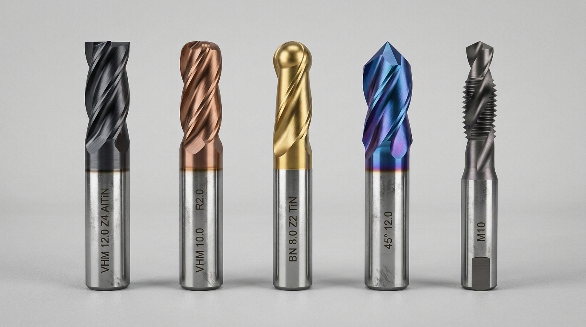
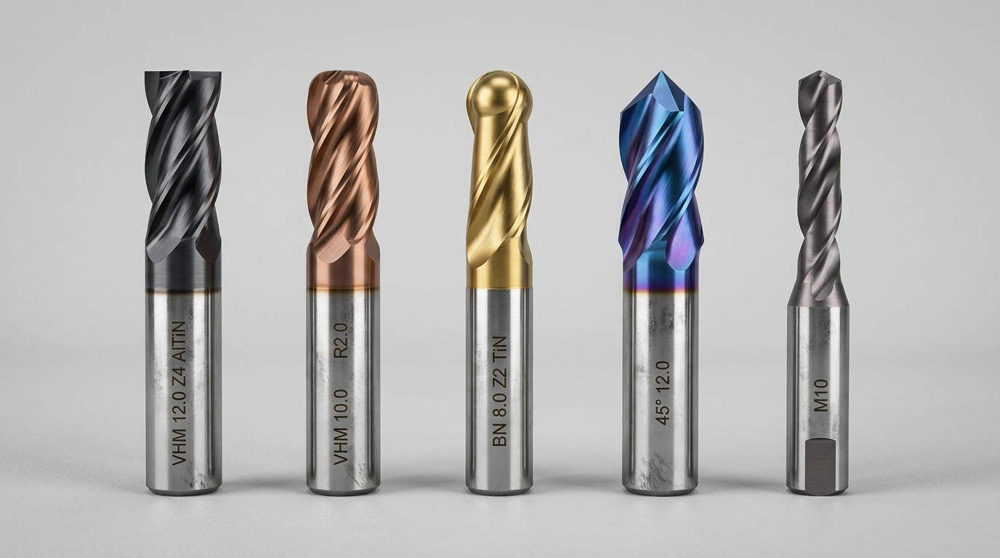
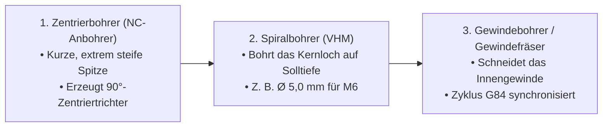

# Werkzeugkunde für CAM- & CNC-Spezialisten: Fräser und Bohrer einfach und praxisnah erklärt

Dieses Dokument erklärt alle praxisrelevanten Grundlagen über **Fräser *(rotierende Zerspanungswerkzeuge mit geometrisch bestimmten Schneiden zur spanenden Bearbeitung von Konturen, Flächen und Taschen)*** und **Bohrer *(rotierende Werkzeuge zur Erzeugung kreisrunder Bohrungen und Gewinde)*** speziell aus der Sicht eines **CAM-Programmierers *(Programmierer für rechnergestützte Fertigung)*** und **Postprozessor-Entwicklers**.

---

## 🧭 Inhaltsverzeichnis

1. **Abschnitt 1:** [Warum Fräser und Bohrer im CAM viel einfacher sind als gedacht](#1-warum-fräser-und-bohrer-im-cam-viel-einfacher-sind-als-gedacht)
2. **Abschnitt 2:** [Übersicht & Bildervergleich: Die 5 wichtigsten Fräser-Typen](#2-übersicht--bildervergleich-die-5-wichtigsten-fräser-typen)
   - 2.1 [Schaftfräser *(Flat End Mill – Der Universalkünstler)*](#21-schaftfräser-flat-end-mill--der-universalkünstler)
   - 2.2 [Torusfräser / Eckenradiusfräser *(Bull Nose Mill – Der Dauerläufer)*](#22-torusfräser--eckenradiusfräser-bull-nose-mill--der-dauerläufer)
   - 2.3 [Vollkugelfräser *(Ball Nose Mill – Der 3D-Künstler)*](#23-vollkugelfräser-ball-nose-mill--der-3d-künstler)
   - 2.4 [Fasenfräser *(Chamfer Mill – Der Saubermann zum Entgraten)*](#24-fasenfräser-chamfer-mill--der-saubermann-zum-entgraten)
   - 2.5 [Planfräskopf / Messerkopf *(Face Mill – Der Abräumer)*](#25-planfräskopf--messerkopf-face-mill--der-abräumer)
3. **Abschnitt 3:** [Die 3 Bohrwerkzeuge: Vom Zentrieren bis zum fertigen Gewinde](#3-die-3-bohrwerkzeuge-vom-zentrieren-bis-zum-fertigen-gewinde)
   - 3.1 [Zentrierbohrer / NC-Anbohrer *(Vermeidung von Verlaufen)*](#31-zentrierbohrer--nc-anbohrer-vermeidung-von-verlaufen)
   - 3.2 [Spiralbohrer / VHM-Bohrer *(Kernlochbohrung)*](#32-spiralbohrer--vhm-bohrer-kernlochbohrung)
   - 3.3 [Gewindebohrer vs. Gewindefräser *(Gewindeschneiden mit G84 vs. Zirkularfräsen)*](#33-gewindebohrer-vs-gewindefräser-gewindeschneiden-mit-g84-vs-zirkularfräsen)
4. **Abschnitt 4:** [Die 4 magischen Schnittdaten-Werte: Was bedeuten sie und woher kommen sie?](#4-die-4-magischen-schnittdaten-werte-was-bedeuten-sie-und-woher-kommen-sie)
   - 4.1 [Spindeldrehzahl $S$, Vorschub $F$, Schnitttiefe $a_p$ und Schnittbreite $a_e$](#41-spindeldrehzahl-s-vorschub-f-schnitttiefe-a_p-und-schnittbreite-a_e)
   - 4.2 [Niemand rechnet mehr im Kopf: Kostenlose digitale Schnittdaten-Rechner (ToolScout & Walter GPS)](#42-niemand-rechnet-mehr-im-kopf-kostenlose-digitale-schnittdaten-rechner)
   - 4.3 [Praxis-Richtwerte-Tabelle: Aluminium vs. Stahl vs. Kunststoff/Holz](#43-praxis-richtwerte-tabelle-aluminium-vs-stahl-vs-kunststoffholz)
5. **Abschnitt 5:** [Die 3 tödlichen Werkzeug-Crash-Fallen im CAM (Und wie du sie verhinderst)](#5-die-3-tödlichen-werkzeug-crash-fallen-im-cam-und-wie-du-sie-verhinderst)
   - 5.1 [Falle 1: Mindest-Auskraglänge $L_{\text{min}}$ zu kurz *(Spannfutter-Kollision)*](#51-falle-1-mindest-auskraglänge-l_textmin-zu-kurz-spannfutter-kollision)
   - 5.2 [Falle 2: Senkrechtes Eintauchen ins Volle *(Plunging Crash statt Helix/Rampe)*](#52-falle-2-senkrechtes-eintauchen-ins-volle-plunging-crash-statt-helixrampe)
   - 5.3 [Falle 3: Gleichlauf vs. Gegenlauf *(Climb vs. Conventional Milling)*](#53-falle-3-gleichlauf-vs-gegenlauf-climb-vs-conventional-milling)
6. **Abschnitt 6:** [Praxis-Spickzettel: Welches Werkzeug für welches CAD-Formelement?](#6-praxis-spickzettel-welches-werkzeug-für-welches-cad-formelement)

---

## 1. Warum Fräser und Bohrer im CAM viel einfacher sind als gedacht

Viele Einsteiger befürchten, man müsse jahrelang eine Werkzeugmacherlehre absolviert haben, um Fräser und Bohrer zu verstehen. Für einen **CAM-Spezialisten** und **Software Engineer** ist die Realität jedoch viel entspannter:

1. **Die Werkstatt macht die körperliche Arbeit:**
   * Der Zerspanungsmechaniker vor Ort in der Kundenwerkstatt holt das reale Werkzeug aus dem Schrank, setzt es in die Spannzange ein, prüft mit der Lupe auf Schneidenausbrüche und misst die Werkzeuglänge mit dem optischen Laser-Voreinstellgerät.
2. **Du bist der digitale Architekt im 3D-Modell:**
   * Im CAM-System *(z. B. Autodesk Fusion, Siemens NX, Mastercam)* existiert das Werkzeug nur als **mathematischer Zylinder oder Kegel mit Durchmesser und Länge**.
   * Deine einzige Aufgabe am PC besteht darin, die **passende geometrische Form** für das jeweilige Formelement auszuwählen *(z. B. Kugel für Wellen, flacher Boden für Taschen, Kegel für Fasen)* und **realistische Werte für Drehzahl ($S$) und Vorschub ($F$)** einzutragen.
3. **Im Postprozessor ist das Werkzeug nur Text:**
   * Für den Maschinencode liest dein JavaScript-Postprozessor lediglich Variablen wie `tool.number`, `spindleSpeed` und `feedRate` aus und schreibt sie in den Heidenhain- oder Siemens-Programmkopf *(z. B. `TOOL CALL 1 Z S3500 F800`)*.

---

## 2. Übersicht & Bildervergleich: Die 5 wichtigsten Fräser-Typen

Im modernen Maschinenbau gibt es zwar tausende Sonderwerkzeuge, aber **95 % aller Bauteile** werden mit nur **5 geometrischen Grundtypen** gefertigt:

*Abbildung 1: Die 5 wichtigsten Werkzeuge nebeneinander – 1. Schaftfräser (flacher Boden), 2. Torusfräser (mit Eckenradius), 3. Vollkugelfräser (3D-Halbkugel), 4. Fasenfräser (45°-Kegel) und 5. Bohr- & Gewindewerkzeug.*

---

### 2.1 Schaftfräser *(Flat End Mill – Der Universalkünstler)*

* **Geometrische Form:** Unten am Boden absolut flach mit scharfen 90°-Außenecken. An der zylindrischen Mantelfläche verlaufen schraubenförmige Spannuten *(Spiralnuten)*.
* **Typische Durchmesser im CAM:** $\varnothing\,3\,\text{mm}, 6\,\text{mm}, 8\,\text{mm}, 10\,\text{mm}, 12\,\text{mm}, 16\,\text{mm}$.
* **Wofür man ihn einsetzt:**
  * **Taschenfräsen *(Pocket Clearing)***: Ausräumen von Vertiefungen im Metall.
  * **Nutenfräsen *(Slotting)***: Fräsen von Passfedernuten und Langlöchern.
  * **Konturschlichten *(Contouring)***: Erzeugung exakt senkrechter, glatter Wände mit $90^\circ$-Winkel zum Boden.
* **Der Unterschied zwischen Schruppen und Schlichten:**
  * **Schruppfräser *(Roughing Mill / Kordelprofil)***: Hat gezackte Schneiden wie ein Brotmesser. Er bricht die Späne in winzige Stücke, verbraucht weniger Spindelleistung und trägt in kurzer Zeit massiv viel Material ab *(lässt aber 0,2 mm Aufmaß an den Wänden stehen)*.
  * **Schlichtfräser *(Finishing Mill)***: Hat glatte, rasiermesserscharfe Schneiden. Fährt am Ende die verbliebenen 0,2 mm ab und erzeugt eine spiegelglatte Oberfläche.

---

### 2.2 Torusfräser / Eckenradiusfräser *(Bull Nose Mill – Der Dauerläufer)*

* **Geometrische Form:** Der Boden ist flach, aber die empfindlichen äußeren 90°-Ecken sind mit einem definierten Radius *(z. B. $R = 0,5\,\text{mm}, 1,0\,\text{mm}$ oder $2,0\,\text{mm}$)* abgerundet.
* **Warum dieser Fräser das „Geheimnis der Profis“ ist:**
  * Bei einem normalen Schaftfräser ist die scharfe 90°-Spitze die schwächste Stelle. Trifft der Fräser bei voller Fahrt auf eine harte Stelle im Stahl, splittert die mikroskopisch kleine Ecke sofort ab – der Fräser wird stumpf und bricht bald.
  * Die Rundung am Torusfräser verteilt den Schnittdruck gleichmäßig auf die Schneide. Der Fräser hält **3- bis 5-mal länger** und ermöglicht deutlich höhere Vorschubgeschwindigkeiten!
* **Wofür man ihn einsetzt:**
  * Modernes **Trochoidales Fräsen / Wirbelfräsen *(Adaptive Clearing)*** in zähem Stahl *(z. B. 42CrMo4 oder Edelstahl 1.4301)*.
  * Bauteile, deren Innentaschen laut Zeichnung einen kleinen Bodenradius *(z. B. $R1$)* vorschreiben.

---

### 2.3 Vollkugelfräser *(Ball Nose Mill – Der 3D-Künstler)*

* **Geometrische Form:** Die Schneidenspitze bildet eine exakte Halbkugel. Bei einem Fräser mit Durchmesser $\varnothing\,10\,\text{mm}$ beträgt der Radius der Kugelspitze genau $R = 5\,\text{mm}$.
* **Warum eine Kugel für 3D-Flächen unersetzlich ist:**
  * Wenn du eine gekrümmte Freiformfläche *(z. B. einen Schaufelrad-Flügel, eine Auto-Karosserieform oder eine Mulde)* fräsen willst, würde ein flacher Fräser mit seinen scharfen Kanten hässliche Absätze und Treppen ins Metall kratzen.
  * Eine Kugel berührt die gekrümmte Fläche in jedem Schwenkwinkel tangential an genau einem sanften Punkt.
* **Wofür man ihn einsetzt:**
  * **3D-Zeilen *(Parallel / Scallop Finishing)***: Der Fräser fährt in engem Abstand *(z. B. mit 0,2 mm Bahnabstand [Stepover])* wie ein Rasenmäher über die gekrümmte Fläche und erzeugt eine perfekte Oberfläche.
  * Gesenk- und Formenbau, Turbinenschaufeln, Medizintechnik-Implantate.

---

### 2.4 Fasenfräser *(Chamfer Mill – Der Saubermann zum Entgraten)*

* **Geometrische Form:** Die Spitze ist wie ein Kegel geformt, typischerweise mit einem Schneidenwinkel von **$45^\circ$** *(Spitzenwinkel $90^\circ$)*.
* **Warum man ihn auf JEDEM Bauteil braucht:**
  * Wenn ein Fräser Metall zerspant, entsteht an den Bauteilkanten immer ein messerscharfer Grat *(feine Metallfahne)*.
  * Ohne Entgraten schneidet sich der Werker beim Ausspannen sofort die Finger auf.
  * Früher feilten Arbeiter das von Hand mit der Feile ab. Heute fährt im CAM am Schluss ein **Fasenfräser mit einer Tiefe von $0,5\,\text{mm}$** einmal um alle Außenkanten und Taschen herum. Das Bauteil kommt gratfrei und mit edlen, gleichmäßigen 45°-Kanten aus der Maschine!

*Abbildung 2a: Technischer Schnitt durch den Fasenfräser mit Spitzen-Versatz (Tip Offset). Die Spitze mit Schnittgeschwindigkeit $v_c = 0\,\text{m/min}$ wird nach unten in die Luft abgesenkt, damit die messerscharfen Außenflanken gratfrei schneiden.*

---

### 2.5 Planfräskopf / Messerkopf *(Face Mill – Der Abräumer)*

* **Geometrische Form:** Ein großer Werkzeugkörper *(Durchmesser $\varnothing\,40\,\text{mm}$ bis $\varnothing\,80\,\text{mm}$)*, auf den mehrere auswechselbare **Wendeschneidplatten *(WSP aus Hartmetall mit 4 bis 8 nutzbaren Schneidkanten)*** aufgeschraubt sind.
* **Wofür man ihn einsetzt:**
  * **Planfräsen *(Facing)***: Das Rohteil ist vom Sägewerk oft uneben und rostig. In der ersten Bearbeitungsoperation (`OP10`) fährt der Messerkopf einmal über die gesamte Oberseite und fräst in 5 Sekunden eine spiegelblanke, exakt plane Bezugsfläche.
  * **In der 2. Aufspannung (`OP20`):** Nach dem Umdrehen des Werkstücks fräst der Planfräser den verbliebenen Rohboden *(Spannrand)* exakt auf Fertigmaß ab.

*Abbildung 2b: Das zweistufige Fertigungsverfahren: 1. Aufspannung (OP10 / G54) mit Spannrand im Schraubstock und 2. Aufspannung (OP20 / G55) nach 180°-Wendung zum Planfräsen auf Fertighöhe.*

---

## 3. Die 3 Bohrwerkzeuge: Vom Zentrieren bis zum fertigen Gewinde

Jedes runde Loch und jedes Gewinde auf einer CNC-Maschine durchläuft in der Regel eine feste **3-stufige Werkzeug-Reihenfolge**:

*Abbildung 2: Technischer Direktvergleich von Fräswerkzeugen und Hochleistungs-VHM-Spiralbohrer mit Spiralnuten zur Spanabfuhr.*

---

### 3.1 Zentrierbohrer / NC-Anbohrer *(Vermeidung von Verlaufen)*

* **Warum man nicht sofort mit dem langen Bohrer bohrt:**
  * Ein langer Spiralbohrer mit $\varnothing\,5\,\text{mm}$ ist biegsam. Wenn er auf eine leicht raue oder schräge Metalloberfläche trifft, rutscht seine Spitze um 0,3 mm seitlich weg *(„der Bohrer verläuft“)* – das Loch wäre schief!
* **Die Lösung:**
  * Der **NC-Anbohrer** ist extrem kurz und dick *(keine Biegung möglich)*. Er taucht nur 1,5 mm tief ein und sticht einen präzisen $90^\circ$-Trichter ins Metall.
  * Danach findet der lange Spiralbohrer in diesem Trichter eine perfekte Führung und bohrt bolzengerade nach unten.

---

### 3.2 Spiralbohrer / VHM-Bohrer *(Kernlochbohrung)*

* **Geometrie:** Zwei spiralförmige Spannuten zur Spanabfuhr und eine Spitze mit typischerweise **$140^\circ$ Spitzenwinkel** bei Vollhartmetall *(VHM)* bzw. $118^\circ$ bei einfachem HSS *(High-Speed Steel / Schnellarbeitsstahl)*.
* **Innenkühlung *(IKZ – Innere Kühlschmierstoffzufuhr)***:
  * Moderne VHM-Bohrer haben im Inneren des Stahls zwei winzige Bohrungen, durch die das Kühlwasser mit **20 bis 70 bar Druck** direkt an die Bohrerspitze gepresst wird. Dadurch werden die Späne bei tiefen Bohrungen explosionsartig nach oben herausgespült, ohne dass der Bohrer verstopft!
* **Wichtige Faustformel für Kernlöcher bei metrischen ISO-Gewinden:**
  $$\text{Kernlochbohrer-Durchmesser } D_{\text{Bohrer}} = \text{Nenndurchmesser } D - \text{Steigung } P$$
  * Für ein **M6-Gewinde** *(Steigung $P = 1,0\,\text{mm}$)*: $6 - 1,0 = \mathbf{5,0\,\text{mm Bohrer}}$.
  * Für ein **M8-Gewinde** *(Steigung $P = 1,25\,\text{mm}$)*: $8 - 1,25 = \mathbf{6,8\,\text{mm Bohrer}}$.
  * Für ein **M10-Gewinde** *(Steigung $P = 1,5\,\text{mm}$)*: $10 - 1,5 = \mathbf{8,5\,\text{mm Bohrer}}$.

---

### 3.3 Gewindebohrer vs. Gewindefräser

Um in das gebohrte Loch die Gewindegänge hineinzubringen, gibt es zwei Methoden:

| Merkmal | 1. Maschinengewindebohrer *(Tapping)* | 2. Gewindefräser *(Thread Milling)* |
| :--- | :--- | :--- |
| **Wie es funktioniert** | Das Werkzeug sieht aus wie eine Schraube mit Nuten. Die CNC-Spindel synchronisiert Drehzahl und Vorschub exakt auf die Gewindesteigung *(z. B. `CYCL DEF 206/207` bei Heidenhain oder `CYCLE84` bei Siemens)* und dreht sich hinein und reversierend wieder heraus. | Ein kleiner Fräser mit Gewindezähnen rotiert schnell und fährt in einer **Schraubenlinie *(Helix-Interpolation)*** an der Bohrungswand entlang. |
| **Vorteil** | Extrem schnell *(dauert nur 2 Sekunden pro Gewinde)*. | **Null Bruchgefahr!** Wenn ein Gewindebohrer abbricht, steckt er fest im Teil *(Ausschuss)*. Wenn ein Gewindefräser bricht, fällt er einfach heraus. Außerdem kann ein einziger Gewindefräser für M6, M8 und M10 genutzt werden! |
| **Empfehlung** | Ideal für Serienfertigung von Durchgangslöchern in Aluminium/Baustahl. | Ideal für teure Bauteile, Sacklöcher, schwer zerspanbaren Edelstahl und Titan. |

---

## 4. Die 4 magischen Schnittdaten-Werte: Was bedeuten sie und woher kommen sie?

Wenn du im CAM-System auf ein Werkzeug klickst, siehst du vier Felder. Hier ist die alltagstaugliche Übersetzung dieser Begriffe:

### 4.1 Spindeldrehzahl $S$, Vorschub $F$, Schnitttiefe $a_p$ und Schnittbreite $a_e$

1. **$S$ / $n$ – Spindeldrehzahl *(Spindle Speed in Umdrehungen pro Minute [U/min])***:
   * Wie schnell sich der Fräser um die eigene Achse dreht.
   * Kleine Fräser *(z. B. $\varnothing\,3\,\text{mm}$)* drehen sich rasend schnell *(z. B. 12.000 bis 18.000 U/min)*. Große Fräser *(z. B. $\varnothing\,50\,\text{mm}$)* drehen sich langsam *(z. B. 800 bis 1.500 U/min)*, damit die Außenschneiden durch die Reibungshitze nicht verglühen.
2. **$F$ / $v_f$ – Vorschubgeschwindigkeit *(Feed Rate in Millimeter pro Minute [mm/min])***:
   * Wie schnell sich der Maschinentisch unter dem Fräser vorwärts schiebt.
   * Typische Werte: $500\,\text{mm/min}$ *(vorsichtiges Schlichten)* bis $3.500\,\text{mm/min}$ *(schnelles Schruppen in Aluminium)*.
3. **$a_p$ – Axiale Schnitttiefe *(Depth of Cut in mm)***:
   * Wie tief der Fräser in Z-Richtung senkrecht ins Material eintaucht.
   * Beispiel: Eine 20 mm tiefe Tasche wird in 4 Durchgängen à $a_p = 5\,\text{mm}$ gefräst.
4. **$a_e$ – Radiale Schnittbreite *(Stepover / seitliche Zustellung in mm)***:
   * Wie viel Prozent des Fräserdurchmessers seitlich im Eingriff sind.
   * Beim modernen **trochoidalen Wirbelfräsen** nutzt man z. B. $a_p = 20\,\text{mm}$ *(volle Schneidenlänge)*, aber nur $a_e = 1\,\text{mm}$ *(nur 10 % seitlicher Eingriff)* – das schont das Werkzeug enorm!

---

### 4.2 Niemand rechnet mehr im Kopf: Kostenlose digitale Schnittdaten-Rechner

Um die optimalen Zahlen für $S$ und $F$ zu finden, musst du keine Formeln wälzen. Nutze die kostenlosen Online-Tools der weltgrößten Werkzeughersteller:

* **[Hoffmann Group ToolScout](https://www.toolscout.com)** *(Der beliebteste Rechner in Deutschland)*:
  * Du wählst den Werkstoff *(z. B. `Aluminium AlMgSi1` oder `1.0503 C45-Stahl`)*.
  * Du wählst Fräsertyp und Durchmesser *(z. B. `VHM-Schaftfräser Ø 10 mm`)*.
  * Das Portal liefert dir auf Knopfdruck die exakten Werte für Drehzahl $n$ und Vorschub $v_f$!
* **[Walter GPS](https://www.walter-tools.com/de-de/walter-gps)**:
  * Perfekt für komplexe Bohr- und Frässtrategien.

---

### 4.3 Praxis-Richtwerte-Tabelle: Aluminium vs. Stahl vs. Kunststoff/Holz

Als Faustregel im CAM kannst du dir diese praktischen Standardwerte merken:

| Materialgruppe | Typischer Werkstoff | Schnittgeschwindigkeit $v_c$ | Richtwert für Fräser $\varnothing\,10\,\text{mm}$ | Kühlung / Schmierung |
| :--- | :--- | :---: | :---: | :--- |
| **Aluminium & Buntmetalle** | EN AW-6082 (AlMgSi1), AlCuMgPb | **Hoch** ($300 - 800\,\text{m/min}$) | **Drehzahl:** $S \approx 10.000 - 15.000\,\text{U/min}$ **Vorschub:** $F \approx 2.000 - 4.000\,\text{mm/min}$ | Viel Kühlschmiermittel (`M08`) oder Minimalmengenschmierung *(MMS)*, damit Späne nicht ankleben. |
| **Baustahl & Vergütungsstahl** | S235JR, C45, 42CrMo4 | **Mittel** ($100 - 220\,\text{m/min}$) | **Drehzahl:** $S \approx 3.000 - 4.500\,\text{U/min}$ **Vorschub:** $F \approx 800 - 1.500\,\text{mm/min}$ | Kühlschmiermittel (`M08`) oder Druckluftkühlung bei Hartmetall. |
| **Edelstahl (Rostfrei)** | 1.4301 (V2A), 1.4404 (V4A) | **Niedrig** ($60 - 120\,\text{m/min}$) | **Drehzahl:** $S \approx 2.000 - 3.200\,\text{U/min}$ **Vorschub:** $F \approx 400 - 900\,\text{mm/min}$ | Intensive Innenkühlung oder Emulsion; darf niemals trocken reiben! |
| **Holz & Kunststoffe (POM, PA6)** | POM-C, Acrylglas, Hartholz | **Sehr hoch** ($400 - 1.200\,\text{m/min}$) | **Drehzahl:** $S \approx 15.000 - 24.000\,\text{U/min}$ **Vorschub:** $F \approx 3.000 - 6.000\,\text{mm/min}$ | **Trocken mit starker Absaugung** (`M09`), kein Wasser bei Holz! |

---

## 5. Die 3 tödlichen Werkzeug-Crash-Fallen im CAM (Und wie du sie verhinderst)

Als CAM-Programmierer machst du deinen Kunden glücklich, wenn du diese drei typischen Anfängerfehler von vornherein ausschließt:

### 5.1 Falle 1: Mindest-Auskraglänge $L_{\text{min}}$ zu kurz *(Spannfutter-Kollision)*
* **Der Fehler:** Eine Bauteiltasche ist 40 mm tief. Im CAM wählst du einen Fräser mit nur 30 mm geschliffener Schneidenlänge und kurzer Auskragung aus.
* **Was passiert:** Sobald der Fräser tiefer als 30 mm eintaucht, rammt das dicke Spannfutter *(die Aufnahme HSK-A63 oder SK40)* mit voller Wucht auf das Werkstück.
* **Deine Lösung:** In deinen Einrichteblättern und im CAM immer prüfen:
  $$\text{Freie Auskraglänge } L_{\text{min}} > \text{Maximale Frästiefe } Z_{\text{max}} + 5\,\text{mm Sicherheitsabstand}$$

### 5.2 Falle 2: Senkrechtes Eintauchen ins Volle *(Plunging Crash)*
* **Der Fehler:** Die meisten Fräser haben am flachen Boden in der Mitte keine Schneide *(sie sind „nicht zentrumschnittig“)*. Lässt man den Fräser wie einen Bohrer senkrecht von oben ins massive Metall stechen, bricht er sofort mit lautem Knall ab.
* **Deine Lösung im CAM:** Als Eintauchstrategie *(Ramping / Lead-In)* **immer „Helix“ (Schraubenlinie)** oder **„Rampe mit 2° Winkel“** einstellen! Der Fräser schraubt sich kreisend ins Material, die Späne können entweichen und die Schneiden werden geschont.

### 5.3 Falle 3: Gleichlauf vs. Gegenlauf *(Climb vs. Conventional Milling)*
* **Gleichlauf *(Climb Milling – Standard auf modernen CNC-Maschinen)***: Der Fräser dreht sich in Vorschubrichtung. Der Span beginnt dick und wird dünn.
  * **Vorteil:** Geringer Verschleiß, erstklassige Oberflächengüte, Maschine läuft leise.
  * **Regel im CAM:** Stelle immer **„Gleichlauf“ (Climb Milling)** ein!
* **Gegenlauf *(Conventional Milling)***: Nur bei alten, klapprigen Maschinen mit mechanischem Spiel in den Spindeln nötig. Im modernen CNC-Bereich fast immer tabu.

---

## 6. Praxis-Spickzettel: Welches Werkzeug für welches CAD-Formelement?

Wenn du vor einem neuen 3D-STEP-Modell sitzt, wirf einfach einen Blick auf diesen 10-Sekunden-Spickzettel:

| Was du am 3D-Modell siehst | Welches Werkzeug du im CAM wählst | Typischer Befehl / Zyklus |
| :--- | :--- | :--- |
| **Rohteil-Oberseite planfräsen** | Planfräskopf ($\varnothing\,50\,\text{mm}$) oder großer Schaftfräser | Planfräsen *(Face Milling)* |
| **Tiefe Taschen & Außenkonturen schruppen** | Schaftfräser oder Torusfräser mit Eckenradius | Adaptives Räumen *(Adaptive Clearing / Trochoidal)* |
| **Flache Taschenböden & 90°-Wände schlichten** | Schaftfräser mit scharfer 90°-Ecke | Taschenschlichten *(2D Pocket / 2D Contour)* |
| **Gekrümmte Freiformflächen & Rundungen** | Vollkugelfräser ($\varnothing\,6 - 12\,\text{mm}$) | 3D-Parallel / 3D-Scallop *(Zeilenfräsen)* |
| **Scharfe Kanten entgraten** | Fasenfräser ($45^\circ$) | 2D-Fasenfräsen *(Chamfering, 0,5 mm)* |
| **Gewindebohrung (z. B. M6)** | 1. Zentrierbohrer $\rightarrow$ 2. Bohrer $\varnothing\,5,0\,\text{mm}$ $\rightarrow$ 3. Gewindebohrer M6 | Zentrierzyklus $\rightarrow$ Tiefbohrzyklus `G83` $\rightarrow$ Gewindezyklus `G84` |
| **Passbohrung mit hoher Genauigkeit (H7)** | 1. Zentrierbohrer $\rightarrow$ 2. Bohrer $\varnothing\,9,8\,\text{mm}$ $\rightarrow$ 3. Maschinen-Reibahle $\varnothing\,10\,\text{H7}$ | Reibzyklus *(Boring / Reaming mit Spindelhalt)* |

---

*Dieses Dokument gehört zum technischen Fertigungshandbuch des CAD/CAM-Ingenieurbüros und ergänzt das Übungshandbuch [ALLE_UEBUNGEN_HANDBUCH.md](file:///C:/Projekte/CNC/ALLE_UEBUNGEN_HANDBUCH.md) sowie den Hauptleitfaden [CAM_Nebentaetigkeit_und_Gewerbe_Leitfaden.md](file:///C:/Projekte/CNC/CAM_Nebentaetigkeit_und_Gewerbe_Leitfaden.md).*
